<p align="center"></p>

<h1 align="center">Residual Ecology</h1>

<p align="center"><i>A world shaped by what has happened in it.</i></p>

<br>

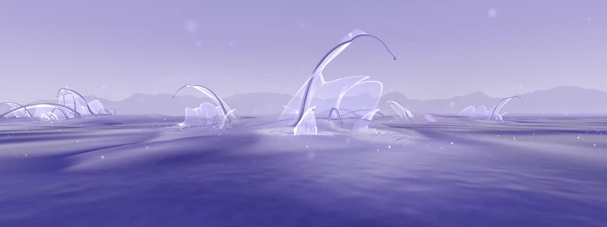

<br>

<p align="center">
The ground of this world carries a history. Sediment settles over a generated
landform; translucent colonies grow where that record allows; residents rise,
lie down and let their matter go on the air, and what settles feeds what grows
next. It can be explored as a whole, or walked through.
</p>

<p align="center">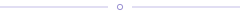</p>

<p align="center"><i>How can a procedural world reveal its own history<br>through the traces its systems leave behind?</i></p>

<p align="center"></p>

<br>

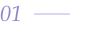

## The World

<p>
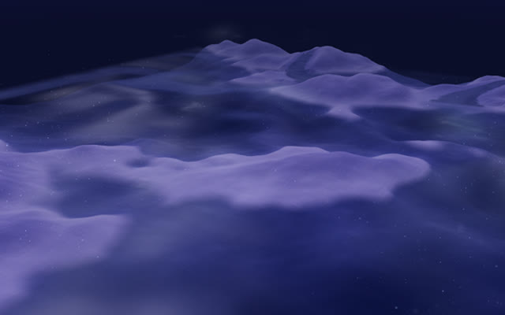

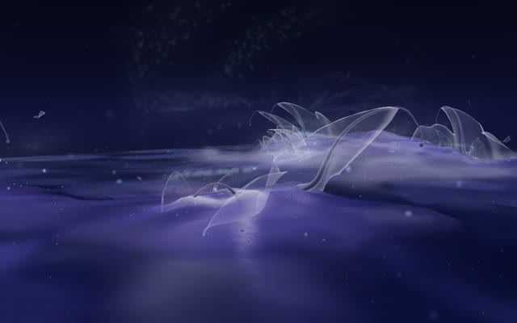
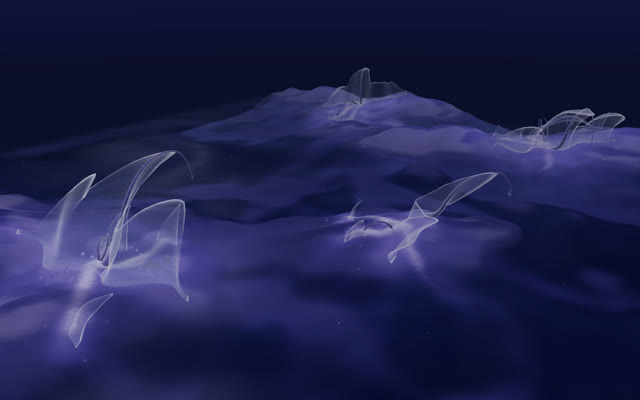
</p>


<p>
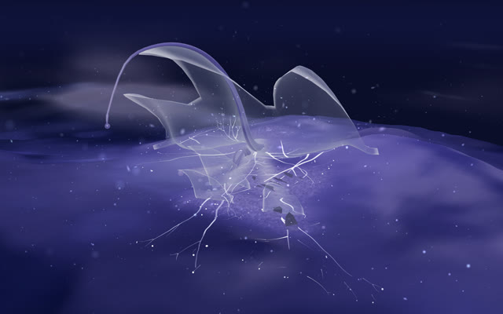
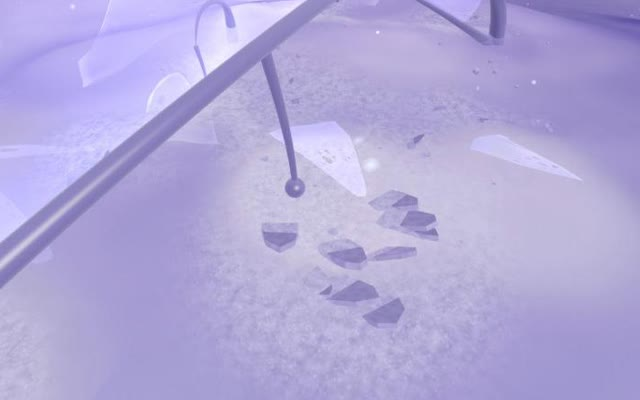
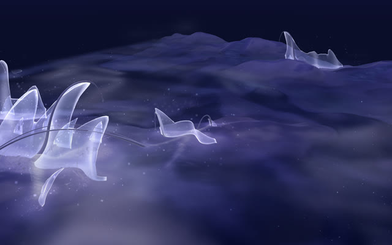
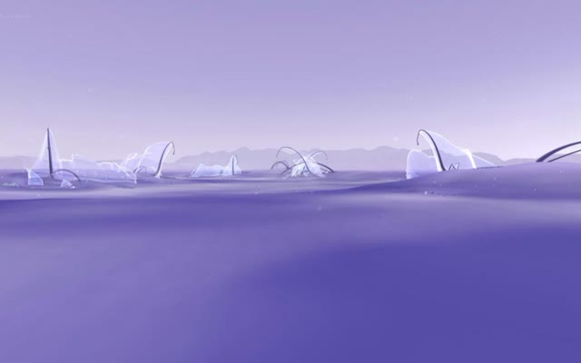
</p>


<sub>A landform with its sediment record, water veins traced downhill, one flow of air, and colonies at different ages, whose matter settles as residue and holds light. Captures from Explore (dark) and the Habitat (pale).</sub>

<br><br>

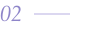

## Living Systems

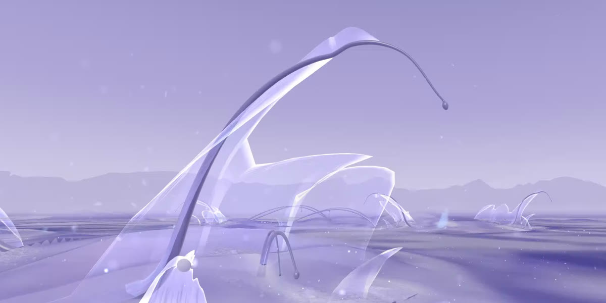

<sub><b>Morphology</b> &ensp;·&ensp; An anchor's crest carries on as a blade, then a tendril and its bulb, each drifting on its own clock &ensp;·&ensp; <a href="docs/27-sheath-and-passage.md">M3S</a></sub>

<br><br>

<p>
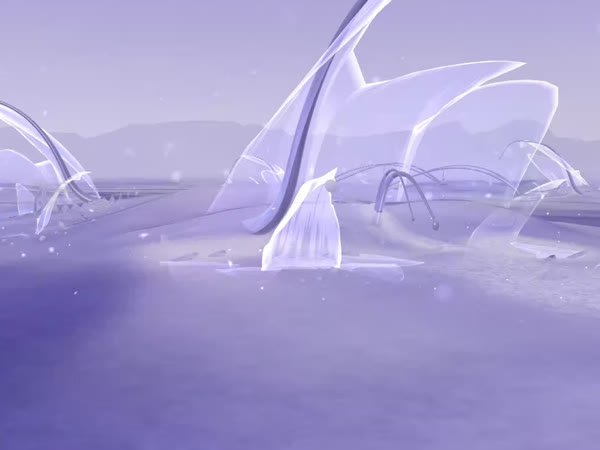
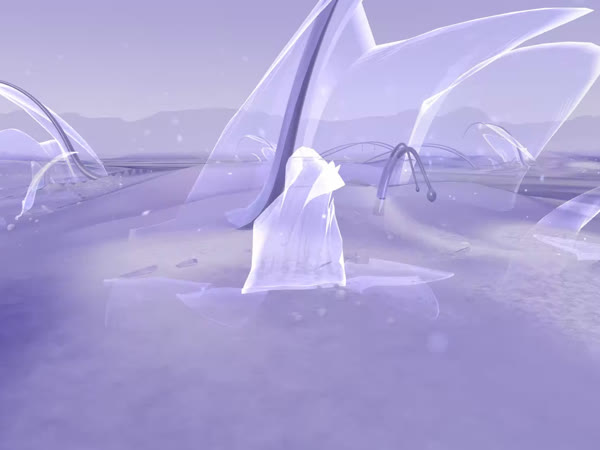
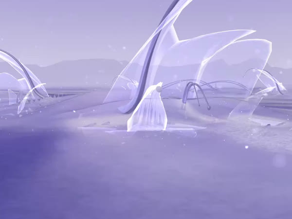
</p>


<sub><b>Sensing</b> &ensp;·&ensp; A resident gathers as a visitor comes near and opens again once they leave: a response to presence, not a stage of its life &ensp;·&ensp; <a href="docs/24-noticing.md">M3N</a>, <a href="docs/25-living-membrane.md">M3L</a></sub>

<br><br>

<p>
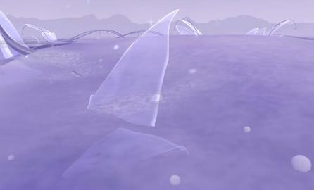
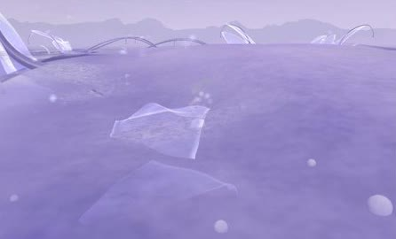
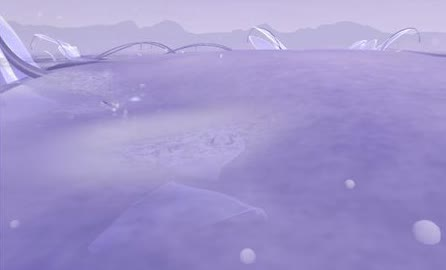
</p>


<sub><b>Lifecycle</b> &ensp;·&ensp; A resident lies down and lets its matter go as films on the air; they settle as residue that what grows next takes up &ensp;·&ensp; <a href="docs/22-habitat-m3e.md">M3E</a></sub>

<sub>Recordings: <a href="docs/images/27-passage.mp4">release and landing</a> &ensp;·&ensp; <a href="docs/images/27-sheath-walk.mp4">walking up to a colony</a> &ensp;·&ensp; <a href="docs/images/25-living-membrane-walk.mp4">a living membrane</a></sub>

<br><br>

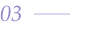

## Current Exploration

**Morphology** &ensp;Membranes as living tissue; tendrils grown out of the colony.<br>
<sub>[25](docs/25-living-membrane.md) · [26](docs/26-colony-motion.md) · [27](docs/27-sheath-and-passage.md)</sub>

**Sensing** &ensp;Residents that notice a visitor and answer by their own state.<br>
<sub>[22](docs/22-habitat-m3e.md) · [24](docs/24-noticing.md)</sub>

**Material circulation** &ensp;Release, residue and uptake under one conserved ledger; next, a transfer through the tendril sheath.<br>
<sub>[10](docs/10-lifecycle-concept.md) · [21](docs/21-habitat-m3.md) · [27](docs/27-sheath-and-passage.md#next-a-conserved-transfer-through-the-sheath-assessment-not-built)</sub>

**Collective morphogenesis** &ensp;A shared cue in the air, and what each resident can perceive.<br>
<sub>[19](docs/19-collective-morphogenesis.md) · [20](docs/20-cue-flow.md) · [23](docs/23-distributed-perception.md)</sub>

<br>

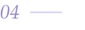

## Visual References

<p>
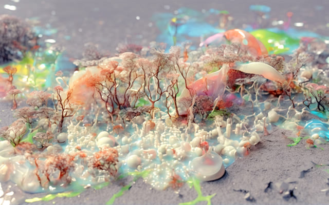
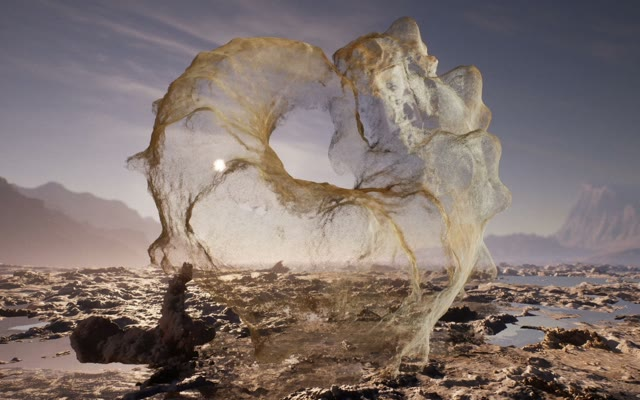
<a href="docs/references/tendril%20morphology.png">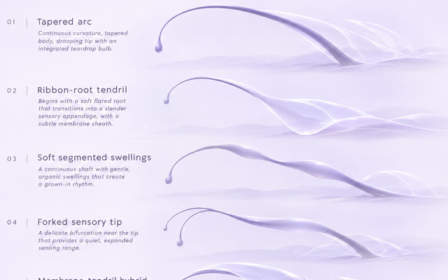</a>
</p>


<sub>Also: Alisa Andrasek / Wonderlab, <a href="https://www.alisaandrasek.com/projects/xenocells"><i>XenoCells</i></a> · Nervous System, <a href="https://n-e-r-v-o-u-s.com/projects/floraform/"><i>Floraform</i></a> · Studio DRIFT, <a href="https://studiodrift.com/work/shylight/"><i>Shylight</i></a> · Philip Beesley, <i>Hylozoic Ground</i> · thatgamecompany, <i>Journey</i> · Giant Squid, <i>ABZÛ</i>. References are others' work or concept studies, not output of this project; more in <a href="docs/references/">docs/references</a>.</sub>

<br><br>

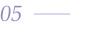

## Explore the Project

**Habitat** &ensp;The world in first person: drift among the colonies and be noticed by them.<br>
<sub>`/habitat` (M3S, also at `/habitat/m3s`; earlier spaces keep their routes, see the <a href="docs/studies.md">study index</a>) · local only · W A S D to drift, Q E lower and rise, drag to look</sub>

**Explore** &ensp;The whole world as a design tool: change a parameter and it is generated again.<br>
<sub>`/` · online at [residual-ecology.web.app](https://residual-ecology.web.app) · drag to orbit, scroll to zoom, P hides the parameters</sub>

**Atlas** &ensp;An editorial archive: World, Life Cycles, Matter Exchange, Field Notes, Fragments.<br>
<sub>`/atlas` · online at [residual-ecology.web.app/atlas](https://residual-ecology.web.app/atlas)</sub>

<sub>Routes are for a local run (below). The published site, from October, serves Explore and the Atlas; the Habitat runs locally.</sub>

<br>

<p align="center"></p>

<details>
<summary><b>Development and technical details</b></summary>

<br>

**Run locally**

```
cd react-app
npm install
npm run dev        # http://localhost:5173
```

The optional Library (saved configurations) needs a Firebase project: copy
`react-app/.env.example` to `.env`, see
[docs/tutorials/firebase.md](docs/tutorials/firebase.md). Without it
everything else runs.

**How it's built**

```
landform ─► relief ─► water veins carved in
                         │
          sediment record   (run before anything grows)
                         │
          colonies          (where the ground and the record allow)
                         │
   forms · tissue · light held in their matter · the air around them
                         │
          lifecycles        (Habitat: residents rise, release, and feed what follows)
```

- **Stack:** React and Vite, three.js through react-three-fiber, plain
  JavaScript and custom GLSL. Firebase only for the Library.
- **Generation** ([`react-app/src/lib/`](react-app/src/lib/)): landform
  (`field.js`), sediment (`sediment.js`), world data (`worldData.js`),
  streams (`streams.js`), colonies and forms (`scatter.js`,
  `traceForms.js`), tissue (`branching.js`), light (`accumulation.js`), air
  (`air.js`), lifecycles (`lifecycle.js`), the Habitat's spaces
  (`habitat.js`).
- **Rendering** ([`react-app/src/components/`](react-app/src/components/)):
  terrain and water (`Terrain.jsx`), forms (`ScatterLayers.jsx`,
  `LifecycleLayer.jsx`), the air as GPU particles (`AmbientAir.jsx`).
- **Reproducible:** the same parameters always generate the same world, and
  each lifecycle runs on a fixed step from its seed. Air and animation run in
  real time.

</details>

<p align="center"><sub>
<a href="docs/studies.md">Studies 01–27</a> &ensp;·&ensp;
<a href="docs/architecture.md">Architecture</a> &ensp;·&ensp;
<a href="PROJECT_DIRECTION.md">Project direction</a> &ensp;·&ensp;
<a href="AESTHETIC_LANGUAGE.md">Aesthetic language</a> &ensp;·&ensp;
<a href="docs/references/">References</a> &ensp;·&ensp;
<a href="docs/presentation/README.md">Presentation notes</a> &ensp;·&ensp;
<a href="docs/project-status-2026-10.md">Status, October</a> &ensp;·&ensp;
<a href="backlog.md">Backlog</a> &ensp;·&ensp;
<a href="docs/tutorials/">Tutorials</a>
</sub></p>
