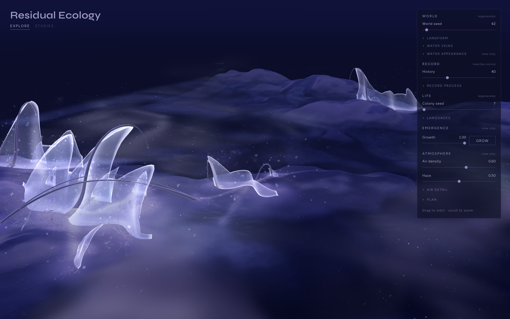
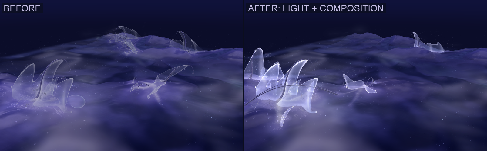
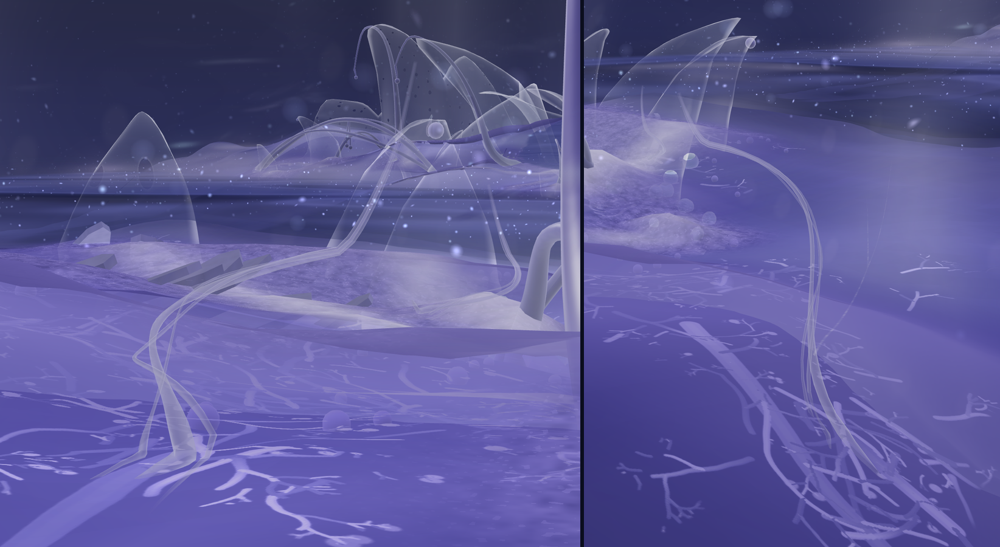
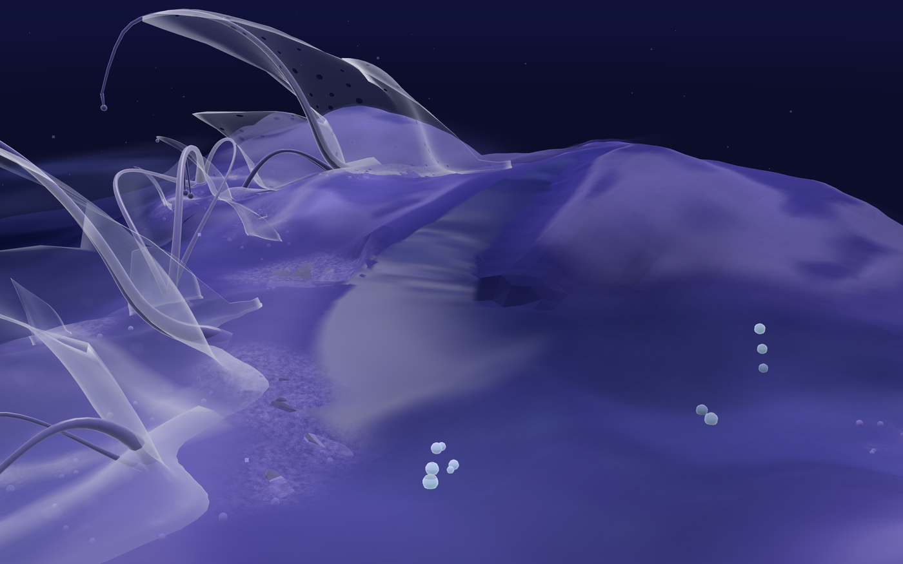

# Residual Ecology

*A procedural world shaped by what has happened in it.*



*The app as it opens on Explore, on its default world. A capture from the
app, 14 October 2026.*

Residual Ecology is an ongoing study in procedural world-building. Its
ground carries a history: sediment drifts, settles and thickens over a
generated landform, and life takes hold where that record allows. Pale,
half-translucent colonies gather on the deeper deposits. The matter they
hold gives off a soft light through the ground around them, and the air
slows and turns as it passes.

One question runs through it:

> How can a procedural world reveal its own history through the traces its
> systems leave behind?

It is a research practice rather than a finished piece: a sequence of
studies that has grown into one shared world. Each study is kept with its
notes, its successes and its failures.

## The world

| | |
|---|---|
| **Ground** | A landform from layered noise and shaping, given relief, and cut by a few water veins traced downhill as splines |
| **Record** | A small sediment model (supply, transport, deposition) run over that ground for a chosen span of time before anything grows |
| **Life** | Colonies in three related languages (structure, membrane and residue), formed where the ground and the record allow; a fine tissue network grows around the first |
| **Light** | Held in the matter the colonies laid down, and spread through the record rather than cast from a source |
| **Air** | Dust, wisps, haze and rare fragments, carried by one flow field that bends around the colonies |
| **Water** | Basins and streams as translucent veils over the ground |

## How it fits together

```
landform ─► relief ─► water veins carved in
                         │
                         ▼
          sediment record   (the simulation, run for N seconds)
                         │
                         ▼
          colonies          (where the ground and the record allow)
                         │
                         ▼
   forms · tissue · light held in their matter · the air around them
```

Each step reads the one before it, and the chain runs one way:
- **The world is recomputed from its parameters** whenever something that
  shapes it changes, with the record computed in advance.
- **Some things move continuously:** the air drifts and the water moves.
- **The record and the colonies do not develop while you watch.** *Growth*
  replays how the forms appear; it does not grow new ones.

A world that keeps writing its own history, with life feeding back into the
record, is a direction ahead rather than the current state. A bounded demo
exists behind a development flag
([study 10](docs/10-lifecycle-concept.md#stages-02-demo-17-october-2026)):
- **Residents change at different times.** In one small patch, they lie
  down and release films that the air carries.
- **Where the films settle, a visible residue stays**, beside the
  resident's faint contour.
- **A new resident forms** there and takes that matter up, or the patch
  waits.

It is one patch of one colony, off by default, and bounded: the patch winds
down after about 500 s. A shared tissue between colonies, with its fold
and greybox studies, is an unfinished experiment, paused. Feedback to
residents, an emergent core and a history kept between sessions are
proposed, not implemented.



*Colonies that gather, and light held in the matter they laid down: before
and after (study 09).*

## Exploring it

The app opens on **Explore**, the whole world in one view. Drag to orbit,
scroll to zoom; **W** shows the wireframe. Its panel follows the order the
world is made in:

| Section | What it holds |
|---|---|
| **World** | World seed, landform, water veins, and water appearance |
| **Record** | History: how much sediment is laid down, and the record's rules |
| **Life** | Colony seed and the three languages |
| **Emergence** | Growth: the colonies' appearance, replayed |
| **Atmosphere** | The air |

One word beside each section says what kind of change it holds:
- **regenerates:** the world is rebuilt
- **rewrites record:** the record is laid down again
- **view only:** changes how it is seen, never what it is

Changes that rebuild the world apply when you let go. Tooltips explain what
follows from what.

The weekly studies sit behind **Studies**, each still its own view on the
same state:
- **Field:** the terrain and the live sediment simulation
- **Volume:** an independent study with its own density field and scene;
  it shares no state with the world
- **Shaders:** three material readings of the ground
- **Scatter:** the colony rules, one language at a time

An optional **Library** stores configurations (Firebase and a Google
sign-in).

| | |
|---|---|
|  |  |
| *Strands leaving a membrane into the tissue on the ground, close up (study 08, one colony).* | *A water vein lying in its channel, running down to the basin (study 06).* |

## Technical approach

- **Stack.** React and Vite, with three.js through react-three-fiber, in
  plain JavaScript with custom GLSL shaders. Firebase is used only by the
  optional Library.
- **Generation** is plain JavaScript in [`react-app/src/lib/`](react-app/src/lib/):
  - the landform and its relief (`field.js`)
  - the sediment model (`sediment.js`)
  - the headless history and the world data that placement reads
    (`worldData.js`)
  - water veins (`streams.js`)
  - colonies (`scatter.js`) and their forms (`traceForms.js`)
  - the L-system tissue (`branching.js`)
  - the accumulation light (`accumulation.js`)
  - the air's flow field (`air.js`)
- **Rendering** is in [`react-app/src/components/`](react-app/src/components/):
  the terrain and water shaders (`Terrain.jsx`), and the air as GPU
  particles (`AmbientAir.jsx` and companions).
- **Reproducible generation.** The same parameters always generate the same
  world: the terrain, the record, and the colonies and their forms. The air
  and the animation run in real time and are not reproduced frame for
  frame. Changes are checked with fingerprints of the generated data and
  with captures under a frozen clock.

To run it locally:

```
cd react-app
npm install
npm run dev
```

The Library needs a Firebase project. Copy `react-app/.env.example` to
`.env`; see [docs/tutorials/firebase.md](docs/tutorials/firebase.md). Without
it the app runs and only saving is unavailable.

## Status

Ongoing. **Working:**
- the shared world and its chain of dependencies
- Explore, with regeneration that never shows a half-built world
- colony formation, and light held in matter
- a reviewed, layered atmosphere that responds to the colonies

**Open**, among others:
- **Approximate alignment.** The haze, the water and the world's edge are
  aligned to the ground only approximately.
- **Stream water.** It breaks up at grazing angles and near stream mouths.
- **The world's edge.** It is a visible square slab. The direction is an
  organically gathered landform whose edges pass into the atmosphere.
- **Branching.** It is an exploratory close-range study on one colony.
- **The lifecycle (study 10).** A flagged demo on one patch of one colony,
  not part of Explore as you see it.
- **Rebuilding.** It runs on the main thread.

The full picture is in the
[project status report](docs/project-status-2026-10.md), and open work is in
the [backlog](backlog.md).

The site at **residual-ecology.web.app** serves Explore and the studies as
of 14 October, and the Atlas at `/atlas`. The lifecycle experiments run
locally only.

## Studies

| | Study | What it explores | Status |
|---|---|---|---|
| 01 | [Noise / height field](docs/01-noise-study.md) | A landform from one continuous function, as map and mesh | Done |
| 02 | [Sediment simulation](docs/02-sediment-simulation.md) | A second field moving across the first | Done; the basis of the record |
| 03 | [Volume](docs/03-voxel-study.md) | Density fields, two meshers, a grown rather than eroded morphology | Done; a separate branch |
| 04 | [Shaders](docs/04-shader-study.md) | Three material readings of one terrain | Done |
| 05 | [Scatter](docs/05-scatter-study.md) | Colonies placed by rules over the world's data and its record | Done; refined in 09 |
| 06 | [Water veins](docs/06-passages-study.md) | Streams traced downhill and carved into the shared ground | Paused |
| 07 | [Air](docs/07-air-study.md) | A particle ecology built in reviewed layers | Checkpoint |
| 08 | [Branching](docs/08-branching-study.md) | Residual matter becoming tissue: an L-system on the ground and the membranes | Checkpoint, one colony |
| 09 | [Composition and light](docs/09-composition-and-light.md) | Gathering colonies, light held in matter, palette, water | Under review |
| 10 | [Ecological continuity](docs/10-lifecycle-concept.md) | Residents of one patch change at different times; what they release settles as visible residue that a new resident takes up | Stages 0–2: a bounded demo behind a dev flag. Shared tissue: unfinished, paused |

Screenshots for studies 01, 02 and 04 were never captured; each document
says what to grab.

## Documentation

- **[Project status, October 2026](docs/project-status-2026-10.md):** what
  the project is, how it works, what is unresolved, where it could go.
- **[Architecture and interface](docs/architecture.md):** the views, the
  state, the verified dependency diagram, and the known spatial issues.
- **[Project direction](PROJECT_DIRECTION.md):** the concept: its ambition,
  and what is implemented so far.
- **[Aesthetic language](AESTHETIC_LANGUAGE.md):** the visual and
  experiential principles, reconciled with the current direction.
- **[References](docs/references/):** external artworks, credited, and
  AI-generated concept studies. Neither is output of this project; every
  image in this README is a capture from the app.
- **[Backlog](backlog.md):** open work, by kind.
- **[Tutorials](docs/tutorials/):** Firebase setup, Git and React notes.
