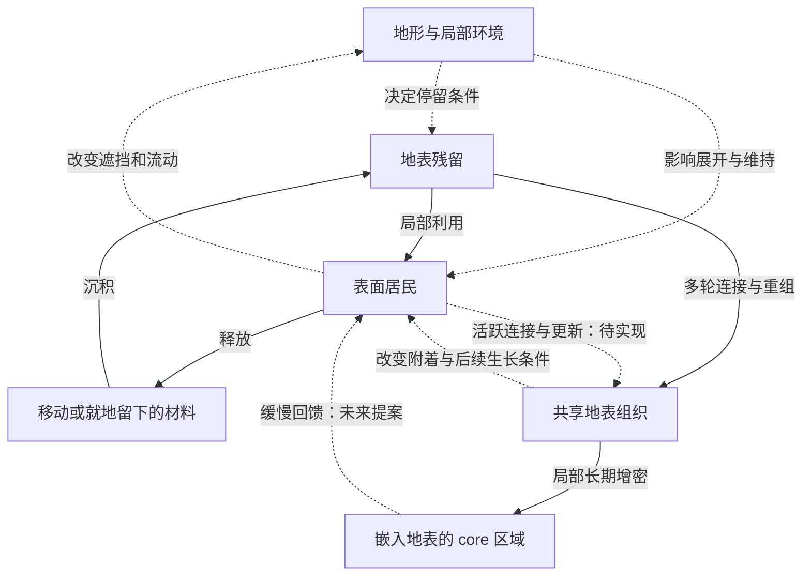

# Residual Ecology — 完整变化逻辑

版本：2026-10-17 · 设计规则 v1  
性质：用于构建 demo 的概念与行为规范；不代表这些行为已经实现。  
配套：[交接说明](01-PROJECT-HANDOFF.md) · [执行计划](03-DEMO-EXECUTION-PLAN.md)

## 1. 整体目标与范围

**局部生命持续更替，它们留下的材料与结构共同形成一个更慢变化的地表身体；后来的生命在这个被改变的身体上出现。**

需要同时成立的三层关系：

1. **个体变化**：居民从局部展开到维持、退缩、释放，原有形体可以结束。
2. **空间循环**：材料移动、停留并改变其他位置的条件，影响已有居民或新的生成。
3. **整体连续性**：部分结果被保留为共享组织；局部居民全部换代时，身体仍延续。Core 从这个身体的长期变化中形成。

这是一个虚构的、可解释的生成生态。无需复刻真实生物学，也不要求把所有地形、空气或水都解释成某种器官。整体生命感需要有持续的结构和功能关系来支持。

## 2. 术语与角色

| 名称 | 在本设计中的含义 | 容易混淆的地方 |
|---|---|---|
| Terrain / Ground 地表 | 空间条件与承载面；慢组织逐渐嵌入并成为其一部分 | 地表并非只是一块与生命无关的展示底座 |
| Resident 居民 | 表面局部形成的活跃形态，现阶段可用 membrane 表达 | 不是每种现有 mesh 都必须成为独立物种 |
| Colony 群落 | 一片地方里的居民、残留和关系形成的局部聚集 | 不必是边界固定、生命周期同步的整体对象 |
| Fragment / Shard 碎片 | 离开原组织、处于迁移或落定过程中的材料形态 | 装饰性空气粒子不自动拥有生态作用 |
| Residue 残留 | 释放后停留的材料，可再移动、被利用或并入慢组织 | 不是永久只增不减的垃圾，也不自动等于新生命 |
| Trace 痕迹 | 过去事件对当下留下的影响：轮廓、方向、连接、层次、位置条件等 | 不必始终保留原来那一片物质 |
| Shared tissue 共享组织 | 多个来源的残留被连接、重组、维持后的慢变化组织 | 不是给所有居民拉几根装饰线就算完成 |
| Emergent core | 共享组织经过反复历史形成的局部增密、折叠和稳定区域 | 它是身体的一部分，不是预置中心或独立居民 |
| Memory 历史影响 | 过去改变当前状态及后续生成的能力 | 与可用材料量、个体年龄、当前活动度不同 |

现有 bridgework / branching 可承担附着或连续连接的表达。是否实际承担输送，由 agent 判断和说明；不能仅因画出连接线就宣称发生了交换。

## 3. 一个完整的因果结构

下图为目标逻辑，不是当前代码架构。实线标示材料/结构的转化，虚线标示条件或功能影响。

图中 core 是共享组织内的一个区域，不是额外的一份物质库存。不是每一块残留都经历所有步骤，也不是每一个地方最终都会形成 core。

## 4. 居民的一次变化

以下是可观察的过程，不要求程序使用固定、线性的状态机。

| 过程 | 应当发生的变化 | 观众应能看到 | 可以出现的分支 |
|---|---|---|---|
| 萌生 / 形成 | 在合适的位置，利用现有材料及附着条件形成局部结构 | 从某一旧边缘或地表局部翻起，有明确的“从哪里长出” | 条件不够时等待；不是所有候选点都发芽 |
| 展开 | 新结构增加可维持的膜面，逐步形成自己的姿态 | 连续展开；底部与地表相接 | 环境不同，展开方向和程度不同 |
| 维持 | 继续与局部条件发生关系，可能有小规模更新或脱落 | 轻微调整、局部变化；不必不断变大 | 可长期停留、暂时收拢、再次展开 |
| 退缩 / 衰退 | 一部分结构失去原先张力，逐渐贴地或断开 | 高度降低、轮廓伏下、边缘松开 | 当前姿态变化不一定意味着即将结束 |
| 释放 | 材料从原形体转入移动、贴地或可沉积状态 | 来源可辨认的薄片或残留面 | 一部分原地留下，一部分离开 |
| 原形体结束 | 原居民的可识别完整轮廓不再存在 | 原位置保留低伏痕迹，或材料已迁走 | 后来可有其他形体，也可持续空置 |

**不使用“没有合适位置就把同一个居民原样刷回来”的保底规则。** 合理的失败、停滞和空置是循环的一部分。不同居民错开阶段，避免全场同步出生或死亡。

局部收拢后再次展开可以属于同一居民的状态变化；若个体已结束、其材料被其他生成利用，后来者应作为新的形成过程处理。第一轮不再叠加另一套“整个居民退回休眠囊后复原”的完整生命周期。

## 5. 释放、运输与落定

### 5.1 材料从哪里来

有生态作用的释放必须改变来源：膜面、可用结构量或其他明确表示的组织量减少。不能让完整居民持续不变，却无限产生有资源价值的碎片。

第一版可简化物质，不必建立化学系统。碎片承接原膜的透明度、弯曲或边缘特征，让观众认出材料的连续性。

### 5.2 材料怎样经过空间

- 允许就地伏下、沿表面迁移或被空气带离；第一版选择最清楚的一条主路径即可。
- 路线至少部分受现有环境影响：地形、流动、已有形体的遮挡、停留位置。
- 不是每一片都去另一个居民；可有局部保留、暂时悬浮、进入未展示区域或流出边界。
- 若采用边界流失，必须说明。图上不再可见，不等于实现了某种未知回收。
- 其他居民改变流动时，应更新相应环境作用；若第一版只用简化障碍，需要标注其范围。

### 5.3 材料怎样成为某处的残留

落定位置需要进入可被后续生成读取的世界状态，并有相应画面。可以是贴地薄层、折边、重叠面、纹理或混合表示；不规定网格、粒子、场或着色器技术。

不要求通过抬高整片地形来表现沉积。已有实验曾因此出现遮住组织的土包。更重要的是贴合地面、位置正确、厚薄可感知，并与后续读取同一份空间事实。

## 6. 残留如何影响后来的生命

本阶段优先使用两个具体作用，避免“读一个数值后随机换个形状”。

| 作用 | 生成时读取什么 | 可见的结果 |
|---|---|---|
| 材料支持 | 某处可被利用的材料及其可达性 | 能否维持生长、展开多少；生长后邻近材料相应减少 |
| 附着结构 | 遗留边缘、连接、表面方向或等价的局部结构信息 | 从哪里起、往哪个方向延展、怎样接上旧组织 |

材料较多并不要求新居民更高、更大或“更健康”。已有居民也可以利用新条件产生局部延展，不必每次都新建一个对象。

**材料不等于生命种子。** 虚构世界仍需要明确的形成规则：何处有生成机会、什么环境适合、如何建立新的局部组织。Agent 可以采用简化的程序化形成规则，但必须说明其前提，不能把所有沉积自动升级为居民。

### 最小可读事件

1. A 伏下，左侧留下旧轮廓；部分材料到达右侧折边。
2. 右侧沉积合并、停留；暂时没有新形体。
3. C 从这处折边的一个局部展开。
4. C 的生长利用邻近材料，那里逐渐变薄；部分原轮廓继续存在。
5. B 在旁边持续存在，或因同一位置条件变化产生局部调整。

至少要能区分这三个事实：**之前发生过释放；某处因此改变；后来的形态利用了这个变化。**

## 7. 从局部残留到共享身体

仅有邻居间材料交换，仍更像居民组成的生态。共享身体要求：多个来源的残留能跨越各自原来的边界，形成会延续的组织。

建议过程：

1. **接触**：不同居民留下的薄层在某些地方重叠。
2. **整合**：相接的边缘被重组，形成连续的附着面或连接。
3. **沿用**：后来者在这些结构上生长，部分路径被重复使用。
4. **维持与改写**：有活动的部分继续更新；长期缺少更新的部分变薄、松弛或断开。
5. **保留**：当一代居民消失时，组织的部分轮廓和连接仍延续，成为下一代的条件。

“残留变成活跃组织”在这里是待定义的程序化整合过程，不是说真实死组织必然复活。第一版可以让与现存活跃组织相接的残留逐渐被纳入，或采用其他同样清楚的虚构规则；不必新增真实生物繁殖系统。

共享身体应至少具备一个真实作用：改变附着位置、局部可利用材料、连接连续性，或后续生长条件。只加地下线条或让地表整体同步闪烁，不算形成共同身体。

### 对局部和整体的影响

居民变化可以通过两条不同速度的途径影响身体：

- **较快的材料回流**：居民结束时释放材料，局部可能暂时获得补充。
- **较慢的维持变化**：若活跃连接、更新或交换长期减少，组织逐渐变薄、松弛、局部失去连续性。

第二条仍是待实现的设计规则。Agent 需要明确“维持”是什么以及不足如何累积。它不能被一个没有空间含义的“死亡人数 → 全局扣血”替代，也不能仅靠视觉计时器假装存在。

## 8. Core 怎样形成、存在与改变

### 8.1 从哪里来

Core 是共享身体内部的一个局部增密区域。其位置和形态应能追溯到多轮历史：材料更常停留、连接更常被沿用、膜层反复叠合或某些组织持续保留。

允许用阈值、连续量或其他算法识别这一过程，但它的形态要逐渐变化。不要到点突然实例化一个“核心模型”。

### 8.2 空间是什么样

- 大部分体量嵌在地表内部，与周围较稀薄组织连续。
- 可呈现低伏、偏心、不对称的叠层、交织或折合，不规定唯一轮廓。
- 地表只需要局部起伏、透光或边缘变化；剖面用于设计与诊断，不是最终视角的必要条件。
- 不要求一个固定中央 core。Demo 可重点展示一处具有历史来历的增密区域；其他地方能继续生长，不必全部通过它。

### 8.3 时间上怎样存在

Core 的形成、退化和重组慢于居民更替。单个居民结束时，不应立即造成 core 消失。长期缺少局部更新后，core 可以松弛、变薄、失去部分连接；其主要位置、旧轮廓或组织历史仍可延续。

“身体延续”不等于每一片物质永远不变，也不保证无限时间后绝不消散。第一版要表现的是跨越多代居民的连续性。

### 8.4 未来回馈

用户希望它以后能给其他居民提供支持。优先候选是：保留的材料沿现有连接缓慢转移，支持局部生长；转出后，来源组织的相关储量应减少。

这不是已经确定的能量系统。若 agent 提议“能量”，必须说明来源、储存、消耗和可见作用；不能只把亮度改名为能量。回馈也不应保证每次衰弱后自动恢复。

图 05 第四格是这个方向的示意，不属于第一轮最小闭环的必要项。

## 9. 三种时间与两种记忆载体

| 维度 | 含义 | 候选线索 | 避免的混淆 |
|---|---|---|---|
| 居民年龄 / 经历 | 这个局部形体形成后经历的展开与退缩 | 旧边缘、重组缝、附着层次 | 大小和数量不直接等于年龄 |
| 当前状态 | 此刻的展开、张力、活动、收拢 | 姿态、局部运动、膜面张力 | 收拢不自动等于年老或死亡 |
| 地方历史 | 这个位置经历过的居民与物质变化 | 旧轮廓、叠层、沿用的连接 | 新居民可以很年轻，脚下地方很古老 |

历史可以留在两类载体中：

- **仍在的旧结构**：例如原膜的低伏轮廓、贴地连接。
- **已经转化的结构影响**：例如原材料被利用，但它留下的附着方向仍体现在新膜里。

代码中可另存事件记录或结构摘要，但可见记忆不能完全依赖隐藏日志。也不要求观众准确反推出年龄数值。

## 10. 材料与历史的一致性

这不是要求物理级守恒模拟，而是避免明显的因果漏洞。

- 释放时来源有所减少；沉积时移动材料不再同时作为同一份可用材料存在。
- 后续生长利用残留时，应扣减相应可用份额；并入共享组织时也不能在两个库存重复可用。
- **Core 已包含在共享组织中**，不能把同一材料再作为独立 core 库存累加。
- 记录一段历史不代表额外创造一份材料。痕迹可以作为形态影响保留，而不提供无限资源。
- 若有外部补给、初始储量、边界流失或抽象化补偿，需要显式说明。
- 稳定的长期循环可以包含停滞、缩减、局部空置；不保证无补给也无限繁殖。

一个可选的自检关系是：初始材料与明确输入，最终分布在居民、移动材料、残留、共享身体及明确输出中。Agent 可选择更简单的核算，但不要宣称已实现自己没有核验的守恒。

## 11. 初态、时间与重置

古老的世界不必从完全空白开始。Demo 可以使用明确标记的历史预演或初始残留，前提是说明哪些来自初始化、哪些由本轮运行产生。

- “预先计算多轮历史后得到 core”可以成立；“手工放一个 core 后称其自然涌现”不成立。
- 提供重置到相同起点的能力；记录或固定相关随机性，使因果对比有意义。
- 时间加速可以使用；保证更快的居民变化与更慢的身体变化仍可区分。
- 第一版可只保留当前会话历史，但应明确切换视图、改变参数、刷新页面分别会发生什么。
- 存储跨会话历史属于后续范围；不要把配置保存误称为生命历史保存。

## 12. 暂不需要扩展的系统

暂不引入完整食物链、物种分类、真实神经系统、无限生态守恒模型、统一健康分数、全场同步呼吸、外部用户数据采集或游戏任务。生物参考提供机制启发，不要求世界具备这些附加系统。

菌丝的参考重点是分布式联系、资源再分配和网络重组；灯塔水母的参考重点是生命形态可以转换。当前主循环采用“个体材料参与后续形成”，不把它当作真实灯塔水母的死亡复活机制。

参考论文（此前讨论中已查阅）：

- Bebber et al., 2007, [Biological solutions to transport network design](https://doi.org/10.1098/rspb.2007.0459)。
- Matsumoto & Miglietta, 2021, [Cellular Reprogramming and Immortality](https://academic.oup.com/gbe/article/13/7/evab136/6300523)。

## 13. 设计是否成立的判断

至少应该能回答：

1. 哪位居民留下了什么？材料实际去了哪里？
2. 哪块地方因此改变？观众看得到吗？
3. 后来的生长具体利用了哪一项改变？没有这项改变会怎样？
4. 多个居民的结果怎样成为同一片组织，而不只是邻近摆放？
5. 居民更替后，身体有哪些可识别的部分仍延续？
6. Core 的位置和形态能否由历史解释？它受影响的速度是否不同于居民？
7. 回馈、跨会话记忆或复杂流动若尚未实现，演示有没有明确说明？

规则要足够清楚以便实现与检查，最终体验仍可以保留模糊、古老、半显露的气质。
