# 07 · Air — particle study

*Assignment 3. The atmosphere of the habitat, built one layer at a time.*

> **Status: rework complete, accepted as a checkpoint. Phases 1 (dust),
> 2.5 (residue carried by moving air) and 3 (colony air) are approved;
> Phases 4 (basin haze) and 5 (rare fragments) are accepted for now; Phase 6
> (integration) is accepted as a checkpoint.** Two visual issues are open
> for a later revisit (see
> [Open visual issues](#open-visual-issues-recorded-at-the-phase-6-checkpoint-for-a-later-revisit)):
> the haze can read as a separate horizontal layer from low angles, and the
> scene can feel slightly grey and washed out. The earlier all-at-once
> "resident ecology" is kept as a checkpoint (commit `cf0431d`) and
> summarised at the end of this document. The streams (study 06) remain
> **unresolved and paused**.

**The assignment.** Add a particle layer moved by a vector field:
- particles that live in the scene's volume, not on the terrain
- a smooth 3D flow field: a slow large-scale drift, gentle curl, and the
  world's own influence on it
- the terrain and the colonies may shape the motion

**The target.** `docs/references/concept-studies/Ambient Particles_ref.png` sets the art
direction (not something to copy literally):
- a quiet, living atmosphere
- several subtle kinds of particle
- uneven, composed density
- depth from the foreground to distant air
- no bright core or visible emitter, no blob, no hard streaks, no snow or
  stars
- calm, varied and readable

## The plan

One visual layer at a time. Each phase must look right on its own and is
reviewed before the next begins.

| Phase | Layer | Gate |
|---|---|---|
| **1** | **Base atmosphere: dust.** Scale, density, depth, opacity, motion, palette, composition. No emitters, trails or colony effects. | **approved** |
| 2 | **Wisps / flow.** Currents of luminous air that reveal the 3D field: broad soft bodies, braided filaments, carried light. | superseded by 2.5 |
| **2.5** | **Wisps as residue in moving air.** Regions of atmosphere that briefly show direction, folds and colour, instead of drawn curves. | **approved** |
| **3** | **Colony air.** The colonies change the air around them (bending, slowing, lifting, a few residents, a passing tint), with no visible source. | **approved for now** |
| **4** | **Basin haze.** A large, low-frequency, veil-like volume over the low ground and water, rather than more point sprites. | **accepted for now; flat / horizontal artifacts unresolved** |
| **5** | **Rare fragments.** A few translucent pieces of membrane suspended in the air, now and then passing the camera or drifting from a colony. | **accepted for now** (second revision: residual films in five states) |
| **6** | **Integration.** Tune the layers together, simplify, check every tab and camera, check performance, set the final palette and docs. | **accepted as a checkpoint** (open issues recorded) |

**Rules for every phase**, learned from the baseline:
1. **Nothing in the field may pile matter up without a limit.** No sinks,
   slowing zones or attractors unless their density is bounded by
   construction.
2. **No unbounded additive light.** Large forms are never stacked additively
   in one place.
3. **Each phase is checked** at five minutes and more, from several cameras,
   with a brightness measure (the largest local brightness added). Never only
   a single screenshot after a few seconds.

## Why the rework: what the baseline did wrong

The baseline (commit `cf0431d`) implemented five resident types at once. In
use it showed:
- huge overexposed blobs
- trails merging into bright beams
- glowing clumps
- earlier, uniform snow
- resident types that could not be told apart

This is what caused each problem and what Phase 1 removes.

| Problem | Cause | In Phase 1 |
|---|---|---|
| **Overexposed blob** | Haze veils were large (3–6 units), additive and not depth-tested. They were born preferentially in the same low basins, and the field slowed them there. Overlapping veils add light without limit, and a few dozen in one place make a white ellipse (the veils' own shape). It was seen in a tab left open through many hot reloads. A fresh five-minute run did not reproduce it, but the mechanism was there. | veils removed; haze returns in Phase 4 as a bounded volume |
| **Glowing clumps** | The field was built to concentrate matter. Colony pull, slowing, a convection cell, damped hover, downhill drainage, basin pooling and quiet-zone slowing all converge. The colony terms even formed attracting rings: streamlines in section spiralled into fixed points. | every convergent term removed; the field is divergence-free |
| **Bright beams / rain** | Wisps were ribbons traced backward along the field, not along the particle's real path. Where the field converges, many ribbons share one path and add into a beam. In a uniform drift they are parallel straight streaks. | wisps removed; they return in Phase 2 |
| **Uniform snow** (first pass) | Births were uniform, every particle was a similar round sprite, and distant grains were enlarged to a minimum-size disc. | births follow a composed map; far grains fade instead of growing |
| **Types not legible** | Five types were tuned together. None was convincing alone. | one type at a time |

Also removed:
- **Motes and flakes:** they return in Phases 3 and 5.
- **The Colony hold slider:** it has nothing to act on until Phase 3.

## Phase 1 — Base atmosphere (dust) · approved

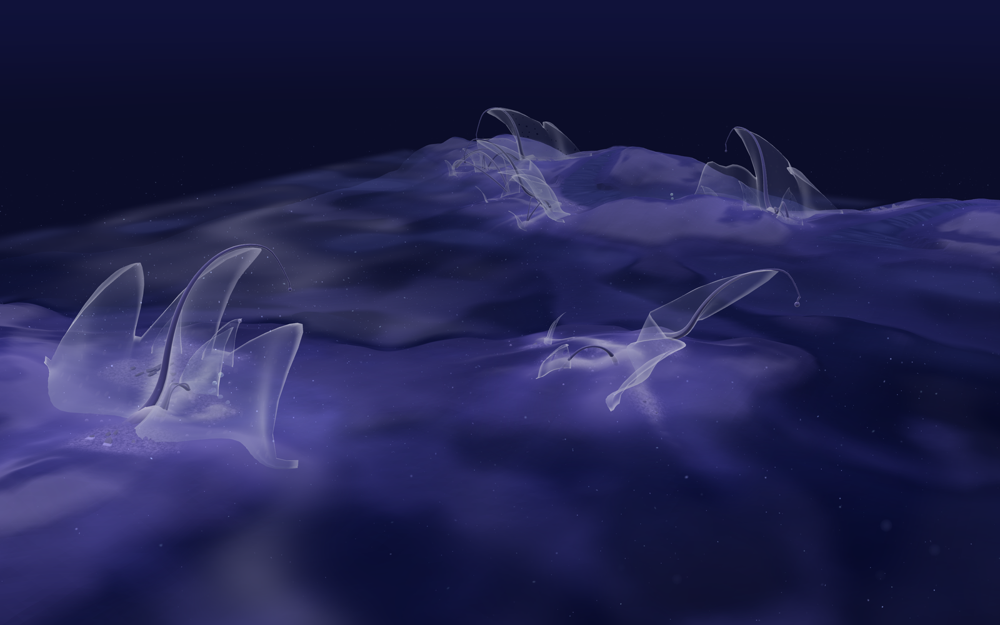

### What it is

One layer of fine suspended matter in the main scene of every tab. It
contains no emitters, trails or colony effects.

**The field moves matter but never concentrates it.**
- **Curl:** a stream function in each horizontal layer, from nine slowly
  travelling waves.
- **Drift:** a slow current, mostly across the default view, that turns over
  many minutes.
- **Hover:** each grain is pulled back to its own height over the floor
  (ground or water). This moves it up or down, never sideways.
- The horizontal divergence is exactly zero, so there are no sinks, no
  attractors and no place where grains can collect.

**Unevenness comes from where dust is born, not from where it collects.**
- A **density map** decides where grains appear:
  - two crossing families of narrow bands about 9 units apart, strongly
    warped so they meander and cross irregularly
  - confined to the land's reach
  - leaning toward the low ground and water
  - drifting slowly over many minutes
- A grain is born after up to eight tries, accepting each with the map's
  probability. If none is accepted it keeps the densest try, never a random
  one.
- It lives 40–110 s. The flow then carries and folds the pattern into
  drifting swaths.
- The first frame is already composed: grains start where the map puts them.

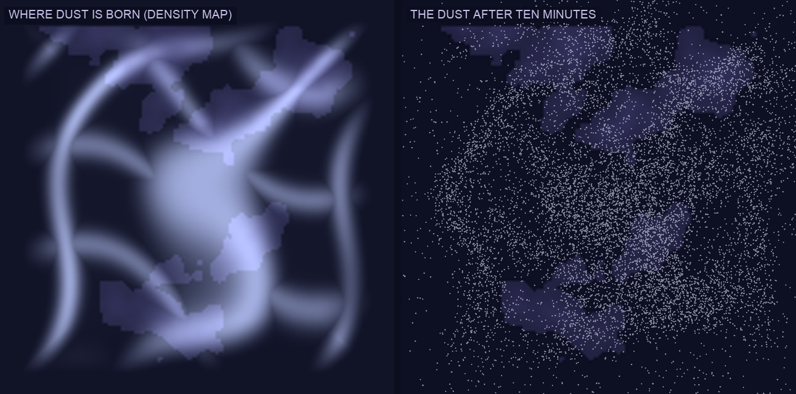

**Three sizes of the same matter.** None has an outline. The specks turn
slowly in place.

| | Share | Size (units) | Look |
|---|---|---|---|
| **grain** | ~85% | 0.010–0.022 | most very faint, a few brighter; round or nearly so |
| **speck** | ~13% | 0.026–0.05 | brighter; often elongated (up to 2.6:1) or with an irregular lobed outline; turning slowly |
| **soft** | ~2% | 0.08–0.15 | very faint and soft, as if out of focus; only in the foreground |

**Depth hierarchy.**
- **Middle distance (about 4–15 units):** grains read best here.
- **Further out:** grains fade away by about 30 units, and specks reach a
  little further.
- **Foreground:** only the soft ones appear.
- **Sky:** everything thins with height over the ground. A grain with only
  sky behind it is dimmed to a quarter: it looks along its line of sight for
  ground or water behind it. Against the dark sky a pale speck reads as a
  star; against the land the same speck reads as air.
- **Sub-pixel:** a point smaller than about a pixel and a quarter fades away
  rather than being enlarged, so distant matter becomes atmosphere, not
  snow.

**Palette.**
- Pale lavender, silver-blue and blue-white, cooler over the low ground and
  water.
- A restrained mint on about one grain in ten, only in the cool regions.
- Broad, slow colour regions across the scene, so it is not one flat purple.
- Grains in the map's bands are a little brighter than grains between them,
  so the composition reads as structure, not only as counts.

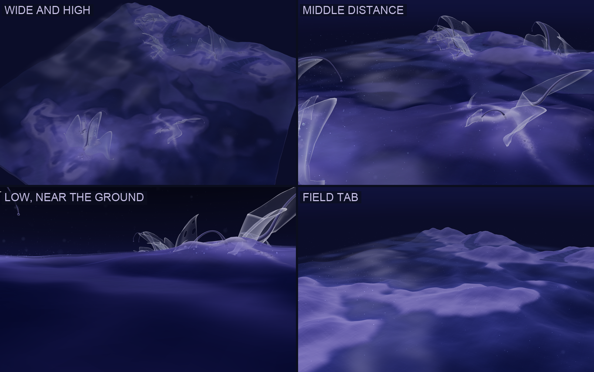

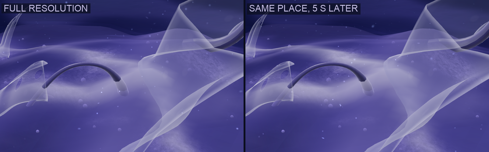

### Measured

| | Result |
|---|---|
| horizontal divergence of the field | 0 (numerical, 3,000 samples) |
| horizontal speed, median (p90) | 0.086 (0.15) units/s |
| unevenness over 2-unit cells (CPU run, 12,000 grains) | coefficient of variation ≈ 1.0; about 60 of 289 cells nearly empty |
| stability over ten minutes | the densest cell stays at 4.3–4.5× the mean; nothing accumulates |
| GPU, five minutes, default view | brightest 32-pixel block +9 luminance levels; 2 saturated pixels (single grains) |
| frame rate (3200 × 2000, headless Chrome) | 60 fps, the same as with no dust |

### Controls

Three sliders in the Scatter panel's **Air** section. They apply in every
tab.

| Control | What it does |
|---|---|
| **Density** | how much fine matter hangs in the air (0.6 draws about 9,800 of 16,384 grains) |
| **Drift** | the slow current across the scene |
| **Curl** | how much the air turns and folds as it drifts |

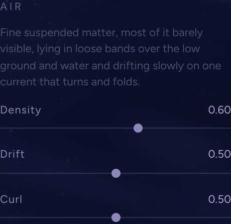

### For review

- **Presence:** is the dust too faint, about right, or too present at the
  default view? (Density goes to 1.)
- **Composition:** do the bands and clearings read, or should they be
  stronger, broader or fewer?
- **Shape and size:** is there enough variety, or should the specks be more
  elongated or irregular?
- **Palette:** is the silver-blue, blue-white and mint enough against the
  lavender?
- **Motion:** slow enough to watch but not static?
- **Depth:** is the sky empty enough? Do the soft foreground specks add
  depth or distract?

### Limitations noticed

- **Very restrained.** At the default and wide views the dust is barely
  there. It adds texture but does not lift the palette (mean brightness
  unchanged). The lift is meant to come from the Phase 4 haze.
- **Shape variety shows only up close.** At normal distance most specks
  read as round.
- **The colour variation is weak**, because the specks are small.
- **The flow softens the bands within a minute or so**, so the composition
  on screen is looser than the birth map.
- **The sky check reads only the floor.** A grain in front of a colony seen
  against the sky is still dimmed.
- **The baseline's figures** (`07-air.png`, `07-ecology.png`, `07-colony.png`,
  `07-close.png`, `07-details.png`, `07-lift.png`, `07-panel.png`) are kept in
  `docs/images` as the record of the baseline (summarised at the end).

## Phase 2 — Wisps: currents of luminous air · superseded by Phase 2.5

### Why it was revised

The first version of Phase 2 was technically clean but visually far too
timid. It read as Phase 1 dust plus a few barely visible grey-blue arcs, and
you had to search for them. The cause was the way I had guarded against the
baseline's failures (rain, beams, blobs): I made everything thin, faint,
sparse and one colour. The revision keeps those guards but solves them with
structure rather than invisibility. Measured from the default camera, the
currents now light about 7–15% of the frame, against well under 1% before.

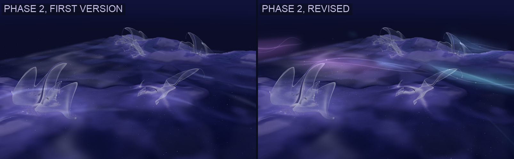

### What a current is now

The same path as before: a piece of a streamline of the field that moves
the dust, through an anchor drifting with the air. But it is longer (7–16
units) and drawn at **three scales**:

| Scale | Form |
|---|---|
| **body** | a broad, soft volume of coloured air, 1.6–3.8 units across: two crossed sheets fixed in the world, one flat over the land and one upright, each fading as it turns edge-on, so from any angle it reads as one soft mass |
| **filaments** | two or three thinner, brighter strands braided inside the body; their sway waxes and wanes along the length, so the braid is never regular |
| **glints** | three to six small soft lights carried along the filaments, about 40% of them warm pearl; they breathe slowly and never sparkle |

**Light moves along each current.** Slow swells of brightness travel along it
a little faster than its anchor drifts, so it reads as flowing even in a
still frame.

### Visual weight, colour, width, luminance, composition

- **Visual weight.** About 6 currents are clearly present at once at the
  default (7 alive), each a broad luminous flow rather than a line. The
  first currents are born already partway through their lives, so the scene
  opens with its air moving.
- **Colour.** Each current has its own identity, chosen loosely by height:
  - mint and icy blue low over the ground and water
  - icy blue and lilac in the middle
  - lilac, and rarely a warm pearl, higher up

  Along its length the colour drifts toward a neighbouring hue. No identity
  may take over the scene at once. Over ten minutes the mix is ice 30%,
  mint 30%, lilac 30% and pearl 10%. The hues are pastel, not neon.
- **Width hierarchy.** Broad bodies (1.6–3.8 units), filaments (0.1–0.3)
  and glints (points). A body is narrowed locally where the current bends
  tightly, so it cannot fold over itself.
- **Luminance variation.** Brightness differs between currents (each has its
  own intensity), along them (the travelling swells and the soft dissolving
  ends) and within them (filaments brighter than the body). Some crossings
  shimmer more strongly; no place becomes a core.
- **Flow composition.** Currents are born in depth bands across the land, so
  they layer from foreground to the far side. Within a band they appear
  mostly where the air runs, upstream or mid-scene so each crosses the land,
  and never on another current's path. They skim the ground or float up to
  about two units above it, and dissolve softly where the land stands
  between them and the camera, then reappear. Large quiet gaps remain
  between them.

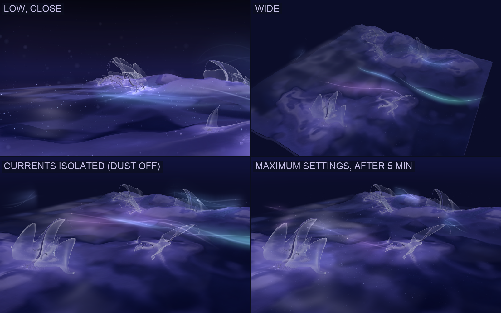

### Guards, kept and added

| Failure | Guard |
|---|---|
| **Rain / streaks** | Broad bodies, not lines. A strand lying steeply on screen fades almost entirely and a body mostly, since that is what reads as rain, or as light pillars when a current recedes from the camera. Seen end-on, strands go before they could fan out like rays. The drift runs across the default view. |
| **Beams / convergence** | The field is divergence-free; anchors are kept 4.5 units apart and new currents avoid existing paths; at most a few bodies overlap at any moment. |
| **Hotspot / blob** | A fixed number of currents; capped opacity per layer; the two body sheets are normalised so together they never exceed one sheet; filaments braid across whichever sheet the camera sees best, so they never stack into one bright line; a body seen end-on fades before it could overlap itself on screen. At maximum settings after five minutes, the brightest 32-pixel block adds +78 luminance and only 4 pixels saturate. |
| **Hard edges** | Found and fixed during the revision. A broad body on a tight bend folded over itself (fixed by narrowing it there). A camera-dependent sheet orientation flipped (replaced by the two world-fixed sheets). Per-vertex occlusion and fog creased the bodies along their triangles (occlusion and sky are now judged per pixel, every other fade at the centreline). |
| **Stars** | A glint or current with only sky behind it is dimmed strongly. |
| **Uniform repetition** | Every current differs in width, length, curvature, height, colour, intensity and braid; the braid waxes and wanes. |

### Measured

| | Result |
|---|---|
| currents alive / clearly visible at the default (median) | 7 / 6 |
| bend, end to end (p10 / p50 / p90) | 9° / 46° / 117° |
| height over the floor (p10 / p50 / p90) | 0.3 / 0.7 / 1.9 units |
| colour identities over ten minutes | ice 30%, mint 30%, lilac 30%, pearl 10% |
| frame lit by the currents, default camera | about 7–15%, varying with the moment |
| brightest 32-px block, maximum settings, 5 min | +78 luminance; 4 saturated pixels |
| frame rate (3200 × 2000, headless Chrome, default and Wisps 1) | 60 fps |

### Controls

Unchanged: **Wisps** (how many currents; 0.5 keeps about 7 alive, 0 is
Phase 1 exactly) and **Wisp strength** (how visible).

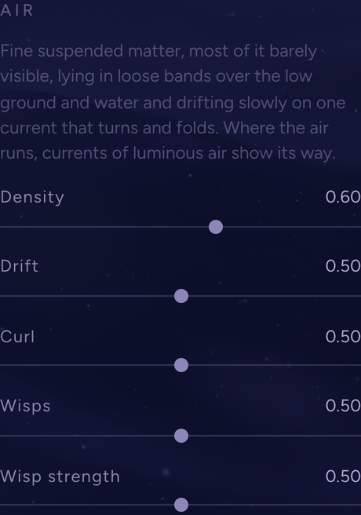

### For review

- At the default camera, can you name several currents without searching?
  Is it now too much anywhere?
- Do the bodies read as **light carried inside mist**, not tubes or ribbons?
- **Colour:** is the mix of ice, mint, lilac and pearl right, and pastel
  enough?
- **Composition:** are the layers and quiet gaps right, or should currents
  be more numerous, longer or broader?

### Limitations noticed

- **Each moment differs.** Currents are born and die over 1–2 minutes, so
  one screenshot may show five vivid currents and the next three. The
  figures here are single moments.
- **From low cameras** many currents are behind the land or past the camera,
  so the air there is quieter than from the default view.
- **Bodies are two crossed sheets.** At some angles you can sense the upright
  sheet as a faint curtain.
- **Occlusion reads only the floor**, not the colonies: a current passes
  through a colony's membranes rather than behind them.
- **The currents are traced on the CPU** each frame (about 7 × 48 stations
  at the default). That is cheap here but would not scale to hundreds.

## Phase 2.5 — Wisps: residue carried by moving air · approved

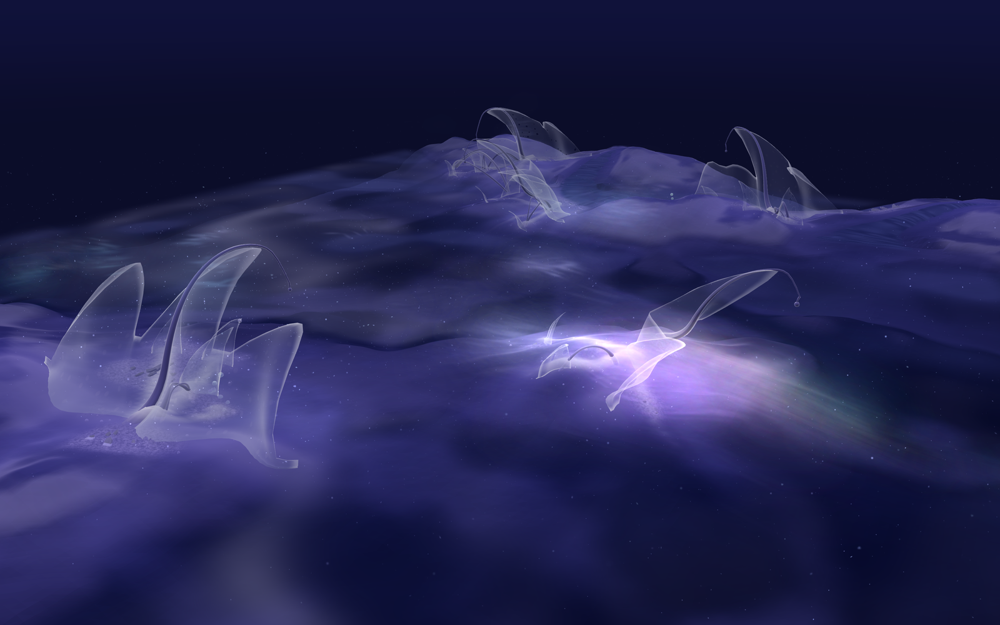

### Why

The revised Phase 2 was visible and its colour direction was right, but the
wisps read as **designed spline objects**: long complete curves, smooth
Bézier-like arcs, nearly constant width, clean crossings, one colour per
path, repeated ribbons. That is the language of energy trails and data
flows, not of Residual Ecology. The cause was the representation itself:
any continuous strip drawn along a path shows that path. Phase 2.5 replaces
it.

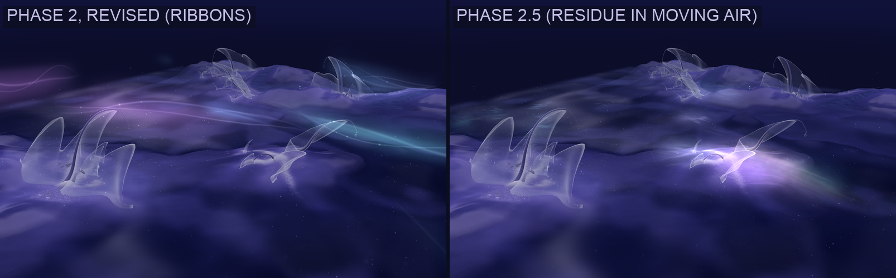

### What it is now

**Dye in moving air, not curves.**
- A few loose regions of atmosphere (four at the default) drift slowly
  downwind across the land.
- Each holds seven invisible release points that let out fine luminous
  residue now and then.
- The residue is carried by the same field that moves the dust. It is
  simulated on the GPU (32,768 grains) and pre-simulated for 110 s at load,
  so the air opens already moving.

**Why it does not look like a spline.**
- **Streak lines, not paths.** The field changes slowly over time, so the
  residue traces where the air has been carrying it. Traces stretch, bend
  unevenly (long flat stretches, soft folds) and are never one clean arc.
- **Puffs.** Release comes and goes, so traces start and stop.
- **Fraying.** Each grain wanders a little more the older it is, and small
  eddies fold it, so a trace breaks into scattered fine matter as it ages.
- **Breathing width.** The release spreads and narrows over time, so a
  trace goes from a thin trace to a broad one.
- **Mist.** About an eighth of the residue is broad, very faint mist that
  grows as it ages, making soft translucent patches.
- **Visibility.** A visibility field travels with the air, so whole sections
  dissolve and reappear further on.
- **No source.** Residue is invisible near where it is released and fades in
  only once it has travelled and spread.

**Drawn as soft grains.** Each grain is stretched a little along its own
motion on screen, like a long exposure. A streak spreads the same light
over its length, never more. A grain moving toward the camera stays round,
and one lying steeply on screen stays round (no rain).

**Colour as staining.**
- The colour of each grain is the local stain of the air: a slowly drifting
  field in space, not a colour per trace.
- Most of the air stays near silver. Here and there it picks up mint, icy
  blue, lilac, or rarely pale pearl.
- The hue shifts a little with the angle the motion is seen at, like a thin
  film, which gives a faint iridescence at folds and edges.

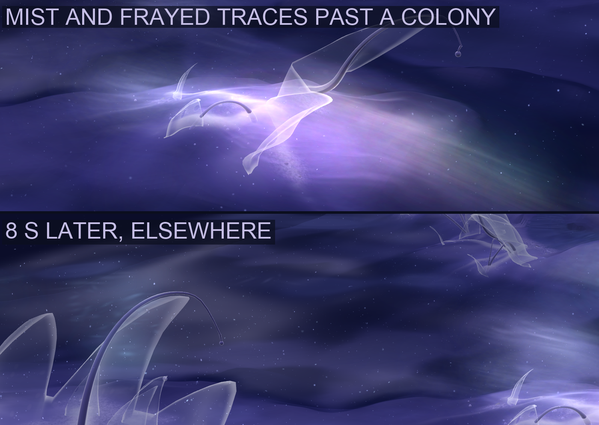

### Guards (what went wrong while building it, and the fix)

| Problem found | Cause | Fix |
|---|---|---|
| Invisible at first | 8k grains spread over three regions were too sparse to add up | 32k grains, higher opacity |
| Compact glitter clusters | visibility and release gaps cut traces into short pieces; tiny dot-like grains | larger visible sections; softer, wider grains streaked by their speed |
| Bright white blob near a release point | fresh residue, not yet spread, overlapping | invisible until it has travelled and spread; wider release |
| Persistent glow near a colony | a release point inside a closed eddy kept filling it (393 grains of one point in one small patch of screen, traced by reading the GPU back) | **density cap**: each frame the residue is counted into a coarse map over the land, and each grain gives less light wherever residue is denser than a loose trace, so **no place can glow beyond a set level, whatever the cause**; plus a fade for residue that has not been carried away from its release |
| Comet-like streak with a white core near the camera | close grains are large on screen; foreshortened traces overlap along their length | residue fades out close to the camera; stronger fade for motion along the line of sight; energy-conserving streaks |
| White hotspot at maximum strength | the density ceiling rose with Wisp strength | the ceiling is absolute: the slider brightens only loose residue |

### Measured

| | Result |
|---|---|
| default camera, residue light | about 12% of the frame lit; brightest 32-px block +112 |
| maximum settings (Wisps 1, Wisp strength 1), after 5 min | brightest 32-px block +121; no saturated pixels (before the absolute ceiling: +193 and about 5,000 saturated) |
| frame rate (3200 × 2000, headless Chrome, default and maximum) | 60 fps |
| warm-up at load | under 10 ms of CPU (the GPU work is queued) |

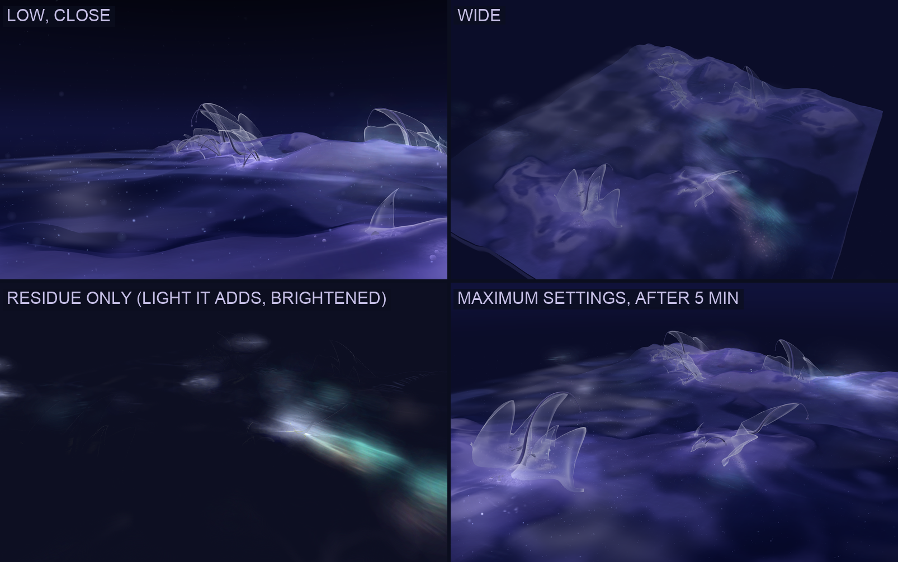

### Controls

The same two sliders, with new meanings:

| Control | What it does |
|---|---|
| **Wisps** | how many regions of the air show their motion: none at 0, four at the default, five at 1 |
| **Wisp strength** | how visible loose residue is. Dense places are capped and do not brighten. |

### For review

- At the default camera, do you sense moving air, two or three regions with
  incomplete traces, without being able to trace a path?
- Does it read as **thin mist and residue caught in moving air**, not trails
  or ribbons?
- **Colour:** is the staining (mostly silver, local mint, lilac, ice, a little
  pearl, faint iridescence) right, or should it be stronger?
- **Strength:** is it now too quiet or too present? The default can move
  either way within the brightness cap.

### Limitations noticed

- **It changes over minutes.** Regions drift slowly, so at a given moment
  one region often dominates and another barely shows. The figures are
  single moments; the motion is much more legible when watching than in a
  still.
- **The default view currently has its richest region around the right
  colony.** This is where a region happens to pass, not colony behaviour;
  colony-specific air is Phase 3.
- **Low cameras see little.** Most residue is behind the land, or within the
  near-camera fade, which keeps close residue from becoming streaks.
- **Eddies swallow some residue.** A release point inside a closed eddy
  shows little: its residue is capped and faded rather than shown circling.
- **The density cap is per area of land, not per pixel.** It bounds the
  light of dense residue but not two separate traces overlapping on screen
  at different depths, which the end-on and near fades mostly prevent.

## Phase 3 — Colony air · approved for now

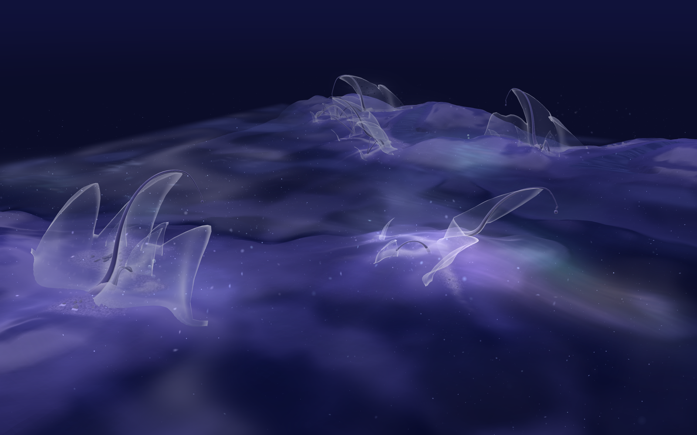

### The aim

As the viewer approaches a colony, the air should feel subtly different
there, as if the colony changes how suspended matter behaves. It should not
add another obvious layer, and there must be no emitter, fountain, ring,
orbit, halo or glowing centre.

### What the colonies do to the air

**Their actual forms are obstacles.**
- Every membrane (each bloom anchor and smaller veil) becomes a soft
  obstacle. Its footprint is its own width along its base line and part of
  its height across it, sitting a little toward the way it leans. It acts
  from the ground to about its height.
- Each colony as a whole is a broader, gentler obstacle over its radius.
- About 25 obstacles on the default world, read from the colony data the
  Scatter tab already builds.

**The air bends around them and slows inside them, without piling up.**
- The horizontal flow is the curl of a stream function. Each obstacle holds
  that function near its value at the obstacle's centre, so air goes round
  a membrane rather than through it, and slows among the forms.
- Because it is still a curl, the flow stays divergence-free: measured
  divergence 0 to numerical precision. Nothing collects.
- Inside the forms the air moves at about 75% of its open speed (median),
  down to about 55%. Around them the speed is unchanged on average.

**Matter drifts up along the forms.**
- Inside a form the dust rises gently (up to about 0.04 units/s), and its
  pull back to its own height eases, so it drifts up along the membranes
  and out over the top.
- About 23% more dust floats more than 1.5 units up over colony cores than
  without the colonies (CPU run, ten minutes).

**A little more matter is born around colonies.** The dust's birth map is
raised over their footprints.

**Residents.** About 2% of the dust is resident in the colonies. They are
three states of the same matter, not a catalogue:

| | Share of residents | Look |
|---|---|---|
| **soft floating matter** | ~45% | soft, slightly elongated, faint |
| **translucent fragments** | ~37% | elongated, lobed outline, turning slowly |
| **brighter motes** | ~18% | small, a little brighter |

- They are born among a colony's forms (within about its radius, at heights
  0.15–1.9), live 25–75 s, and are carried by the same air.
- A resident that drifts out of its colony fades, ends its life soon and is
  born again among the forms. So most residents are lingering in a colony
  at any moment, and no force gathers them. They are spread over the whole
  colony, not clustered.
- Their colour is the colony's: pale mint, silver-blue, pearl or faint
  lilac, varying between them.

**A passing tint.** Ordinary matter near a colony takes the colony's colours
only in patches that drift and come and go. It is intermittent and local,
not an aura.

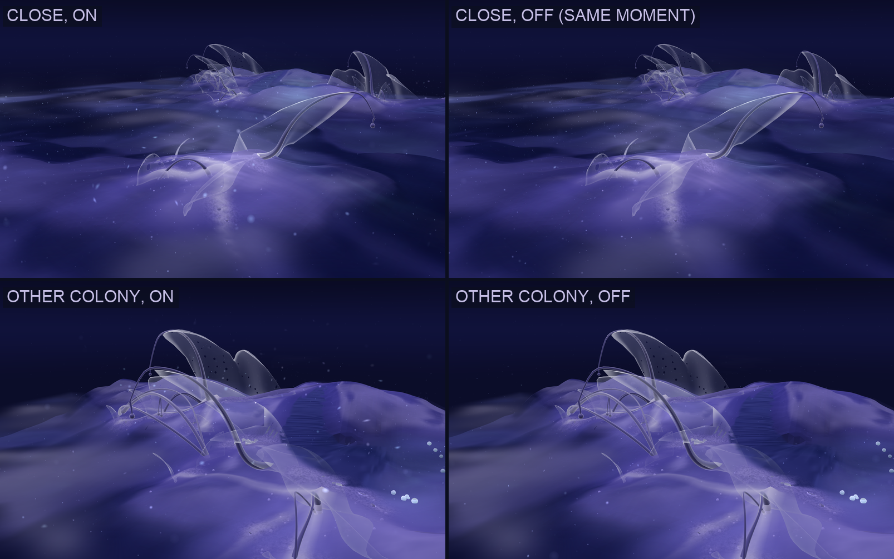

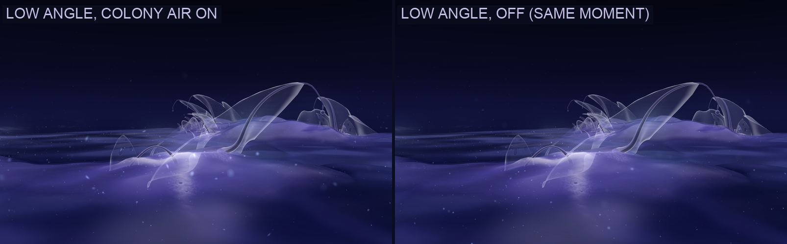

### Diagnosis view

Adding `?debug=colonyair` to the URL is an internal check, not part of the
interface. It shows only the air the colonies touch:
- dust held by an obstacle in mint
- residents in pearl
- residue near a colony in mint
- each obstacle's footprint as an outline

The figures are at Colony air 1.

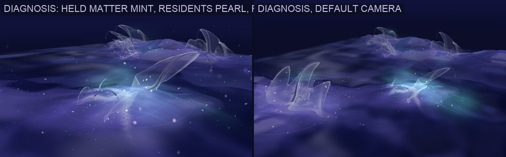

### What went wrong while building it, and the fixes

| Problem found | Cause | Fix |
|---|---|---|
| A glowing core at a colony | I had let residue near colonies skip its slow-air fade, so slowed residue lingered and its light stacked | removed; the colony shows itself in the dust and residents |
| A bright white blob with Colony air off (a Phase 2.5 problem, made visible by the wider regions below) | residue from one region, about 18 units away, lying along the line of sight at a grazing angle: hundreds of grains in one patch of screen; the caps work per area of land and cannot bound stacking along the view | **an on-screen ceiling**: the residue is drawn into its own buffer at half resolution and laid over the scene through a soft curve, so faint residue passes almost unchanged and no pixel can exceed a ceiling, whatever stacks there; the mist's own cap now counts the puffs over its whole footprint |
| The residue vanished after that change | the meshes were moved into the offscreen scene inside a React memo, which runs twice in development; the kept scene was empty | they join the scene in an effect instead |
| A bright band at a colony's base, apparently from colony air | a **flawed test**: I compared Colony air on and off at different moments, and residue regions drift. Compared at the same moment (two fresh loads), it is identical with Colony air on and off: Phase 2.5 residue passing | none needed for Phase 3; the residue still feels only part of the colony's hold, enough to bend around the forms, and barely rises |
| No visible difference with the effect on | residents drifted away from their colonies for most of their lives and were invisible while away | residents that leave end their life soon and are reborn among the forms; slightly more visible |

### Changes Phase 3 made to Phase 2.5

- **The residue is drawn through an on-screen ceiling** (see the table
  above). Its brightest places are a little gentler than before (default
  brightest block about +75, against +112). The share of the frame it lights
  is the same (about 12%).
- **Two of the residue regions are broader** (×1.6 in extent), so the air
  reads across more of the world from the default camera, as asked, without
  making particles larger or brighter.

### Measured

| | Result |
|---|---|
| horizontal divergence with the colonies | 0 (numerical, 3,000 samples near colonies) |
| air speed inside forms vs without colonies (p10 / p50 / p90) | 0.55 / 0.75 / 1.0; around them 0.91 / 1.01 / 1.13 |
| dust in colony cores, with vs without (CPU, ten minutes) | 0.94–1.04× (no pile-up); about 23% more high over the cores |
| maximum settings (Colony air 1, Wisps 1, Wisp strength 1), 5 min | default view brightest 32-px block +74, 2 saturated pixels; low colony view +45, none |
| frame rate (3200 × 2000, headless Chrome, all at maximum) | 60 fps |

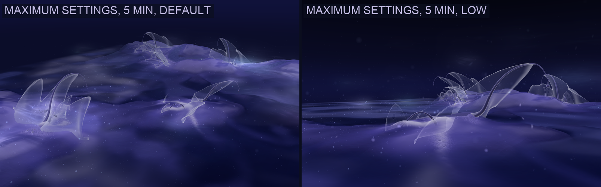

### Controls

One slider joins the Air section: **Colony air**, how much the colonies
change the air around them. The default is 0.6, and 0 is exactly Phase 2.5.
Colonies exist only in the Scatter tab, so the effect appears there.

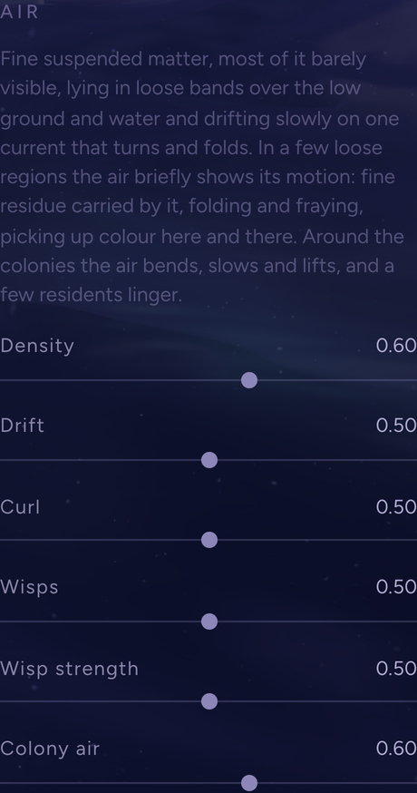

### For review

- Close to a colony, does the air feel **disturbed and hosted** by it,
  without an emitter?
- Are the residents the right amount: present but rare, heterogeneous,
  not a swarm?
- Is the tint (mint, silver-blue, pearl, lilac) local and intermittent
  enough, or too faint to notice?
- From the default camera the effect is very quiet. Is that right, or
  should colonies read from further away?

### Limitations noticed

- **Subtle in stills.** The bending and slowing show mostly in motion; a
  screenshot shows the residents and tint, not the flow.
- **The obstacles are ellipses, not membrane shapes.** Air goes round a
  membrane's footprint, not through its holes or under its overhangs.
- **Residents can sit inside a membrane**, since nothing keeps them out of
  the forms. They are translucent, so it reads as matter caught in the
  membrane.
- **Colonies are only in the Scatter tab.** In Field and Shaders the air is
  Phases 1 and 2.5 only.
- **Residue drawn without the scene's depth.** It now fades where land lies
  between it and the camera, but it does not pass behind membranes.

### Revision: making the relationship legible

**The review.** Pleasant up close, but the colony relationship was not
legible. It read as scattered motes, and you could not tell the air behaved
differently because of a colony. This revision changes behaviour, not
look: the residents and palette are unchanged, and there is no new layer.

**Why it was not legible:**
- **Too little of the effect reached what you can see.** The residue (the
  only matter that shows motion in a still) felt only a third of the
  colonies' influence. A Phase 2.5 region might not even be passing a given
  colony.
- **Hard to see in a still.** The dust felt it fully but is too fine to show
  flow in a still.

**What changed.**

| Change | Effect |
|---|---|
| **Incoming air** | Each colony has five release points upwind, traced back along the air that will actually reach it (not the average drift, which missed). They let out thin filaments in puffs, at irregular spacing and heights, like smoke in a wind tunnel. So air is always arriving at every colony and shows what happens to it. |
| **Bending** | The residue now feels the colonies fully. The air bends round each membrane, which is held more gently than before so the air does not funnel through the gaps between them. |
| **Slowing and lingering** | Near a colony all of the residue's motion is held back, easing in from about 1.6 colony radii to up to 60% less among the forms. This is the one place matter may crowd, by at most about 2.5×. Each grain dims with the square root of its speed, so a lingering zone is at most about 1.6× fuller than open air, never a glow. Streaks shorten into grains as they slow. |
| **Rising** | About a third of the residue lifts among a colony's forms, its pull back to its own height released, so it drifts up and over the membranes before falling back. |
| **No glow** | The residue is now laid over the scene with screen blending: over dark air it is unchanged, over a bright membrane it adds less and less, so it never clips. |

**Findings along the way:**
- **No slowing at first.** Holding the air inside a membrane made it flow
  round the membranes and speed up through the gaps. In air that cannot
  compress, slowing one part of a stream only pushes its flow aside, so
  there was no lingering. Hence the limited, deliberate slowing above.
- **Slowing hidden by the residue's own motion.** The residue's own small
  eddies and wander were added after the slowing and were as fast as the
  air near a colony. Now everything is held back.
- **Filaments dimmed by the brightness cap.** The Phase 2.5 per-area cap
  dimmed the thin filaments to about 8% of their light, since a filament
  packs about 90 grains into one patch of land. They may be 6× denser
  before dimming; the on-screen ceiling still bounds them.
- **Stranded grains.** Grains released before the colonies existed were
  parked outside the world and stayed there for their whole life (30% of
  them at one minute). They now join their colony at once.
- **Clipping.** About 400 pixels clipped where residue lay over the bright
  membrane bases, fixed by screen blending.

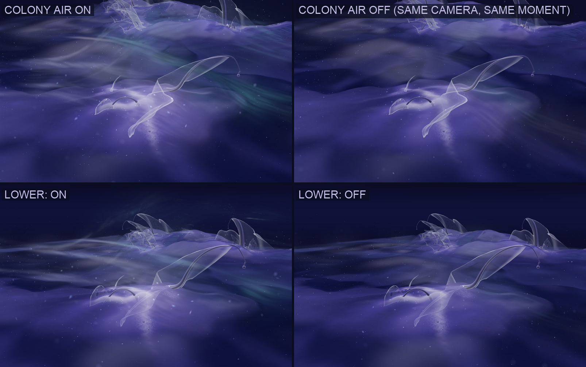

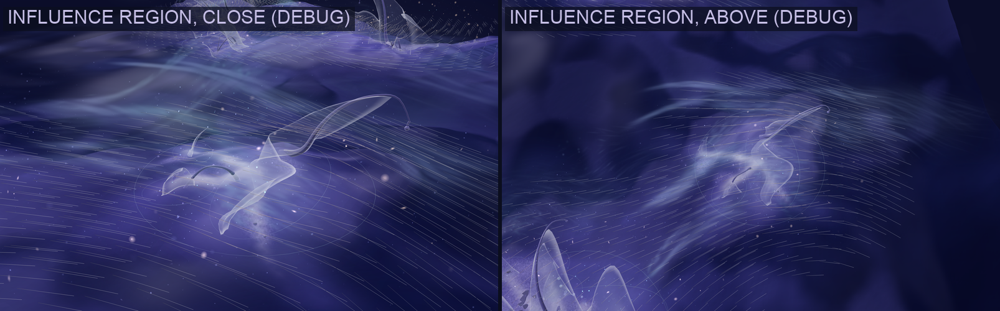

**Measured.** Read back from the GPU, residue from the colonies' incoming
air, about a minute after load:

| | Among the forms (< 0.8 R) | At the edge (0.8–1.3 R) | Around (1.3–2.2 R) |
|---|---|---|---|
| horizontal speed, median | 0.060 | 0.071 | 0.066 units/s |
| rising third: vertical speed, median | **0.029** | 0.023 | 0.002 units/s |
| height above colony ground, p90 | 2.7 | 2.5 | 2.7 |

- **Slowing is modest in the numbers** (about 10–15%). The air also speeds
  up round the sides of each membrane, which is what bends it, and the two
  partly cancel in a median. The rise is clear.
- **Brightness, same camera, on vs off:** brightest 32-px block 185 vs 167;
  2 saturated pixels vs 0.
- **Maximum settings, after 5 min:** close 156, default 151; 10 and 1
  saturated pixels.
- **Frame rate:** 60 fps at maximum. The residue is now 65,536 grains: the
  regions keep their share, and the colonies' incoming air is the rest.

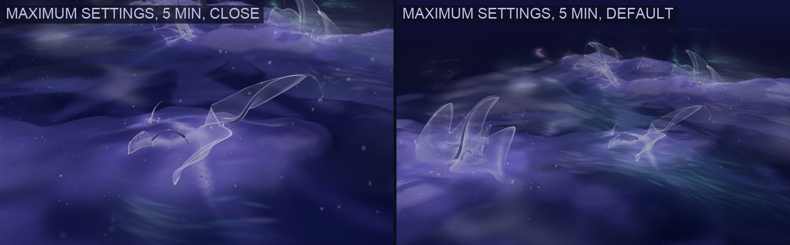

**For review:**
- Close to a colony, can you see the air arriving, slowing, bending round
  the membranes, rising and fraying beyond?
- Do the filaments read as air (smoke in a soft wind tunnel), or too much
  like drawn lines?
- Is the influence region coherent around the colony, without a ring, halo
  or centre?

**Limitations of the revision:**
- **The incoming air takes about a minute to establish** after the colonies
  appear (switching to the Scatter tab). The residue is not re-simulated
  when the colonies change.
- **Filaments are released along the air as it is now.** When the air turns,
  a filament can miss its colony for a while.
- **Slowing is gentler than bending and rising**, for the reason above.
- **Release points upwind are invisible but fixed in pattern:** five
  filaments per colony. With many colonies close together, their filaments
  can cross.

## Phase 4 — Basin haze · accepted for now, artifacts unresolved

> **Unresolved, carried forward.** Accepted for now so that Phase 5 could
> begin, but some flat and horizontal haze artifacts are still visible in the
> scene and are **not resolved**:
> - Mist toward the far horizon still reads as horizontal bands. Perspective
>   flattens it, and where the land's silhouette cuts it, the band has a flat
>   lower edge.
> - Where a near ridge hides a basin's mist, the mist ends along the ridge's
>   silhouette: a visible edge.
> - The haze ignores scene depth, so mist behind a membrane is drawn over it.
>
> No further work on these in Phase 5. In Phase 6 the horizon band was
> softened (the haze fades out earlier with distance and thins along
> grazing lines of sight), but not removed; the other two remain.

Built, reviewed and revised; then reviewed again in the scene itself and
fixed. The fix is the current state and is described first. The revision
and the first version are kept below it as the record; where they differ,
the fix holds.

### Fix after review: a continuous volume, and less green

**The review.** The revised haze looked better in the comparison figures,
but not in the scene itself, especially from low cameras:
- **A flat, rectangular-looking layer** stretched horizontally across the
  scene, like a translucent sheet rather than a volume of atmosphere.
- **The mint tint was muddy** against the lavender terrain.

The aim was to fix the rendering and the visual coherence, not to add
effects: one continuous atmosphere with clear areas, silver-blue and lilac
for the most part, mint and pearl only here and there, and the contrast and
the gains over the first version kept.

**Diagnosis.** Measured rather than assumed, from low and close cameras
that showed the sheet. Temporary switches isolated each layer and showed
the height and distance the haze's light came from; the slab top, the
step count and the compositing could each be changed without reloading.
Each test was compared with the haze as it was, against a control: two
ordinary captures taken the same interval apart (the dust and residue keep
moving).

| Suspect | Test | Result |
|---|---|---|
| **The volume's height limit** | slab top raised from 2.4 to 5 units | no change beyond the control (0.66 and 0.76 levels against 0.95 and 1.16): **not the cause** |
| **Ray marching** | 160 steps instead of 36 | no change (0.66, 0.74): **not the cause** |
| **Compositing** | the half-resolution buffer read without softening | no change (0.68, 0.74): **not the cause** |
| **Depth handling** | the march stops at the land; the membranes are not part of it | the bands crossed in front of a membrane, a known limitation, but this does not make them flat: **not the cause** |
| **The density field** | each layer alone, and the height its light comes from | **the cause**: the higher veil alone made the lilac rectangles, the lower veil alone the flat band, each from a constant height (about 1.3 and 0.6 above the water) |

**Why the sheets looked flat.** Each veil was a 2D pattern multiplied by a
thin vertical profile at a slowly varying height: an extruded flat sheet.
Seen nearly edge-on from a low camera, a sheet collapses into a horizontal
band with a flat top and bottom, and where its 2D pattern ends it ends in a
near-vertical side: a rectangle. The value noise used for the pattern also
tends toward blocky, axis-aligned shapes.

**Why it looked green.** Mint was the colour of all the low mist over the
water, and the silver and icy blue had green above red. Over the dark blue
water, screening those adds more green than red, so the result reads teal.
Measured as the share of hazed pixels whose final colour has green above
red: **34–50%** in the overview, across the basin and close, and **44–75%**
from the low cameras (with the haze off, the same pixels: 0–8%).

**The fix**
- **One continuous 3D field instead of sheets.** The mist's forms come from
  tileable 3D gradient noise (64³, three octaves, made once in about 40 ms),
  bent by the air's swirls. They are somewhat flatter than tall (2.2×) and
  slightly longer along the drift (1.25×), but have no flat top, bottom or
  side anywhere.
- **It thins upward in billows, not at a ceiling.** Densest low (falling
  off over about 0.7 units) and eroded more the higher it is (its threshold
  rises with height), with soft edges that grow softer with height, so the
  forms grade into clear air instead of ending.
- **Layering without layers.** The air low down drifts at half the air's
  speed and the air higher up at 1.4×, blended smoothly between 0.2 and 1.4
  units, so the forms slide over one another without any layer having an
  edge.
- **Clear areas kept.** Broad soft areas of mist alternate with clear air,
  and it lies over the low ground judged over a few units around (the
  blurred floor), thinning towards the hills.
- **Colour.** A base of translucent silver-blue and lilac from a slow field
  of its own, with green never above red, a little icier near the water.
  Mint and pearl appear only at the thin fringes of the forms (where the
  mist is half there), and only where a sparse field peaks: a faint
  iridescence, not a tinted region.
- **The distant air fades a little nearer** (20–40 units instead of 24–44),
  and the march ends at 40.
- **Unchanged:** the compositing (veiling and screened light, both capped),
  the near fade, the stop at the land, the resolution and the step count.

**Findings along the way**
- **The diagnosis switch first acted on the wrong instance.** In
  development, React builds the haze twice and keeps one; the switch held
  the discarded one, so "haze off" still showed haze. Caught because the
  off captures were not off; the switch was moved to the instance on
  screen.
- **The first 3D attempt left floating pancakes.** Higher up, only the
  noise's peaks survived, as small isolated lenses (squashed 3.5×
  vertically, with a sharp threshold). Rounder forms, softer edges that
  widen with height, and a faster fall-off with height fixed it.
- **Forms on the far horizon look flat-bottomed** where the land's
  silhouette cuts them: rays just above the horizon cross the most air,
  rays just below stop at the land. That is correct; making high mist rarer
  and fading the distance a little nearer keeps them from reading as
  separate clouds.
- **Silver with green above red read teal** over the dark water, so the
  base colours were made neutral to lilac.
- **The balance moved twice:** at one step the mist was too faint across
  the basins, at the next too heavy in the overview. It now sits close to
  the previous revision in the overview, and lighter elsewhere.

**Measured.** Same camera and settings, haze off, 0.5 and 1 captured within
a few seconds of each other, at 2× density. "Teal" is the share of hazed
pixels whose final colour has green above red.

| View | Version | Haze | Brightness added | Local contrast vs off | Frame touched | Strongly hazed | Teal |
|---|---|---|---|---|---|---|---|
| overview | previous | 0.5 | +6.3 | 0% | 41% | 8% | 37% |
| overview | **fixed** | 0.5 | **+7.4** | **+4%** | **33%** | **11%** | **1%** |
| overview | previous | 1 | +11.9 | +2% | 57% | 18% | 49% |
| overview | **fixed** | 1 | **+10.9** | **+5%** | **41%** | **17%** | **2%** |
| across a basin | previous | 0.5 | +8.1 | −2% | 41% | 14% | 35% |
| across a basin | **fixed** | 0.5 | **+2.3** | **−2%** | **16%** | **3%** | **4%** |
| across a basin | previous | 1 | +12.6 | −5% | 51% | 21% | 50% |
| across a basin | **fixed** | 1 | **+3.0** | **−1%** | **16%** | **4%** | **4%** |
| close, over the water | previous | 0.5 | +6.4 | +7% | 31% | 10% | 34% |
| close, over the water | **fixed** | 0.5 | **+1.9** | **+2%** | **10%** | **2%** | **7%** |
| low, C1 | previous | 0.5 | +8.0 | −2% | 26% | 13% | 48% |
| low, C1 | **fixed** | 0.5 | **+2.7** | **+3%** | **12%** | **3%** | **4%** |
| lowest, L1 | previous | 0.5 | +6.2 | +6% | 19% | 9% | 44% |
| lowest, L1 | **fixed** | 0.5 | **+1.9** | **+2%** | **9%** | **3%** | **5%** |
| low, L3 | previous | 0.5 | +8.6 | −5% | 29% | 16% | 75% |
| low, L3 | **fixed** | 0.5 | **+2.3** | **+2%** | **11%** | **3%** | **5%** |
| low, L4 | **fixed** | 0.5 | +6.2 | +6% | 24% | 10% | 5% |
| low, L4 | **fixed** | 1 | +7.6 | +8% | 25% | 12% | 4% |
| close, C2 | **fixed** | 0.5 | +1.4 | +2% | 7% | 3% | 3% |

The previous revision's low-camera rows come from the diagnosis run (at 1×
density, on and off at the same moment), the rest from runs at 2× density.

What the numbers show:
- **Teal is gone as a broad tint:** 1–7% of hazed pixels, against 34–75%
  before.
- **Contrast is kept or slightly raised** everywhere except across the
  basin (−1 to −2%).
- **Across the basins and from low cameras the mist is now lighter**
  (+2 to +3 levels). Much of what the previous revision added there was
  the flat sheets themselves. The overview carries about as much as before.

**Every Air slider at maximum, after five minutes** (2× density):
- **Brightest 32-px block:** 161 in the overview, 190 across the basin,
  151 from the low camera L4 (the revision: 163 and 194).
- **Saturated pixels:** 2, 17 and 0 of 6.4 million.
- **No sheets, no glow, no milky wash.**
- **60 fps throughout**, checked every minute; the WebGL context was never
  lost.

**GPU time of the haze:** 1.09 ms a frame at the defaults, 1.11 ms with
every Air slider at maximum, at 2× density (the revision: 1.36 ms).

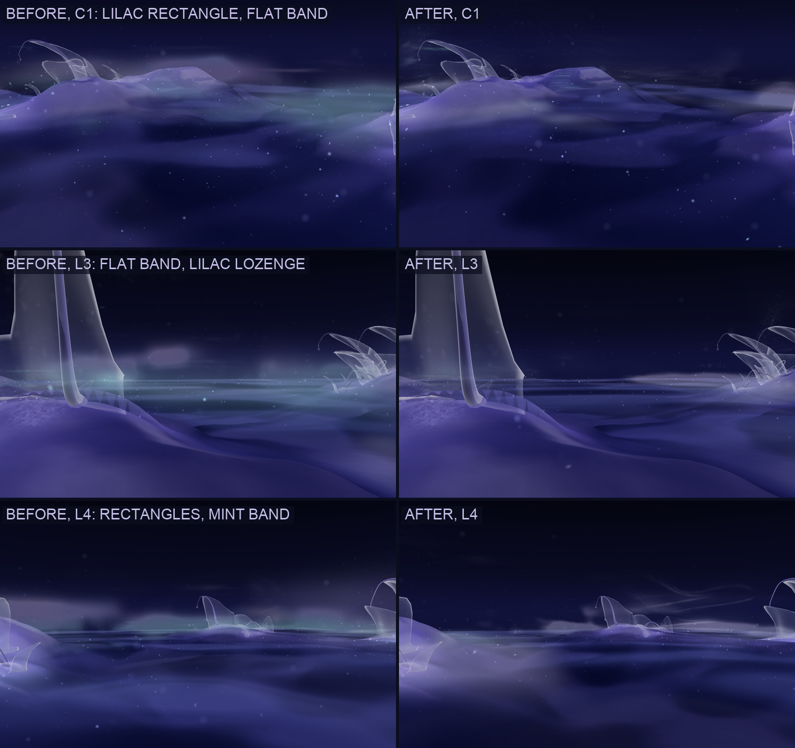

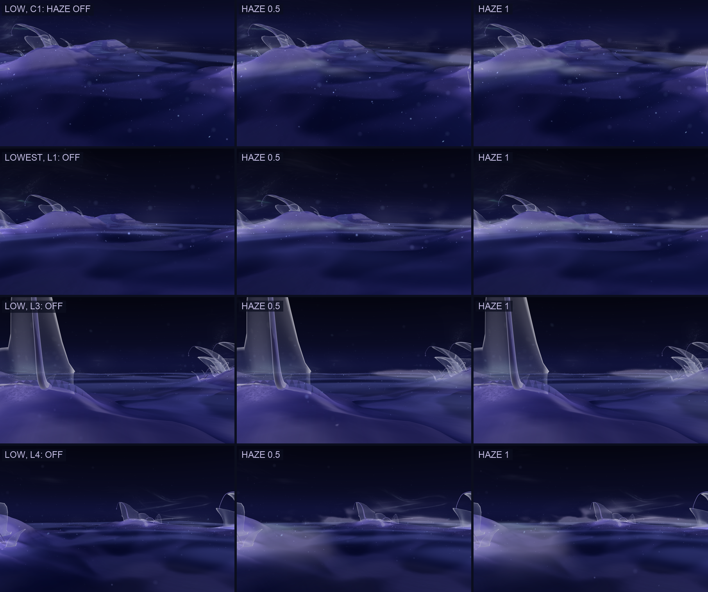

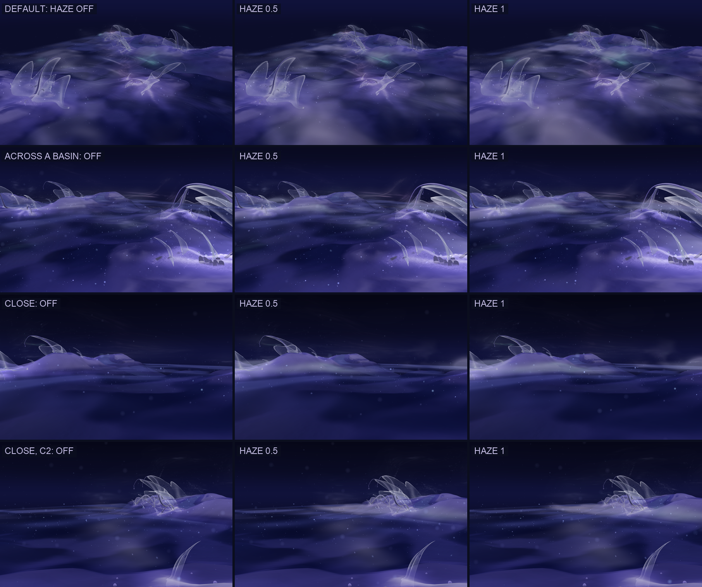

**For review**
- From low and close cameras, does the haze now read as **one continuous
  atmosphere**, with no recognisable planes or rectangles?
- **Colour:** is it predominantly translucent silver-blue and lilac now? Is
  the mint and pearl iridescence too faint to notice?
- **Amount:** across the basins the mist is lighter than in the revision.
  Is that the right balance, or should the basins carry a little more?

**Limitations of the fix**
- **Still no scene depth.** Mist behind a membrane is drawn over it
  (screening keeps this mild).
- **Horizon forms stay horizontal.** Perspective flattens any mist at the
  far horizon; the forms there are soft and broken, but horizontal.
- **Occlusion edges.** Where a near ridge hides a basin's mist, the mist
  ends at the ridge's silhouette. That is correct, but it is an edge.
- **The iridescence is very sparse**, and may be too subtle to notice.
- **The basins are lighter** than in the revision; from a camera above them
  the mist shows mostly at grazing angles, as thin mist does.

### Revision: less haze, more layering, colour and depth (its layers and palette superseded by the fix above)

**The review.** The first version worked technically, but compared with
the reference it lacked layering, local colour and depth. Raising Haze made
a brighter, milky wash that softened the scene and flattened its contrast.
The aim of the revision was less haze with more interesting variation, not
more fog, with no new controls and no separate mode.

**What changed**

| | First version | Revision |
|---|---|---|
| **Layers** | one layer of banks | three layers of one atmosphere (below), each drifting at its own pace (0.5×, 1× and 1.6× the air's drift), so they slide over one another |
| **Shapes** | round soft banks | the veils are stretched along the drift (2.4–2.8×) and bent by the air's own swirls (the field's velocity warps where the noise is read) |
| **Colour** | silver-blue to lavender to pearl, by height only | a slow colour field of its own, so colour changes across the air, not along a layer (below) |
| **How it is laid over the scene** | one "over" blend: every hazed pixel was pulled toward one pale colour, which flattened contrast | two parts: a slight veiling (dims what is behind by at most 18%), then the mist's own light screened on top (it shows over the dark water and basins, adds little over bright membranes, and cannot clip) |
| **Coverage** | banks over about half the low ground; Haze scaled the density linearly | thresholds set from the noise's measured distribution (below); Haze 1 adds a little coverage and about 1.3× the density of 0.5 |
| **Near the eye** | mist could sit at the camera | none within 1 unit, fading in by 6, so close views keep a clear foreground and the mist reads at middle distance |
| **Edges** | the world's edge was not handled | the mist stops just inside the land; past the edge the floor reads as water, which made mist over the void |
| **Softness** | 28 steps | 36 steps; the half-resolution buffer is read softened (four bilinear taps), which hides the dithering on thin layers |
| **Resolution** | half the device's pixels | half the CSS pixels: a dense (2×) display marches a quarter as many, since the mist has no fine detail to gain |

**The three layers**
- **Ground mist:** hugging the water and the basins, falling off within
  about a quarter unit, in patches with clear water between them. The
  slowest layer.
- **Lower veil:** a thin sheet whose height wanders between about 0.1 and
  1.0 above the water, and whose thickness varies. Where it dips it merges
  into the ground mist, so the layers read as one atmosphere. It is torn
  into long soft forms and lies over the low ground and its lower slopes.
  Which ground counts as low is judged over about 3 units (a blurred copy
  of the floor, made once), not under each point. Otherwise a veil ends in
  a sharp column above a steep shore.
- **Higher veil:** sparser and fainter, about 0.85–1.45 above the water,
  around the hilltops. The fastest layer.

**Colour.** Muted versions of the colonies' palette:
- low over the water, mint and icy blue
- in the veils, icy blue and lilac
- here and there, where a second field peaks, warm pearl (mostly in the
  veils)
- distant air turns slightly cooler and dimmer, for depth

**Coverage**, from the measured distribution of the noise (each threshold
is a percentile, not a guess). At Haze 0.5:
- ground mist over about a third of the water
- the lower veil over about a quarter of the land
- the higher veil over about a tenth

At Haze 1 each covers a little more.

**What was kept**
- a volume marched per pixel at half resolution, stopping at the land
- stateless: no particles, nothing accumulates
- it fades with distance
- drawn before the dust and the residue, which stay crisp
- the one Haze control, default 0.5

**Guards**

| Risk | How it is prevented |
|---|---|
| **A milky wash** | The mist is mostly light screened over the scene, not a pale colour mixed over it. Veiling is capped at 18%. The light is capped (0.36 at its brightest), and screening adds less the brighter the scene already is. |
| **Fog over everything** | Coverage is set by percentile, with clear air between the patches at every setting. The mist lies over low ground and below the hilltops, and there is none near the camera. |
| **A blob or glow** | Nothing accumulates (stateless). Screened light can never exceed white, and over a bright membrane it adds almost nothing. |
| **Lost depth or contrast** | Local contrast is measured on every view (below). The dust and residue are drawn after it, crisp. |
| **Mist through hills, or past the world** | The march stops at the land, and the mist stops inside the land's edge. |
| **Banding or dither** | 36 dithered steps, read softened. |

**What went wrong while building it, and the fixes**

| Problem | Fix |
|---|---|
| A **fine cross-hatch** in the thin veils (the dither of an undersampled march) | thicker veils, 36 steps, the softened read |
| The **higher veil floated above the hills** like a cloud deck: it sat at about 1.6, and the hills are only about 1.1 tall | lowered to about 1.15, and the lower veil to about 0.55 |
| The **ground mist was almost absent**: thresholds set by eye fell in the top 5% of the noise | measured the noise's distribution; thresholds set by percentile |
| A camera standing inside a veil **tinted the whole frame**, sky included | the near fade |
| The second pass was **too heavy again** (the default near a wash) | halfway back on coverage, and a gentler response to Haze |
| A soft **lighter strip** at a frame's edge in a close view | found to be mist over the void past the world's edge; the mist now stops inside the land. What remains there is a smooth brightening from real mist close by (see limitations). |

**Measured.** Same camera, same moment: haze off, 0.5 and 1 in one load.
The first version's Haze 1 captures were from a different load than its
"off", so its Haze 1 rows are approximate.

| View | Version | Haze | Brightness added | Local contrast vs off | Frame touched | Frame strongly hazed |
|---|---|---|---|---|---|---|
| default | first | 0.5 | +9.6 | −4% | 54% | 13% |
| default | first | 1 | +21.3 | −4% | 66% | 42% |
| default | **revised** | 0.5 | **+6.3** | **0%** | **41%** | **8%** |
| default | **revised** | 1 | **+11.9** | **+2%** | **57%** | **18%** |
| across a basin | first | 0.5 | +12.9 | −9% | 65% | 15% |
| across a basin | first | 1 | +23.4 | −12% | 74% | 39% |
| across a basin | **revised** | 0.5 | **+8.1** | **−2%** | **41%** | **14%** |
| across a basin | **revised** | 1 | **+12.6** | **−5%** | **51%** | **21%** |
| close, near the water | **revised** | 0.5 | +6.4 | +7% | 31% | 10% |
| close, near the water | **revised** | 1 | +7.7 | +3% | 30% | 12% |

How the columns are measured:
- **Brightness added:** mean of RGB, in 0–255 levels.
- **Local contrast:** the standard deviation of brightness in 32-pixel
  blocks, averaged.
- **Frame touched:** where the haze changes a pixel by more than 2% a
  channel.
- **Strongly hazed:** where it changes a pixel by more than 10% a channel.

What the numbers show:
- **At the maximum it is about half as heavy:** brightness added about
  half, area strongly hazed about half.
- **Contrast is kept:** within ±2% of haze-off at the default, and at most
  5% lower at the maximum across a basin (the first version took 9–12%).
- **The colour variation** is shown by the figures rather than measured:
  a simple hue count on the difference images was misleading (it reads the
  first version's silver-white over lavender as "mint").

**Every Air slider at maximum, after five minutes** (2× density):
- **Across the basin:** mean brightness 58.1 (the first version: 92.2),
  brightest 32-px block 194 (194), 13 saturated pixels of 6.4 million
  (179).
- **Default view:** mean 61.9 (65.7), brightest block 163 (173),
  8 saturated pixels (43).
- **No milky sheet, no blob, no glow:** the basin keeps its dark water
  between layers of mist.
- **60 fps throughout**, checked every minute; the WebGL context was never
  lost.

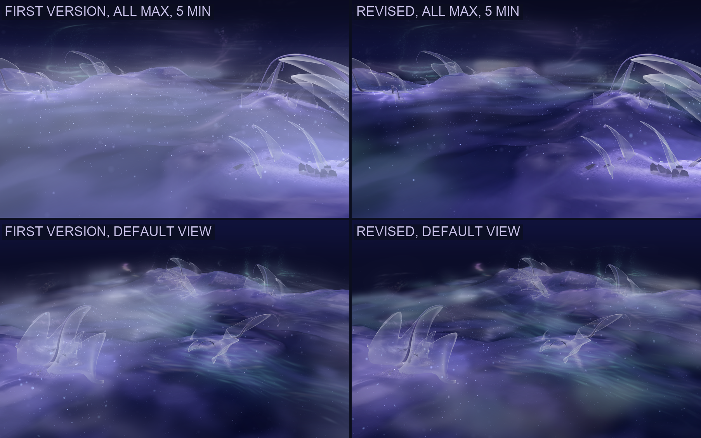

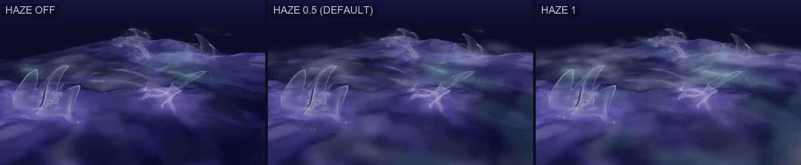

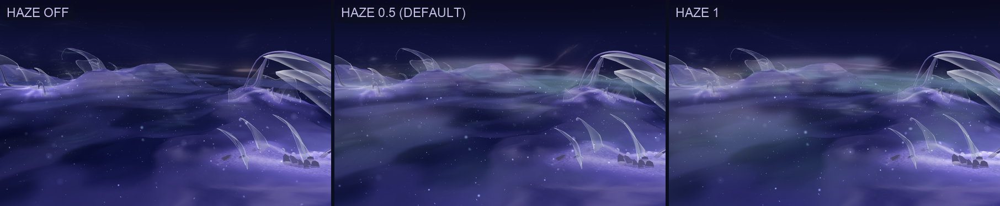

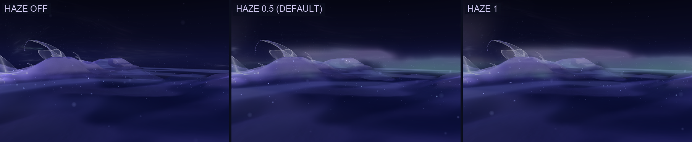

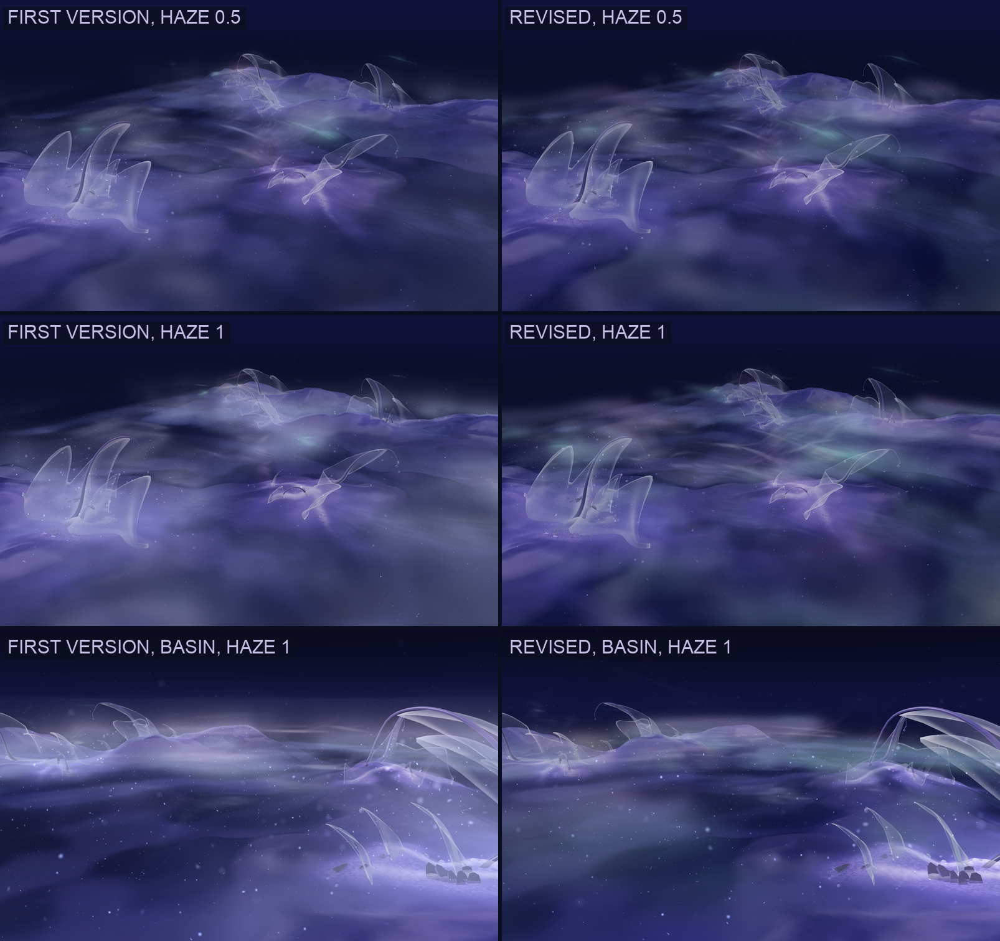

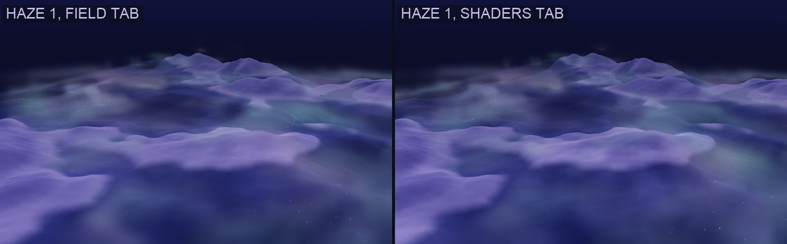

**For review**
- Does it now read as **layered atmosphere**, with distinct areas of mist
  and clear air, rather than fog?
- **Colour:** are the mint, icy blue, lilac and pearl variations visible
  enough, or still too subtle? Should pearl be more frequent?
- **The maximum:** is Haze 1 now restrained enough?
- **Close views:** is the clear foreground with mist at middle distance
  right, or should mist come closer to the camera?

**Limitations of the revision**
- **Still no scene depth.** Membranes are not part of the land, so mist
  behind a membrane is still drawn over it. Screening makes this much
  milder over bright membranes, but it is not correct.
- **A soft brightening at a frame's edge.** From a camera low enough to
  stand among the veils' heights, mist a few units away to one side shows
  as a smooth brightening at the frame's edge (about +9 levels, fading over
  a tenth of the width).
- **The colour field ignores the colonies.** The mist does not pick up a
  colony's tint near it.
- **The veils follow the mean drift**, bent by the field but not carried by
  it, and do not part round the colonies.
- **The colour is subtle at the default.** The hues read best at Haze 1
  and at grazing views; from above they are faint.
- **Cost.** 36 steps, with the air's velocity (nine plane waves)
  evaluated inside the veils. Measured with a GPU timer, the haze takes
  **about 1.4 ms a frame** at 2× density, of about 13 ms for the whole
  frame (main scene 3.9 ms; the dust, residue and their simulations about
  8 ms). One session ran at 30 fps even at the default settings and with
  the haze off, because the machine was busy with other applications. The
  five-minute run held 60 fps at 2× density.

### First version (superseded by the revision above)

#### The aim

Larger, slower atmosphere over the low ground and the water: a soft veil
that lifts the dark basins and gives the air depth, built as a volume rather
than as more point sprites. It must not become fog over everything, a wall,
a glow, or a white blob like the baseline's veils.

#### What it is

**A volume, not particles.** For every pixel, the line of sight is marched
through a thin slab of air above the water, and the haze's density is
summed along it:
- **28 steps** per pixel, at **half resolution** (the haze has no fine
  detail). The steps are dithered per pixel, so they never band.
- **The march stops where the line meets the land.** Hills hide the haze
  behind them, and haze in a basin lies in front of the slope beyond it.
- **Seen across a basin, the haze gathers into a veil; seen from above, it
  is thin,** as mist is.

**Where it lies.** Its density:
- **is low ground only:** over the water, the basins and their shores,
  thinning out within half a unit above the water level, so the forms read
  against clear land
- **lies low:** it falls off with height above the water (half a unit), and
  is soft at the ground
- **comes in large soft banks with wide clear gaps:** a tileable,
  low-frequency noise (about 30 units across) with a finer one fraying the
  edges. The banks drift slowly with the air and the finer noise changes
  over minutes, so the banks breathe.
- **stays within the land's reach** and fades with distance (24–44 units)

**Colour.** Cool silver-blue low over the water, lavender higher, a little
pearl at its upper edge. It is paler than the lit land behind it, or it would
not read as mist.

**How it is laid over the scene.** As a veil: what lies behind shows through,
softened by the haze's transparency (premultiplied "over", not additive). It
is drawn before the dust and the residue, which stay crisp in front of it.

#### Guards

| Risk | How it is prevented |
|---|---|
| **A white blob** (the baseline's failure) | Nothing accumulates. The haze has no particles and no state: its density is a function of place and time only, so a tab left open for an hour looks like a fresh load. It is not additive: each pixel is a mix of the scene and the haze's colour, so it can never be brighter than the brighter of the two, and the haze's colour stays below 0.95. |
| **A wall** | Its opacity is capped at 0.5 per pixel: the world always shows through. It fades with distance and lies only over the low ground, in banks with gaps. |
| **Fog over everything** | It is confined to the water and the basins, and to half a unit of height. Colonies on the shores stand above it. |
| **Glow** | It is not lit by anything and adds no light of its own: it softens toward a pale colour rather than brightening. |
| **Haze seen through hills** | The march stops at the land. |
| **Banding** | Steps are dithered per pixel; the half-resolution buffer softens what is left. |
| **Cost** | Half resolution, 28 steps, four texture reads a step (the land twice, the noise twice). When Haze is 0 the pass is skipped. |

#### What went wrong while building it, and the fixes

| Problem | Fix |
|---|---|
| **Too uniform, low contrast:** a thin grey film over everything, reading as a dimmer, not as mist | confined to the water and basins; a thinner layer; sharper banks with wider gaps |
| **Invisible against the lit land:** the colour was as dark as the land behind it | paler, cooler colour, a little pearl at the top; density raised (it is capped anyway) |

#### Measured

Haze 0.5 (default) against Haze off, same camera, same moment (two fresh
loads captured at the same time):

| View | Mean luminance, on vs off | Saturated pixels, on vs off |
|---|---|---|
| default | 54.9 vs 45.1 | 6 vs 14 |
| across a basin | 61.9 vs 48.5 | 16 vs 37 |
| low | 51.1 vs 39.8 | 2 vs 9 |

- **It lifts the dark ground:** mean luminance rises by 22–28%.
- **It softens rather than brightens the brightest parts:** fewer pixels
  saturate with the haze on, and across the basin the brightest 32-px block
  falls from 211 to 189 (it veils the bright membrane bases a little).

- **Haze 1, about a minute after load:** mean luminance 66.8 (default view)
  and 72.5 (across a basin); brightest 32-px block 173 and 203; 23 and 88
  saturated pixels of 6.4 million.
- **Every Air slider at maximum, after five minutes:** brightest 32-px block
  173 (default view) and 194 (across a basin), lower than the basin with the
  haze off (211); 43 and 179 saturated pixels of 6.4 million (under 0.003%),
  where residue and dust lie over the brightest membranes. **No blob and no
  glow**, but across the basin the mist has become a broad milky sheet (mean
  luminance 92). Being stateless, the haze has not piled up: at that moment a
  bank lies across the whole basin, with the dust and residue also at their
  maximum. This is the heaviest it gets, and it is too much (see For review).
- **Frame rate:** 60 fps (the display's cap) with Haze 1, and with every Air
  slider at maximum after five minutes, in the headless test.

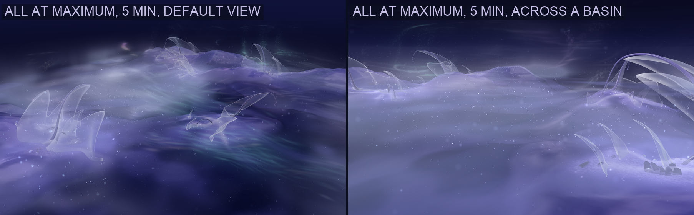

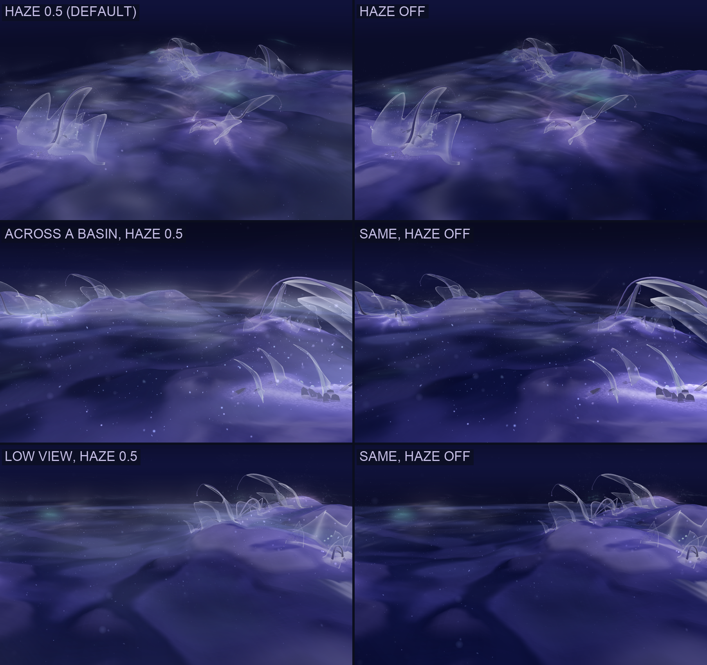

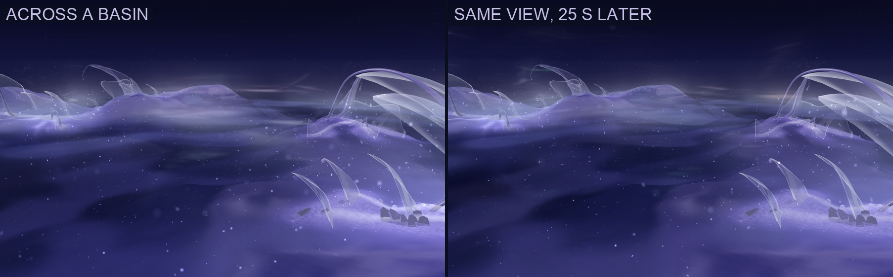

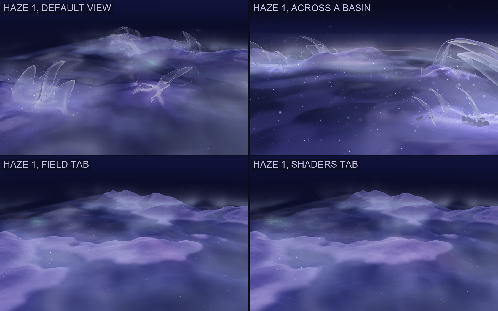

#### Controls

**Haze** (0–1, default 0.5): how dense the mist is. At 0 nothing is drawn.
The panel's note now mentions the mist over the water and basins.

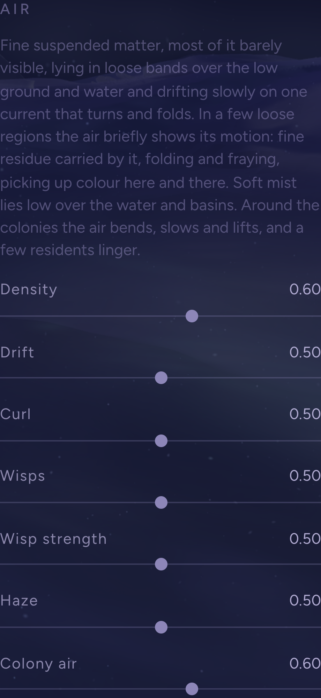

#### For review

- Does it read as **mist lying in the basins**, a veil, and not as fog over
  everything, a glow or a dimmer?
- **Strength:** is the default 0.5 enough to lift the dark water, or should
  it be higher?
- **The maximum is too heavy.** At Haze 1, across a basin and in the Field
  and Shaders tabs, the mist becomes a broad sheet. I propose lowering the
  cap at the top of the slider (an opacity cap of about 0.35 instead of 0.5,
  so Haze 1 is roughly today's 0.7), unless you prefer to keep a dense
  setting available.
- **Colour:** silver-blue at the water, lavender above, pearl at the edge.
  Does it sit with the palette?
- **Motion:** the banks drift slowly as one body. Should they bend round the
  colonies (Phase 6), or stay this calm?

#### Limitations noticed

- **It does not know the scene's depth, only the land's.** The colonies'
  membranes are not part of the land, so haze lying behind a membrane is
  still drawn over it, as if the membrane stood in the mist. Because the
  haze is low and the colonies stand on higher ground, this shows mainly at
  colonies near the water. The fix is to stop the march at the scene's depth
  (Phase 6).
- **Only the lowest ground.** It follows the water level: a hollow high up
  gets no mist.
- **It moves as one body.** The banks drift with the mean air, not with its
  curl, and do not feel the colonies. At the default drift they move about
  1.4 units in 25 seconds.
- **It is not lit.** It has its own colour and does not respond to the
  scene's lights.
- **Half-resolution edges.** Where a hill's silhouette crosses the haze, the
  edge is upsampled from half resolution, so it is soft rather than exact. I
  have not seen a visible halo, but have not looked for one closely.
- **Too heavy at the maximum** (see above and For review).

## Phase 5 — Rare fragments · accepted for now

Built, revised, and revised again. The second revision is the current
state and is described first. The earlier versions follow it as the record.

### Second revision: residual films in different states, a little more present

**The review.** The revised skins read as flower petals:
- a repeated leaf / petal / crescent silhouette
- too rare: almost absent in the overview
- more decorative than ecological

Wanted:
- detached membrane skins or residual films
- more irregularity, asymmetry and different structural states, without
  going back to rough debris
- usually at least 1–2 in some form in the overview, a bit more in closer
  views
- rare residual matter carried by the air, not ornaments passing through

**What changed**

| | First revision | Second revision |
|---|---|---|
| **Silhouette** | a two-tipped tapered strip (crescent, curved skin, wisp): always a leaf or petal | an irregular patch: smooth-edged but lopsided, elongated 1.15–2.25×, with two soft scallops, often one cleaner torn edge where it came away |
| **Edge** | a crisp rim all round | crisp along part of the outline; elsewhere the film thins away to nothing, so no piece is drawn round like a sticker |
| **States** | one (a curved strip) | five, the membranes' own states in a residual form: a **shed skin** (a gently waved film); a **rolled skin** (one edge rolled into a scroll, tightening as it ages); a **decaying skin** (thinning away toward one side, where its edge has opened in long soft openings, more with age); a **rib remnant** (film hanging from a fibre along one side, the fibre trailing past it as a fine thread); a **folded skin** (folded along a crease) |
| **Ageing** | none | skins change over their life: rolls tighten, decaying edges open further, the film grows thinner |
| **Number** | at most 4; overview usually none | at most 6 (5 from colonies, 1 past the viewer); colony pauses 18–48 s; first arrivals staggered; when fewer than two colony skins are about, one waiting skin comes sooner (at most one every ten seconds) |
| **Distance** | dissolving beyond 10–17 units | dissolving beyond 16–28, so the colonies' skins show in the overview |
| **Where** | from the top of a membrane, downwind | from anywhere along a membrane's surface and up it, downwind, so they visibly come away from the colonies and drift on their air |

**Kept:**
- the thin, clear opalescent film material (pearl, rose-lilac, periwinkle,
  aqua; clear in the middle, colour at the edges and at grazing angles)
- carried along the flow, rocking about it
- the near, size-cap and edge-on guards
- the passing skin, traced back along the air
- blended, never added; no control

**What went wrong on the way**

| Problem | Fix |
|---|---|
| **Buttons / crackers:** the first lace had many even round holes inside an oval | decay toward one side only |
| **Faces:** two or three dark holes on a pale oval read as eyes (the membranes' old failure, `lib/formMaterial.js`) | nothing inside the film at all: no holes, no pores. A decaying skin only thins and opens at its edge. |
| **Stickers / line drawings:** a crisp rim all round outlined every piece | the rim covers only part of the outline; elsewhere the film fades out |
| **Hearts:** a V-notch at the end of a rounded shape | soft, wide scallops instead of notches |
| **Bitten cookies:** round bites along the decaying edge | fewer, longer, softer openings, with a faint rim |
| **Feathers:** a fibre down the middle of a narrow strip | the film hangs from the fibre on one side |
| **Too many specks in the overview:** seven slots with a far dissolve at 18–32 units showed 3–7, mostly tiny | dissolve from 16–28 units; six slots, longer pauses |
| **A lull, then a burst:** a first generation ending together left one or two; the presence floor that fixed it then brought every slot at once at load (seven in the overview) | the floor brings at most one skin every ten seconds, and first arrivals are staggered |
| **Too faint** after removing the crisp outline | more body and rim, and more of each outline keeps its rim |

**Measured**

**As they are** (nothing placed), four views at five moments 30 seconds
apart, fresh load:
- **Visible:** on screen and at least a fifth faded in.
- **Noticeable:** also at least half faded in, and at least 0.018 in size
  (radius over distance, about 18 pixels on a 1000-pixel-high view).

| View | Noticeable at each moment | Visible at each moment | Nearest |
|---|---|---|---|
| overview | 4, 2, 1, 0, 1 | 5, 3, 3, 2, 3 | 6.7–23.9 units |
| across a basin | 2, 0, 1, 1, 4 | 3, 3, 1, 2, 5 | 6.8–16.6 |
| beside a colony | 1, 2, 1, 1, 3 | 3, 2, 1, 3, 6 | 3.4–18.3 |
| low | 4, 1, 0, 0, 1 | 4, 2, 2, 1, 2 | 3.1–16.7 |

- **Overview:** usually one or two noticeable skins (on average 1.6), with
  a few fainter ones farther off. The 4 is the opening wave.
- **More near colonies,** where they come from.
- **In the habitat:** 3–6 skins at a time.

**A pass:** released from a low camera, the skin came within 6.3 units,
crossed from the left to the middle of the view over about 70 seconds,
and drifted on.

**The approach guard:** faded out at 1.0, 1.5 and 2.0 units; 0.30 at 2.6;
full from 3.4 to 16; dissolving beyond (0.26 at 24).

**Brightness**, skins on and off at the same moment:
- **Staged:** the most added is 106 levels (smoothed over 9 px); the
  brightest final pixel in a skin is 209; 1 saturated pixel with skins,
  0 without.
- **Every Air slider at maximum,** low camera: 19 saturated pixels with
  skins against 2 without (of 6.4 million). The extra 17 lie on a residue
  streak that is already almost white (228–254) at maximum, which a skin
  tips over. A thin line, not a glow.

**Five minutes at every Air maximum:** 60 fps throughout (checked every
minute), and the WebGL context was never lost.

**Cost:** the main scene takes 2.83 ms with skins and 2.49 ms without, so
about 0.3 ms a frame (GPU timer, 2× density). That is more than the first
revision, which drew at most 4 simpler strips.

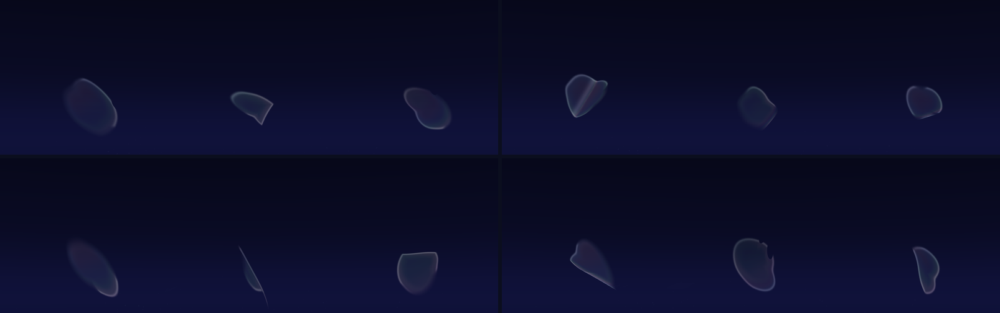

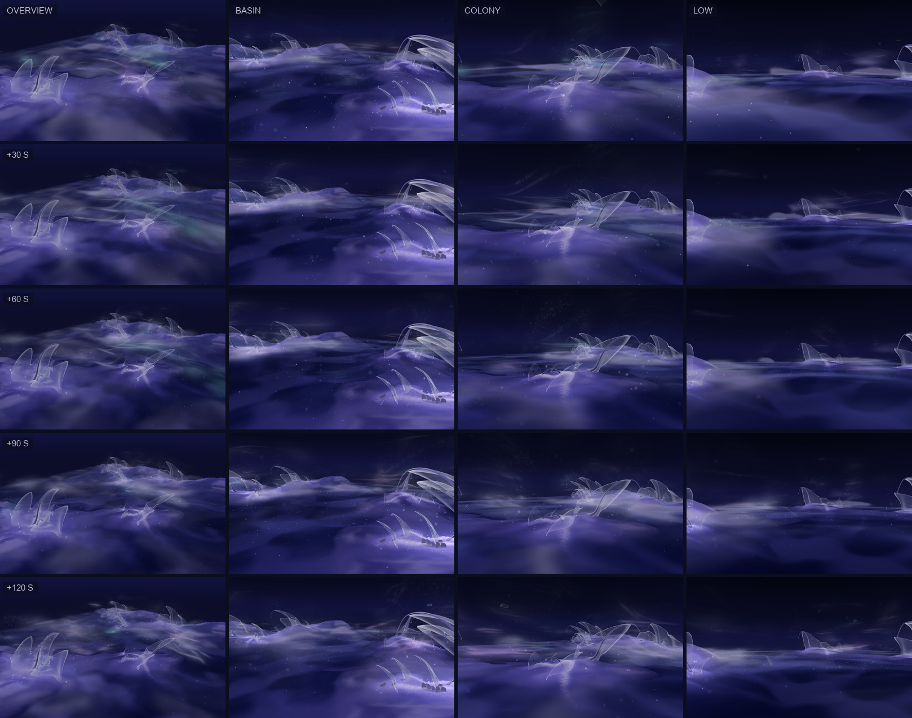

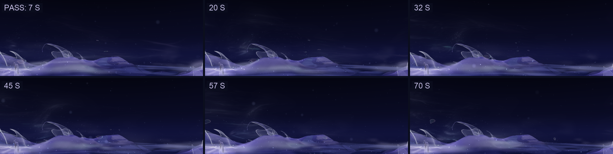

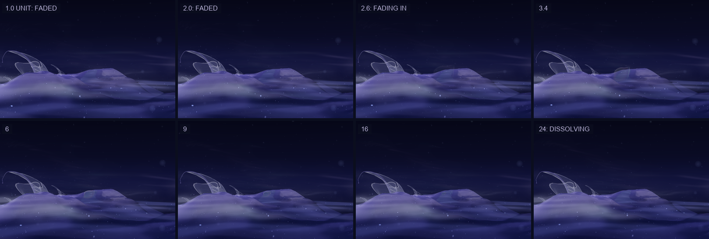

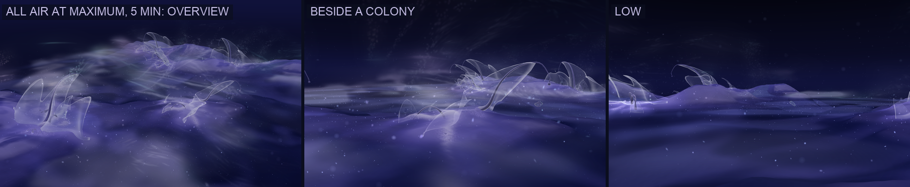

**For review**
- **Not petals:** do they read as residual films and shed skins now, in
  different states?
- **Irregular but clean:** is the balance right, or still too smooth or
  too blobby at a glance?
- **Presence:** usually one or two in the overview, more near colonies.
  Right, or still too little or too much?
- **Ecological:** do they read as matter shed by the colonies and carried
  on their air?

**Limitations of the second revision**
- **States show only up close.** At overview distance the five states read
  alike: small faint films. Rolls, folds and decaying edges show within
  about 8 units.
- **Smooth outlines can still read as pebbles** (a rounded, rimmed blob)
  from some angles.
- **The rib's thread is fine,** and seen edge-on a rib remnant is a line.
- **Draw order with membranes** (as before): a skin behind a translucent
  membrane is drawn over it.
- **Colour is still restrained:** the opalescence shows mostly along the
  rims and at grazing angles.

### First revision (superseded by the second revision above)

#### Revision: fewer, thinner, opalescent skins carried by the air

**The review.** The first version read as floating debris, dandruff or
rough flakes rather than elegant atmospheric fragments. In the overview, a
few random pieces hung in space without visual logic. Wanted:
- **Kin to the membranes, but in another state:** thinner, lighter, more
  delicate and atmospheric, less architectural.
- **Smoother outlines:** graceful asymmetry, usually one main curl. Not torn
  debris.
- **No paper, confetti or dry flakes:** thin translucent slivers or
  detached skins instead.
- **More distinct from the membranes:** cleaner and thinner, less milky, a
  clearer opalescent shift, more ephemeral.
- **Rarer and quieter in the overview,** noticed gradually.
- **Placed by the air** or the colonies, not as arbitrary objects in empty
  space.

**What changed**

| | First version | Revision |
|---|---|---|
| **Form** | a torn disc: a ragged outline, tips, notches, a noisy edge, a cup or saddle with a fold | a smooth tapered strip in three kinds: crescent slivers (about half), broader curved skins (about a third), long slender wisps. The width swells toward one end, the tips taper at their own rates, and it is always curved in its plane. A clean edge. |
| **Curl** | cup or saddle, fold and twist together | one main curl: along the length for slivers and wisps, a gentle cupping across the width for skins; only a slight twist |
| **Material** | the membranes' film: milky body, pores, grain, uneven thickness | a thinner, clearer film: nearly transparent in the middle; the colour gathers toward the rim and at grazing angles as an opalescent shift (pearl, rose-lilac, periwinkle, a little aqua) cycling along the skin; a fine coloured rim; one soft highlight along the curl. No pores, no grain, no milky body. |
| **Number** | at most 9 in the habitat | at most 4, with longer pauses (20–60 s for colony skins, 40–90 s for passing ones) |
| **Where** | 3 from colonies, 5 at random over the low ground, 1 past the viewer | only along the air: 3 come loose from colonies (from the top of a membrane, on its downwind side), 1 rides the air past the viewer. None at random. |
| **Motion** | tumbling about a turning axis | carried, not tumbling: each lies along the flow, its length turned slowly toward where the air goes, rocking gently about that length |
| **Distance** | visible anywhere | dissolves beyond 10–17 units, so the overview rarely shows one and they are noticed as you come closer |

**Shapes that went wrong on the way:**
- **All crescents** looked like fingernail clippings. Hence three kinds and
  varied widths.
- **Broad skins with blunt tips** looked like pills or lenses. They are now
  always curved in their plane, with tapering tips.
- **A strong roll across the width** looked like a tube. It is now a gentle
  cupping.
- **Lying flat with the flow,** most were edge-on from the usual low views.
  They are tilted well up from flat, and rock.

**Kept:**
- the near guards (fade within 1.2–2.4 units and above a size cap)
- the edge-on thinning
- the passing release, traced back along the air
- the scene's light and fog
- blending, never adding
- no control

**Measured**

**As they are** (nothing placed), four views at four moments 35 seconds
apart, fresh load. "Visible" means on screen and at least a fifth faded in.

| View | Visible skins at each moment | Nearest | Largest on screen |
|---|---|---|---|
| overview | 1, 1, 1, 1 | 4.5–13.1 units | 0.027–0.063 |
| across a basin | 0, 0, 1, 0 | 7.5 | 0.046 |
| beside a colony | 0, 0, 0, 0 | – | – |
| low | 0, 0, 1, 1 | 2.5–13.7 | 0.026–0.132 (that one half faded by the near guard) |

- **Fewer:** 0.44 visible per view on average, and **none in 9 of 16
  views**. The first version showed 4.2 per view, up to 8.
- **The overview** shows at most one, often the passing skin, at middle
  distance.
- **Beside a colony** none happened to be in view during the run: colony
  skins come from any of the five colonies, and dissolve beyond 10–17
  units.
- This run was made just before the last change to where a passing skin is
  aimed (closer to the line of sight, so it stays in view; the pass figure
  is after it).

**A pass**, after that change: released from a low camera, the skin came
within **5.6 units** and crossed the middle of the view from left to right
over about 70 seconds. From the basin camera, a second came within 3.7
units.

**The approach guard:** faded out at 1.0, 1.5 and 2.0 units; 0.68 at 2.6;
full from about 3.4 to 9; dissolving from 10 (0.61 at 13, 0.06 at 16).

**Brightness**, skins on and off at the same moment:
- **Staged:** the most added is 112 levels (smoothed over 9 px, at a rim
  highlight); the brightest final pixel in a skin is 208; 0 saturated
  pixels either way; the skins cover 2.5% of the frame.
- **Every Air slider at maximum,** low camera: 34 saturated pixels with
  skins and 35 without (out of 6.4 million).

**Five minutes at every Air maximum:** 60 fps throughout (checked every
minute), and the WebGL context was never lost.

**Cost:** the main scene takes 2.55 ms with skins and 2.49 ms without, so
about 0.06 ms a frame (GPU timer, 2× density); the first version cost about
0.2 ms.

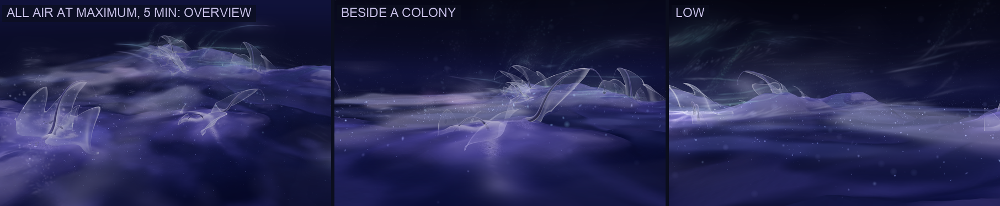

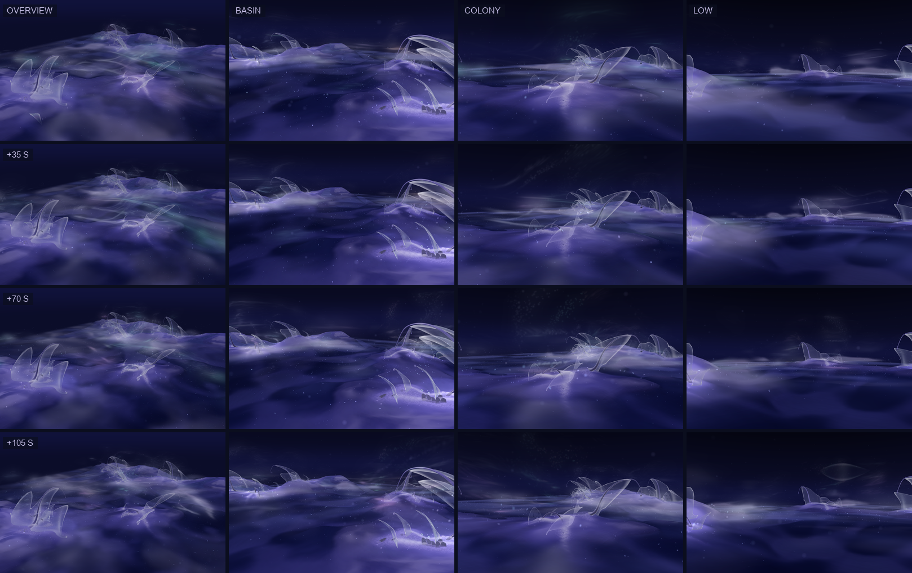

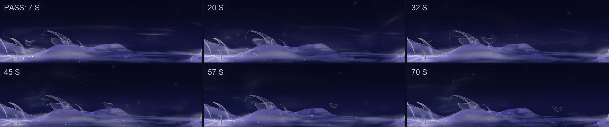

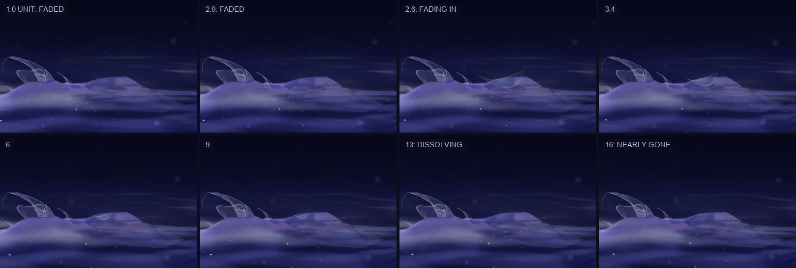

**For review**
- **Thin, opalescent, ephemeral:** do they now read as thin film skins of
  the membranes' family, rather than flakes or debris?
- **Shapes:** are crescents, curved skins and wisps graceful enough, and
  varied enough?
- **Rarity:** most views show none or one, and the overview rarely shows
  any. Is that too rare to notice now?
- **Opalescence:** visible enough at the rim, or still too faint?

**Limitations of the revision**
- **Very quiet:** in more than half the moments no skin is visible at all;
  the passes are the main way to see one. If that is too rare, the colony
  pauses can shorten.
- **A teardrop:** a broad skin with one blunt end, seen at some angles,
  reads a little like a drop or a comet.
- **A family resemblance:** at a distance, slivers and wisps can look alike
  (thin curved lines).
- **Draw order with membranes** (as before): a skin behind a translucent
  membrane is drawn over it.
- **The opalescence** shows mostly at the rim and at grazing angles. Seen
  face-on and far away, a skin is a faint pale line.

### First version (superseded by both revisions above)

#### The aim

Following the reference and `fragment-material-ref.jpeg`: a small number of
delicate, translucent, irregular fragments drifting through the
atmosphere, as if pieces of membrane or gathered trace had come loose and
hung in the air. The priorities:
- **Material over glow:** soft, pearlescent, slightly iridescent.
- **Organic, not geometric:** irregular, folded, varied.
- **Rare and spatial:** now and then in the foreground or drifting past a
  colony, never filling the scene.
- **Gentle motion.**
- **Kin to Membrane Bloom.**

To avoid: petals, glass shards, confetti, snow, butterflies, bright glowing
objects, and fragments that suddenly loom large near the camera.

#### What it is

**Few, and mostly far.** At most nine in the whole habitat at once, each
lasting about a minute or two, with an empty pause between one and the
next. They come in three ways:
- **Coming loose from a colony:** three of the nine start near the upper
  part of a membrane, small, and unfold to their size over about ten
  seconds as they drift away. In tabs without colonies they drift in the
  open instead.
- **In the open:** five drift over the low ground and water, between half a
  unit and two units up.
- **Past the viewer:** now and then one is let go upwind of a point 2.8–5
  units in front of the camera and a little to one side, so the air brings
  it past, never through the eye. Its release point is traced back along
  the air for about half a minute, because the air curls and a straight
  line upwind misses. It is one of the larger ones and lives long enough to
  arrive. Between passes it rests for 20–50 seconds.

**Moved by the same air.** They are carried by the shared field
(`lib/air.js`) at 85% of its speed, bending round the colonies like
everything else, holding their own height, with a slow bob. They tumble
slowly (0.05–0.16 rad/s) about an axis that itself turns.

**Each fragment is one small curved sheet,** different for every fragment:
- **its outline** comes from smooth random radii around the rim at three
  scales, plus a few drawn-out tips (as where a membrane tore away), one or
  two lopsided notches, and an edge torn by noise
- **its curve** is a cup or a saddle, with a soft fold (usually
  off-centre), a slight twist, and a slow breathing that grows toward the
  free edge
- **its size** is 0.09–0.24 units in radius: a fingernail to a palm, beside
  membranes a few units tall. Some are broad, some longer slivers (up to
  1.5×).

**Its material is the colonies' film:**
- **Lit by the scene's own light** (the same light direction, colours and
  ambient as the membranes), and fogged like them.
- **Clearest in the middle** of the sheet and thicker toward its folds and
  free edge, with a thin lip along the edge as on the bloom's membranes.
- **A pearlescent sheen:** warm pearl, a pinkish lilac, silver-blue and a
  little pale mint, in soft bands that move with the angle, the sheet's
  thickness and the fold, like a soap film. Kept in the palette, never a
  rainbow.
- **Light along the fold** and a few pale thin spots, like the bloom's
  pores.
- **A faint mottling** of its density close up, like the reference's fine
  grain.
- **Blended, never added:** a fragment is material, not a light. It writes
  no depth but is hidden by the land and the solid forms.

**No new control.** Rare by construction; they appear in every tab.

#### Guards

| Risk | How it is prevented |
|---|---|
| **A giant object near the camera** | Fades out within 1.2–2.4 units of the eye, and wherever its radius would exceed about 0.08–0.13 of the view (about a sixth of the screen height). Measured: fully faded at 1.0 and 1.5 units, 0.08 at 2.0, 0.85 at 2.6, full from 3.4 (softened, as if out of focus, until about 6). |
| **A blade or shard** | A sheet seen edge-on fades to a quarter. Slivers are at most 1.5× long. |
| **Bright artifacts** | Alpha-blended, not additive, alpha at most 0.65. The sheen stays below white. |
| **Snow, confetti, stars** | Few (at most nine in the habitat), mostly far and small, slow. Close up the grain is a soft mottling, not dots. |
| **Hearts, wings, petals, feathers, moths** | No clean low-harmonic outline. Notches are lopsided bites, not a symmetric V. The edge is torn by noise, not combed into hairs. Folds sit off-centre. |
| **A source or emitter** | Fragments appear by fading in over seven seconds where they start, and leave by fading out. Colony fragments start small and unfold. |

#### What went wrong while building it, and the fixes

| Problem | Fix |
|---|---|
| **Hearts and butterflies:** a strong two-lobed outline term made symmetric shapes | odd harmonics at random phases, then an outline from random radii around the rim |
| **Feathers / eyelashes:** the frayed fringe was radial fibres | an edge torn by noise, and a few torn wisps |
| **Bokeh discs:** near fragments softened into round blurry blobs | milder defocus that keeps the silhouette |
| **A tall blade near the camera:** an elongated sheet seen edge-on and close | less elongation; edge-on fade; a lower size cap |
| **Grey felt:** pale, uniform, paper-like | clearer centres, thicker folds and edge, stronger sheen bands, light held inside |
| **Frost or glitter:** a speckled grain read as white dots | a soft mottling of density instead |
| **Moths:** a crease through the middle of a two-lobed piece | folds usually off-centre |
| **Passing fragments went unseen** or expired before arriving | they are among the larger ones, released 2.8–5 units ahead, and live until they have passed |
| **A capture hung:** a hot reload landed mid-capture | re-run (a testing problem, not the scene) |

#### Measured

**As they are** (nothing placed), four views at three moments 35 seconds
apart. "Visible" means on screen and at least a fifth faded in.

| View | Visible fragments | Nearest | Largest on screen (radius ÷ distance) |
|---|---|---|---|
| overview | 7, 1, 8 | 8.1–15.6 units | 0.014–0.022 |
| across a basin | 6, 1, 5 | 7.3–10.0 | 0.022–0.030 |
| beside a colony | 3, 2, 4 | 9.5–12.8 | 0.017–0.021 |
| low | 6, 2, 5 | 5.0–11.4 | 0.019–0.036 |

- **4–9 fragments in the whole habitat** at any time; 1–8 in view
  (average 4.2), almost all of them small and far.
- **The overview shows the most** because it sees nearly the whole habitat.
  At 0.022 a fragment's radius is about 20 pixels on a 1000-pixel-high
  view.

**A pass, as it happens.** Released from a low camera by the normal
rule:
- the fragment came within **4.7 units** (largest size on screen 0.037)
- it drifted across the upper left of the view over about 70 seconds, then
  away
- it fades in and out as it turns edge-on (the edge-on guard), so it
  breathes rather than staying constant

Before the release point was traced back along the air, a pass missed by
some way: its nearest point was 6.3 units.

**Fragments on and off,** same camera and moment, in the staged study
(eight fragments placed at 3–12 units):
- The most they add is about 107 levels (smoothed over 9 px), at a fold
  crease.
- The brightest final pixel inside a fragment is about 202.
- Saturated pixels: 1 with fragments, 0 without, out of 6.4 million.
- They cover about 3% of the frame, in the staged study.

**Cost:** the main scene takes 2.77 ms with fragments and 2.59 ms without,
so about 0.2 ms a frame (GPU timer, 2× density).

**Every Air slider at maximum, five minutes:** 60 fps throughout (checked
every minute); the WebGL context was never lost. Beside a colony at
maximum, fragments on and off at the same moment: 12 and 11 saturated
pixels of 6.4 million.

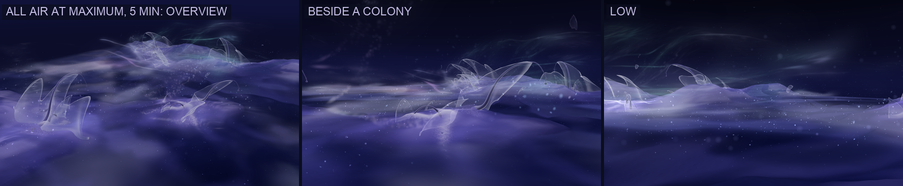

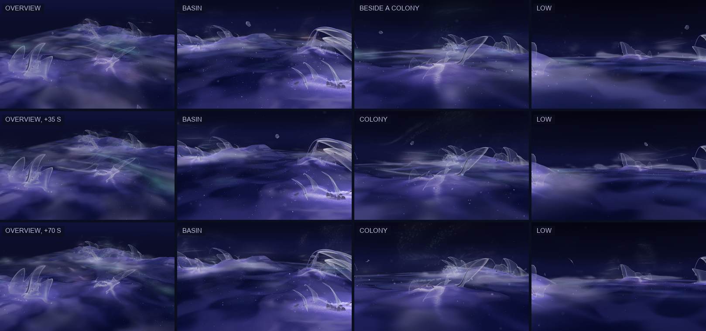

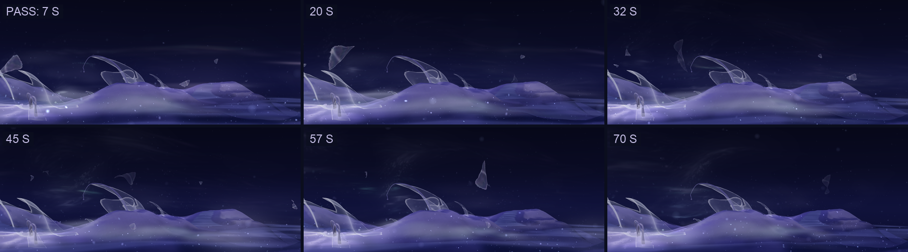

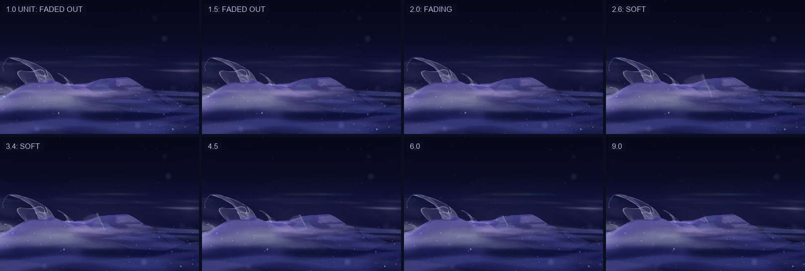

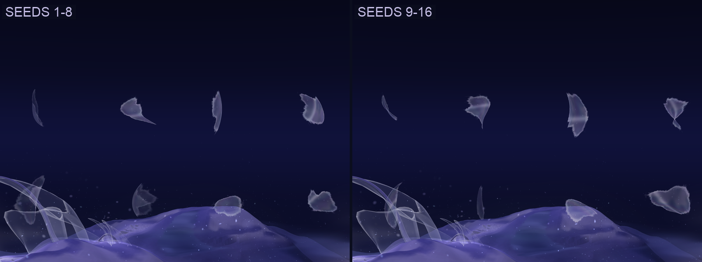

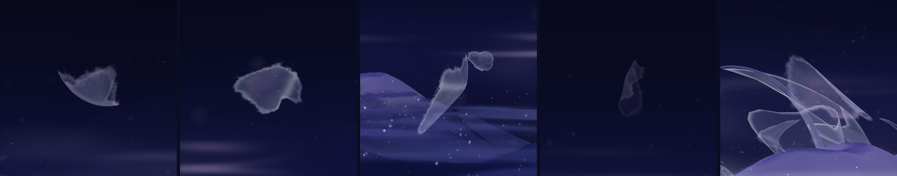

#### For review

- **Material:** do they read as tiny pieces of the reference material
  (translucent, pearly, folded), related to the blooms? Or still too pale
  and plain?
- **Shapes:** irregular and graceful enough? From some angles a piece can
  still suggest a familiar shape (a pinched piece can read a little like a
  bow).
- **Rarity:** in the overview, several small ones are usually in view,
  mostly far. Is that rare enough, or should there be fewer?
- **The pass:** about once every two to three minutes, a fragment drifts
  through the foreground. Too often, too seldom, or too subtle?
- **Near the camera:** they fade out before they can loom. Is the soft,
  slightly out-of-focus look right when they are close?

#### Limitations

- **Draw order with membranes.** Fragments are drawn after the colonies'
  membranes, which write no depth, so a fragment behind a translucent
  membrane is drawn over it. The terrain and solid forms hide them
  correctly. The haze is drawn before them, so a fragment inside mist is
  not veiled by it.
- **Not touched by the haze or the residue,** and they do not interact with
  each other.
- **No rotation from the air:** they tumble at their own pace, not turned by
  the flow's shear.
- **Spawning is random,** so a view can have none for a while or, briefly,
  two near each other.
- **A pass is not guaranteed to come close.** It is aimed 2.8–5 units ahead
  and traced back along the air, but the air changes while it travels. The
  one recorded came within 4.7 units.
- **Some angles still suggest a shape:** a piece with a drawn-out tip, seen
  side-on, can look like a small pointed shard.
- **Fade-in where they start:** a fragment let go in view appears there,
  softly, over seven seconds.
- **Iridescence is restrained;** at small sizes it reads mostly as
  pearl-lilac.

## Phase 6 — Integration · accepted as a checkpoint

### The aim

A final integration and consolidation pass, not new experimentation: no new
visual system, layer or style. The aim was to make dust, residue, colony
air, haze and fragments work together as one atmosphere, judged mainly from
the default overview and normal use. To watch for:
- haze becoming a flat sheet or band again
- dirty green or teal casts
- residue reading as drawn lines
- colony influence vanishing, or becoming too explicit
- any layer becoming dominant or noisy

### How it was judged

Each layer was switched off in turn at the same moment, from the default
camera and from low, close and wide ones. The difference shows what each
layer adds and where; a control (two ordinary captures taken the same
interval apart) shows how much changes anyway (6.8 levels on average, the
terrain's and water's own motion).

**What the default overview showed at the start of Phase 6**
- **A teal cast:** 4.3–4.7% of the frame had green above red by more than 8
  levels, and about 1% by more than 16. **The residue made almost all of
  it** (a quarter of the light it adds leaned green): its stain palette
  gave a third of its hue range to a saturated mint. The colony tint added
  some too, with mint across a third of its range.
- **Line-like streaks:** a few bright parallel lines across the middle
  ground. They were the colonies' incoming filaments (Phase 3), released
  narrow and allowed six times a loose trace's density before dimming.
  Switching Colony air off removed them.
- **A horizon band:** from low cameras, the far mist stacked into a
  horizontal band with a flat top (the Phase 4 artifact). It came from the
  haze; switching the residue off left it.
- **Grey chips:** from close and low cameras, fragments drifting in front of
  the bright lit ground were darker than it, and read as small grey chips.
- **No problem with balance as such:** the haze, dust and fragments were
  each moderate, and the residue the most present (as intended: the air's
  motion).

### Integration changes

Tuning only. Five small changes in four files:

| Change | Where | Effect |
|---|---|---|
| **Mint only as a narrow, pale accent** in the residue's stain palette (from a third of its hue range to an eighth, and paler), and the stain slightly lighter (0.85 → 0.75) | `AirWisps.jsx` | removes the teal cast |
| **The same for the colonies' passing tint** (mint from a third to a seventh of its range) | `lib/air.js` | colony tint stays pearl, silver-blue and lilac |
| **The colonies' incoming filaments released wider** (0.07–0.19 → 0.13–0.30) **and allowed half the density before dimming** (6× → 3× a loose trace) | `lib/wisps.js`, `AirWisps.jsx` | soft bands of air instead of drawn lines; colony influence still readable close up |
| **Haze fades out earlier with distance** (from 12–30 units, was 20–40) and **thins along grazing lines of sight** (to 40% where the line of sight is within about 2° of horizontal, fully back by about 9°) | `AirHaze.jsx` | the horizon band from low cameras is softer. The default overview looks down at the land and is unchanged. |
| **Fragments screened over the scene,** like the residue, instead of blended; one fragment instead of two in tabs without colonies | `AirFragments.jsx` | over bright ground a skin fades instead of darkening into a grey chip; secondary in the Field and Shaders tabs |

**Considered and not changed:**
- **Wisp strength at 0.4 or 0.3 instead of 0.5:** it barely changes the
  default overview (mean brightness within 1 level, fine detail within 1%).
  The slider brightens loose residue, and dense places are capped anyway.
  No reason to change the default.
- **The haze amount, dust density and fragment number:** balanced already.

### Measured

The default overview, start and end of Phase 6, each at the same elapsed
time on a fresh load (different moments of the air):

| | Start | End |
|---|---|---|
| teal pixels (green above red by > 8 levels) | 4.3–4.7% | **0.6–0.7%** |
| strongly teal (> 16 levels) | 1.0–1.4% | **0%** |
| mean brightness | 58.5–60.2 | 55.6–59.2 |
| local contrast | 3.79–3.86 | 3.74–3.76 |
| saturated pixels | – | 1–3 |

**The horizon band from low cameras.** This measures the haze's own light,
by switching it off at the same moment: its sharpest vertical step along
the frame, and the brightest row.

| Camera | Start | End |
|---|---|---|
| low, toward a colony (L4) | step 5.90, peak 27.8 | **step 3.41, peak 20.1** |
| low, over the water (L1) | 3.97, 26.5 | **2.69, 12.6** |
| beside a colony | 3.63, 18.8 | **3.23, 14.2** |

**Fragments over bright ground** (screened): close to a colony with six
skins placed, none darken the scene, and there are no saturated pixels.

**Every view at the end, defaults:**

| View | Mean | Teal | Saturated | Brightest 32-px block |
|---|---|---|---|---|
| default overview | 59.2 | 0.68% | 1 | 160 |
| low over the water | 35.1 | 0.04% | 0 | 166 |
| low, toward a colony | 39.4 | 0.05% | 1 | 173 |
| close to a colony | 50.3 | 0.04% | 3 | 169 |
| wide | 37.2 | 0.11% | 0 | 124 |
| high | 53.3 | 0.04% | 0 | 135 |
| Field tab | 71.5 | 0.02% | 12 | 166 |
| Volume tab | 34.7 | 0% | 0 | 140 |
| Shaders tab | 70.1 | 0.40% | 6 | 154 |

**Every Air slider at maximum, after five minutes:**

| View | Mean | Teal | Saturated | Brightest 32-px block |
|---|---|---|---|---|
| default | 61.9 | 0.09% | 1 | 165 |
| low | 37.2 | 0.05% | 0 | 152 |
| close | 56.0 | 0.05% | 4 | 184 |
| wide | 38.2 | 0.01% | 0 | 140 |
| Field tab | 72.6 | 0.08% | 4 | 158 |
| Shaders tab | 70.9 | 0.09% | 9 | 164 |

**Frame rate:** 60 fps throughout the five minutes at maximum (checked
every minute); the WebGL context was never lost.

**GPU time per layer** (from Phases 4 and 5, 2× density):
- haze: about 1.1 ms
- fragments: about 0.3 ms
- main scene: about 2.5–2.8 ms
- dust and residue simulations and drawing: about 8 ms together

A whole-frame GPU timer gave about 17 ms at both default and maximum: the
display's frame interval, not the work, so it is not used.

### Recommended default settings

Unchanged from the current defaults:

| Control | Default |
|---|---|
| Density | 0.6 |
| Drift | 0.5 |
| Curl | 0.5 |
| Wisps | 0.5 |
| Wisp strength | 0.5 |
| Haze | 0.5 |
| Colony air | 0.6 |
| (Fragments) | no control: at most 6, one or two noticeable in the overview |

### Figures

### Remaining known limitations

At acceptance, two of these were raised in review and recorded as open
visual issues (see
[Open visual issues](#open-visual-issues-recorded-at-the-phase-6-checkpoint-for-a-later-revisit)):
the haze reading as a separate layer, and the scene feeling slightly grey
and washed out.

- **The haze ignores scene depth:** mist behind a membrane is drawn over it,
  and fragments are not veiled by it.
- **The horizon band is softer, not gone:** from very low cameras over open
  water, the far mist still lies as a horizontal band. Where a near ridge
  hides a basin's mist, the mist ends along the ridge's silhouette.
- **Fragments are drawn over translucent membranes behind them,** and their
  structural states show only up close.
- **The residue's incoming filaments take about a minute** to establish
  after the colonies appear.
- **Colour cast is low, not zero:** about 1% of the overview still leans
  slightly green (more than 8 levels), none strongly.
- **The streams (study 06) remain unresolved and paused.**
- **Performance:** measured in a headless browser on one machine at 2×
  pixel density; not profiled on low-end hardware.

### Commit-ready?

**Yes, as a checkpoint of the rework (phases 1–6):**
- **Build:** passes.
- **Lint:** warnings only, of the kind the codebase already has (React
  immutability notes on three.js objects mutated in frame loops).
- **Tabs:** all four load without console errors.
- **Clean code:** no temporary or debug code is left; the diagnosis view
  (`?debug=colonyair`) is intended and stays.
- **Docs:** every phase is written up, with its limitations.

For the commit:
- `.obsidian/workspace.json` is local editor state, unrelated to this
  work; leave it out.
- The work since `cf0431d` is large (new air components, docs and many
  figures), so it may be worth one commit for the rework rather than one
  per phase.
- The known limitations above stay open; none blocks a checkpoint.

## Open visual issues (recorded at the Phase 6 checkpoint, for a later revisit)

Phase 6 was accepted as a checkpoint. Two visual issues were reviewed and
deliberately **left unresolved**, to be revisited later. When they are, the
aim is to investigate the haze's spatial distribution, its relationship to
the terrain, and the compositing, **not** simply to reduce opacity.

### 1. The haze reads as a separate horizontal layer

From some low camera angles the haze reads as a layer of its own rather
than as part of the terrain's spatial volume. Large pale or white patches
seem to hover above the ground, and they do not respond naturally to the
terrain's elevation and contours.

**What is known.** These are facts about the current implementation
(`AirHaze.jsx`), not yet a diagnosis of this issue:
- **Height is measured from the water, not the ground.** The density falls
  off with height above the water level, and the "low ground" mask is a
  blurred copy of the floor. So the mist fills a stratum of fixed absolute
  height: over a slope it is a level sheet the slope passes through, not a
  layer that follows the contours or pools in the hollows.
- **Its light is a fixed colour, screened on.** It is not lit or shaded by
  the scene's light, the terrain's orientation or what lies beneath. Over
  dark ground a dense patch reads as a pale cut-out rather than as volume.
- **It knows only the land's depth:** membranes do not hide it, and
  fragments are not veiled by it.
- **Grazing lines of sight stack it.** Phase 6 softened this (an earlier
  distance fade, thinning along grazing lines), but did not remove it.

**To investigate when revisited:**
- **Spatial distribution:** density relative to the local ground and its
  hollows, so mist lies in and follows the land; its contact with the
  ground.
- **Terrain relationship:** occlusion by the whole scene (membranes
  included); shading and colour that respond to the terrain's light and
  elevation.
- **Compositing:** the balance between veiling and added light, and whether
  the haze should enter the scene's own depth and fog rather than lie over
  the finished image.

### 2. The scene is slightly grey and washed out in some views

Overall the scene can feel a little too grey and washed out. More
saturation is not the goal. The goal is to recover more spatial depth and
contrast between the terrain, the membranes and the atmosphere.

**Measured** (the land, the lower two thirds of the default view):

| | Dark floor (5th percentile) | Median | 95th percentile | Tonal range |
|---|---|---|---|---|
| air layers off | 22.7 | 52.7 | 119.0 | 96.3 |
| accepted state, defaults | 33.0–35.3 | 60.0–66.7 | 120.0–124.7 | 87.0–89.3 |

The air layers lift the darkest tones of the land by about 10–13 levels
and narrow its tonal range by about 8%. They add light across the frame
more than they separate near from far.

**Likely contributors** (not yet isolated):
- the haze's added light and veiling
- the residue's and fragments' screened light
- the dust
- the scene's own fog, which is lighter than the background by design
  (`Scene.jsx`)

**To investigate when revisited:**
- keeping the darks of the near ground
- letting atmosphere build with distance, rather than lift the whole frame
  evenly
- the contrast between membranes and the air in front of and behind them

**Since isolated** (study 09's palette pass,
[`09-composition-and-light.md`](09-composition-and-light.md#palette-pass-cleaner-darks)).
Hiding each layer in turn on the default overview:
- **the haze** is the largest source of the grey-lavender midtone (8% of the
  frame with it, 4% without)
- **the water veil** comes next
- **the fog** contributes almost nothing

The haze's colours were made cooler there (colour only).

A compositing revision followed in study 09's cleanup pass: mist lit by
distance and by the colonies, and a veil toward a deep air colour. It cut
the haze's lift on the dark foreground to a third, but it went with an
ultramarine and icy-blue palette, and it was **rejected and reverted**
([`09-composition-and-light.md`](09-composition-and-light.md#cleanup-pass-rejected-and-reverted)).
The haze composites as it did before that pass.

**A concrete cause for issue 1, found since**
([diagnosis](09-composition-and-light.md#layering-and-boundary-diagnosis)):
- the haze's floor (the air's 96-cell, 8-bit floor of the base field) lies
  below the ground as Scatter draws it, raised by the sediment record:
  median 7–9 cm, up to about 0.25
- so part of the mist's densest layer sits inside the visible ground, and,
  composited without a depth test, is painted onto its surface
- add the flat water plane seen edge-on, and low views show a horizontal
  sheet

Not yet fixed.

## The baseline, for the record (commit `cf0431d`)

The first pass was one uniform ambient layer, and it read as snow. The second
pass, the baseline, added five residents at once in one field with
convergent local terms:
- dust
- wisps, as field-traced ribbons
- colony motes, in a convection cell
- turning flakes
- haze, as additive veils pooled over the basins

It looked acceptable on a fresh load but failed as described above. Its
known limitations were also recorded at the time:
- wisps read like rain
- the types were not differentiated enough
- the palette was largely monochrome lavender
- the spatial structure was too subtle

The full write-up is in this file at commit `cf0431d`.

## Not resolved: the streams

Study 06's streams are still **paused, and they need later revision**. This
work does not touch them. The known limitations in
[06 · Known limitations / future revision](06-passages-study.md#known-limitations--future-revision)
still stand:
- the water surface's banded ripples do not follow the stream's direction
- the sources are valid but not convincing places for water to begin
- the stream still reads as a layer placed on the terrain rather than a
  landform

## Files

| File | Role |
|---|---|
| `react-app/src/lib/air.js` | the field (curl, drift, hover, colony obstacles); the floor; the density map; the colonies' nearness and colours; JavaScript and generated GLSL |
| `react-app/src/lib/airColony.js` | the colony uniforms every air shader reads |
| `react-app/src/components/AmbientAir.jsx` | the dust's GPU simulation and births; residents; sizes, depth, sky check, palette and colony tint; the diagnosis view |
| `react-app/src/lib/wisps.js` | the residue's regions, release points, release timing and spread, small eddies, and the visibility and staining fields (GLSL) |
| `react-app/src/components/AirWisps.jsx` | the residue's GPU simulation and warm-up; the density map; drawing grains and mist into its own buffer; the on-screen ceiling; the guards |
| `react-app/src/components/AirHaze.jsx` | the basin haze: a volume marched per pixel at half resolution; its 3D and 2D noise, density and colour field; the veiling and the screened light laid over the scene |
| `react-app/src/components/AirFragments.jsx` | the rare fragments (residual films): their slots and pacing, release (from colony membranes downwind, or past the viewer along the air), drift and alignment with the flow, guards; the five structural states, the irregular outline, and the opalescent film material |
| `react-app/src/components/Scene.jsx` | the air in the main scene, in place of the old motes |
| `react-app/src/components/Atmosphere.jsx` | motes can be switched off |
| `react-app/src/App.jsx` · `ScatterPanel.jsx` | the seven controls (three for the dust, two for the wisps, one each for the haze and the colony air) |
