# 08 · Branching network — L-system study

*Accumulated traces developing into organic structure.*

> **Status: checkpoint, one representative colony.** Three passes: the
> first (bright lines over the terrain) was rejected; the revision paints
> micro-growth into a tissue map shaded as part of the ground; a final,
> narrowly scoped transition experiment adds three real strands from the
> membranes into that ground network. Close up, the membrane → strand →
> ground relationship now reads; at normal distance it is still very
> quiet. Not distributed across the world. The streams (study 06) and the
> haze issues (study 07) remain **unresolved**; this study does not touch
> them.

**The brief.** Introduce a subtle procedural branching network that feels
like accumulated traces gradually developing into organic structure. It
should read as something between mycelium, fine roots, veins and
crystallisation, never as trees, grass or decorative branches: ancient,
delicate, partly embedded in the world.
- **Where:** around existing colonies and settled sediment, not at random.
  It extends from colony bases, spreads along the terrain, and sometimes
  continues into or under the translucent membranes. Most of it lies close
  to the ground, and large areas of terrain stay empty.
- **Form:** irregular and asymmetric, with varied density and scale.
- **Light:** restrained pearl, lavender and silver-blue, with occasional
  colour variation; never uniformly bright, thick, geometric or repetitive.
- **Method:** an actual procedural grammar (an L-system or a related
  recursive growth grammar), seeded from the colony and sediment data, with
  a distance-based level of detail.
- **Scope:** built into the existing Scatter scene, with no new tab and few
  or no new controls. Start with one representative colony, and stop for
  review before distributing it.

**References.**
- `docs/references/concept-studies/branching1.png`: the overall direction (traces running
  between colonies across the land).
- `docs/references/concept-studies/branching2.png`: the detail around one colony (fine
  dendritic roots with beads, veins rising into the membranes).

Both are visual targets, not scenes to recreate.

## Final targeted transition experiment: membrane → strand → ground

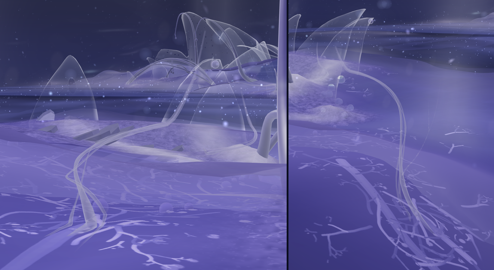

### What was asked

One last, narrowly scoped revision. The membranes and the ground network
still read as two separate systems. Add a few (2–4) real transitional
structures on the same colony: membrane body → thin connective strand →
shallow embedded ground network. Each should emerge from a membrane or its
base, lift or arc slightly in space, then rejoin or dissolve into the
ground texture. The material should come from the membranes' own family
(translucent, pearly, pale lilac and silver-blue), thinner and more
fibrous, with variable thickness. No glowing white lines, no pasted-on
graphic look, and not a flat texture-only answer. No new tabs or
controls, no redesign, and empty terrain should stay empty. If it still
does not work cleanly, say so rather than keep iterating.

### What changed

All of it is in `lib/branching.js` and `formMaterial.js`. Nothing else in
the network changed, and it adds no controls.

1. **Where the strands are (`transitionSites`).**
   - Three sites by rule: two on the anchor, set apart along its base line,
     and one on the tallest satellite.
   - Each leaves its sheet 0.25–0.55 above the ground, on the side with
     more settled matter beyond it (read from the accumulation field).
   - Its heading is turned a little off square to the sheet, so it does
     not leave at a right angle.
   - It touches down 0.55–1 unit out from the sheet's foot, always on land.
2. **The strand (`tendrilGeometry`), a real 3D bundle of fibres, in three
   parts:**
   - **In the sheet:** a short run (about 0.2–0.3 units) gathered
     diagonally across the membrane, read off the sheet's own grid, lifting
     gradually off its surface so it peels away rather than sticking out.
     It comes from the side away from where it will lean, so the run and
     the free span are one sweep, not a kink.
   - **Free span:** a cubic curve. It leaves along the way it ran in the
     sheet, turned outward. It comes down onto the ground at a shallow
     angle from slightly above, and bows sideways most toward the ground
     end.
   - **Into the ground:** it sinks below the surface over 0.2–0.35 units
     and fades out.
   - **Three fibres:** one main fibre and two finer ones. They share the
     leaving point, twist slowly round each other, drift apart toward the
     ground and splay where they root.
   - **Radius:** fine in the sheet, a slight node where it leaves,
     thinning under tension mid-span, and slightly thicker where it roots.
     Each fibre also varies slowly along its length.
   - **Cost:** about 5,800 triangles in all, shown at the near and middle
     levels of detail and dropped at the far one.
3. **The ground side, grown by the same grammar.**
   - From each touchdown, a structural root is grown by the L-system's
     ground turtle and painted into the tissue map like the others.
   - It is a little stronger for its first 0.3 units, so the strand has
     something to continue into. A first try made this a long pale band
     over the terrain, so both its strength and its length were cut back.
   - Seven micro seeds sit around each touchdown, so fine growth gathers
     where the strand roots.
4. **The material (`createTendrilMaterial`).**
   - Shaded like the membranes, in their colours: lilac shifting toward
     silver-blue at the outline, brighter toward the outline (a strand is
     all edge), with a little light held inside and a faint wet highlight.
   - Faint fibres run along it.
   - Translucent everywhere (at most 0.85 opacity), with no glow or
     emission spike, and dimmed under the water line.

Tuning, briefly:
- **Strands invisible on screen:** tinted red for a debug view, the
  strands were there; their light and opacity had sunk them into the
  ground's value. Fixed with held light and a brighter outline.
- **Stiff "L" shapes:** the part in the sheet ran straight up a membrane
  column, then turned sharply at the leaving point. It now runs diagonally
  and peels off along the same sweep.
- **In-sheet run too long:** it reached almost a unit up the anchor,
  because the sheet's rows and columns are not evenly spaced. It is now
  measured by walking the sheet.

### Results


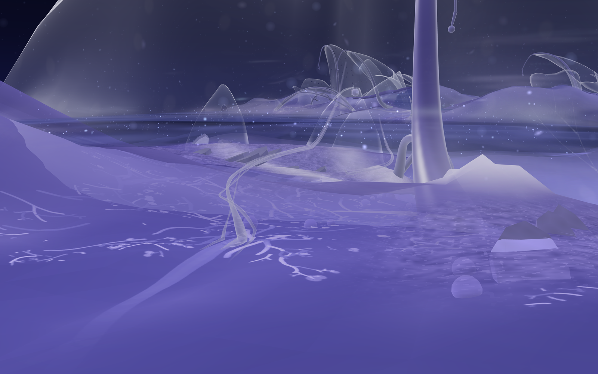

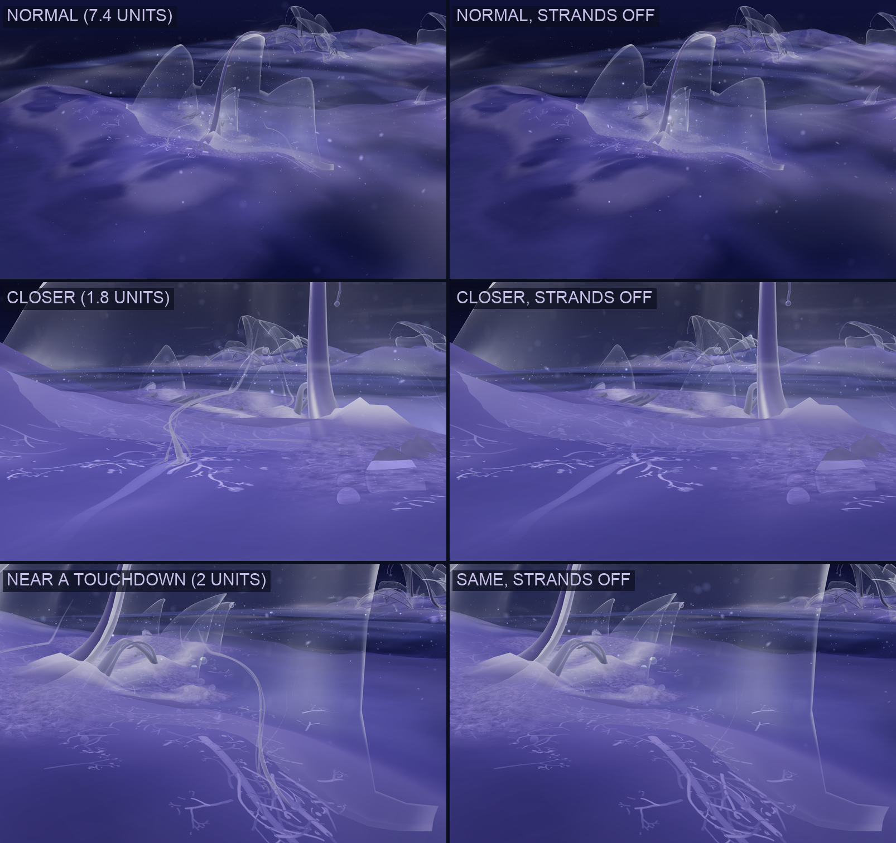

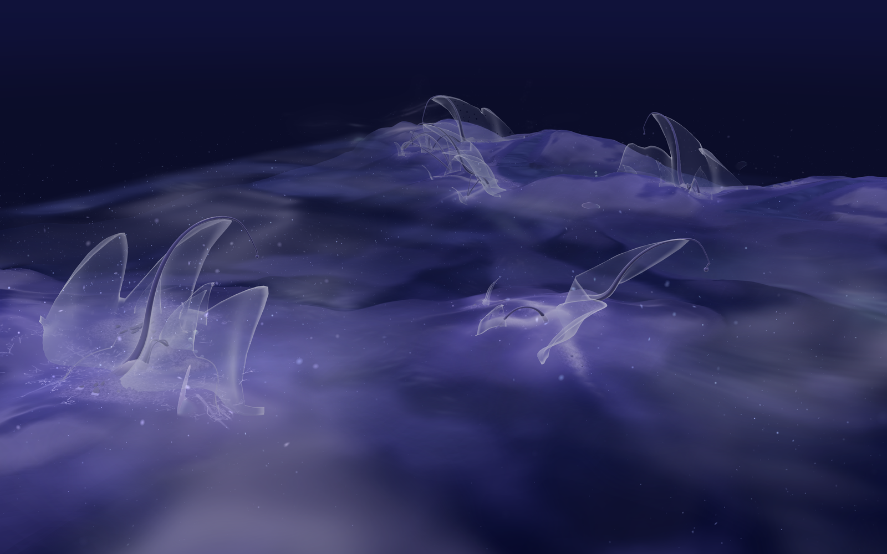

### Does the connection read better?

**Close up: yes.**
- With the strands, a membrane visibly sends a fibre down into the ground,
  where the fibre splays into the painted branching. Without them, the
  same frame shows a membrane and a separate ground texture.
- The strand looks like the membranes' material drawn out into a fibre,
  not a line on top of the picture: translucent, with a brighter outline,
  three fibres twisting, thinner where it is taut.
- Nothing about it is tree-like, white or glowing, and the empty ground
  around the colony is unchanged.

**At normal distance and in the overview: no.**
- At 7.4 units, the views with and without strands are practically the
  same: a fibre about a centimetre wide is a pixel or less there, and it
  is pale on a pale ground. This is the same distance limitation as the
  revision's ([below](#the-limitation-plainly)), and this experiment does
  not address it.

**It does not work fully cleanly. What remains unresolved:**
- **The touchdown is the weakest point.** Two different representations
  meet there: three-dimensional fibres and a flat painted map. The fibres
  splay over the painted roots rather than becoming them. Up close they
  still read as two kinds of thing touching, not one tissue continuing.
- **The strands are shaped, not grown.** The free span is a designed curve
  between two points chosen by rule. Only the ground side is grown by the
  grammar. A fuller answer would extend the L-system's turtle itself into
  the air between the two spaces it already has.
- **A little too clean.** Fibres of an even radius, twisting steadily, can
  read as smooth cables rather than drawn-out tissue. The membrane does
  not thicken or pucker where a strand leaves it.
- **Just three, on one colony,** placed by rule. They are visible only
  from some angles: against a membrane seen face-on, they disappear into
  it.
- **The painted root that continues each strand** can still read as a
  soft, wide band from low angles close to the camera.

**Good enough as a study checkpoint?** Yes, as a checkpoint: it
demonstrates the intended relationship close up, with the right material
and without breaking the restraint of the rest. It is not a finished
system: distance legibility and a continuous fibre-to-map transition
remain open. As asked, it stops here rather than iterating further.

## Revision: residual matter becoming tissue

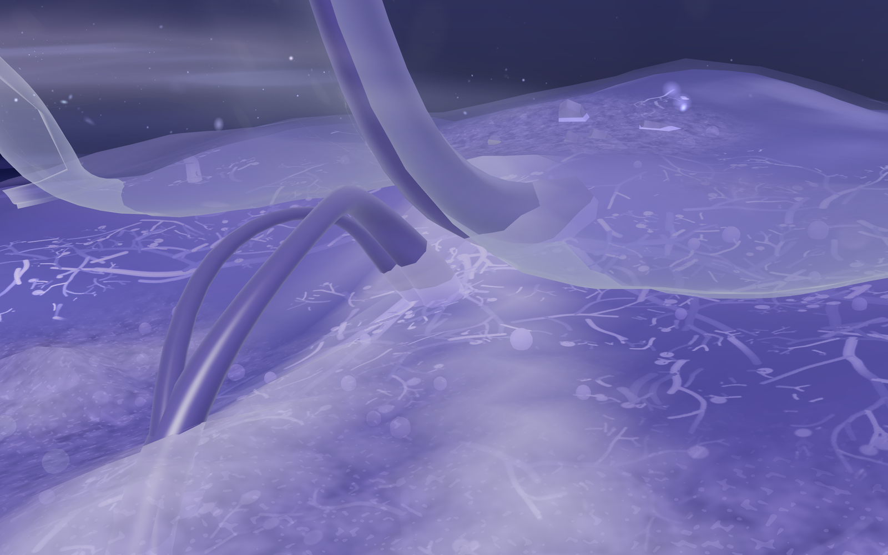

### The review of the first pass

The first pass did not work visually, and the problem was not only density.
It read as bright white branching lines laid over the terrain, not as
organic tissue emerging from accumulated traces. What was asked:
1. **Not a tree:** no prominent upright white branches, exposed Y-shaped
   skeletons, or long bright lines over empty terrain.
2. **A different scale and hierarchy:** mostly much finer, denser,
   irregular micro-branching concentrated near settled sediment and the
   membranes' bases, with the main structural branches subdued.
3. **In the surface:** partly embedded in it or emerging through it, with
   soft transitions rather than sharp lines over it.
4. **A different material:** subtle translucency, gradual fading, variable
   thickness, restrained local light; no uniform white emission and no
   glowing endpoints.
5. **The same L-system,** with a different translation of its structure into
   geometry and material.

The constraints stayed: the same single colony, no controls, views or
connections between colonies, a genuine close-up and a normal-distance
comparison with the reference, and an explanation if the integration
cannot be reached without a substantial rework.

### What changed

**The grammar is kept; how much of each kind grows changed.**

| | First pass | Revision |
|---|---|---|
| **Structural roots** (`base`, `trace`) | 15 roots of 0.15–0.21 segments, up to 5 orders, reaching 1.25–1.85 colony radii, drawn brightest | 9 roots of 0.10–0.14 segments, at most 3 orders, reaching 0.75–1.05 colony radii, drawn subdued (a broad soft raised vein) |
| **Micro growth** (new kind `micro`) | none | about 260 seeds of short-stepped (22–40 mm), densely branching, irregular growth, up to 5 orders: about 19,000 segments |
| **Where it grows** | from the membranes' feet outward | an **accumulation field** (below) seeds the micro growth and stops it where it thins. More of it leaves the structural roots wherever they pass through settled matter, so it is continuous with them. |
| **Climbing veins** | 3 bright ribbons | 2 faint translucent ribbons, lower in the membrane |
| **Tip beads** | pearls on a third of the finest tips | none. A few soft thickenings in the tissue where growth gathered, never a light. |

**The accumulation field** is where matter has settled around the colony,
0..1 on a 128-cell grid over its ground. It is high:
- along the whole base line of every membrane
- where residue plates and grains lie, along the trail, and on the heap

It is thickened by the sediment record and ended by water and by distance
from the colony. Micro seeds are drawn in proportion to its square, so they
gather where matter settled most. A micro branch stops where the field
falls below 0.12, or beyond about 0.3–1.2 units from its seed (further
where matter is thicker).

**The ground network is no longer drawn as lines. It is painted into a
tissue map and shown as part of the ground.**

- **The tissue map:** 2048 × 2048 texels over the growth's own extent
  plus a small margin, about 5.5 units on a side here, so under 3 mm a
  texel. Each branch segment is
  painted as an anti-aliased capsule of its width. Overlaps take the
  maximum, never the sum, so crossings do not brighten. A branch thinner
  than a texel gets a share of one. Four channels:
  - **coverage:** how much tissue is here
  - **core:** the denser middle of each branch
  - **fineness:** 0 on the structural roots, 1 on the finest growth
  - **surfaced:** a slow noise along each branch: 0 where it runs beneath
    the surface, 1 where it has come through
- **Fading:** every branch fades where the accumulation thins (0.06–0.4),
  so nothing runs out bright over empty ground.

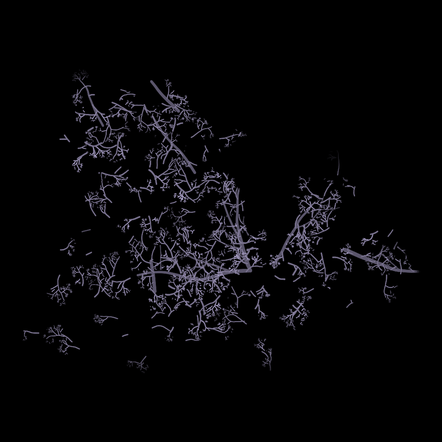

- **The drape:** a grid over the colony's ground, following the terrain
  14 mm above it. Cells the map leaves empty are dropped. It is drawn after
  the colony's own tissue skin and before the membranes.
- **The material** (`createTissueMapMaterial`):
  - **Lit as part of the ground:** the scene's light, ambient and wrap. The
    coverage, slightly softened, raises the surface a little (a bump of a
    few millimetres), so the veins catch the light like raised tissue.
  - **Pale tissue,** paler at the cores and on the finest growth, cooler
    (silver-blue) where it lies beneath. A little light is held in the
    tissue itself, more at the dense cores. Restrained, but enough to read
    as pale matter rather than a stain of the ground's own colour.
  - **Beneath the surface:** a branch shows as a blurred, fainter read of
    the map (a mip bias), not a sharp line. It never breaks into dashes: at
    least 45% of its sharp presence remains.
  - **A faint pale spread** where the growth is dense: the tissue between
    branches thickens too.
  - **Translucent and blended,** never added: alpha up to about 0.85 on a
    surfaced core, much less elsewhere. Under water it dims.
  - **Holding detail with distance:** the shader estimates how many texels
    fall in a pixel and holds thin branches up by that much, so at a
    distance the growth stays a lacy texture instead of averaging away.
- **The membrane veins** are faint translucent ribbons in the sheet,
  rounded across and thinning to nothing; stretches sink into the sheet.

**Level of detail.** One `THREE.LOD` per colony, as before. The map is
mipmapped (with anisotropic filtering), so its fine growth simplifies with
distance on its own; the levels change the drape's grid and drop the veins.

| Level | From | Drawn | Triangles |
|---|---|---|---|
| 0 | 0 | the drape on a 160-cell grid, and the membrane veins | 13,744 + 346 |
| 1 | 8 units | the drape on an 80-cell grid, and the veins | 4,574 + 346 |
| 2 | 16 units | the drape on a 40-cell grid | 1,472 |

**What went wrong on the way:**

| Problem | Cause | Fix |
|---|---|---|
| **Nothing visible at first.** The map held a dense mat, but even pure red at four times the opacity barely showed. | Diagnosed with a debug view of the map on the drape: the drape was placed right and not occluded. Thin branches got a share of a texel's coverage, and the alpha multiplied that down again. | presence reaches full strength well before full coverage; a faint spread under dense growth |
| **The tissue had the ground's own colour.** | the same lavender, lit the same way | paler, with a little light held in the tissue |
| **Scattered curly "noodles"** in the genuine close-up | the parts beneath the surface dropped out almost entirely, so branches broke into dashes; the micro turns were too sharp; the seeds were scattered rather than leaving the roots | beneath-the-surface stretches stay faintly present; gentler turns; more seeds from the roots; longer surfaced stretches |
| **Lines vanished at normal distance** | mipmapping averages a line a texel wide into its surroundings | hold thin branches up by the texels per pixel |
| **"Close-ups" were not close** | the app's orbit controls keep the camera at least 7 units from its target | for these captures only, the clamp was lowered in the capture script; the app is unchanged |

### Results

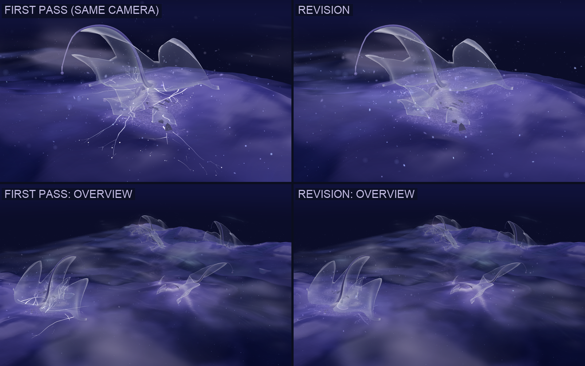

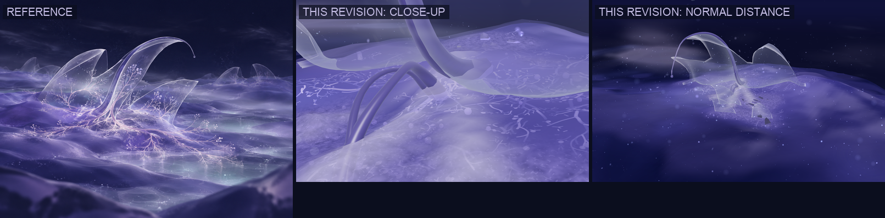

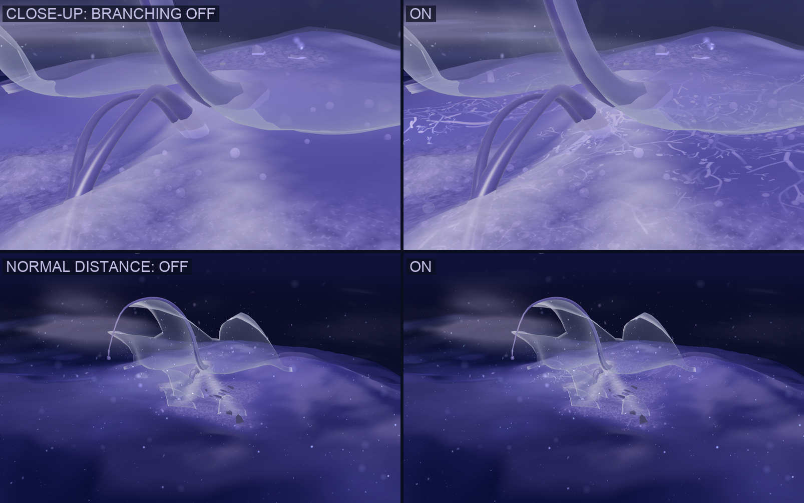

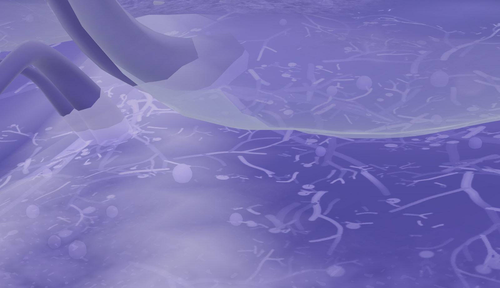

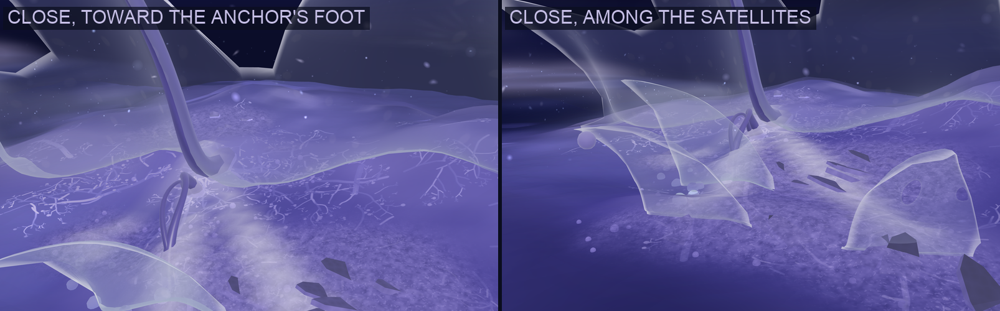

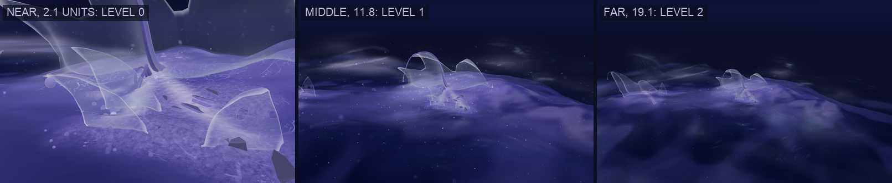

**Measured** (headless browser, 2× pixel density, defaults):

| | |
|---|---|
| axioms | 269: 9 structural roots, 1 along the trail, 2 climbing veins, 257 micro seeds |
| chains / segments | 4,146 branches, 19,098 turtle segments |
| tissue map | 2048², 6.3% of it holding tissue (at half resolution) |
| close-up (2.1 units) | touches 23% of the frame, about 11 levels on average where it does; no saturated pixels |
| normal distance (8.7 units) | touches 2.3% of the frame, about 17 levels where it does; saturated pixels 107 with it, 96 without |
| default overview (12.8 units) | 1.8% of the frame, about 12 levels where it does; saturated 7 against 6 |
| GPU time | within the timer's noise: 4.0 ms with it, 4.3 without, 4.0 with again |
| build | about 216 ms to grow, 82 ms to paint the map and build the drapes: about 0.3 s for this colony |

### Compared with the reference (`branching2.png`)

**Closer than the first pass:**
- **No tree or skeleton:** no white lines and no glowing ends.
- **Fine, irregular, dense micro-branching** gathered around the bases and
  the settled residue, from the same L-system.
- **In the ground:** shaded with it, partly beneath it, soft-edged,
  translucent, with gradual fading at the edges of the growth.

**Still different:**
- **Far quieter.** In the reference the branching is the luminous focus of
  the image: pale pink-white roots with a soft glow, haloed and
  depth-of-field-blurred. Here, without white emission, the growth is a
  pale texture. At the genuine close-up it reads clearly as tissue; at
  normal distance (about 8–9 units, near the closest the app's camera
  allows) only as a faint lacy patch at the colony's foot; in the
  overview hardly at all.
- **The reference's thicker main roots,** smoothly tapering into fine
  filigree, are subdued here by request, so the hierarchy is less legible
  at a distance.
- **Close up, the micro growth is still a little "wormy":** irregular short
  curves rather than the reference's crisp, fine dendrites. The map's
  texel (about 3 mm) is magnified at close range.
- **The membrane veins are barely visible.**

### The limitation, plainly

The integration asked for (in the surface, translucent, soft, not
emissive) works **close up**. At **normal distance** it costs legibility:
a pale, translucent, non-emissive texture on the pale lit lavender ground
has little contrast, and a few-millimetre-wide pattern seen from 8 units
covers a pixel or less. The reference is legible at that distance because
its branches glow, are wider, and are set against a darker, blurred
ground. Bringing it to that level of legibility is not a parameter change.
It would need one of these, and each is a decision rather than a tweak:
- **Accept** that the network is a close-range detail and quiet at a
  distance.
- **Bring back some luminosity in a controlled way:** a soft local glow in
  the densest tissue at the bases, as the reference has, which the brief
  now restricts.
- **A multi-scale representation:** a coarser, broader version of the same
  network for distance, painted at a second scale, so it reads as fine
  filigree close up and as soft veining further out. That is a substantial
  rework of the translation.
- **A higher-resolution or tiled map,** so the close-up is crisper. It is a
  cost in memory: 16 MB of texture per colony already.

### Limitations of the revision

- **One colony only,** as asked.
- **The ground network is a map,** so its sharpness is bounded by the
  texel (about 3 mm). Very close it is soft, and slightly wormy.
- **Not structure in 3D:** the ground growth is flat in the surface (raised
  only by shading). Only the membrane veins leave the ground.
- **Rebuild cost:** about 0.3 s for this colony whenever the scatter or the
  reused controls change. For every colony, that would need a worker.
- **Memory:** a 2048² map with mipmaps, about 21 MB per colony on the GPU.
- **Overdraw:** the drape is a second translucent layer over the colony's
  own tissue skin. The cost was within the timer's noise here.
- **Still open, unchanged:** the streams (study 06), and the haze's
  horizontal-layer and washed-out issues (study 07).


## First pass (superseded by the revision above)

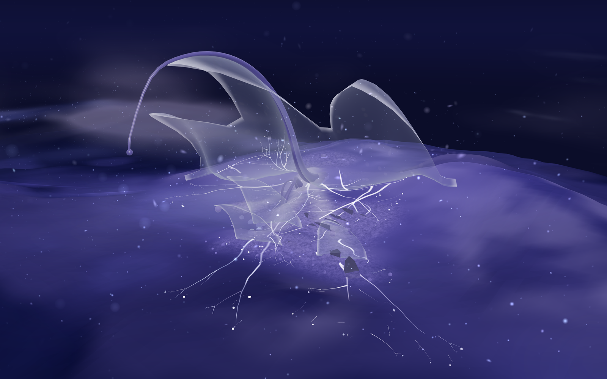

### In simple terms

- **One grammar grows the network.** A parametric, stochastic L-system
  rewrites a few starting symbols into a branching string. Each branch has an
  order (its generation): the main axes come first, then side branches off
  them, then finer ones off those.
- **A turtle draws it on the world.** It walks the string on the ground (or
  up a membrane), bending toward where the world draws it, and stopping at
  water, at the edge of its reach, or where it meets another branch.
- **The colony decides where it starts.** Roots leave the foot of every
  membrane, follow the residue trail and heap, run from the anchor toward its
  satellites, and climb a little way into the larger membranes.
- **It is drawn as fine luminous ribbons** lying in the surface they grew on,
  brightest at the roots of the oldest axes, with stretches passing beneath
  the surface, and small pearls at some of the finest tips.
- **Three levels of detail** by distance from the colony.

### Implementation

#### The grammar (`lib/branching.js`)

Modules (with parameters):

| Module | Meaning |
|---|---|
| `A(l, w, g, a)` | an apex: segment length, width, order (generation), age along its own axis |
| `F(l, w, g)` | grow one segment |
| `R(d)` | turn by `d` radians, in the surface |
| `[` `]` | push / pop: a lateral branch |
| `T` | a tip: a bead may form here |

Productions for an apex, chosen stochastically (the probabilities depend on
the order and the kind of axiom):

```
A(l,w,g,a) : g ≥ G or a ≥ age(g)  → F T                                     (the axis ends)
           : p_lateral(g)          → F [ R(±θ) A(l·ks, w·qs, g+1, 0) ] R(∓δ) A(l·0.96, w·0.93, g, a+1)
           : p_fork(g)             → F [ R(+θ1) A(…, g+1, 0) ] [ R(−θ2) A(…, g+1, 0) ] T
           : p_stop(g)             → F T
           : otherwise             → F R(±small) A(l·0.95, w·0.96, g, a+1)
```

- **Monopodial and asymmetric:** a continuing axis with side branches of a
  higher order, as in roots and fungal hyphae, with an occasional
  dichotomous fork. Main axes may fork only once they are established.
- **Side branches** are more frequent on the finer orders, so tips are
  dendritic. Every angle, length ratio and width ratio is drawn from a
  range per branch, so nothing repeats.
- **Maturity sets the depth of branching.** The highest order runs from 3
  (young colony) to 5 (old), from the colony's maturity. History ages the
  colonies (study 05), so it adds orders.
- **Derivation:** up to 26 rewriting steps; any apex still growing then
  becomes a tip.

**Three kinds of axiom**, with their own parameters:

| Kind | Starts | Character |
|---|---|---|
| `base` | at the foot of every membrane | branches most, travels furthest over the ground |
| `trace` | on the residue trail and heap | follows the record downhill |
| `climb` | at the foot of the larger membranes | rises up the membrane's own surface, branches little, at most 3 orders |

#### Growth on the world: the turtle

The string is walked by a turtle in a **space**. Each space can place a
point (with its surface normal), take one step, and say where the branch
wants to bend:

- **Ground space:** world positions on the displayed ground
  (`world.surface`, the same data the colonies stand on).
  - **Bending (tropism):** a branch bends toward a blend of unit vectors:
    - its own course (the heading it set out on: an axis holds its
      direction, as a root does)
    - outward from where its root began
    - downhill
    - toward thicker sediment record (the trace gradient)

    `trace` axioms weight downhill and the record more.
  - **Weaker on finer orders:** side branches keep their branching angle
    rather than bending back parallel to their parent.
  - **A meander:** the turning rate drifts slowly, so a branch curves one
    way and then the other instead of jittering.
  - **Stops:** at water (depth below −0.04), at the world's edge, and at
    its reach (about 1.25–1.85 colony radii by maturity, longer down
    thicker record and with Accumulation).
- **Membrane space:** the membrane's own columns of points, kept by the
  bloom builder (`traceForms.js`, `bloomSurfaces`). The turtle walks in
  column/row coordinates and sits just off the sheet, so the veins lie in
  the translucent membrane and stop below its rim.
- **Spacing:** an occupancy grid (5 cm cells). A finer branch stops where it
  would run onto ground another branch already holds (its own ancestors
  excepted), which spaces the network as growing tissue spaces itself. Main
  axes may cross each other.
- **Smoothing:** each chain is resampled along a Catmull-Rom spline (three
  points per turtle step) and put back on its surface, so the turtle's
  straight steps become continuous curves.

#### Relationship to the colony and sediment system

Nothing is placed by hand: every start comes from what the colony placed
(`scatter.js`) and from the world's record (`worldData.js`).

| Source | Becomes |
|---|---|
| each membrane (`bloom` instances): position, lean, width | `base` roots along its base line. The anchor's spread all round, spaced by the golden angle and leaning downhill toward the water; a satellite's lead outward from the colony. |
| the anchor and its larger satellites | one root from the anchor's foot toward each: the connections the colony made |
| the residue trail and heap (`shard` instances, `kind: trail / heap`) | `trace` roots that follow the record downhill |
| the larger membranes' surfaces | `climb` veins up into the membrane |
| the record (`trace` channel) and slope (`downX/downZ`) | where branches bend and how far they reach |
| colony maturity (from the record around the site) | how many orders of branching |

**Controls (reused, none added):**
- **Bridgework Amount:** how many roots each membrane sends out. It is
  structure.
- **Shard Accumulation:** how far the network runs down the record.
- **History** (via maturity): orders of branching.
- **Scatter seed:** a different network.
- **Growth:** plays it: the network spreads out from the colony along its
  own arc length, after the membranes.
- **View:** the network shows with *All* and *Bridgework*.

**Scope of this pass:** `BRANCHING.colonies = 1`, the strongest colony site
(colony 0, the anchor at (−0.2, 8.73)). The same code grows every colony
once that is raised.

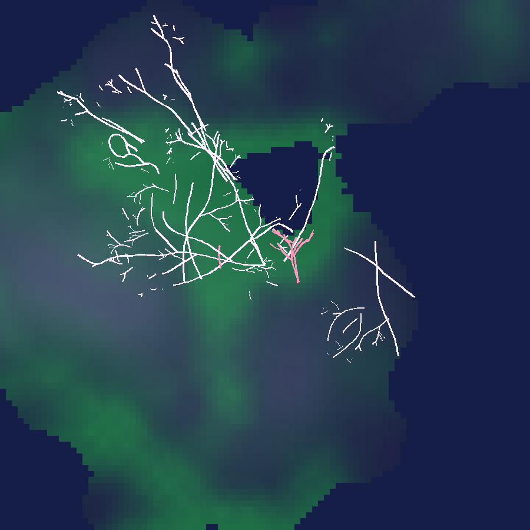

#### Drawing (`BranchNetwork.jsx`, `formMaterial.js`)

- **Ribbons:** each chain is a ribbon lying in its surface (on the ground,
  or just off a membrane). It tapers along the branch and to a point at its
  tip, and each order is thinner.
- **Material:**
  - Rounded in the shader: a soft body with a fine brighter core.
  - Colour is pearl, lavender or silver-blue per branch.
  - Brightest at the roots of the oldest axes, fading with order and with
    distance along the network.
  - Stretches pass beneath the surface and dim, so the network reads as
    embedded rather than laid on.
  - A barely visible light travels outward along it.
  - Screened over the scene (never darker), and capped below white.
  - A ribbon thinner than a pixel and a half fades rather than shimmering.
- **Beads:** small pearls on about a third of the finest tips, soft.
- **Growth:** grows with the colony on the shared growth clock.
- **Water:** under water it dims, as the colony's other forms do.

#### Level of detail

One `THREE.LOD` per colony, centred on it. The detail drops with the
camera's distance from that colony:

| Level | From | What is drawn | Triangles (this colony) |
|---|---|---|---|
| 0 | 0 | every order, every smoothed point, and the tip beads | 19,686 |
| 1 | 8 units | the finest order dropped, the turtle's own points only (a third), slightly widened | 2,708 |
| 2 | 16 units | the main axes only, every other turtle point, widened | 528 |

The default overview camera is 12.8 units from this colony, so it draws
level 1.

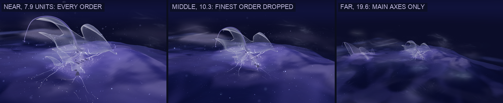

### Results

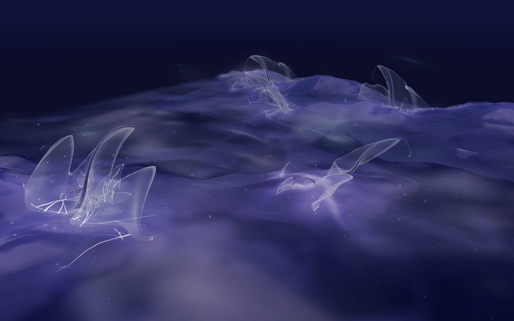

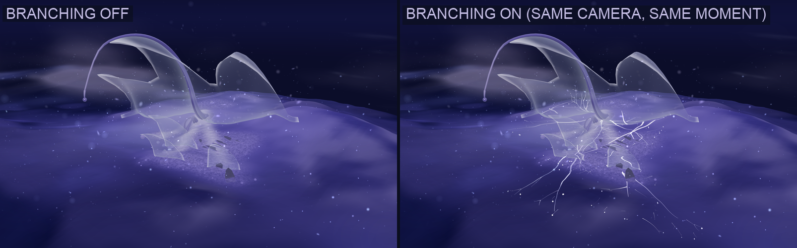

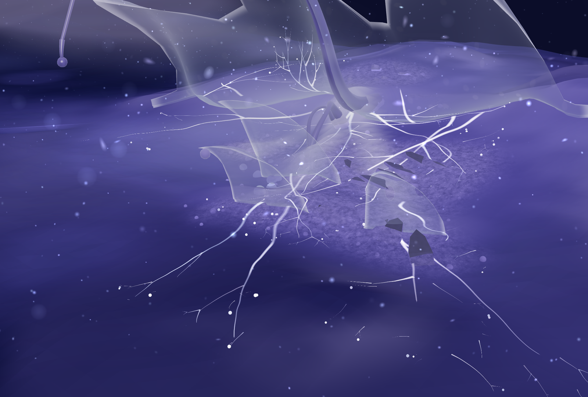

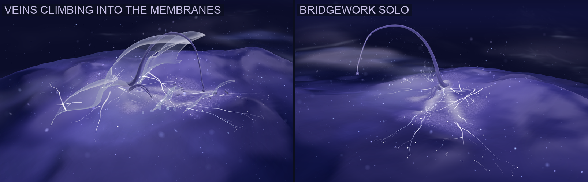

#### Measured

Headless browser, 2× pixel density, default settings.

| | |
|---|---|
| axioms | 21 (15 base, 3 trace, 3 climb) |
| chains (branches) | 329, up to order 5 |
| turtle segments | 2,033 |
| tips | 315 |
| why branches stopped | met another branch 214 · water 13 · membrane rim 2 · the rest by the grammar |
| frame touched by the network | 1.6% of the default overview, 2.2% of the close view |
| saturated pixels | overview: 60 with it, 9 without · close: 416 with it, 103 without (of 6.4 million) |
| GPU time | within the timer's noise: the main scene measured 3.3 ms both with and without it (one earlier run read 4.3 against 3.0) |
| build | about 26 ms to grow the network and build its three levels |

The extra saturated pixels in the close view lie along the brightest main
roots where two ribbons overlap (a branch point, or two axes crossing):
thin lines, not glows.

#### Compared with the references

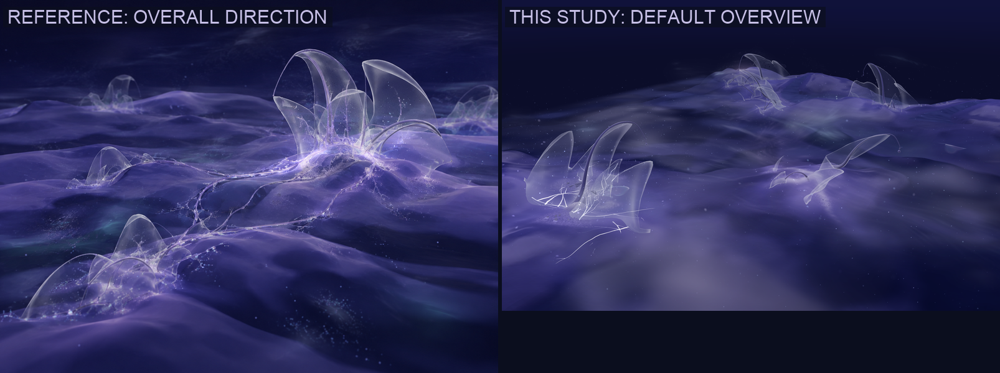

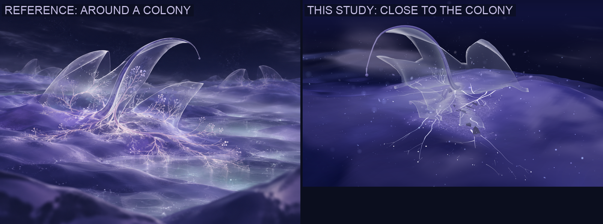

**What matches:**
- **Organic, dendritic branching:** asymmetric laterals, fine tips with
  pearls, and no tree or grass shape. It comes from colony data: roots from
  the membranes' feet, toward the water and the satellites, and along the
  record.
- **Veins rising into the translucent membranes** (as in `branching2`).
- **Restrained and partly embedded:** the light fades with order, distance
  and depth. Large areas of terrain stay empty.
- **Integrated:** in the existing scene, with the existing light, fog,
  water and growth clock.

**What differs:**
- **Much less dense than `branching2`.** The reference has a thick mass of
  fine roots and many beads. Here it is a few hundred branches, and from
  most cameras the membranes hide part of it.
- **Bright stretches around the anchor.** The reference glows more evenly
  along its main roots; here the brightest stretches sit near the anchor,
  and roots fade quickly with distance.
- **No traces between colonies yet (`branching1`).** Only one colony grows
  a network, and it does not reach the next colony.
- **The network grows mostly on one side of the colony:** toward the water
  and the satellites (north-west here), where the record is thickest. The
  side facing the default camera has little, because the record there is
  thin.
- **The overview shows it only faintly.**

**Still to improve:**
- **Density and hierarchy:** more fine growth near the bases, and thicker,
  softer main roots that taper more.
- **Distribution across all colonies,** and connections between them along
  the record, like `branching1`.
- **Fine order:** the finest branches can read as dashed lines where the
  embedding fades them in and out.
- **Overlaps:** branch points and crossing axes double the light.
- **Climbing veins:** they can be straight-ish, and one is a bright stripe
  across a membrane.

#### Known limitations

- **One colony only:** `BRANCHING.colonies = 1` for this review.
- **Draw order:** the ribbons do not write depth. Membranes in front of
  them are translucent and also write no depth, so a root behind a membrane
  can show through it more than it should.
- **The ground is sampled, not the mesh:** ribbons sit 12–32 mm above the
  ground the scatter system samples. Where the 224-cell terrain mesh rises
  above that (on tight convexities) a short stretch could be hidden; none
  was seen.
- **Rebuilt in full** when the scatter or the reused controls change:
  about 26 ms for this one colony (growth and geometry, in the browser).
  Five colonies would be about 130 ms, on the same deferred path as the
  scatter itself.
- **Seeded per colony:** a different Scatter seed gives a different network,
  but the grammar's ranges are fixed in code (`KINDS`, `BRANCHING`).
- **Unchanged and still open:** the streams (study 06), and the haze's
  horizontal-layer and washed-out issues (study 07).

## Files

| File | Role |
|---|---|
| `react-app/src/lib/branching.js` | the L-system (modules, productions, derivation), the turtle and its two spaces (ground, membrane), the occupancy grids, smoothing; the accumulation field; seeding (structural, micro, climbing); the transition sites and their strands (`transitionSites`, `tendrilGeometry`); painting the tissue map; the drape, the membrane veins and the strands in three levels of detail |
| `react-app/src/components/BranchNetwork.jsx` | one `THREE.LOD` per colony (drape, veins and strands per level); the map as a mipmapped texture; drives growth and the water line |
| `react-app/src/lib/formMaterial.js` | `createTissueMapMaterial` (the ground tissue), `createVeinMaterial` (the membrane veins) and `createTendrilMaterial` (the transition strands). The first pass's ribbon material is gone. |
| `react-app/src/lib/traceForms.js` | exports `FormWriter` (and `sphere`, no longer used by this study); keeps each membrane's surface (`bloomSurfaces`) for the climbing veins |
| `react-app/src/components/ScatterLayers.jsx` | grows the network from the placed scatter and the reused controls, inside the Scatter scene |
