# 09 · Composition and spatial light

*A pre-midterm pass on the Scatter world: one living ecology rather than
objects placed on a tile.*

> **Status: under review.** Two changes, made and evaluated separately:
> light held in accumulated matter, and colonies that gather. Then a palette
> pass for cleaner darks ([below](#palette-pass-cleaner-darks)). A further
> cleanup toward ultramarine ground and icy-blue mist was **rejected in
> review and reverted**
> ([below](#cleanup-pass-rejected-and-reverted)). The code is as it was
> after the palette pass, plus a last water pass
> ([below](#water-pass-the-stream-artifact-and-underwater-visibility)):
> - the stream water's striped artifact, fixed in its shader
> - one view-only control, Underwater visibility, in Explore
>
> Until that water pass: no new tabs, controls, particles, geometry families
> or effects, and no change to the terrain, exposure, fog, the streams
> (06), the haze (07) or the branching (08).

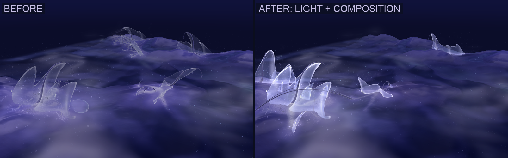

## Why

Measured before this pass, the scene's darks matched the references, but
its highlights were missing. Nothing in it was luminous, and the only light
belonging to a colony was a circular halo mesh laid over the ground.

The colonies were spread out by construction:
- up to five sites, at least 6.5 units apart on a 26-unit world
- maturity saturated at about 0.9, so every colony reached the same size

The world read as several similar objects on a tile.

## What changed

### 1. Light held in accumulated matter

`lib/accumulation.js` builds one grid from what each colony laid down:
- the base line of every membrane, in proportion to its size
- residue: plates, grains, the heap and the trail
- the footings of structure

Light spreads outward from that matter by damped diffusion on a
half-resolution grid. How well each cell passes light on depends on three
things: the sediment record (deposits carry it), slope (steep faces hold it
back) and water (it dims there). It also leans downhill, the way residue
moves.

So the light's outline is the outline of the deposits and the landform, not
a disc. The grid stores three channels: light, density and tone (pearl,
icy lavender or silver-blue; never mint). It takes about 20–70 ms to build
after each placement change.

The ground, the colony tissue and the forms all read the same grid:

| Surface | What it does with the light |
|---|---|
| **Ground** (Dormant reading, Scatter only) | Paler and more translucent where light is held. Gives off light in proportion to light and density; the record carries more of it than bare ground; a grain breaks it up. Away from life, the record's own glow is held down, so quiet ground stays dark. Shoulders near colonies catch more of it. |
| **Colony tissue** | Takes the light's tone. Holds more light the thicker, denser and more crusted it is. Its veins brighten near the cores. |
| **Membranes** | Light rises from the matter at the foot, fades over about 0.6 units, and is stronger where the sheet is seen thin. Folds (sharp curvature) hold more. Part of each sheet's light passes through stacked films instead of being blended over them (premultiplied blending), so overlaps build up light. |
| **Structure** | A little light at the foot. |

The circular halo mesh is removed. Exposure, tone mapping and fog are
unchanged, and there is still no bloom.

### 2. Colonies that gather (`lib/scatter.js`)

Placement now works like this:
- **The first colony** takes the strongest place in the site potential.
- **Each later colony** is chosen by potential multiplied by the pull of the
  colonies already there. Pull falls off over about 5.5 units, in proportion
  to the established colony's maturity.
- **A new, separate group** needs 72% of the best site's potential. Joining an
  existing one needs only 30%.
- **Near an established colony, the noise-based colony field no longer
  decides:** the colony has made the ground around it habitable. Shore, slope,
  record, shelter and streams still decide.
- **Spacing** scales with the two colonies' radii (0.85 × their sum). It is
  checked after a site has settled onto dry ground, which can move it inland.
- **Age:**
  - an offshoot is younger and smaller, by up to 45%
  - a separate group is 25% younger
  - no colony is older than the first
- **The first colony** grows 1.5 × the veils. There are at most five colonies.

Nothing is placed by position. Members, residue, tissue, colony air and the
branching study's representative colony (number 0) all follow without any
change of their own.

## How it was compared

- **Four worlds:**
  - field seed 42, scatter seed 7, history 40 (the default)
  - 42 / 3 / 40
  - 123 / 7 / 40
  - 7 / 21 / 60
- **The same four cameras in each:**
  - the default overview
  - a colony close-up, 7.5 units from the first colony along the default
    view direction
  - a low view
  - a high, wide view
- **Exposure:** 1 with ACES, unchanged.
- **Four variants:**
  - **baseline:** a snapshot taken before the pass
  - **lighting only:** new light, old placement
  - **composition only:** old light, halo included, with new placement; run
    from a copy of the baseline with only `scatter.js` replaced
  - **both:** the current code

## Results

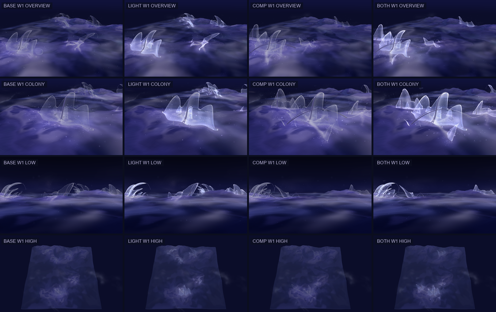

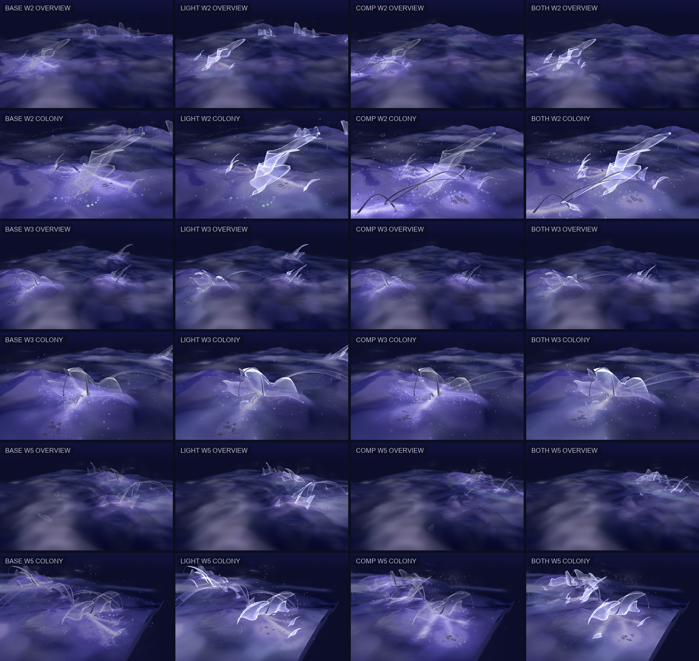

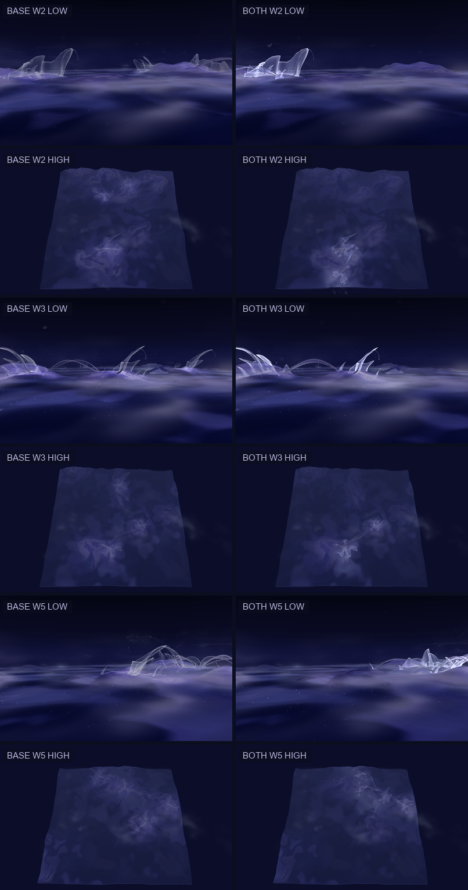

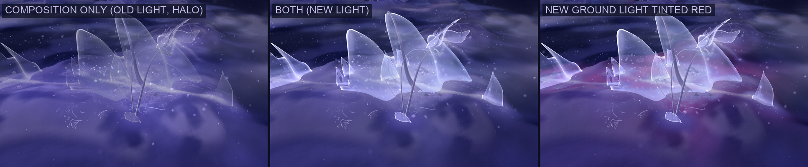

Brightness across the four worlds, before → after (both changes):

| Camera | Median | Top 5% starts at | Top 1% starts at | Very bright pixels (> 0.6) | Dark pixels (< 0.15) |
|---|---|---|---|---|---|
| Colony close-up | 0.22 → 0.23 | 0.49 → 0.61 | 0.63 → 0.84 | 1.5% → 5.4% | 31% → 32% |
| Overview | 0.16 → 0.16 | 0.41 → 0.42 | 0.53 → 0.65 | 0.3% → 1.4% | 46% → 47% |
| High | 0.06 → 0.06 | 0.21 → 0.21 | 0.26 → 0.31 | 0 → 0 | 78% → 78% |

The darks stay where they were. The new top end sits at the colonies, not
across the scene.

Field, the Shaders tab (including Dormant) and Volume are visually
unchanged.

## What improved

- **One recognisable concentration of life.** In most worlds there is one
  fuller colony with smaller, younger offshoots, and wide empty ground
  between groups. It still varies by seed: a cluster, a chain along a shore,
  two distant groups.
- **Light belongs to the matter.**
  - The membranes are luminous at their feet, in their folds and where they
    overlap.
  - The ground near the colonies is paler and lit, in a shape that follows
    the record and the slope.
  - The rest stays dark.
  - No disc, and no white bloom.

## Still unresolved

- **The terrain boundary.** The square slab is still obvious from high and
  wide views, and at the w5 close-up. As asked, the camera was not
  restricted to hide it; it is recorded as a separate issue.
- **Ground light is subtle at a distance.** From high and wide views most of
  the change is in the membranes, and the ground's light hardly registers.
- **Less life in some worlds.** Membrane counts:

  | World | Before | After |
  |---|---|---|
  | default | 19 | 14 |
  | 42 / 3 / 40 | 12 | 9 |
  | 42 / 44 / 20 | 14 | 9 |
  | 7 / 21 / 60 | 16 | 17 |

  The first colony is fuller, but a group that had a weak site now never
  forms. That is the trade-off of requiring a strong place for a separate
  group.
- **The default camera stays on the world's centre.** Where the gathering
  lies elsewhere (w5), the default overview frames mostly empty ground.
- **Bridgework's dark arches** stand out more around the fuller first colony.
  Their material is unchanged.
- **The smallest veils over dense matter** can go almost white at their
  base.
- **Unchanged and still open:** the haze's horizontal layer and the slightly
  washed-out look (07), the streams (06) and the branching (08).

## Palette pass: cleaner darks

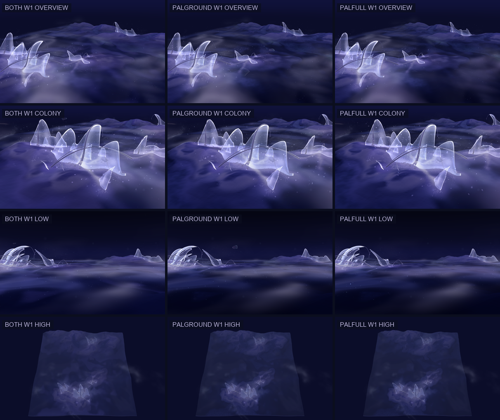

### The question

After the light and composition changes, the darker terrain read as muddy
and slightly greasy rather than deep. Grey-lavender midtones built up where
terrain, haze and the accumulated light overlapped. Was the cause the base
palette itself?

### What was found

Each layer was hidden in turn, with the same cameras and the same moment.
Grey-lavender midtone here means value 0.12–0.45 at saturation below 0.45.

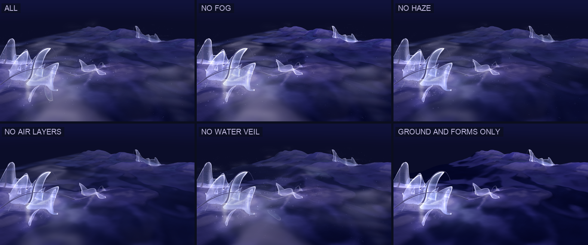

| Default overview | Median value | Grey-lavender midtone | Saturation of the darks |
|---|---|---|---|
| Everything | 0.33 | 8% | 0.67 |
| Without the haze | 0.29 | 4% | 0.69 |
| Without all air layers | 0.27 | 4% | 0.70 |
| Without the water veil | 0.31 | 7% | 0.68 |
| Ground and forms only | 0.23 | 0% | 0.77 |

Fog changes almost nothing.

- **The haze is the largest source.**
  - Its colours (silver, lilac, ice, pearl) were nearly white, at about 20%
    saturation.
  - It is screened over the scene, and screening lifts the darks the most.
  - Pale light over dark indigo comes out grey-lavender, and in the near
    field it lies on the ground as a soft pale smear. That is the greasy
    look.
- **The water veil lifts the basins.** It reflected a horizon colour
  (#4A4E84) paler than the sky the scene actually draws (#3B3F70). So the
  basins, where the darks should be deepest, took a grey-blue sheen.
- **The ground itself is clean but lifted.**
  - Its darks are a saturated indigo (0.77), not grey, but nothing on the
    ground goes below about 0.16 in value.
  - Shadows, mids and lit plateaus all carry the same hue (about 237°); only
    saturation changes with value.
  - So anything pale laid over them greys them.
  - The sediment record blended the ground toward a pale grey-lavender
    (#B4ADD8) over broad, soft patches: further smears.
- **The accumulation light added pale tone.** In the ground it mixed toward
  pearl rather than brightening the ground's own colour, which greyed the
  darks where the light overlapped.

### What changed

Ground (Scatter only, through one flag in its descriptor, `grade`):
- **Shadow response.** A toe takes the darks about 45% deeper in their own
  colour: scaled, so hue and saturation hold. It eases back to unchanged by
  the low mids, and shifts the darks only slightly cooler. The first attempt
  remapped the darks onto a blue at equal luminance and made them a
  saturated royal blue; that was replaced.
- **Record.** It pales the ground less, only where it is really thick, and
  is broken by the deposit's grain instead of one smooth blend.
- **Accumulation light.** It now brightens the ground's own colour
  (multiplied), with no pale tone mixed in.
- **Water.** In Scatter it reflects the sky dome's own horizon.

Haze (colour only; every view):
- **Silver, ice and lilac now carry more blue,** so the screened mist lifts
  the darks toward a cool blue instead of toward grey.
- **Pearl and mint accents are unchanged.**
- **Density, extent and veiling are unchanged.**

Field, Shaders and Volume are otherwise as they were. In Field the only
difference is the slightly cooler haze.

### Results

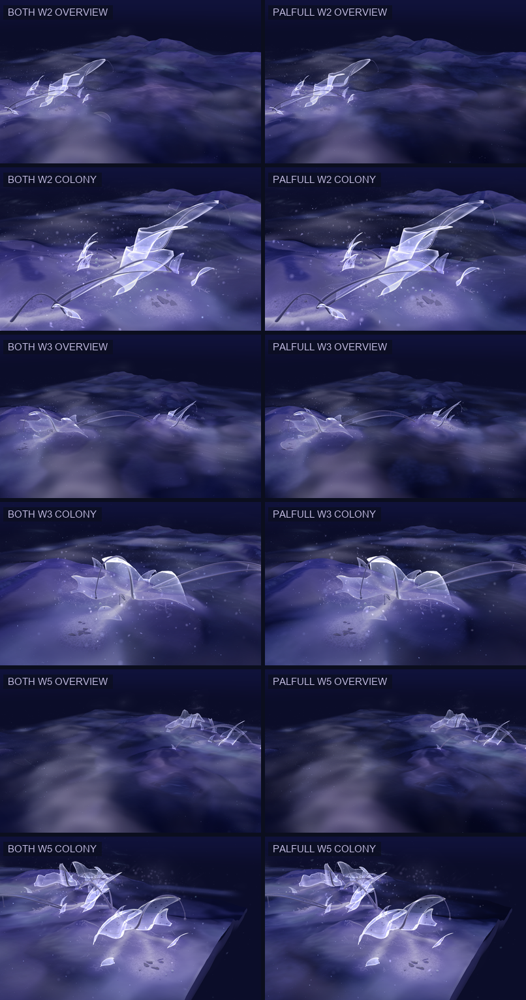

Across the four worlds, before → after:

| Camera | Median value | Share of pixels at value 0.3–0.5 (overview, default world) |
|---|---|---|
| Overview | 0.32 → 0.27 | 40% → 30% |
| Colony close-up | 0.42 → 0.38 | |
| Low | 0.22 → 0.18 | |

The darks keep their saturation (0.67 → 0.65), and the top end is
unchanged. The ground reads deeper, and the membranes separate from it more
clearly.

The grey-lavender share is **not** reduced. It was 10% across the four
overviews before and 10% after.

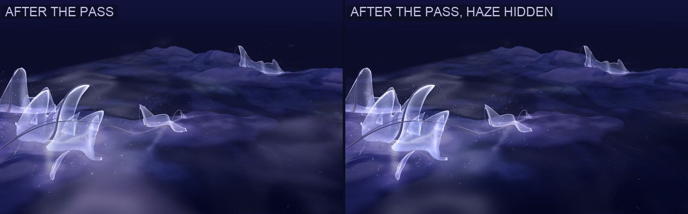

What remains comes mostly from the haze's near-field screened light:
- with the haze, 8% of the default overview
- with it hidden, 5%

A colour change cannot remove it without making the mist a saturated blue.

### Still unresolved

- **The haze's grey smear in the near field.** It is a matter of how the
  mist is composited (screen lifts darks most) and where it lies (close to
  the ground in front of the camera). That is the open haze issue from study
  07, not a palette setting. A next step there would be to composite the
  mist so it lifts the darks less than the mids, or to keep it off the
  near-field ground.
- **The darkest value in every frame is still the sky** (the zenith, about
  0.15). The ground can now go below it in shade, but the frame has no
  deeper foundation than the dome. Deepening the dome is a change to every
  tab, and was left alone.
- **The palette pass does not touch the forms.** Membranes, tissue and
  structure keep their colours.

## Cleanup pass (rejected and reverted)

> **Rejected in review and reverted.** The scene became too dark, too blue
> and less dreamy. The intention was a softer, more luminous violet and
> lavender atmosphere, not deeper ultramarine shadows and icy-blue mist.
> Every change below was taken out again, exactly: the haze compositing
> and colours, and the ground, sediment, colony-light and water colours.
> The colony gathering, the accumulation light and the palette pass before
> it were kept. The restored scene matches its pre-cleanup captures to
> within the frame-to-frame motion of the air: a mean difference of
> 0.001–0.003 per pixel, against about 0.02 from the cleanup's captures.
> The rest of this section is the record of what was tried.

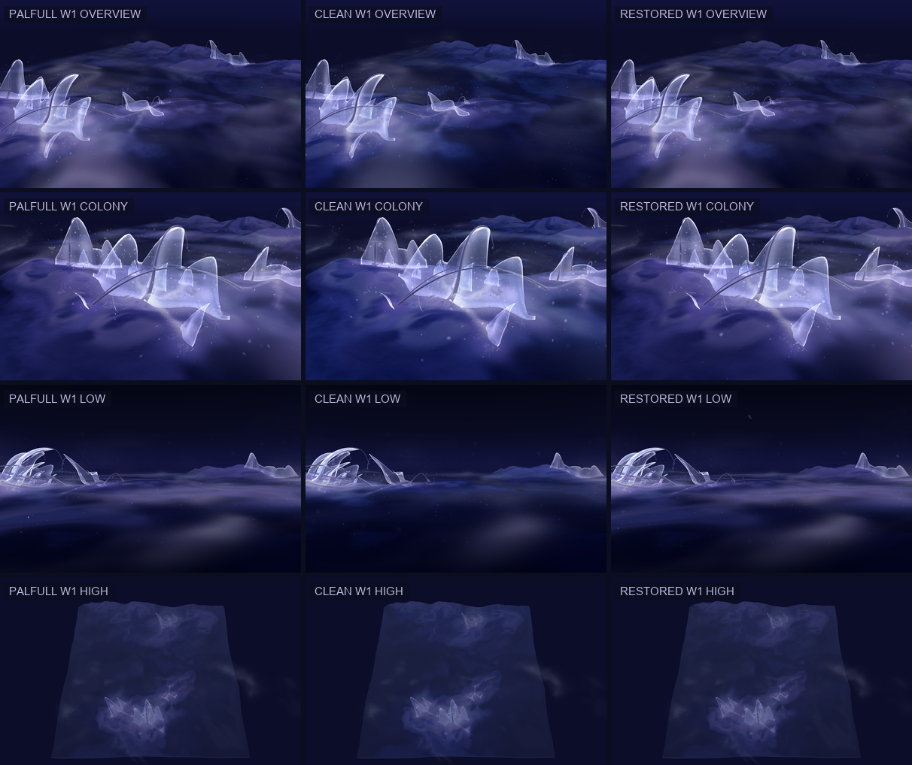

**The visual intention, for the next iteration:**
- Dreamy, ethereal, luminous; predominantly violet, lavender and lilac.
- Soft atmospheric gradients, with pearl and subtle iridescent highlights.
- More breathing room and lightness: not deeper shadows, not stronger blue.
- Keep the delicate translucency and the material relationships between
  terrain, membranes, sediment and atmosphere.
- Journey and ABZÛ are references for spatial atmosphere, light and depth,
  not for their blue palette.

What the experiment did show, independent of its palette: muddiness comes
from *how* layers are composited and *where* they lie, not from their hue.
In particular, the haze's lift on the dark foreground could be cut to a
third by changing what lights the mist. A violet-keeping version of that
idea remains open; see the boundary diagnosis below.

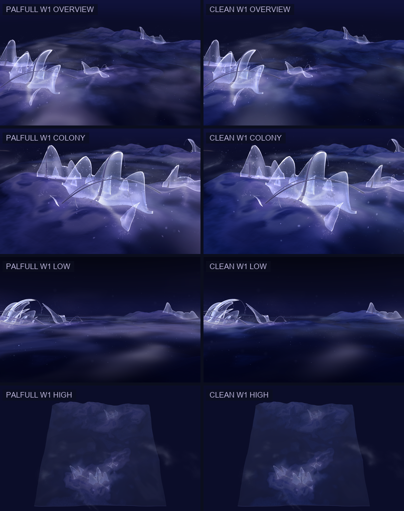

A focused visual cleanup, not a feature pass. Journey and ABZÛ served only
as loose references for colour structure: a dark field, selective glow,
airy depth. No new systems, layers or bloom, exposure unchanged, branching
untouched.

### The diagnosis it answered

- **Near-ground haze.** It still laid a greasy grey-lavender smear over dark
  terrain.
- **Compressed palette families.** Terrain, haze, sediment, water reflection
  and membrane light all sat in the same blue-purple-grey range.
- **No clean separation** between the dark base, the translucent forms and
  the luminous air.

### What changed in the haze compositing (`AirHaze.jsx`)

The haze is still a raymarched volume laid over the finished image in two
parts: a veil that dims what is behind it, and the mist's own light,
screened on.

Unchanged:
- density, extent and movement
- the march and the distance fade
- `VEILING`, `MAX_VEILING`, `MAX_LIGHT`
- the light pass's screen blending

Three things changed:

1. **The mist's light depends on what lights it.** Before, every sample of
   mist had a fixed, nearly white colour, screened over everything. Now each
   sample's light is scaled by `mix(0.32, 1, max(far, glow))`, where:
   - `far` rises with distance along the line of sight (7 → 24 units)
   - `glow` is the accumulation light below the sample (the colonies'
     matter, `accumulation.js`), fading with height above the ground over
     about 1.1 units

   So near mist over empty ground gives a third of its light. Mist
   near the colonies is lit and takes their cool pearl and lilac, and
   distant air keeps its luminous depth.
2. **The veil dims toward the air's deep colour, not toward black.** It was
   `scene × (1 − a)`. It is now `scene × (1 − a) + DEEP_AIR × a`
   (premultiplied; `DEEP_AIR` is a deep ultramarine). Near mist cools and
   deepens what it covers.
3. **Colours.**
   - The base mist is silver and icy blue: silver (0.74, 0.77, 1.0) and ice
     (0.64, 0.71, 1.0).
   - Lilac (0.82, 0.72, 1.0) and a new cool pearl (0.93, 0.92, 1.0) appear
     only where the mist is lit by a colony.
   - Warm pearl and mint remain as the rare fringe accents.

The air is shared by every tab, so this applies everywhere. Outside Scatter
there is no accumulation light, and only distance lights the mist. Field's
foreground smear disappears too:

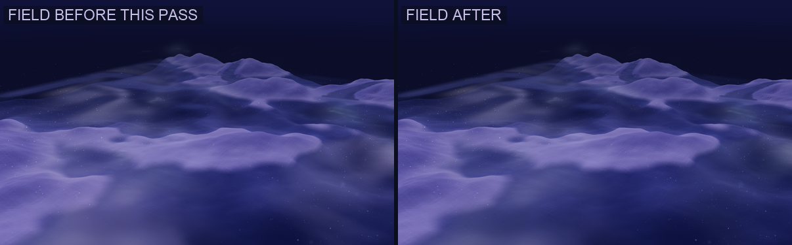

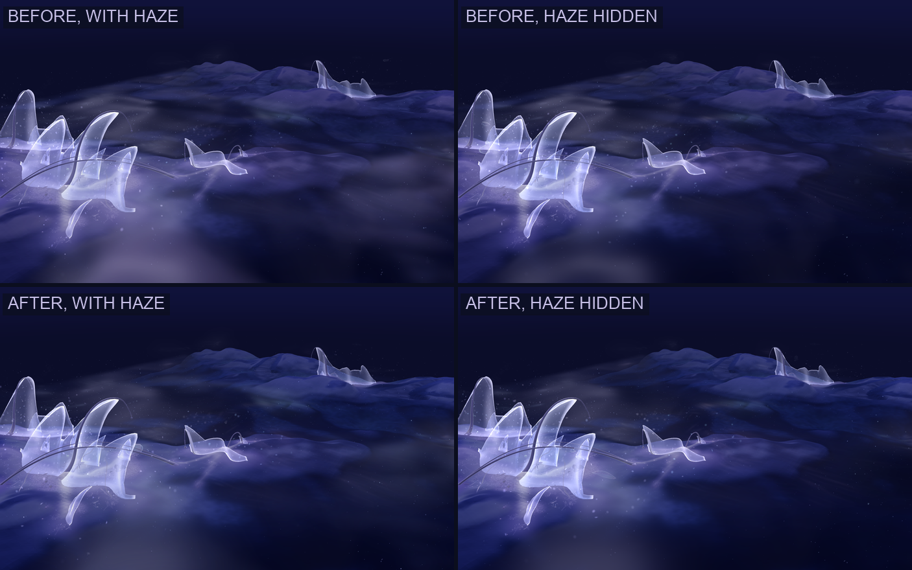

How much the haze lifts the near ground (bottom 45% of the frame; haze on
minus haze hidden):

| View | Lift in value, before → after | Saturation lost, before → after |
|---|---|---|
| Default overview | +0.052 → +0.017 | 0.09 → 0.04 |
| Colony close-up | +0.024 → +0.006 | 0.06 → 0.02 |
| Low | → +0.008 | → 0.02 |

### What changed in the palette relationships

Each family now has its own place:

| Family | Before | After |
|---|---|---|
| **Ground (dark base)** | the same blue-violet from shade to plateau, with lilac-grey deposits | ultramarine indigo: its lit colour multiplied by (0.84, 0.95, 1.1), with the earlier shadow toe |
| **Sediment record** | lilac-grey `#B4ADD8` | cool silver `#A6B2DE` |
| **Plateau lift** | lilac (1.04, 1.0, 1.12) | cool (0.98, 1.02, 1.12) |
| **Light on the ground** | lilac-pearl | 45% toward silver-blue; 1.4 × stronger near colonies; empty ground's record glow held to 30% (was 45%) |
| **Air** | near-white silver and lilac everywhere | silver and icy blue; dim near, luminous far; pearl and lilac only around colonies |
| **Water** | a pale reflected horizon over a rippled surface | the dome's own horizon at 62%, less of the reflection in its opacity, its light patches at 35%, the swell's tilt at 40%: a calmer, darker surface |
| **Membranes, tissue** | lilac and pearl | unchanged: lilac is now theirs, and the colonies' light |

Ground, record, light-on-ground and water changes are Scatter only, behind
the ground descriptor's `grade` flag. Field, Shaders and Volume keep their
own ground.

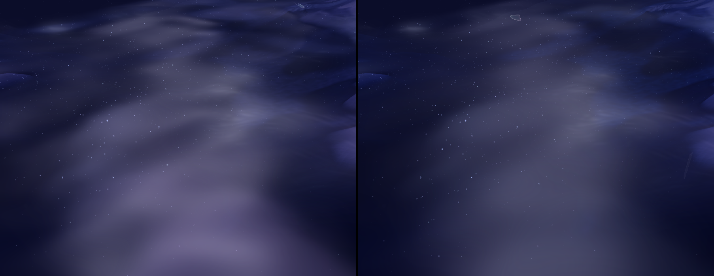

### Does it reduce the greasy, muddy feeling?

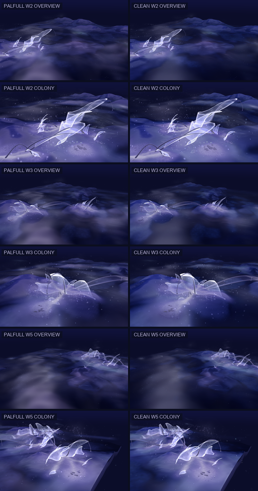

Across the four worlds, before → after:

| Camera | Median value | Grey-lavender | Saturation of the darks | Hue of the darks | Top 1% of brightness |
|---|---|---|---|---|---|
| Overview | 0.27 → 0.24 | 10% → 9% | 0.65 → 0.68 | 237° → 235° | 0.64 → 0.64 |
| Colony close-up | 0.38 → 0.36 | 4% → 2% | 0.66 → 0.69 | 237° → 235° | 0.83 → 0.83 |
| Low | 0.18 → 0.16 | 5% → 2% | 0.70 → 0.74 | 237° → 236° | 0.57 → 0.56 |
| High, wide | 0.16 → 0.16 | 1% → 0% | 0.66 → 0.67 | 235° → 235° | 0.30 → 0.31 |

- **Near ground, colony and low views: yes.**
  - The haze's lift on dark ground is about a third of what it was.
  - The grey-lavender midtone is halved, and the darks are deeper, more
    saturated and slightly more ultramarine.
  - The membranes keep their top end, so they separate more clearly from
    a darker ground.
- **The overview: its foreground, yes; as a whole, only a little**
  (grey-lavender 10% → 9%). What remains is mostly in two places:
  - **Large basins seen at a low angle (w3, w5).** The mauve is gone and the
    blotches are calmer, but the water still reads as a smooth, cool
    grey-blue sheet lighter than the ground around it, because it reflects
    the sky.
  - **Pale silver deposits.** The metric counts them as greyish even where
    they read as cool.
- **The distance and high views barely change:** there is little haze
  there, and what dominates them is the square boundary.

### Still unresolved

- **Water as a design choice.** Should a basin seen across the field be a
  dark mirror (reflecting the deep zenith) or a luminous sheet (reflecting
  the horizon)? Now it is in between. Pushing it further either way is a
  decision, not a constant.
- **The colonies' glow in the air is subtle.** Mist near a colony is lit,
  but there is not much mist near most colonies, so the hierarchy comes
  mainly from the membranes and the ground.
- **The haze's open spatial issues (07) remain:** level with the water
  rather than following the ground; no occlusion by membranes. The
  compositing changed, not where the mist lies.
- **The sky's zenith is still the darkest value in every frame,** and the
  terrain boundary is unchanged.

## Layering and boundary diagnosis

In review a layering/boundary was visible, most of all from low angles: a
horizontal sheet across the basin, and a pale film lying on the ground.
Diagnosed on the restored scene, with no fix attempted. It is mostly real
geometry and depth, not palette. The rejected cleanup only made it more
obvious.

**1. The haze's floor is lower than the ground it lies on (a real depth
mismatch).**
- The haze decides where the ground is from the air's floor (`makeFloor`
  in `lib/air.js`): a 96-cell grid of the base field, stored at 8 bits.
- In Scatter the ground is drawn raised by the sediment record. Over
  70–80% of the land the visible ground stands above that floor: median
  7–9 cm, up to 0.2–0.28 units, on the default world and on 7 / 21 / 60.
- The mist is densest just above its floor, so part of its thickest layer
  lies *inside* the visible ground.
- The haze is laid over the image without a depth test, so that mist is
  painted onto the ground's surface. Along grazing lines of sight it gathers
  over long stretches just under the surface, and reads as a pale sheet
  hugging the ground.
- Raising the haze's floor by 15 cm at runtime visibly thins the film in
  front of the colony and the band in the low view.

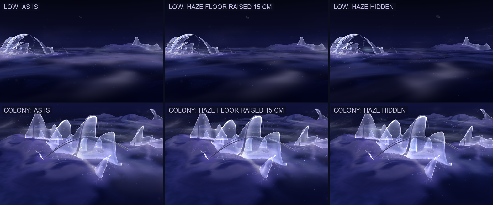

**2. The water is one flat sheet (real geometry).**
- Seen edge-on from a low camera, the water plane's veil and its sheen at
  grazing angles form a straight horizontal band across the basin, ending at
  a long straight waterline.
- With the haze hidden the band stays. With the haze and the water hidden,
  the line is gone and the terrain's contours read naturally.

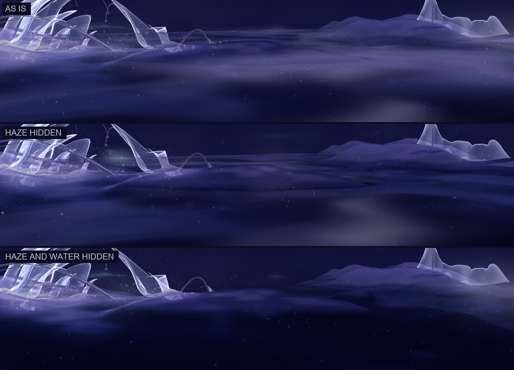

**3. The rejected cleanup made the edge between near and far obvious
(palette and compositing).** It dimmed near mist and kept far mist
luminous over 7–24 units. That drew a near-dark / far-bright transition
across the frame, and set a lighter water sheet against a darker ground.
Both are reverted.

**For a later fix, not attempted:**
- build the air's floor from the ground as drawn (with the sediment lift, at
  a finer resolution and precision), or give the haze the scene's depth so it
  stops at the real surface, membranes included
- soften the water's sheen where it is seen edge-on, and its long waterline

This is the open haze issue 1 of study 07 ("the haze reads as a separate
horizontal layer"), now with a concrete cause.

## Water pass: the stream artifact and Underwater visibility

2026-10-14, the last pass before the midterm. One fix in the stream water
shader and one presentation control in Explore. No procedural change:
seeds, parameters, saved states and every generated output are as before.

### The artifact

**What was reported.** Under the water, a dark polygonal region with
repeated parallel ridges or stripes.

**How it was reproduced.**
- Settings: world seed 188, elevation 2.10, water level 0.355, History 80,
  colony seed 7, power exponent 1.70 (the default).
- Seen from several angles; it is clearest at the mouth of stream 0.
- In this world 56% of the ground is under water. After 80 s the record
  under the water is full, so the sediment lift there is at its maximum
  (0.168).

**How it was isolated.** Each test had the clock frozen and the air hidden.

| Test | The stripes |
|---|---|
| Haze and air hidden | stay |
| Basin water hidden | stay |
| Stream water hidden | gone; the ground under it is smooth |
| Stream water tinted red | it covers exactly the striped region: the stream's water ribbon, spread into a wide, level pool on its sediment fan at the mouth |
| The ribbon's sheen and reflection neutralised | gone, leaving a smooth dark body with a jagged outline |
| Clock frozen at 3 / 50 / 140 / 600 s | absent at 3 s; then bands that grow finer and denser the longer the scene has run |

**Ruled out:**
- depth precision
- the haze
- the stream carving (the ground alone is smooth)
- the basin water's 8-bit depth

Brightening would not have fixed it, because nothing in it was a matter of
exposure.

**Two causes, both in the stream water** (`createStreamWaterMaterial` in
`Terrain.jsx`):

1. **The ripples were sheared by time.**
   - They drifted at `uTime × speed`, where speed is a per-vertex value
     (0.3–1.5, from the local slope).
   - Where the speed changes along the stream, neighbouring rows drift at
     different rates, and the gap grows every second. The pattern's
     frequency along the flow rises linearly with the running time.
   - After a minute the soft ripples are bands across the flow; after ten
     minutes they are a comb.
   - It is worst where a steep reach slows into a flat pool, as on a
     sediment fan at a mouth. Seen at a grazing angle, the bands read as
     ridges.
   - An exhibition runs for hours, so it would have spread along every
     stream. It is also most of what study 06 recorded as "scan lines".
2. **The ribbon's last stretch floated.**
   - The ribbon rides its bed's sediment lift.
   - After a long History the record under the water is full, so past the
     mouth the ribbon stood a whole lift (17 cm here) above the basin water:
     a flat, rippled plate over the drop.

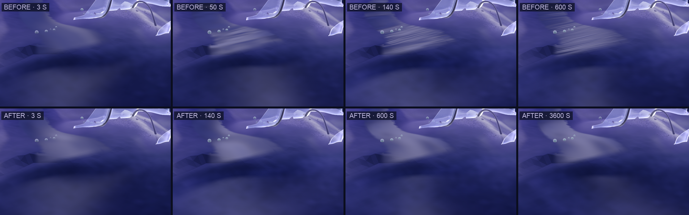

**Fixes, both confined to the stream water shader:**
1. **The drift runs in two staggered cycles of 2 s** (the flow-map
   technique).
   - Each cycle restarts from a fresh place in the noise while its weight
     is zero, so the shear never grows past one cycle's worth.
   - The blend is renormalised, so the ripples keep their contrast.
2. **The ribbon fades out near the water line where the sediment lifts it**
   by more than 1–5 cm, and the stream ends on its delta. Where it is not
   lifted, it meets the basin as before.

**Measured** in the pool, as the high-pass energy that the bands produce:

| Clock | 3 s | 50 s | 140 s | 600 s | 1 h |
|---|---|---|---|---|---|
| Before | 0.53 | 1.01 | 1.52 | 2.00 | n/a |
| After | 0.53 | 0.57 | 0.66 | 0.61 | 0.62 |

Across one cycle the pool's mean brightness varies by 1.4 levels of 255,
so the cross-fade does not pulse. In world 188 the faded end is 0.1–1.0%
of each frame; in the other four worlds, at most 0.13%.

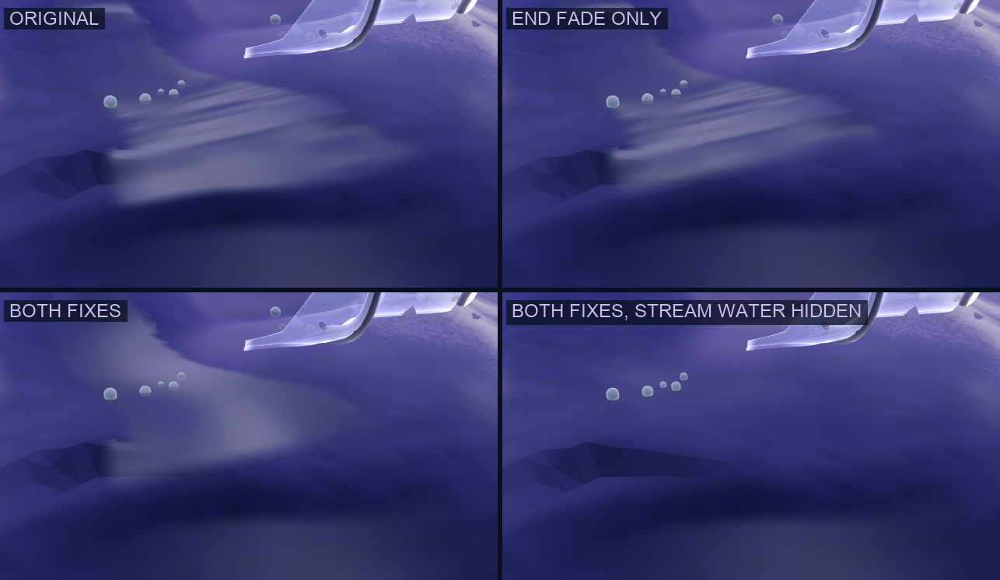

**Left as it is (documented, not changed):**
- **A dark, faceted ledge at the fan's front.** This is the ground itself:
  the sediment lift steps down where the deposit ends, and the steep face
  sits in shade under the water (panel 4 of the last figure). Changing it
  means changing the sediment display or the record. That is generation,
  not something for this pass.
- **The ribbon's jagged outline.** The level ribbon meets faceted ground in
  a jagged line: the depth buffer draws its shoreline, as it does the
  basin's.
- **Ripple direction.** The ripples still follow the ribbon's across/along
  coordinates rather than the local flow direction (study 06).

### Underwater visibility

One control in Explore, under World ▸ **Water appearance**: a collapsed
group of its own, separate from Water veins.
- **Presentation only.** It acts live and rebuilds nothing.
- **At 0, the default, the water is exactly as before.**
- **Explore only.** App adds it to Explore's ground descriptor, so the
  studies never receive it.
- **Saved** with the configuration; older saves read 0.

What it changes, and nothing else:

| Where | At 1 (scaled linearly below that) |
|---|---|
| **Ground below the water line** | The lit surface multiplied by up to 1.6 in its own colour, so its shading and its darkening with depth keep their ratios. Plus a little of the record's pale lilac (`#B4ADD8` × 0.03), so the darkest floor comes up violet, not grey. What glows (the mint of active flow, the held light) is not lifted. It ramps from nothing at the (tidal) water line to full at 4% of the relief below it, so the shore shows no seam |
| **Basin water** | The depth-based part of the veil's opacity drops to 55%. The sky reflection and the glint, which make it read as a surface, stay. Its body colour moves 35% toward violet (`#5C5290`) |
| **Stream water** | Opacity drops to 65%, toward the same violet |

It leaves alone:
- the palette, exposure and atmosphere
- the water's geometry
- the ground above the water line
- the forms

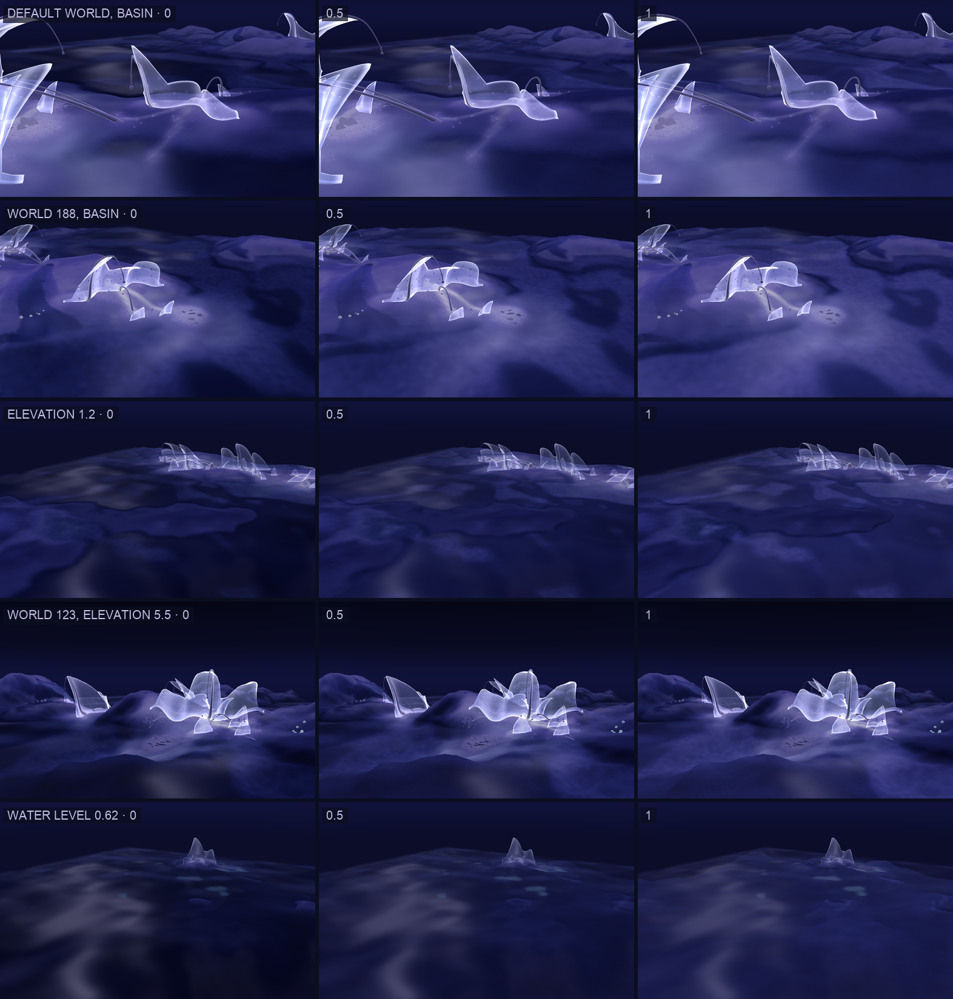

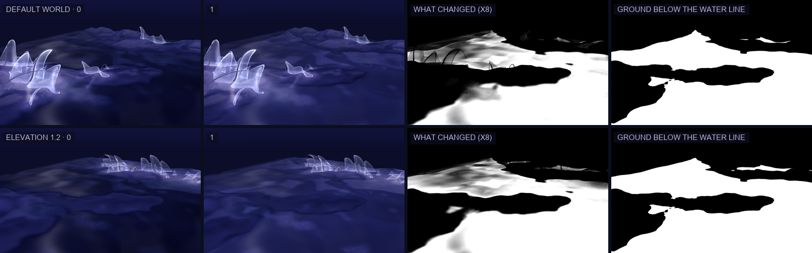

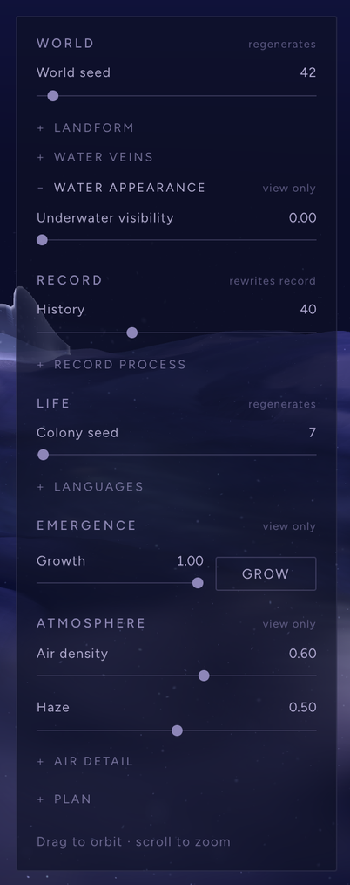

**Results.** Before and after with identical seeds, cameras and a frozen
clock: the five worlds of the figure, 12 views, at 0, 0.5 and 1.

| Check | Result |
|---|---|
| At 0 | Identical to the previous code once the stream water is hidden: 19 of 19.2 million pixels differ, by one level. A recheck after the last change matched pixel for pixel |
| Where it acts | Only on the water and the ground under it. The land above the water line is pixel-identical at every value. The 0.04% of pixels outside the water and submerged-ground masks are far water whose veil exactly matched the backdrop at 0 |
| How much | At 1 the submerged ground's mean luminance rises from 0.38–0.73 of the land's to 0.61–0.92: toward the land, never past it |
| Shading and depth | Kept. Across the submerged ground, the rank correlation between 0 and 1 is 0.88–0.97, and 64–93% of its absolute variation remains. The lowest is where the veil's own reflections made most of the variation |
| Shore | Zero change on land, rising smoothly from the water line inward, with no peak at the shore |
| Colour | Mean hue of the submerged ground up by 0.2–3.3°, toward the violet of its fill (from 234–237°). Saturation changes by −0.08 to +0.02, so the same or a little paler, toward pearl. Nothing moves toward cyan or teal, and the mint of active flow is not amplified |
| Studies | Field, Shaders and Scatter are pixel-identical with it at 0 and at 1 (set in Explore). Volume is within its own run-to-run variation |

**Revised once before review.** The first version had two problems:
- **Too strong.** It multiplied the whole surface by 2.1, which brought the
  floor to 0.96–1.12 of the land's luminance. World 188's basin read as a
  pale, milky film.
- **It amplified glows.** The same multiplication lifted the emissive mint
  glints toward teal.

The control now lifts only the lit surface, by up to 1.6. It also thins the
veils a little less: by 45% (basin) and 35% (stream), against 55% and 45%
before.

**Still open.** Under the water the ground keeps the Dormant reading's
stacked darkening (see [architecture](architecture.md#known-limitations-deferred)).
This control lifts it on request; the default look is unchanged.

## Files

| File | Change |
|---|---|
| `react-app/src/lib/accumulation.js` | new: the accumulation light (sources, diffusion over the ground, light / density / tone) |
| `react-app/src/lib/formMaterial.js` | the shared light (`ACCUMULATION_GLSL`, uniforms, texture); in the forms, the tissue and the films, with premultiplied films |
| `react-app/src/components/Terrain.jsx` | the ground's Dormant reading reads the light (Scatter only); the palette pass: shadow toe, finer record, own-colour light, water reflecting the dome's horizon (Scatter only, `grade`). (The cleanup's changes were reverted.) |
| `react-app/src/lib/scatter.js` | gathering site selection, offshoot and later-group ageing, a fuller first colony |
| `react-app/src/lib/traceForms.js` | the halo mesh removed |
| `react-app/src/components/ScatterLayers.jsx` | the halo layer removed; the light rises with growth |
| `react-app/src/App.jsx`, `components/Scene.jsx` | build the light once per placement and pass it to the ground and the forms; `grade: 1` in the Scatter ground's descriptor |
| `react-app/src/components/Terrain.jsx` (water pass) | stream water: two-cycle ripple drift (no time shear), the lifted end near the water line fades out; Underwater visibility (`uUnderwater`) in the ground, basin water and stream water, 0 = as before |
| `react-app/src/App.jsx`, `components/ExplorePanel.jsx`, `components/SidePanel.jsx`, `App.css` (water pass) | `scatterParams.underwater` (Explore only, via `exploreGround`); World ▸ Water appearance; the panel's notes become one word per section plus tooltips |
| `react-app/src/components/AirHaze.jsx` | palette pass: the mist's silver, ice and lilac carry more blue (colour only). (The cleanup's compositing changes were reverted.) |
