# Residual Ecology · Ecological Continuity Study

*Working concept and implementation boundary · 14 October 2026 · proposal, not an implemented feature*

> **Status, 24 October 2026:** paused. Everything below runs only behind
> development flags, off by default; Explore is unchanged.
> - **Stages 0–2** (`?lifecycle=1`): implemented as a bounded experimental
>   demo on one patch of one colony, with its development inspector. See
>   [Stages 0–2 demo](#stages-02-demo-17-october-2026).
> - **The shared tissue** (`&conduit=1`), with its fold (`&fold=1`) and
>   greybox (`&greybox=1`) studies: experimental, unfinished, paused. The
>   code is kept as it stands.
> - **Further mechanisms** (an emergent core, feedback to residents, a
>   history kept between sessions): proposed, not implemented.
>
> *(Status, 15 October 2026:* a bounded prototype: one resident of one
> colony; see [Prototype](#prototype-15-october-2026). The concept above it
> is unchanged.*)*

## Why this study exists

The current world has a real **one-way procedural dependency**: landform and water shape a sediment record; that record affects colony placement; colonies determine their forms, tissue, local light and air. But in Explore, sediment history is precomputed, colonies do not live through successive generations, and **Growth replays their appearance**. A world continuously changing its own conditions is still a future goal.

The next step is **not** another kind of organism, visual layer, or technical tab. It is to connect existing components through one small lifecycle, making the world feel alive through material continuity rather than through animation alone.

> **Nothing disappears without consequence; nothing returns unchanged.**

This is a creative principle, not a claim that physical mass must be perfectly conserved or that all matter inevitably survives.

## Biological references: mechanisms, not visual instructions

### A. Mycelium — environmental growth and redistribution

**Biological basis.** Fungal hyphae extend and branch to explore their surroundings. Some mycelial networks form transport pathways through which resources can move. In mycorrhizal associations, nutrient uptake and transport are documented, but the extent and ecological consequences of transfers *between different plants through shared networks* remain contested and difficult to distinguish from indirect pathways.

**Borrow:** responsive growth from local conditions; branching and retreat; matter/resources moving through spatial relationships; different network structures depending on previous conditions.

**Do not infer:** a universally cooperative 'wood-wide web'; that our colonies must look like roots or mushrooms; that every bridge already transports material.

### B. *Turritopsis dohrnii* — transformation between life stages

**Biological basis.** Under stresses such as injury, unfavorable conditions or aging, its medusa can reverse development through a cyst-like stage to a polyp, accompanied by tissue reorganization and cellular reprogramming. This is a particular biological process—not literal resurrection or proof of an endless cycle for every individual in nature.

**Borrow:** stages need not progress in a straight line; a recognizable form may lose its structure and pass through a simpler intermediate state; later forms may arise from reorganized material.

**Do not infer:** that the jellyfish itself spreads fragments into the substrate to grow new colonies, or that the project's new residents must be clones of earlier ones.

### Sources

- Mycelial networks and resource pathways: [Mycelial networks: nutrient uptake, translocation and role in ecosystems](https://www.sciencedirect.com/science/article/pii/S0275028708800057) (2008); [Track and trace: how soil labelling techniques have revealed the secrets of resource transport](https://link.springer.com/article/10.1007/s00572-022-01080-7) (2022).
- Important qualification on common mycorrhizal networks: [Common Mycorrhizae Network: A Review of the Theories and Mechanisms Behind Underground Interactions](https://pmc.ncbi.nlm.nih.gov/articles/PMC10512311/) (2023).
- Jellyfish: [Transcriptome Characterization of Reverse Development in *Turritopsis dohrnii*](https://pmc.ncbi.nlm.nih.gov/articles/PMC6893190/) (2019); [Cellular Reprogramming and Immortality](https://pmc.ncbi.nlm.nih.gov/articles/PMC8480191/) (2021).

## Our world: interpretation and parts

- **World** — a continuous habitat, conceptually alive as a whole, without literal organs or a required central core.
- **Colony** — a local settlement/community rather than a single creature.
- **Membranes** — individual residents with overlapping but nonidentical life stages.
- **Bridgework** — existing local structural relationships; possible future transport role, *not yet implemented as such*.
- **Shard / Residue** — potential matter shed or left behind; distinguish existing visible fragments from future simulation data.
- **Sediment record** — the environmental memory. Currently precomputed; a new live accumulation mechanism would need to be added without silently overwriting it.

## Proposed minimal cycle

```text
Existing landform + precomputed sediment record
                 ↓
          Colony / resident
                 ↓
         Development → maturity
                 ↓
     Aging / shedding / dissolution
                 ↓
      Transport (using existing flow logic)
                 ↓
    New localized residual accumulation
                 ↓
    Modified local growth conditions
                 ↓
      A subsequent, non-identical form
                 └────→ may shed again
```

The cycle should progress slowly without user input. A small local environmental disturbance (e.g., temporary change in water/flow conditions) **may** become an optional way to influence it later. The first prototype should not require the user to destroy a colony or click `Grow` repeatedly.

### What must be causally real

1. **State:** one existing resident changes through time, not just a replay of a predetermined reveal animation.
2. **Transfer:** its outgoing material is tracked in simulation data and moves/settles according to some *documented existing* field or rule. Existing GPU particles may be visual-only; never claim a particle affects history unless it does.
3. **Memory:** a resulting deposition updates a **live residual delta** or equivalent durable record for the current world session.
4. **Consequence:** new local growth actually reads the changed record. Show an A/B case with the same world and life seed: with feedback enabled and disabled, subsequent growth differs for a reason traceable to the deposit.

The initial sediment history and the new ongoing residual record must not be conflated. If world seed, terrain, or History regenerates, define how the live residual delta is reset or invalidated. Keep the simulation repeatable under a fixed initial state, event sequence and timestep where feasible.

### Prototype scope

- **One real Explore world**, no independent world, no new public tab.
- At most **one colony / one resident** to prove a loop. Reuse existing geometry, textures, fragments and flow. Do not add a core, a species, a shader layer or a new visual aesthetic.
- Gate the behavior under a **dev/experimental flag**, off by default until reviewed. A temporary debug view or compact inspector is fine; keep public Explore uncluttered.
- Preserve the current Studies, saved Library states, generation controls, baseline procedural fingerprints and visual rendering when the flag is off.
- Keep the first observable loop short enough to inspect deliberately (time controls/dev acceleration acceptable), while normal animation remains slow.

### Validation / evidence to record

- Baseline vs flag-off: generation data and key captures match before/after.
- One controlled cycle: timestamps/state changes, fragment release, movement/deposit location, measured record delta and observed consequence for new growth.
- Counterfactual: feedback disabled → no new record contribution → different new growth (or no new growth) under otherwise identical inputs.
- Reseeding/recomputing resets or scopes the lifecycle reliably; previous saves load safely.
- Performance, no console errors, no unexplained new artifacts or conflicting depth effects.

## Deliberately out of scope

No wholesale colony lifecycle, no first-person camera, no permanent new user-facing controls, no advanced nutrient simulation, no irreversible changes to terrain geometry, no overhaul of haze/water/square boundary, no rework of the branching tissue, no central 'brain' object and no attempt to fully recreate the biological examples.

## Open design questions to examine after the prototype

- How much of aging, transfer and rebirth should be visible, and at which camera distance?
- Can one colony influence another, or should the first loop stay local?
- How should the resulting organism differ from its predecessor, without becoming pure randomness?
- Does the world eventually develop a collective 'core' *as a result* of its history, rather than a generator placed at the beginning?
- What is an appropriate first-person or embodied way to encounter the lifecycle, once the underlying mechanism works?

## Visual direction (existing, not a change request)

Dreamy, softly luminous violet/lavender/lilac/pearl. Half-formed translucent materials embedded in the landscape. Quiet, ancient, living rather than graphically diagrammatic. Do not fix perceived muddiness by turning the scene darker/bluer, and do not add bright biological tendrils or decorative fragments simply to make the loop legible.

---

## Prototype, 15 October 2026

> Superseded in the code by the [stages 0–2 demo](#stages-02-demo-17-october-2026)
> below. This section stays as the record of the first prototype.

### Audit: what the code already offered

Checked in the code before building anything:

- **Placement already reads the record.** Placement reads named world-data
  channels (`worldData.js`), and the record is one of them: `trace`
  (History's sediment over its display depth). The membrane rule "something
  has gathered here" reads it (`scatter.js`), and so does colony maturity.
  A live deposit in the same grid and units can be read by the same rules.
- **A resident can be one membrane.** Each membrane is a descriptor
  (position, height, lean, openness, maturity, birth window) built by
  `buildBlooms` (`traceForms.js`). Its growth runs in the vertex shader from
  `uGrowth`, its lace from `uOpenness`, its film strength from `uGain`. One
  membrane can therefore be drawn and aged on its own, with copies of the
  existing materials.
- **The air field exists in JavaScript.** `airVelocity` in `air.js` is used
  on the CPU by the air's fragments. But those fragments are visual only:
  they use `Math.random`, they vanish when their life ends, and nothing
  lands or deposits. Shed matter had to be tracked separately.
- **The sediment model's transport rule can be reused.** It can run on a
  separate grid, over History's surface, without writing to History.
- **Nothing in Explore writes back.** History is recomputed from nothing,
  colonies are placed once, and Growth replays.

**No architectural blocker:** everything needed could be added beside the
existing pipeline.

### Running it

| URL | What it does |
|---|---|
| `?lifecycle=1` | Turns it on in Explore. Off by default; not state, not saved, no panel control |
| `&feedback=0` | The counterfactual: films are shed, carried and settle as usual, but nothing is recorded |
| `&lifespeed=8` | Runs the simulation eight times faster, for inspection; normal speed stays slow |

A compact development inspector (bottom left, flag only) shows:
- the generation, the stage and the films
- the residual's total
- the last germination decision
- a small map of the residual around the colony

`window.__lifecycle` exposes the simulation for scripted checks.

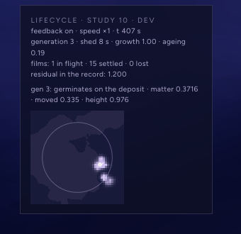

### The cycle as built

The simulation is `lib/lifecycle.js`: pure data, a fixed 0.1 s step, and
seeded randomness. The drawing is `components/LifecycleLayer.jsx`.

**The resident.** The largest veil of the strongest colony (colony 0) that
no strand reaches toward, so the colony's structure stays whole. On the
default world it is a veil 0.73 tall at (1.45, 9.95).

| Stage | Seconds | What happens | Rule it uses |
|---|---|---|---|
| Develop | 30 | Grows on its own clock, from nothing | the bloom material's existing `uGrowth` |
| Mature | 30 | Full | — |
| Age and shed | 40 | Opens toward lace and its film thins. Five films come away at seeded times, along it and up it, each carrying 0.08 units of matter | existing `uOpenness`, `uGain` |
| Transport | (each film) | Carried by the air at 0.9 of its speed, as the air's fragments are. It loses its preferred height (time constant 3 s) and sinks at 0.05 units/s. It settles within 0.1 of the ground or water, or after 90 s; over water it sinks to the bed | `airVelocity` (`air.js`); **the sink speed is the one new rule** |
| Memory | (each landing) | Its matter is added to the **live residual**: a 128² grid in History's own units. That new deposit then settles for five steps by the sediment model's transport and blur, with no supply and no decay, and stays. History is never written to | `sediment.js` steps 2 and 4 |
| Dissolve | 15 | Contracts away | `uGrowth` back to 0, as display only |
| Rest | ≥ 8 | Waits until every film has settled | — |
| Germinate | — | Reads the record and decides the next resident (below) | `scatter.js` membrane and veil rules |

**Germination, the consequence.**
- **Candidates.** Every point on a 0.15-unit grid within the colony's reach
  is weighed by:
  - the **membrane rules**, reading the record as it is now: History's
    trace *plus the residual*
  - **room** among the other membranes and the streams
  - **matter**: the residual within a 0.55 footprint, which must reach 0.03
- **Choice.** It germinates on the best site (suitability × matter).
- **Size** follows that matter: 0.75–1.35 × the first resident, from 0.03
  to 0.4.
- **Lean, openness and crests** follow placement's own veil rules at the new
  site.
- **Seed** comes from its predecessor's seed and its site's cell, so its
  shape is related but its own.
- **If no site holds enough matter, it grows back exactly as it was.** So
  any change in the next generation is caused by the deposit.

### What is causally real

| Requirement (above) | How it is met |
|---|---|
| **State** | The resident changes through its own stages on its own clock. Nothing is replayed |
| **Transfer** | Each film is simulation data: position, velocity, matter. It moves on the documented air field plus one sink rule, until it settles. The air's own GPU particles and fragments are untouched and still affect nothing |
| **Memory** | Settled matter is written to a live residual grid, kept separately from History. It is cleared whenever the world, History or the colonies are rebuilt |
| **Consequence** | The next resident's site, size and shape are computed from that grid. With it erased, they are not (below) |

**Display only:** dissolution reuses the growth parameter in reverse. The
causal path is entirely in the data.

### Validation

Every check uses the same world and the same seeds, stepped the same number
of times.

**The causal A/B.** Three generations (420 simulated seconds). "Same" means
the same site, height and seed as generation 0.

| World | Gen | Feedback on | Feedback off |
|---|---|---|---|
| Default | 1 | Germinates at (1.69, 9.57), 0.44 from its parent, on matter 0.194; height 0.729; new seed | Same: (1.45, 9.95), 0.729 |
| | 2 | Same site, same matter; a new shape (lineage seed) | Same |
| | 3 | Moves to (1.99, 9.42), onto matter 0.372; height **0.976** | Same |
| 188 | 1 | (0.75, 5.71), matter 0.071, height 0.709 | Same: (0.51, 5.80), 0.920 |
| | 2 | (0.75, 8.26), matter 0.128, height 0.784 | Same |
| | 3 | Same site, matter 0.247, height **1.038** | Same |
| 7 | 1 | (3.94, −10.58), matter 0.167, height 0.817 | Same: (3.27, −10.62), 0.873 |
| | 2 | (4.09, −10.73), matter 0.315, height 1.108 | Same |
| | 3 | Same site, matter 0.386, height **1.176** | Same |

**The other checks:**
- **Ablation.** Feedback on, but with the residual erased just before the
  first germination reads it: the result equals feedback off in all three
  worlds. The difference comes from the deposit and nothing else, such as
  the random streams or the stage timing.
- **Determinism.** Two runs give bit-identical decisions and residuals. The
  browser and Node give the same decisions and the same sites.
- **With the flag off:**
  - Explore's frames are pixel-identical to the committed code (12 frames,
    five worlds).
  - The generation fingerprints are bit-identical (eight worlds).
  - Saved configurations are untouched: the lifecycle adds no state.
- **Reset.**
  - A new colony seed, or a new History, starts a new lifecycle at
    generation 0 with an empty residual.
  - A view-only control (air density) does not reset it.
  - The studies run no lifecycle, and returning to Explore starts afresh.
- **Cost.**
  - 60 simulated seconds take 3.5 ms in the browser; the worst single step
    is 1.8 ms (a landing with its settling).
  - Node runs 420 seconds in 19–33 ms.
  - At ×8, a run of about 30 s reached generation 2 with no console errors.


### Limitations

- **One resident, one colony.** The colony's other members, structure,
  tissue, accumulation light and air obstacles stay as placed. Tissue that
  would have climbed the resident's first membrane does not grow, and the
  air still bends around generation 0's footprint.
- **The deposit is not drawn.** A first attempt added the residual to the
  terrain's record. That raised the ground by up to about 5 cm over the
  colony's tissue drape, which then read as a dark mound. It was removed:
  the ground shows History alone, and the deposit is visible only in the
  inspector and through what grows from it. How it should be seen is open.
- **Hard to see at a normal distance.** The ageing and the films are small
  there; the loop reads best close up or in the inspector.
- **One new rule.** The sink speed is the only rule not taken from an
  existing system. Without it, films flew for a minute or more and settled
  past the colony, in the basin.
- **Deliberately simple choices:**
  - Germination has a threshold.
  - Size saturates at 1.35×.
  - The residual never decays and is never taken up, so memory accumulates
    for the whole session.
  - Residents tend to stay on their own deposits (positive feedback).
  - Matter that settles under water is recorded, but no resident can grow
    there.
- **Session-only.** The lifecycle is not saved, and it starts afresh on any
  regeneration or on leaving Explore. In the browser the simulation follows
  frame time, so a step happens at a slightly different wall-clock moment,
  but the sequence of events is the same.
- **Lint.** It adds three warnings of existing kinds: per-frame updates, and
  a fast-refresh notice for exporting the film mesh from `AirFragments`.

### Stopping here

Not extended to other colonies, pending review. The open questions above
remain open, together with:
- whether and how the deposit should be visible
- whether residents should take matter up (a cycle rather than an
  accumulation)
- whether memory should fade

---

## Stages 0–2 demo, 17 October 2026

Built to stages 0–2 of the [demo plan](03-DEMO-EXECUTION-PLAN.md), read
with the [handoff](01-PROJECT-HANDOFF.md), the
[ecological logic](02-ECOLOGICAL-LOGIC.md) and the five design studies in
[`references/`](references/). It replaces the prototype's code above. A copy
of that code, and of the rest of the working tree before this round, is kept
outside the repository in `pwb_hw0-baseline-2026-10-17-stage02/`.

### Stage 0: what was reused, what was missing

**Reused:**
- **The prototype's simulation:**
  - a fixed 0.1 s step and seeded randomness
  - films carried by `airVelocity`
  - the live residual grid in History's units, settled by the sediment
    model's transport rule
- **The membrane rules** (`bloomFits`), reading History's trace plus the
  live residual.
- **The renderers:** `buildBlooms` and the bloom materials for each
  resident, `createFilmMesh` for the films, and the tissue material for the
  deposit.

**Missing, against the plan:**
- **One resident at a time.** The next generation replaced the last.
- **Regrowth in place.** With no site, the resident grew back as it was:
  the respawn the plan rules out.
- **The deposit was not drawn.**
- **Nothing was taken up.** The residual only grew, and shedding did not
  reduce a body.
- **No pause or reset**, short of regenerating the world.

**No architectural blocker.** Everything stays beside the pipeline, in
`lib/lifecycle.js`, `components/LifecycleLayer.jsx` and
`components/LifecycleInspector.jsx`. The generation libraries are unchanged.

### Running it

| URL | What it does |
|---|---|
| `?lifecycle=1` | Turns it on in Explore and frames the patch. Off by default; adds no state and no panel control |
| `&feedback=0` | The counterfactual: residents still lie down and release, and films still fly and settle, but nothing is recorded |
| `&lifespeed=4` | Starts at ×4 (1, 4 or 8 also from the inspector) |

**The inspector** (bottom left, flag only):
- **Controls:** pause, ×1/×4/×8, reset (a fresh lifecycle on the same world).
- **Residents:** each one's stage, body and unfold.
- **The ledger:** where the matter is.
- **The last events**, in words: a release, a settling, waiting, a formation
  and what it took matter from.
- **A map:** live residue (lilac), standing residents (dots), contours
  (rings) and films.

`window.__lifecycle` exposes the simulation for scripted checks.

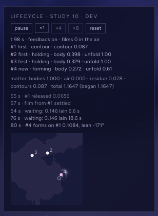

### What happens

**The residents.** Three veils of colony 0 that no strand reaches, the
tallest first. They are drawn by the lifecycle and left out of the placed
colony. On the default world:

| | Site | Height | Body | Stands until |
|---|---|---|---|---|
| #1 | (1.45, 9.95) | 0.73 | 0.437 | 14 s |
| #2 | (−0.09, 6.58) | 0.66 | 0.398 | 110 s |
| #3 | (−2.15, 6.90) | 0.55 | 0.329 | 210 s |

Their holds are staggered by hand. Everything after that is computed.

**A resident's stages:**

| Stage | Seconds | What happens |
|---|---|---|
| Forming | 26 | Takes up matter (below) and unfolds as it does |
| Holding | 80–140 (seeded) | Stands. One not fully formed keeps taking up while it can |
| Lying down | 20 | Reclines along its lean toward the ground |
| Releasing | 28 | Lies flat and sheds four films, carrying 60% of its body. The body loses exactly what they carry |
| Contour | — | The other 40% stays where it stood, as a faint flat outline. A later resident can take at most half of it |

The reclining is a vertex transform, drawn only. The matter is all in the
simulation.

**Transport.**
- **Carried** at 0.9 of the air's speed, as the air's fragments are.
- **Lift** decays over 4 s; the film sinks at 0.04 units/s.
- **Settles** within 0.1 of the ground or the water, or after 90 s.
- On the default world 24 films settle in 600 s, 15 of them in the
  shallows. None is lost.

**Memory.**
- **The residual.** A settled film's matter is added to the live residual,
  with its source recorded and the time it arrived.
- **Settling.** That new deposit then settles for five steps by the
  sediment rule.
- **History is never written to.**

**Seen.**
- **A ground skin.** The deposit is drawn as a thin skin in the tissue
  material, 2 cm above the ground: pale lilac, with fold light where it
  thins. It does not raise the terrain.
- **Blurred for display only.** The residual is blurred before it is drawn.

**Waiting.** Matter must lie for 22 s before anything can use it. Until then
the inspector reports "waiting".

**Formation.** Every 2 s the patch looks for a site:
- **Matter:** at least 0.1 within a 0.6 footprint, none of it arrived in
  the last 22 s.
- **Ground:** the membrane rules at least 0.2 on the live record.
- **Room:** clear of the streams, the colony's other membranes and standing
  residents.
- **Limits:** at most four standing, and one forming at a time.
- **Choice:** the best site by suitability × matter × edge. Edge is how
  sharply the deposit changes there.
- **Lean:** follows the deposit's downhill direction, blended 3:1 with the
  colony's own lean.
- **Height:** from the veil rule. Its body needs 0.6 × height.
- **Use:**
  - it takes matter from the residual under its footprint, in proportion
    to each source's share
  - and from the spare of old contours, never below half of each
- **Partial form:** it unfolds as far as the matter taken allows. No site
  means no resident: the patch waits.

**The ledger.** Bodies, films in the air, residual, contours, and what was
lost or not recorded always add up to the total the patch began with.

### Causal evidence

Default world, Node, 600 simulated seconds, same seeds.

| | Feedback on | Feedback off |
|---|---|---|
| #1 releases (39.5–55 s) | 4 films × 0.0656 | The same 4 films, the same landings (to 80 s) |
| 48–57 s: settle | Residual 0.262 by #1's contour | Not recorded: residual 0 |
| 80 s | **#4 forms at (1.74, 9.47)**, on matter from #1 (0.108), lean −171°, height 0.74 | — |
| #4's body | Took #1's residue 0.185 and #1's contour 0.087; unfolds to 0.61 | — |
| 188 s | **#5** forms at (0.09, 6.92), on #2's residue | — |
| 292 s | **#6** forms at (2.04, 8.72), on #1's (0.027) and **#4's** (0.074) residue: a second generation | — |
| End | 6 contours, residual 0.617 | 3 contours, 0.699 never recorded |

**The other checks:**
- **Ablation.** Feedback on, but only #1's residue (0.262) is erased at
  79.5 s, just before it would be read. Nothing forms there. The first
  formation is at 184 s, on #2's residue at (0.09, 6.62).
- **The ledger.** It drifts at most 2 × 10⁻⁸.
- **Determinism.** Two runs give identical events and residuals.
- **Browser and Node agree.** In the browser, at the default view, the
  residue is 0.262 at 62–74 s and #4 forms at 80 s.
- **With the flag off:**
  - Explore's frames are pixel-identical to the committed code (12 frames,
    five worlds).
  - The generation fingerprints are bit-identical (eight worlds).
- **Cost.** In Node, 600 simulated seconds take 0.54 s. The slowest step
  (a formation search or a landing) takes 6 ms.

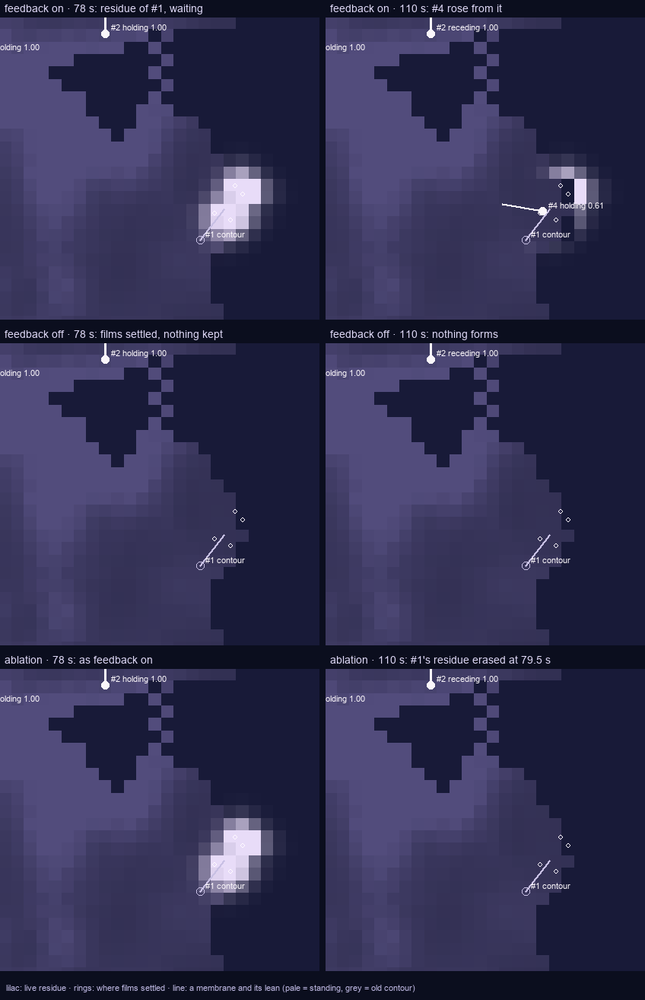

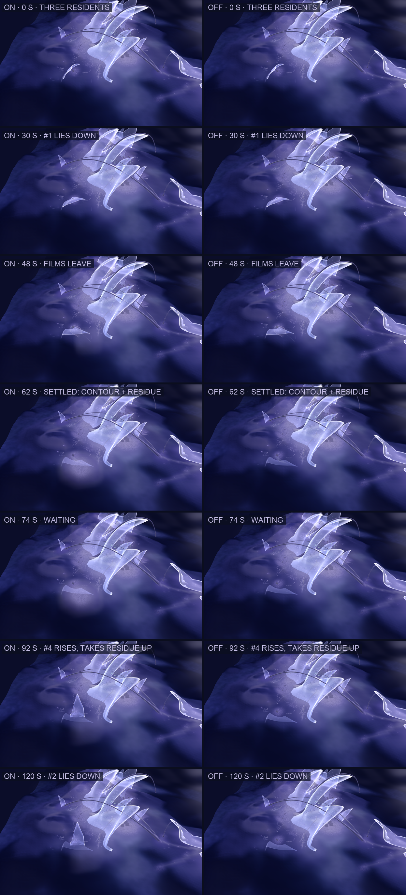

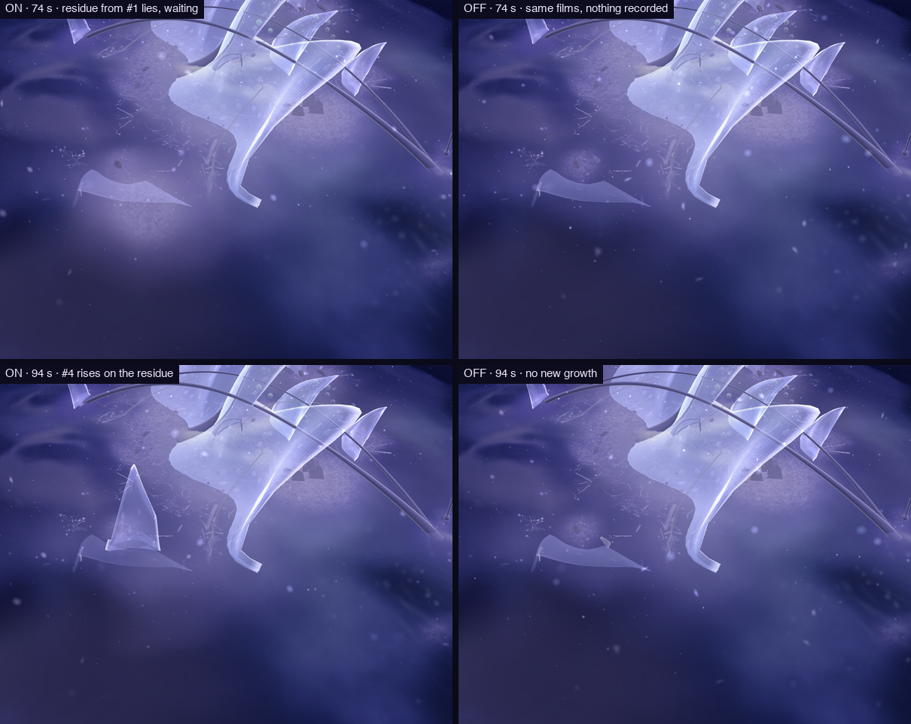

The short recording,
[`10-stage2-on-off.gif`](images/10-stage2-on-off.gif), runs the stills from
20 s to 120 s side by side.

### Relation to the design studies

The studies are proposals, not specifications. This demo covers part of
them:

- **[02, *What remains becomes a condition*](references/02.png).** Its six
  moments map onto one resident's cycle:

  | Study | Demo |
  |---|---|
  | Held form | Holding |
  | Release | Lying down, then shedding films |
  | Settle | Films settle; residue by the contour |
  | A changed place | Residue that waits 22 s |
  | Reorganize | Formation taking matter up |
  | A different resident | #4: a new site, lean and height, with #1's contour still there |

  The study's warm gold residue is not used. The deposit stays in the
  project's lilac and pearl.
- **[01, *One shared habitat*](references/01-habitat.png).** Release (a
  form recedes, some matter stays) and new conditions (growth uses the
  deposit; the trace persists) are built.
  - **Within reach:** matter crosses about a unit, within one colony.
  - **Not built:** living forms redirecting the passage. The air does not
    change around residents as they change.
- **[03, *Three readings of time*](references/03.png).**
  - **Place history:** built. A young resident can stand on an old place,
    as #6 does on #1's and #4's residue.
  - **Present state:** only lying down, which is part of ending.
  - **Age:** not shown on the resident.
- **04 and 05, the bodies.** Not built. A shared body below the surface is
  stage 3–4. Nothing here is a core: the colony's existing forms are placed
  as before.

### Readability

The default view stands about 8 units from #1, in the opening framing.

**Readable at that distance, with the full atmosphere on:**
- lying down
- the residue patch
- #4 rising
- the faint contour

**Less readable:**
- **The films** are small in flight.
- **Deposits in the shallows** sit under the water's veil and read weaker.
  Most landings here are there.

### Limitations

- **The patch winds down.** Each formed resident is smaller than the matter
  it stood on (unfold 0.52–0.61), and nothing feeds the patch. After about
  500 s every resident is a contour and nothing more forms.
- **Hand-set:**
  - the first three holds
  - the sink speed
  - the 22 s rest
  - the 50% kept by contours
  - the four films
- **The rest of the colony does not follow:** its structure, tissue,
  accumulation light, branching, and the air's obstacles stay as placed.
- **One patch.** Only colony 0, and no world-wide rollout.
- **Evidence conditions.** The figures were made with the render clock held
  and, for the stills and the recording, the haze, dust and air fragments
  hidden. The full-app figure shows the default atmosphere.
- **Session-only.** It starts afresh on any regeneration or on leaving
  Explore, and the reset button restarts it.
- **Not measured:** frame rate in a real browser.
- **Lint.** Five new warnings of existing kinds (43 in all, 38 at the
  commit). Four are per-frame updates in `LifecycleLayer`, and one is the
  fast-refresh notice for exporting the film mesh from `AirFragments`.

### Stopping here

Stage 2 is complete, pending review. Not extended beyond the patch, not
committed. Stages 3–4 (a shared body that forms below the surface, and
integration over many generations) and feeding back to residents are later
candidates.

---

## Warm accent A/B, 17 October 2026

A development A/B, not a decision: a very restrained warm shift (pale
champagne, `#EFDCC0`) only where matter is crossing from one state to
another, to make exchange easier to read. Off by default.

### What the code can actually read

| Exchange | In the simulation | Readable as |
|---|---|---|
| Release | `release()`: a film leaves a lying resident, which loses that matter | the film's age, and the point it left from (`lastRelease`, added as a record) |
| Transport | each film moves on `airVelocity` until it settles | position and velocity per film. **There is no channel:** matter crosses open air as films. No strand, bridge or vein carries anything |
| Deposit | `settle()` writes the film's matter into the residual | `arrived` per cell (existing); only when feedback is on |
| Uptake | `takeUp()` moves matter from residual cells and old contours into a forming resident | about 10 s at the full rate (0.03/s), then a short tail. Recorded for the display as `drawn` per cell, `tookAt` per resident, `gaveAt` per contour |

The records are timestamps only. The simulation is bit-identical with and
without them: event log, residual, residents and ledger, feedback on and off.

### Running it

`?lifecycle=1&warm=1|2|3`, or the inspector's "warm accent" buttons. Without
it, the accent is not compiled: the shaders use a `WARM` define set only on
the lifecycle's own materials (the residents' membranes, the deposit, the
lifecycle's films).

### Where the accent goes

- **The hue changes, at the brightness the surface already has.** Nothing
  is outlined, and the only added light is 3–10% of the tint.
- **Only on lit surfaces.** A pale beige on a dim violet surface reads as
  brown, so shadow and the deep shallows keep their violet. The films are
  the exception: they are screened light and cannot darken.
- **Each cue fades out after its transition** (simulation seconds):

| Transition | Where | Fades over |
|---|---|---|
| Release | the spot on the lying resident a film left; the film in its first seconds of flight | 3 s; 8 s |
| Deposit | a film just settled (feedback on only); the fresh deposit's thin edge, or (variant 3) all of it | 4 s; 18 s |
| Uptake | the residue cells being drawn from; the new resident's foot while it takes matter in; an old contour while it gives | 3 s; 2.5 s; 2.5 s |

**Not done, because it would be decoration or false logic:**
- no trails or tubes along the films' paths
- nothing on strands, bridges, veins or the colony's tissue
- no permanent warm on contours or deposits
- nothing over the whole world

### Variants

| | Release | Deposit | Uptake | Reads as |
|---|---|---|---|---|
| 1 edge | faint | fresh edge only | faint | almost invisible at the default distance |
| 2 uptake | light | fresh edge only | **strongest**: drawn ground, the new foot, the giving contour | exchange at the moment it happens; quiet otherwise |
| 3 deposit | light | **all of the fresh deposit** | faint | a warm stain that lasts 18 s; on a deposit in the shallows it can turn beige-grey |

### Evidence

- **Default unchanged:**
  - Without `&warm`: 16 lifecycle frames (feedback on and off) and 12
    flag-off frames are pixel-identical to before. Switching the accent
    back to off in a running session also restores identical frames.
  - With feedback off, only the release cue appears. Release still happens
    then; nothing is recorded, so no deposit or uptake cue shows.
- **Build and lint:** the build passes. Lint gives 0 errors and 47 warnings,
  four new, all the existing per-frame kind.

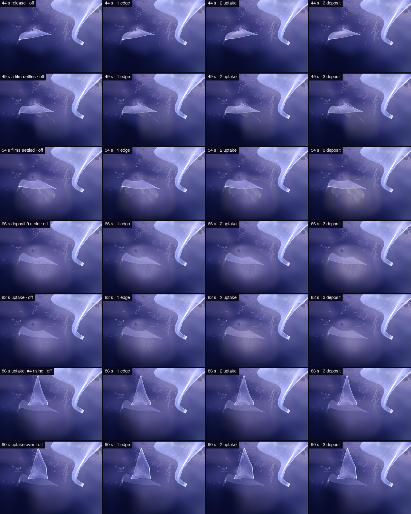

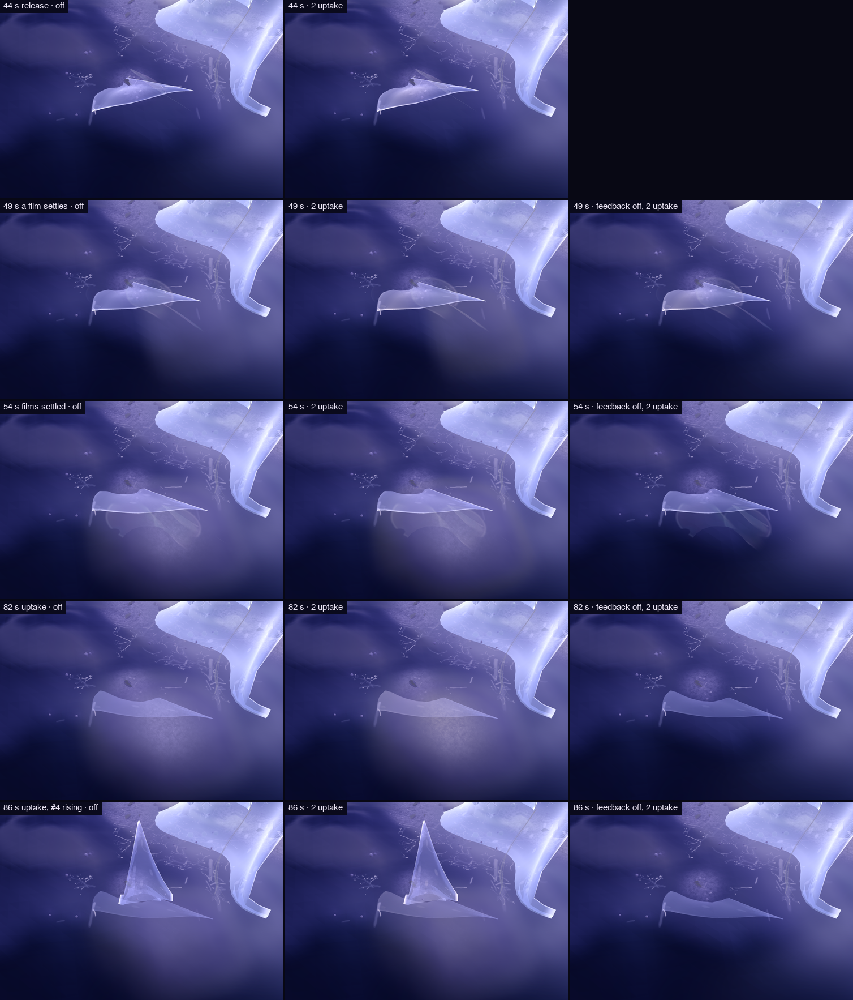

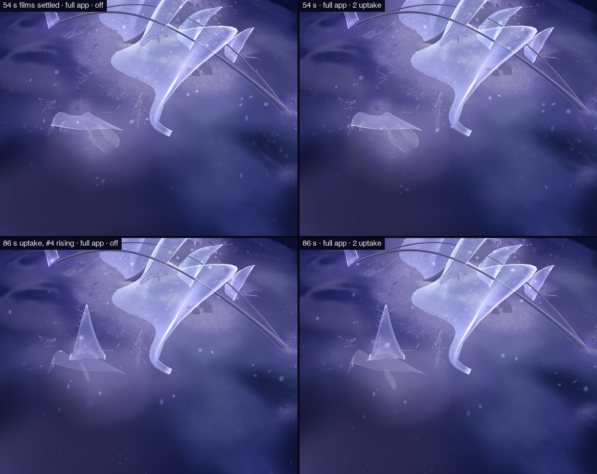

### Open

- **Recommended:** variant 2, pending review.
- **Weak at the default distance:**
  - The release cue on a near-white membrane is faint.
  - A film in flight barely carries it.
- **The handoff's warning.** It cautions against making the design
  studies' gold markings permanent (01, §7). This accent is transient and
  bound to state, but whether a warm hue belongs in the world at all is a
  design decision, not settled here.

---

## Uptake study, 18 October 2026

**Why.** Variant 2's uptake cue was correct but hard to see. Around 82–90 s
the A/B captures barely differed from off. This study tries two distinct
approaches to the same event, the same world and the same camera, and
nothing else is lit. It is an A/B for review, not a decision.

### What the simulation offers

Inspected in the code before changing anything:

- **The uptake** (`takeUp()`). #4 forms at 80 s and takes matter at the full
  rate (0.03/s) until about 90 s, then a short tail.
  - **From the residue** under its footprint (radius 0.6), each cell giving
    in proportion to its matter and how central it is.
  - **From #1's old contour**, never below half of it. That is 0.087 of the
    0.272 #4 takes, about a third.
- **The new membrane.** Each column scales up from its own foot as the
  resident unfolds. #4 is visibly growing from about 84 to 88 s. Its `uv.y`
  is the arc length up each column, so a cue can follow the sheet itself.
- **No channel.** Matter moves from the ground into the body directly. No
  strand, bridge or vein carries it, so neither approach draws a path.

**Added, display records only.** Uptake was recorded only by *when*, not by
*how much*. The study adds how much matter was taken up lately:
- per cell: `uptake`, `uptakeAt`
- per resident: `inflow`, `inflowAt`

Each amount is weighed down by exp(−age / 2.5 s), kept lazily. Nothing in
the simulation reads them. The event log, residual, residents and ledger
hash the same as before any warm work, feedback on and off.

### The two approaches

Both use the same pale champagne (`#EBDBB6`). The URL is `?lifecycle=1&warm=a`
or `&warm=b`, or the inspector's "A absorb" / "B growth".

| | A, surface absorption (`warm=a`) | B, new growth (`warm=b`) |
|---|---|---|
| Where | the deposit skin | the new resident's membrane |
| Reads | matter taken from each cell lately, ÷ 0.005 (about the most one cell gives) | matter the resident took in lately, ÷ what full-rate uptake brings in 2.5 s |
| Over time | grows around #4's foot (80–85 s), peaks at 85–87 s, then shrinks toward where matter is still left and is gone by about 94 s | 0.19 at 80.5 s → 0.96 at 87 s → 0.17 at 94 s |
| Drawn as | **Hue and light.** A hue shift where the skin is lit; where it is dim, a little light instead (a hue there turns olive). **Texture.** Broken by a broad, slow variation; two light blur passes, so the cell grid does not show. **Density:** slightly denser | **Extent.** From the foot along each column's own surface, as far as 0.08 + 0.32 × the intake, unevenly across columns. **Front.** Fuller low down, with a soft, slightly brighter front. **Density:** a little denser |

**How it got there.** Four rounds of captures:
1. Both too faint, and B a flat tan.
2. A turned into yellow-olive blotches.
3. A showed the cell grid as dots.
4. Final.

### What changed, and what did not

- **Changed:**
  - `lifecycle.js`: the records above
  - `formMaterial.js`: A in the tissue shader; B in the membrane shader,
    and the arc length in the form vertex shader. All inside the `WARM`
    define.
  - `LifecycleLayer.jsx`: variants 4 and 5
  - `LifecycleInspector.jsx` and `App.jsx`: two inspector buttons, and
    `&warm=a|b`
- **Unchanged:**
  - **The simulation** (hash above).
  - **The off state.** Without `&warm`, 16 lifecycle frames are
    pixel-identical to before. With the flag off, 12 frames match the
    committed references.
  - **Variants 1–3.** Six frames are pixel-identical to the 17 October
    captures.
  - **No new geometry, controls or settings.**
- **Build and lint:** the build passes. Lint gives 0 errors and 47 warnings,
  none new.

### Comparison

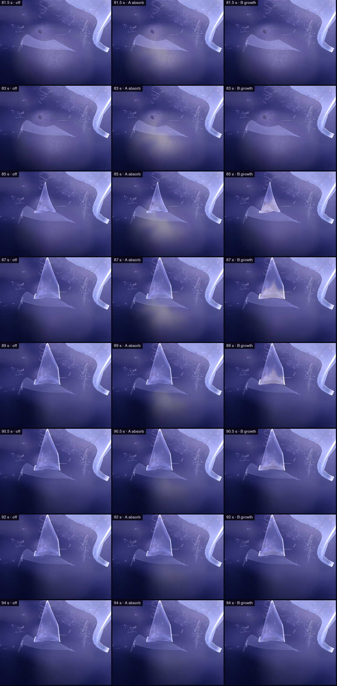

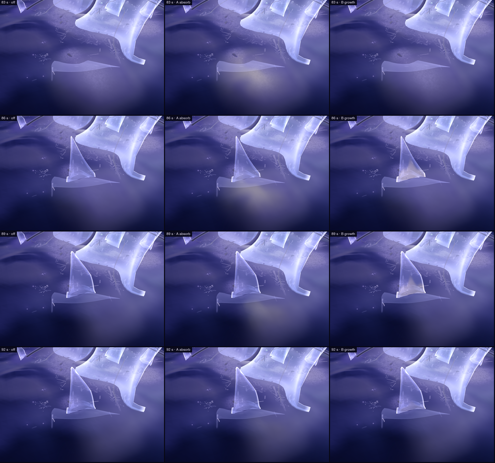

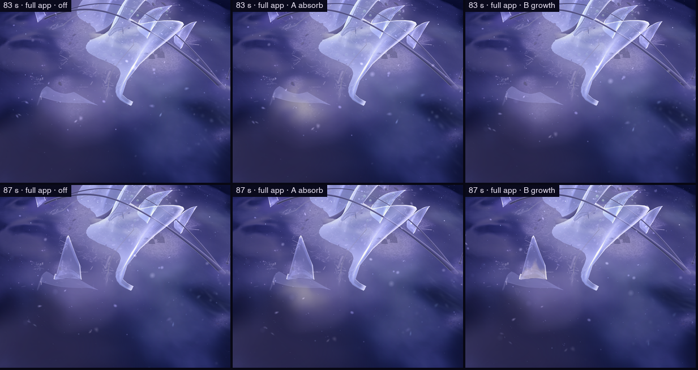

- **B communicates exchange better.** The warmth sits in the new body's own
  material and follows its geometry. It rises and recedes with what the
  resident actually takes in, and it is clearly distinguishable at the
  default distance from 85 to 90.5 s. It reads as matter becoming part of
  the organism, not as a light.
- **A has the better timing.** It is the only one visible in the first
  seconds (81.5–84 s), while #4 is still too small to see. It is also
  truthful about where the matter comes from.
- **But A reads as a soft glow in the ground.** Late in the uptake it drifts
  away from #4, toward the matter still left. That is accurate, but on
  screen it does not connect to the new resident.

**Recommended: B, pending review.** One possible limited combination, *not
implemented*: B, plus A only near the foot and only until the membrane is
visible, to cover the first seconds.

### Limitations

- **B starts late.** It cannot show the first ~4 s of the uptake (80–84 s),
  because #4's geometry is still tiny then.
- **The contour's third is not shown** by either approach. Variants 1–3
  have a contour cue.
- **One event tested:** #4 on the default world. #5 and #6 were not
  reviewed.
- **Hand-set:** the normalisations (0.005 per cell; full rate × 2.5 s), the
  reach and the tint.
- **Colour.** B can read slightly beige-peach on the lilac membrane. A dims
  with the water in the shallows.
- **Evidence conditions.** The captures hold the render clock and hide the
  haze, dust and air fragments. The full-app figure shows the default
  atmosphere.

---

## Shared conduit, 19 October 2026

> Superseded on 20 October by [a tissue that grows](#shared-tissue-grown-20-october-2026).
> This section stays as the record of the fixed-route version. Its code is
> outside the repository, in `pwb_hw0-conduit-v1-2026-10-19/`.
>
> **Correction (20 October):** that version's soft band was hardly ever
> drawn. It rendered single-sided and was culled when seen from above, so
> only its tubes showed. The grown tissue below renders both sides.

The brief is the [Shared Conduit Study](references/conduit-01.png): one
landscape, shared tissue, distant lives; local release can support distant
emergence. It is read here as the system's statement, toward stage 3 of the
[demo plan](03-DEMO-EXECUTION-PLAN.md) (a shared body with one real function).
This is a contained step behind a flag, for review, not a change to Explore.

### Diagnosis: what existed

- **Implemented.** A real local loop on one patch of colony 0: release,
  deposit and uptake, with a matter ledger and provenance (stages 0–2 above).
- **Only implied.** Every colony was self-contained:
  - nothing in the code connected one colony to another;
  - the branching network (study 08) grows around one colony and is static;
  - the colony tissue and accumulation light are computed once;
  - the air carries nothing between colonies.

  "One body" existed only as a shared palette.
- **What could become a shared conduit.** History's record. Between colony 0
  and colony 2 (4.4 units apart, the same landmass) the trace never falls
  below 0.41 along the line between them: the ground already remembers a
  corridor where matter gathered. The branching study's way of drawing a
  network "beneath the surface" was the visual precedent.
- **Where to put it.** A contained step first, behind a flag. It changes the
  lifecycle's dynamics, and adds geometry Explore has not had, so it should
  be reviewed before Explore shows it.

### What was built

**The tissue** (`lib/conduit.js`).
- **The route.** The cheapest way over land from the lifecycle's colony to
  the nearest colony it can reach (within 9 units), where crossing ground
  with no record costs up to five times more.
- **Its roots.** At each end it roots into the bases of that colony's
  members, wherever there is a way over land. On the default world:
  - colony 0's three residents;
  - one of colony 2's two smaller membranes. Its anchor stands at the hub
    itself, and the other membrane has no way over land from the hub.
- **As a graph.** On the default world, 154 nodes 0.1 apart: a 4.8-unit trunk
  and four roots.
- **Not grown, and not claimed to be.** The route is read from the record. It
  does not grow from the lifecycle's residents.

**What moves through it** (`lib/lifecycle.js`, `circulate`). Each step:

1. **What lies on the tissue sinks in** (only with feedback on):
   - **Old contours:** their spare part, with a 60 s time constant. A
     contour keeps half of itself, as before.
   - **Residue lying on the tissue:** 1.5% per second.
2. **It spreads.** Diffusion along the tissue's edges (0.12 units²/s), in
   substeps that stay stable.
3. **Each colony's hub draws on it.** The hub draws into a pocket while the
   pocket has room. A colony holds up to 0.45 × its demand, and its demand is
   1 − maturity (its room to grow):
   - **Colony 0** (maturity 0.92) holds up to 0.036 and is soon full.
   - **Colony 2** (maturity 0.45) holds up to 0.25.

   Matter therefore passes on from the mature colony to the younger one.
4. **The tissue thickens** where matter passes, and thins again (over about
   4 minutes) where none does.

**Formation from it.**
- **Where.** A colony's pocket can be taken up where the tissue runs within
  that colony, and each colony looks only on its own ground (nearer to it
  than to the other).
- **The usual rules.** Enough matter, rested 22 s since the pocket came to
  hold enough, the membrane rules, room.
- **Provenance.** Matter keeps its origin through the tissue and the pocket.
  The formation event names its sources ("via the tissue"), and the ledger
  adds `tissue` and `pockets` to the total.

**Drawn** (`components/ConduitLayer.jsx`).
- **The body.** A soft band along each path, a little deeper in tone than
  the ground, like a vein under skin.
- **The fibres.** Three fibres braided along the trunk (two on each root):
  thin translucent tubes that run beneath the ground and come up through it
  here and there, as roots do. They are lit as the colonies' strands are.
  This is the "small amount of new geometry".
- **Champagne only where matter is.** The tissue turns toward it as much as
  matter is in it. A pocket shows as a warmer stretch at its hub.
- **Specks: flowing residue.** Small pale specks carried at the velocity the
  matter actually has (net flow ÷ matter present). They appear only where
  matter is moving, so stored matter shows in the tissue, not as specks.
- **No arrows, labels or glow.**
- **Defaults with the flag.** Uptake into new growth uses approach B of the
  [uptake study](#uptake-study-18-october-2026), unless `&warm` says
  otherwise. The view frames both colonies from the south, well above.

**Running it:** `?lifecycle=1&conduit=1`. The inspector adds tissue and
pockets to the ledger, "sank into the tissue" and pocket events, and the
tissue on its map.

### Evidence

Default world, Node, 900 simulated seconds, the same seeds.

| | Colony 0 (local loop) | Colony 2 |
|---|---|---|
| Conduit on | #4 80 s, #5 188 s, #6 292 s (as without it) | **#7 at 494 s**, on the tissue, via the tissue: #3 0.080, #2 0.028, #1 0.002. **#8 at 872 s**, partly from #7 (0.046) |
| Conduit off | The same | Nothing |
| Trunk cut in its middle | The same | Nothing; colony 2's pocket stays at 0 |

- **Movement.** After the first flow (57 s), matter is moving through the
  tissue in 94% of steps up to 900 s. So at almost any moment something is
  being carried somewhere, which is the "global" reading.
- **The ledger** drifts at most 2.6 × 10⁻⁸; runs are deterministic.
- **Unchanged without the flag:**
  - The stage 0–2 simulation's hash is unchanged.
  - 16 lifecycle frames are pixel-identical to the 17 October baseline.
  - With the flag off, 12 frames are identical to the committed references.
- **Cost.** About 2.4 ms of computation per simulated second (diffusion
  substeps).
- **Build and lint.** The build passes. Lint gives 0 errors and 51 warnings;
  the four new ones are per-frame updates in the new layer.


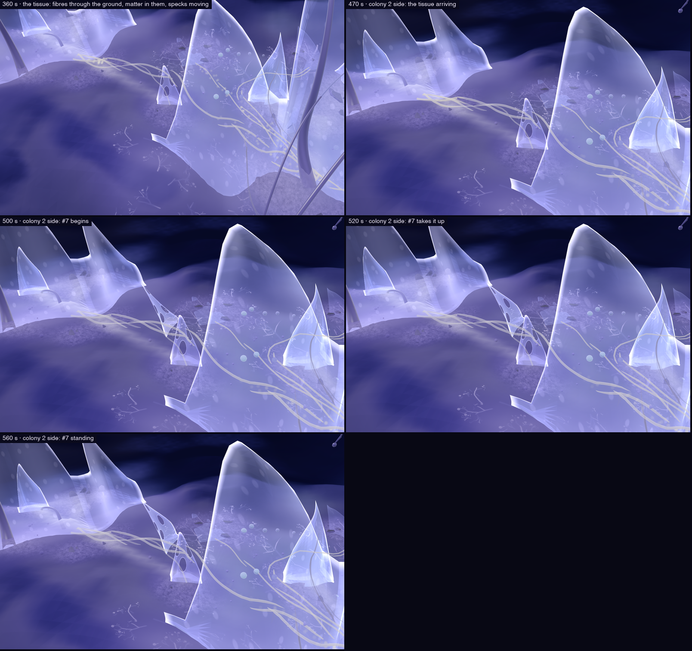

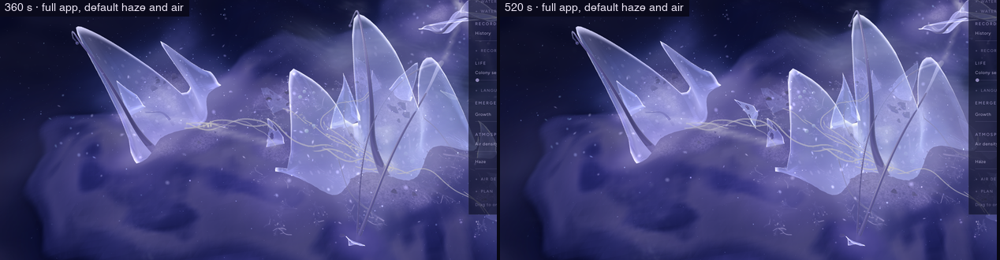

[`10-conduit-specks.gif`](images/10-conduit-specks.gif): twelve frames, ten
simulated seconds apart, of the specks moving along the tissue.

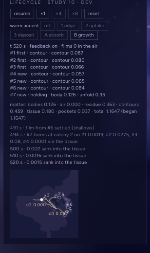

### Relation to the study

| Study | Here |
|---|---|
| 01 Release site: a colony releases excess matter into the ground | Old contours and residue lying on the tissue sink into it |
| 02 Transfer through a shared subterranean conduit | Diffusion through a tissue routed along the record, toward where there is room to grow |
| Stored residue in local pockets | Each colony's pocket, at its hub |
| Shared conduit: a living tissue network | Braided fibres beneath the ground, surfacing; thickening with use |
| Flowing residue | Specks moving at the matter's own velocity |
| Uptake zone; 04 emergence | #7 forms from the pocket, on the tissue, on colony 2's ground |

**Not taken from the study:**
- the cross-section view, porous ground and "deeper matrix" (Explore has no
  section mode)
- arrows, labels and its gold
- a network across the whole landscape: one link only

The champagne keeps the meaning set earlier: matter in transition, stored
residue, uptake. It is never a permanent line.

### Limitations

- **One link, built once.** The route is fixed at the start, and it does not
  grow from the residents.
- **A hand-set rule.** Demand as room to grow (1 − maturity) is a rule of
  this study, and the rates are set by hand.
- **Provenance near the boundary.** #3 was placed in colony 0, but it stands
  at its western edge, 0.6 units from where #7 rises. Its matter still
  reached #7 only through the tissue, up its root to colony 0's hub and
  along the trunk (the cut removes #7). On screen, though, #7 rises close
  to where #3 lay.
- **Readability.**
  - The emergence happens at about 500 s (about 2 minutes at ×4).
  - At the default distance, #7 and the warmth are small.
  - The specks are faint until close.
  - The first ~57 s carry nothing (no release has ended yet).
- **The rest of the world is unchanged:** the air, colony tissue,
  accumulation and branching do not respond to the conduit. The tissue's
  geometry does not change shape with use; only its shading thickens.
- **Session-only**, like the rest of the lifecycle.

### Stopping here

For review. The next candidate is to extend this to every colony reachable
over land, so the conduit becomes a network. Its route would then grow, or
thicken in geometry, from what has passed through it, rather than being
fixed.

---

## Shared tissue, grown, 20 October 2026

The brief: revise the conduit using mycelium's growth logic, without
drawing a fungus. Make it easier to explain and more organic, and tie
every visible effect to state and to material flow. It replaces the fixed
route above, behind the same flag, `?lifecycle=1&conduit=1`.

**In one sentence:** where a resident lets matter into the ground, a
tissue begins; its tips grow on that matter toward colonies with room to
grow, and fuse where they meet; the paths that carry most thicken into a
trunk while the rest thin to dormant traces; and a colony's pocket, filled
through the tissue, becomes a new resident there.

### What is taken from mycelium, and how

| Mycelium | Here | The rule |
|---|---|---|
| Growth begins from local conditions | Where matter enters the ground | **What enters:** part of every release (35%) goes into the ground at the resident's base; the rest is films, as before. An old contour's spare part sinks in too, and so does residue lying on tissue. **Where none is near:** with no tissue close by, a growth begins there (not under water) |
| Tips explore and branch | Tips grow only on the matter they hold | **Feeding:** a growing tip draws matter toward itself from the few nodes behind it. It advances up to 0.08 units/s as that allows, carries half forward, and spends 0.004 per unit length (which becomes the tissue). **Steering**, among a few headings: <ul><li>History's trace</li><li>a signal from colonies with room to grow (1 − maturity), measured as distance over land, so it leads around water</li><li>persistence, chance, and a little self-avoidance</li></ul> **Branching:** a chance per step |
| Hyphae fuse | Separate growths join | A tip meeting other tissue (within 0.14) joins it and stops |
| Used paths thicken | Thickness is how fast a path carries | Each path's conductance rises with what passes along it and decays toward a floor without it. Parallel paths compete, and the busiest becomes the trunk |
| Local pockets store matter | Each colony's hub | A hub draws matter from the tissue while its pocket has room (0.45 × demand). New residents there form from the pocket and take it up |
| Inactive paths go dormant | Nothing is deleted | **A tip** that rests 120 s without matter stops. **An unused path** thins to the floor and stays as a faint trace |

**What spreads matter.** Diffusion along each path, as fast as the path is
thick, in substeps that stay stable. Nothing is lost: the ledger adds the
matter in the tissue, the matter grown into it, and the pockets.

**The growth's own randomness.** It uses a seeded generator of its own, so
everything else runs exactly as without it.

### What is drawn

Each point below is a quantity, not a decoration (`components/ConduitLayer.jsx`):

- **The tissue:** soft translucent bands just over the ground along every
  stretch. Pearl-lavender, deeper at their edges, with a faint iridescence.
  Drawn before the membranes, so they veil it as they veil the ground.
- **Use:** a band's width and density, and fine fibres along it. A dormant
  path narrows to a faint line. Free ends taper.
- **What it holds:** a pale champagne, as much as matter is there,
  including a colony's pocket at its hub.
- **What moves in it:** soft pulses inside the band. Each stretch's pulses
  move at the matter's own velocity there (net flow over the matter
  present). Where nothing flows they stand still.
- **Growth:** a slight brightening at a tip while it advances.
- **Removed from the fixed route:** the tubes and specks. There are no
  particles, arrows or lines over the ground.

**Seeing it:**
- The view frames every colony the tissue joins, from the south.
- The inspector adds:
  - the tissue and its matter to the ledger;
  - the tips growing and dormant;
  - fusions;
  - "tissue begins under #…", "reaches colony …" and pocket events;
  - the network on its map, as thick as it is used.

### Evidence

Default world, Node, 900 simulated seconds, the same seeds.

| Run | At colony 0 | Elsewhere (via the tissue) |
|---|---|---|
| **Tissue on** | none | **#4 at colony 1** (282 s, from #2's matter), **#5 at colony 2** (394 s, from #3, #1, #2), **#6 at colony 1** (582 s, mostly from #4), **#7 at colony 2** (806 s, mostly from #5) |
| Tissue off | 3 local formations | none |
| No growth (tips never advance) | 1 | none |
| No release into the ground | 2 | later, and fewer: 490 s and 834 s, both at colony 1 |
| No thickening with use | none | four, at different times (334, 350, 742, 778 s) |

**The growth itself (tissue on).**
- **Beginnings.** Tissue begins under #1 at 39.5 s, #2 at 134.7 s and #3
  at 233 s.
- **Arrivals.** Colony 1's pocket is ready at 259 s, and a tip reaches
  colony 2 at 275 s.
- **The network.** At 450 s it has 241 nodes and 20 fusions, with 210
  thickened paths. By 900 s, 44 are still thick and the rest have thinned
  (9 already at the dormant floor). One tip went dormant.
- **Generations.** #6 and #7 are a second generation: their matter came
  mostly from residents that had themselves risen from the tissue.

**The other checks:**
- **Determinism and the ledger.** Runs are deterministic, and the ledger
  drifts at most 6 × 10⁻⁸.
- **Unchanged without it:**
  - The stage 0–2 simulation's hash is unchanged without the flag.
  - Without the tissue, 16 lifecycle frames are pixel-identical to the
    17 October baseline.
  - With the flag off, 12 frames are identical to a clean build of
    `c923a84`.
- **Cost.** About 3–5 ms of computation per simulated second. The worst
  step is about 10 ms, in the formation search once a pocket is full.
- **Build and lint.** The build passes. Lint gives 0 errors and 50
  warnings, one fewer than the fixed route.

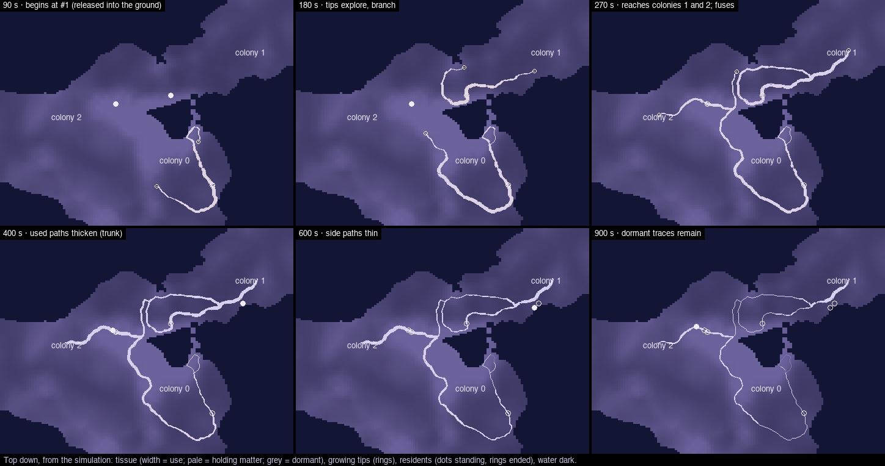

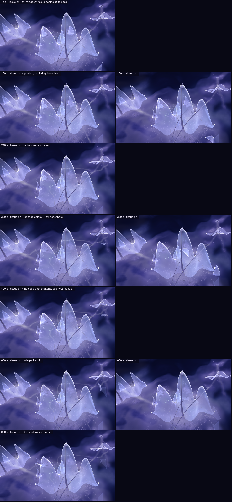

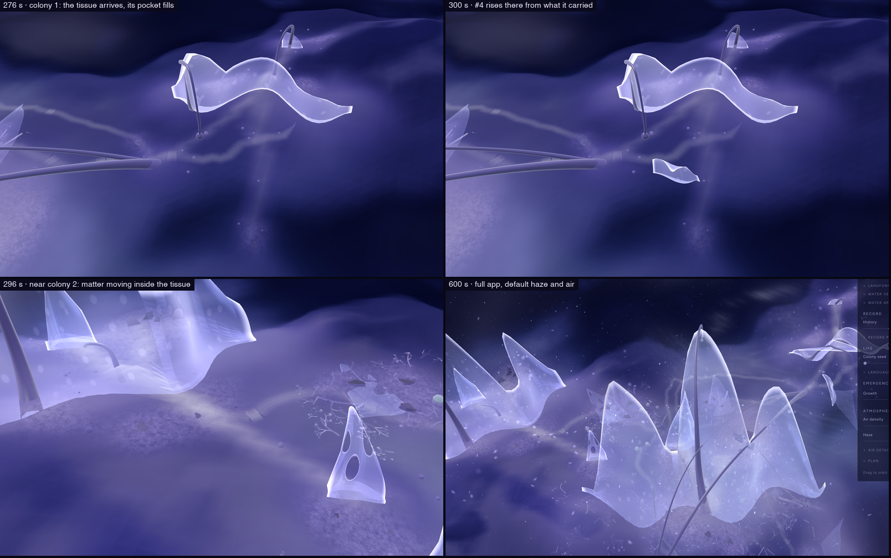

[`10-tissue-flow.gif`](images/10-tissue-flow.gif): twelve frames, half a
simulated second apart, of the pulses moving inside the tissue near
colony 2.

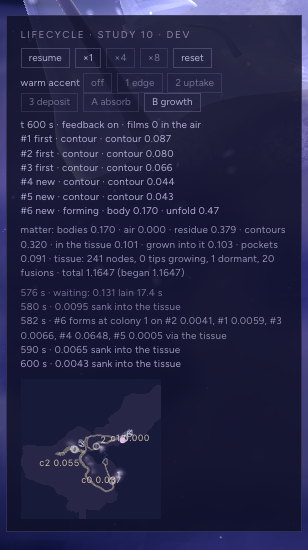

### What changed in the code

- **`lib/conduit.js`, rewritten:**
  - the growing network (`TissueNet`): nodes, edges and their thickness,
    tips, and a spatial index;
  - which colonies share the land (`tissueColonies`);
  - each colony's signal over land.
- **`lib/lifecycle.js`:**
  - release into the ground;
  - the tissue under a resident;
  - growth, tip pull, diffusion by thickness, thickening and thinning;
  - pockets for every colony on the land.

  Two exact speed-ups (an early exit and a bound) leave its results
  unchanged, as the hash confirms.
- **`components/ConduitLayer.jsx`, rewritten:** bands, fibres, pulses,
  growth.
- **The view and the inspector:** `LifecycleLayer.jsx`, `LifecycleInspector.jsx`.

### Limitations

- **Colony 0 no longer regrows locally with the tissue.** It is mature
  (little room to grow), so its released matter leaves through the tissue.
  The local loop of stages 0–2 still runs without the flag.
- **Thickening and speed.** Thickening decides which paths dominate and
  which go dormant. It does not consistently speed delivery; see the
  ablation.
- **Hand-set:**
  - growth speed and cost;
  - the share released into the ground;
  - the steering weights;
  - the thickening rates;
  - the pocket capacities.
- **Readability.**
  - At the default distance the veins are subtle by design.
  - The pulses are clearest close up.
  - Nothing happens in the first ~40 s.
- **Visual flaws.** Short fusion joins can leave a small blunt seam in a
  band.
- **One landmass.** Colony 3, across the water, is not joined.
- **Session-only.** Like the rest of the lifecycle.

### Stopping here

For review. The next candidate is to let a dormant path be re-used:
growth that meets a dormant trace could follow and reopen it. That would
be the "memory" side of the mycelial logic.

## Conduit fold, 20 October 2026

The brief: on one existing, active stretch of the shared tissue near a
colony, try the tissue as 3D geometry, a fold of the ground rather than a
band on it. The section should be the one chosen in review:
- an asymmetric fold of living tissue, lifting off the ground in places,
  with space inside it and under it, its edges merging back into the ground;
- not a symmetric mound, fin, tube or raised strip.

The decisions it was built on:
- reuse the membranes' material, adapted where needed;
- keep one stretch near a colony fixed through the comparison;
- treat 0.2 units as an experimental height, to be judged against the
  membranes and the camera.

Local and display only, behind `?lifecycle=1&conduit=1&fold=1`.
`&foldlift=0.35` tries another height.

### The stretch

**How it is chosen.** The simulation chooses it (`Lifecycle.chooseFold`),
checking every 2 s until it has one:
- it starts at the hub node of a colony other than the resident's own,
  the one most matter has passed through;
- it follows the neighbours most matter has passed through, up to 3 units;
- it is accepted when it is at least 1.8 units long and its mean thickness
  is at least 2.5 (of 6).

It is then kept for the session.

**The record it reads.** Each node keeps the matter that has passed
through it. This is a record for the display; nothing in the simulation
reads it.

**In the default world:** colony 1's stretch, 3.1 units westward from its
hub, chosen at 190 s. Over a run it passes through every state:

| Time | Its mean thickness (of 6) | State |
|---|---|---|
| 250–350 s | 5.9 | active |
| 1000 s | 1.8 | declining |
| 2400 s | 0.31 (floor 0.12) | near dormant |

Pockets refilling at 800, 1250 and 1650 s thicken it again for a while.

### The form


**The section** (`components/ConduitFold.jsx`). A centripetal Catmull–Rom
through 14 points (no loops at the curl):
- **The outer skin:**
  - a long low trailing edge, a hump and a dip;
  - a crest that rolls over itself into an undercut;
  - a face flaring back into the ground.
- **The inner skin** rises from the trailing side into the space under the
  crest and fades out before it meets the face.
- **Edges and side.** Both skins enter the ground by 2 cm. The fold curls
  toward the lower side; here that is south, toward the water and the
  default camera.

**Along the stretch:**
- **Lobes.** It lifts in lobes seeded by the stretch (two here, 1.2 and 2.0
  units from the hub). Between them it lies at 12% of its lift, staying in
  the ground.
- **A lean, not a dome.** Each lobe rises slowly on one side and drops on
  the other, alternating, and a finer ripple runs along its top.
- **Shifting with distance:**
  - where the crest stands;
  - the hump;
  - the curl;
  - each side's width.

  So its edges are never parallel.
- **The ends.** It widens into colony 1's ground over its first 0.7 units
  and sinks into the flat tissue over its last 0.6.

**Two timescales, each tied to the simulation:**

| | What it reads | What it shapes |
|---|---|---|
| **Slow memory** | matter passed through (m = 1 − e^(−passed / 0.06)) | its width (half-width 0.1 to 0.25), how far it can rise, and the scar it keeps (22% of its lift) |
| **Use now** | thickness (conductance) | how far it stands: lift = 0.2 × m × (0.22 + 0.78 × use) × the lobes |
| **Activity** | matter it holds | a little fullness (the hump and the inner skin rise slightly), and the specks below |
| **Dormant** | thickness at the floor | lift about 0.05: a low scar. The curl and the inner skin fade with the lift (gone below 0.03, whole above 0.1) |

**The material:**
- **The base.** The bloom layer's film (`createFormMaterial` with the
  bloom spec), adapted:
  - a little toward the colony's ground skin (`#C8C2EA`);
  - less light of its own (gain 0.95, against 1.5);
  - no apertures.
- **Where it meets the ground.** Its edges fade, and the skin thins near
  the ground.
- **The roll's lip** catches light as a membrane's free edge does, as much
  as the fold stands.
- **Curvature light off.** The film's curvature light is per triangle; on
  this lofted mesh it showed the triangles as facets, so the fold has it
  off.
- **Draw order:**
  - the inner skin at 1.4 and the outer at 1.5;
  - after the water (0) and the streams (1);
  - before the colonies' membranes (2).

**What it carries.** Champagne specks in the inner skin, inside the cavity:
- **How many:** a share of small cells (about 0.08 units) equal to the
  matter there (at most half).
- **How they move:** along the fold at the matter's own velocity, the same
  measure as the flat tissue's pulses. Where nothing moves they stand
  still.
- **Their colour:** `#E6D6B4` at a moderate brightness. Seen through the
  outer skin it is a pale warm pearl.

**The inspector** adds a line for the stretch, for example "colony 1, 3.1
units from its hub (chosen at 190 s) · in use, thickness 5.9 of 6", and
outlines the stretch on its map.

### Comparisons

**The captures.** Frozen clock, haze, wisps, dust and fragments hidden,
the same seeds. Fold off, at 0.2 and at 0.35. Simulated time stepped
exactly to:
- 300 s (active)
- 1000 s (declining)
- 2400 s (near dormant)

**The views:**
- **overview:** high and far
- **normal:** the conduit's own framing, the one the app opens with
- **close:** about 2.4 units away, 30° down
- **low angle:** about 1.8 units, a few tenths above the ground

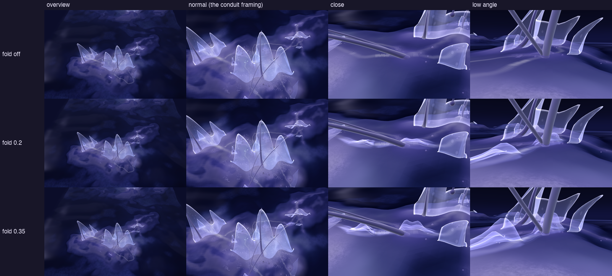

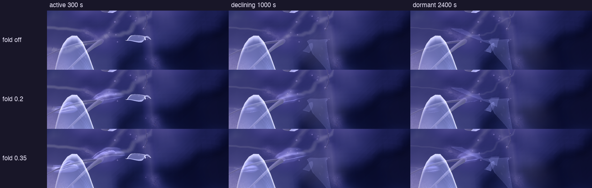

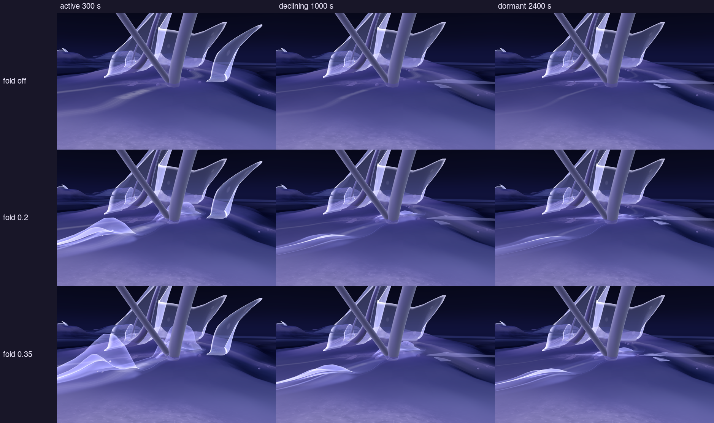

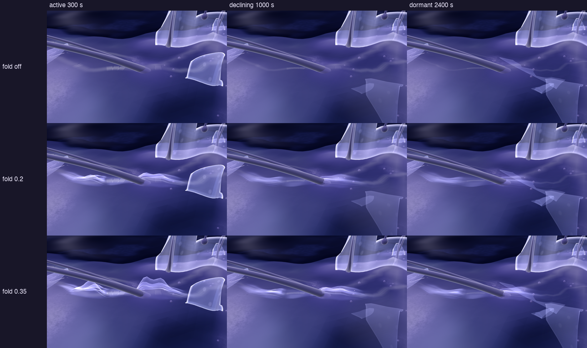

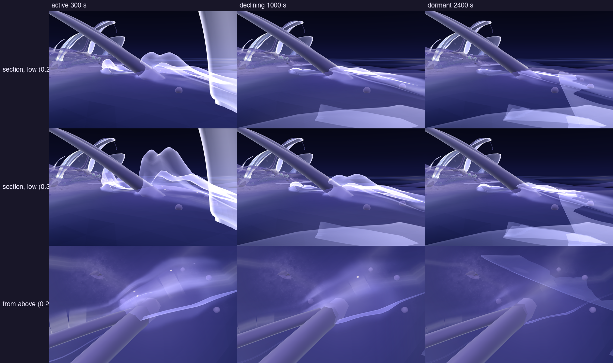

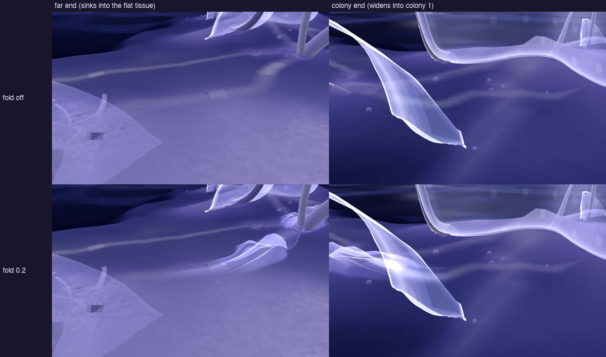

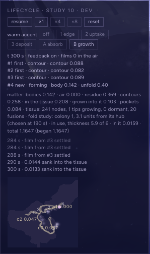

### What worked

- **The section reads from low and section angles.** A translucent sheet
  lifts out of the ground, rolls over itself and comes down into it again,
  with the inner skin seen through it.
- **A lean, not a mound.** The first version had symmetric lobes; from the
  side it read as a row of domes, the mound to avoid. With a slow rise, a
  steep drop and a ripple along the top, it reads as folds.
- **In the ground and out of it.** Embedded stretches alternate with lifted
  ones. The far end lies down into the flat tissue with no cap or seam.
- **At the colony.** At colony 1 the fold rises right at the foot of a
  membrane (low view), so ground, tissue and membrane read as one sheet
  there.
- **The states come from the simulation.** The same stretch stands and
  curls when active, is lower and quieter when declining, and is a low
  scar without curl when near dormant. Its own thickness and record drive
  this; there is no timeline.
- **The specks follow the matter.** They are more where there is more
  matter and still where it does not move. Too few to see when nearly
  empty.
- **Everything else is unchanged:**
  - the conduit run's hash (`27c1bafd946501d8`, 900 s: events, ledger,
    residents, residual, tissue, thickness, pockets) with the fold on and
    off;
  - the stage 0–2 hash (`811674dd6fda2531`);
  - with the flag off, 12 frames pixel-identical to a clean build of
    `c923a84`;
  - the lifecycle without the conduit, 16 frames identical to the last
    round;
  - the conduit without the fold, identical to this round's baseline.

  The build passes. Lint: 0 errors and 55 warnings, 5 more, the same
  per-frame uniform pattern as the other layers.

### What did not, or not yet

- **At 0.2 it is a close-range feature.**
  - **Against the membranes.** Colony 1's membranes stand 0.38 to 1.63
    units (median 0.46), and colony 0's anchor reaches 2.61. 0.2 is about
    half the smallest.
  - **At the normal distance** it is a soft lifted brightening about 10 px
    tall. From the overview it cannot be seen.
  - **At 0.35** the close view shows distinct hooded folds, and the normal
    view has some volume.

  This study suggests 0.3–0.35 for this stretch (the scar scales with it).
  That is for review.
- **From above, at 0.2,** it still reads partly as a raised wavy strip. The
  asymmetric section shows from low angles or along it. A translucent film
  gives little shape from above: no shadows, only rims.
- **Brightness.** At grazing angles near colony 1, the film's rim light and
  the colony's held light take it toward white. Where it passes under a
  membrane's foot, the stacked light makes a small hot spot (the ends
  figure, right).
- **Movement is hard to see at ×1.** Matter moves along this stretch at a
  few millimetres per second, so the specks look still. That is honest,
  but it does not read as flow unless sped up.
- **The specks need a close view.** Through the outer skin they read pearl
  more than champagne.
- **Sorting.** Films write no depth:
  - a membrane behind the fold is drawn over it, which is not visible in
    these captures, with their similar colours;
  - a resident standing in front of the fold would be drawn under it. None
    did here.
- **A strand in the way.** A bridgework strand lands on the stretch near
  its first lobe and blocks the view into the cavity there.
- **The rest of the tissue is still flat bands.** Side branches leave from
  under the fold.
- **Hand-set:**
  - the section's points;
  - the lobes' spacing and lean;
  - the memory scale (0.06);
  - the lift and the scar;
  - the densities;
  - the specks' size and number.
- **Cost.** About 60 sections × 74 points are rebuilt on the CPU each
  simulation step. Not profiled.

### What changed in the code

- **`lib/conduit.js`:** `CONDUIT.fold`, the choice rule.
- **`lib/lifecycle.js`:**
  - the `fold` option;
  - the `passed` record;
  - `chooseFold`, which reads the simulation and does not change it.
- **`components/ConduitFold.jsx`:** new. The two skins, rebuilt from the
  simulation each step.
- **`lib/formMaterial.js`:** `CONDUIT_FOLD` blocks, compiled only into the
  fold's material:
  - its attributes;
  - the specks;
  - the curvature light off.
- **The rest:**
  - `LifecycleLayer.jsx` mounts it;
  - `App.jsx` reads `&fold` and `&foldlift`;
  - `LifecycleInspector.jsx` has the line and the outline.

### Stopping here

For review: not extended to other stretches, not committed, not deployed.
The questions:
- the height: 0.2 or about 0.35;
- the section and its side (it curls downhill);
- whether the specks should read from further away (larger, or more of
  them);
- whether the next step is a second stretch, or the dormant scar re-opening
  when growth returns to it.

## Tissue greybox, 21 October 2026

The review of the fold: it still read mostly as a line painted on the
terrain, and a higher `foldlift` would not fix that. The new brief:
- stop the raised ribbon;
- make active stretches of the tissue a locally emerging, 3D living tissue,
  with layered membranes, lifted folds, asymmetric cavities and connections
  returning into the ground;
- three states:

  | State | What it is |
  |---|---|
  | **Embedded or dormant** | mostly in the terrain, keeping the trace |
  | **Active** | a 3D structure with its own silhouette, depth, inner space and parallax |
  | **Transitional** | rising out of the terrain and going back into it, not set on top |

- geometry before material: one greybox, opaque and unlit, legible from
  Explore's normal distance;
- the simulation and its causal link kept;
- nothing else changed.

Behind `?lifecycle=1&conduit=1&greybox=1` (unlit), or `greybox=shaded`.

### Why the fold read flat

The same stretch, measured in both cameras at 300 s by projecting its mesh
(1600 × 1000 px, field of view 40°):

| | Explore's default camera | The conduit framing (what the flag opens with) |
|---|---|---|
| Where it is | lower middle, between colony 0's tall membranes and colony 1, in front of colony 1 | upper right, behind colony 0's tallest membranes (seen through them) |
| Distance, and angle down | 12.9–13.2 units, 24.5° | 10.1–10.4 units, 51° |
| On screen | 292 × 49 px (0.9% of the frame) | 390 × 140 px (3.4%) |
| Its lift on screen: highest / median | 19 px / 3 px | 17 px / 3 px |
| Its width on screen | 23–35 px | 45–83 px |
| Pixels it changes (by more than 6 levels) | 0.2% of the frame | 0.3% |

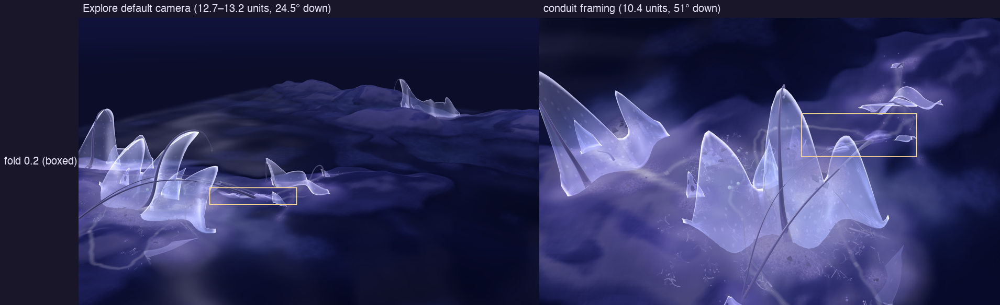

**The causes:**
- **Too low.** Its 0.2 is reached at one lobe only. Along most of it the
  lift is 0.035, about 3 px. On screen it is wider than it is tall
  everywhere.
- **One continuous surface along the path.** Its outline is the path's.
- **Translucent, and the same pearl** as the band and the lit ground below.
  It hides nothing behind it and casts no shadow, so nothing gives depth.
- **In the conduit framing,** it is seen 51° from above, which flattens it
  further, and from behind colony 0's membranes.

### The greybox

**Where.** The same stretch as the fold, chosen by the simulation and kept.
It gathers into knots (`lib/tissueGreybox.js`): groups of junctions, plus
one near the hub where most has passed. There are three, at 0.66, 1.53 and
2.40 units from the hub, with the path staying in the ground between them.

**A leaf per path.** Every path that runs into a knot peels up out of the
ground as a membrane leaf. That is the stretch on either side and up to two
branches.
- **Its root** lies along the terrain out on its path (its first 14%
  follows the ground).
- **It rises** toward the knot, at its steepest between about 60° and just
  past vertical (by its seed, its rank and the flow).
- **Across,** it is cupped, so there is open space under it, and it twists
  a little.
- **Its tip** droops back toward the ground, and its rim is ruffled.
- **Layers.** A knot's leaves cross over it, the most used highest. Where
  much has passed, a second, smaller leaf lies under the first.

**The causal link.** Nothing moves or points; no direction is drawn.

| From the simulation | It decides |
|---|---|
| Matter passed through the knot's nodes (memory) | the leaves' size (×0.55 to 1), and whether a second layer has formed (memory above 0.55) |
| Each path's thickness now (use of its own edge) | how far that path's leaf has peeled up. At the dormant floor it lies on the ground as a trace |
| Flow there now | up to 15% more lift, opening the space under it |

**The material.** Opaque and writing depth, unlit:
- **Unlit:** one grey on a leaf's upper side and a darker one on its under
  side, by which way its triangles face.
- **`shaded`:** adds one plain light from above, a reading aid only.
- **Never:** transparency, glow, fog or haze.

**Cost.** It is rebuilt only when the state, in steps of 1/40, changes:
5–10 ms for 7–14 leaves (7.5k–15k triangles).

### Comparisons

**The captures.** The same harness and frozen clock as before, with haze,
wisps, dust and fragments hidden, at 300 s (active), 1000 s (declining) and
2400 s (near dormant).

**The views:**
- **normal:** Explore's default camera
- **overview:** the same direction at 30 units
- **side/low:** 3 units away, 7° down
- **close-up:** 2.2 units
- **the conduit framing:** added, since it is what the flag opens with

**Its size on screen** at 300 s. Its tallest point stands 0.74 above the
ground.

| View | Its tallest point, on screen | Its extent |
|---|---|---|
| normal | 73 px (the fold: 19) | 316 × 127 px |
| conduit framing | 69 px (the fold: 17) | 428 × 198 px |
| overview | 39 px | 173 × 65 px |

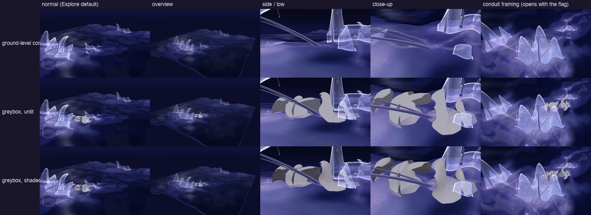

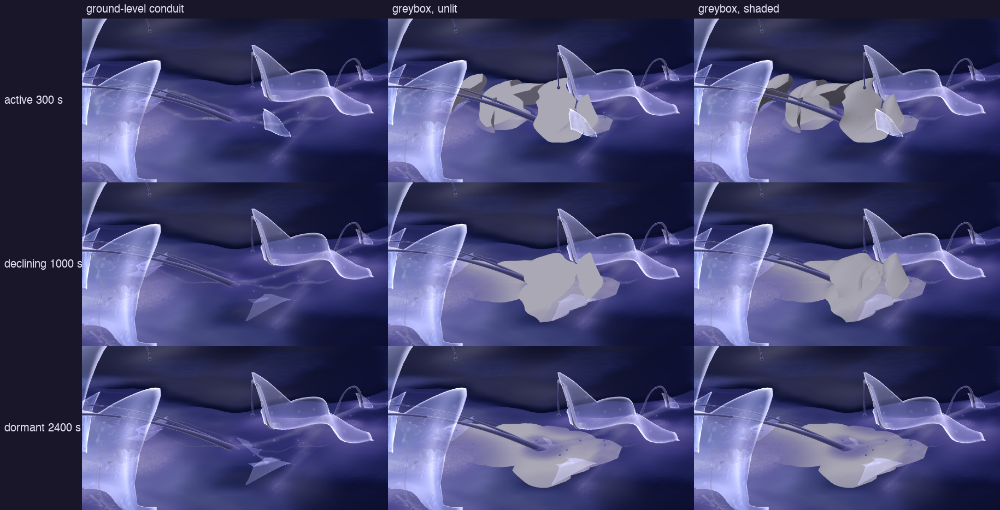

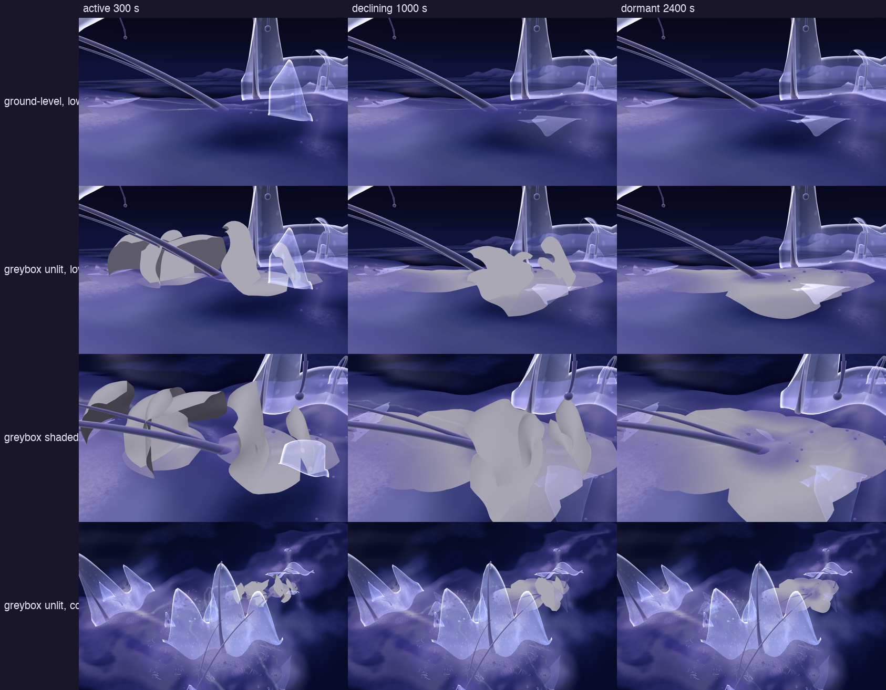

### What was tried on the way

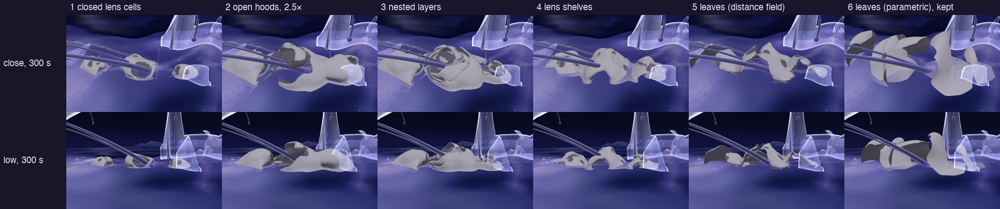

The first five forms were built as one distance field, meshed by marching
cubes and joined smoothly to the ground:

| | Form | Why it was dropped |
|---|---|---|
| 1 | Closed lens cells | About 0.2 tall. Round openings in pale shells read as faces |
| 2 | Open hoods at 2.5× | Legible at last, but their closed parts read as pillows, with jagged rims |
| 3 | Nested layers in each hood | The layers stayed hidden inside and showed as noisy stripes |
| 4 | Lens shelves, open underneath | Low, and the ground's blend filled the space under them, so mounds again |
| 5 | Leaves in the distance field | Space under them at last, but the grid tore the thin sheets' edges and broke up their two tones |
| 6 | **Kept:** the same leaves as surfaces | Clean edges, and 5–10 ms to build instead of 200–350 ms |

The distance field gave the best emergence from the terrain: a true fillet
where tissue and ground meet. The leaves meet the terrain by lying along
it instead.

### What works

- **Legible at the normal distance.** A 3D cluster with its own silhouette
  and depth: about four times as tall on screen as the fold, and still a
  shape from the overview.
- **Inner space.** There is open space under each leaf, and dark undersides
  show in the normal, low and close views. Where leaves cross there are
  layers.
- **The states come from the simulation:**
  - active, every leaf stands;
  - at 1000 s, the hub's knot stands (its paths are still thick); the
    middle one is half up (the stretch on one side is at 0.65, the other
    side and its branch at 0.11); the far one lies down (0.08);
  - near dormant, every leaf lies flush on the ground as a footprint.
- **Not a ribbon.** Three local knots, with flat stretches where the path
  stays in the ground.
- **Unchanged elsewhere:**
  - the simulation's hash (`27c1bafd946501d8`) and the stage 0–2 hash;
  - with the flag off, 12 frames pixel-identical to a clean build of
    `c923a84`;
  - the lifecycle and conduit frames, identical to their baselines.

  The build passes; lint gives 0 errors and 58 warnings, 3 more, all the
  per-frame update pattern.

### What did not, or not yet

- **Leaves rather than one body.** It reads as a cluster of large curved
  leaves more than as one living body. Where leaves cross nothing joins
  them; they simply intersect.
- **Integration with the ground.** The roots lie on the terrain rather
  than growing out of it. In grey, the flush roots and dormant leaves read
  as sheets laid on the ground, and the colour seam makes this stronger
  than a material would. The distance field (tried) had true fillets but
  worse surfaces.
- **The dormant trace is large** (as large as the memory) and conspicuous
  in grey.
- **Collisions.** The hub's knot stands against one of colony 1's
  membranes, and a bridgework strand lands in the middle knot.
- **Unlit grey shows only silhouettes.** Cupping and folds read only in the
  shaded variant.
- **On the shore side,** dormant leaves lie on the lakebed under the water's
  veil.
- **Hand-set:**
  - the leaves' size, steepness, cup, droop and ruffle;
  - the second layer's threshold;
  - how junctions group into knots.

### What changed in the code

- **`lib/tissueGreybox.js`:** new. The knots and their arms, the state read
  at them, and the leaves.
- **`components/ConduitGreybox.jsx`:** new. The opaque greybox material and
  rebuilding on state change.
- **`App.jsx`** reads `&greybox`. It turns on the fold study's choice of
  stretch in the simulation (unchanged).
- **`LifecycleLayer.jsx`** mounts the greybox in place of the fold.
- **Not touched:** the residents, the rest of the tissue, `ConduitFold`.

### Stopping here

For visual review: one prototype, not extended, committed or deployed.
The questions:
- Do the leaves read as living tissue unfolding? Or should a knot be one
  body, the distance-field direction with its fillets, if its surfaces can
  be made clean?
- Its scale: 0.74 tall at the main knot.
- Whether dormant leaves should lie flat, as now, or sink.
- Then the membrane material.
