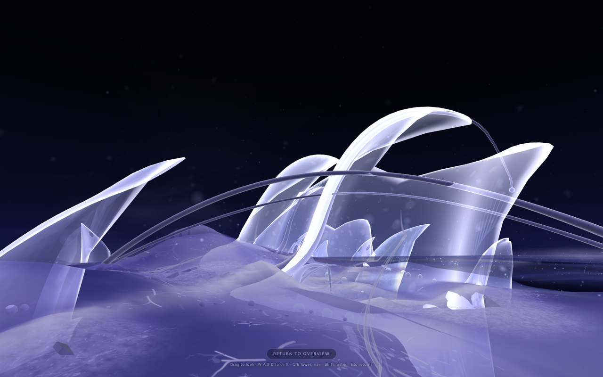
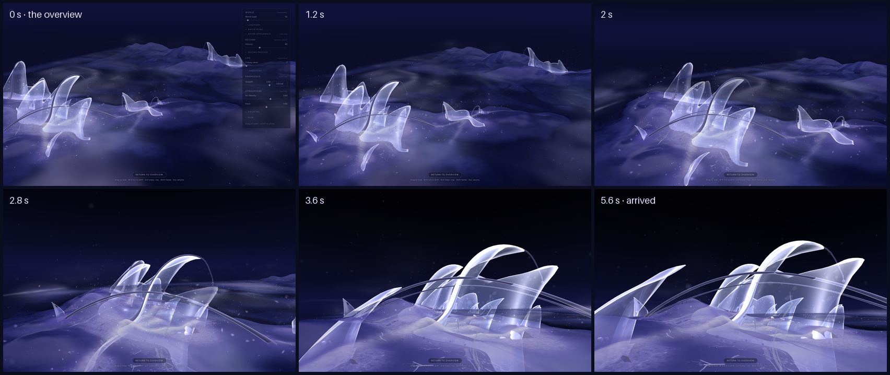
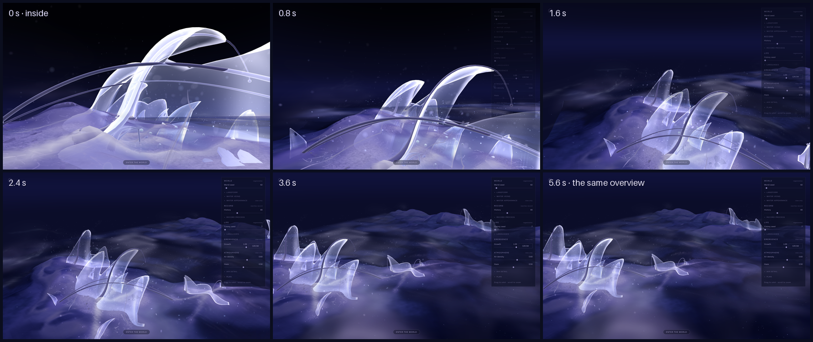
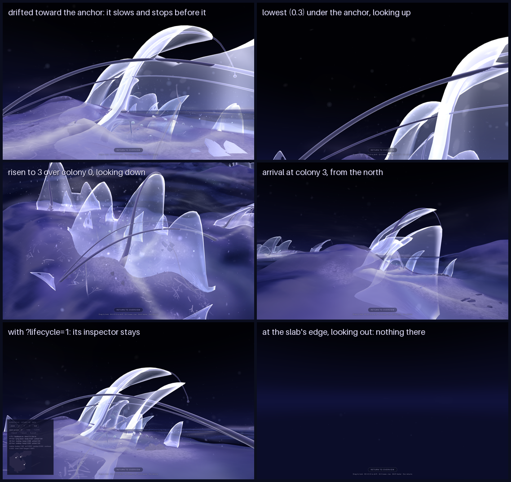

# 11 · Embodied presence

*First-person exploration, phase A: a slowly drifting presence inside
Explore's own world.*

> **Status, 25 October 2026: phase A, a prototype for review.** It is behind
> a development flag (`?presence=1`) and off by default. Explore, the
> Studies, the Atlas and the lifecycle (study 10) are unchanged.
>
> **Phase B, one membrane responding to the visitor, is planned and not
> built.** Nothing is committed or deployed.
>
> **Refined after the first review** (below): faster movement that settles
> sooner; the air's carrying weakened; the close-range white flares
> diagnosed, not yet fixed; phase B's soft boundary assessed.

**The guiding principle:** the world lives without you, but it can
acknowledge your presence. The visitor is not its creator, controller or
centre: a temporary physical presence drifting through an autonomous place.
Phase A builds only the presence. Nothing in the world acknowledges it yet.

## Running it

Add `?presence=1` to Explore's address (it combines with `&lifecycle=1` and
the other study 10 flags). One quiet control appears at the bottom of the
screen.

| | |
|---|---|
| **Enter the world** | The camera drifts down out of the overview to a colony |
| **Drag** | Look around. The world is dragged, as in the overview or a panorama |
| **W A S D**, or the arrow keys | Drift forward, back and sideways |
| **Q / E** | Lower, rise |
| **Shift** | Faster |
| **Wheel or trackpad scroll** | Drift forward or back |
| **Esc**, or **Return to overview** | Rise and drift back to the overview you left |

While inside, Explore's panel and title step back. They return when you
leave. The lifecycle's inspector stays where it is.

## What was inspected first

The scale decides what being "inside" can mean, so it came first. All in
world units, for the default world:

| | |
|---|---|
| The world | A 26 × 26 slab; ground from −1.43 to 1.16; water at 0 (tide ±0.03) |
| Membranes (14) | 0.38 to 2.61 tall, median 0.66. Each colony's anchor is 1.6 to 2.6 tall and up to 4.6 wide; its veils are mostly below 1 |
| Strands and films (structure) | Arch up to 2.1 above the floor, often across eye height |
| Residue, beads, colony tissue | At most 0.27 above the floor |
| Camera | Near plane 0.1; Explore's field of view 40°; orbit distance 7 to 44 |
| Fog | Light (exp², 0.026): about 6% at 10 units, 24% across the island |

**So the eye floats 0.5 above the floor,** within a range of 0.3 to 3.2.
At that height:
- most veils stand at or a little above eye height, close enough to inspect;
- an anchor rises four or five times higher;
- everything lower than the eye's lowest height is only residue on the
  ground, so nothing is ever at the camera's near plane.

## The presence (`lib/presence.js`)

**A position, a velocity and a gaze, stepped each frame by a fixed rule.**
It is pure data, so it is tested in Node against the real world. It has no
model or body to see.

- **Drifting, not walking.** It eases up to its speed in 0.5 s and comes to
  rest over 0.5 s.
  - Its speed is 0.7 units/s, or 1.6 with Shift: about 35 seconds across
    the island.
  - It moves across the ground in the direction it faces. Looking down does
    not dive it.
- **Height.** It follows the ground or water beneath at the height it chose
  (Q and E change it), settling over 0.5 s.
  - The ground is read over a small footprint (0.22), so a bank beside it
    lifts it before the slope can rise into view.
  - It is never nearer than 0.22 to the ground or the water, whatever else
    happens. It never goes below the water.
- **Forms.** It meets the forms as they are built: every vertex of the
  membranes' films and the structure's strands and films (11,538 points,
  from the colony's own geometry builder) in a grid.
  - Approach softens inside 0.7 of a surface and stops at 0.3, its body.
    Pressed further, it slides along the surface or over it.
  - The proxy is built once per world, on entering: about 55 ms in Node.
    Each step takes about 9 µs there.
- **Carried by the air.** The air is the World's own field (`air.js`), as
  the dust, wisps and films use it, at 0.12 of its speed and taken up over
  2.5 s. Left alone, it slides 0.2 to 1.2 units a minute, less inside a
  colony, which holds the air ([what it feels like](#the-air-what-you-feel-standing-still)).
- **The slab.** It eases back from 0.8 inside the edge of the drifting area
  (±11.6), and never passes it.
- **No bob, no roll, no forced motion** other than the slow air and the two
  flights. The gaze eases toward where it is dragged over 0.08 s, so a drag
  does not snap. Its pitch is kept within −60° and +54°.

## Entering and leaving (`components/PresenceCamera.jsx`)

**The same camera, the same scene, the same world.** On entering:
- Explore's orbit controls let go;
- the field of view widens from 40° to 56°;
- the camera flies along a smooth curve, over 3.4 to 5.6 s by distance.

Leaving reverses it to the exact overview pose it left (position, target
and field of view). Then the orbit controls take over again. Switching
direction mid-flight starts a new flight from wherever the camera is.

**Where it arrives:**
- **The colony:** the most established colony near where the overview is
  looking (maturity, discounted by distance from the overview's target).
  From the default overview this is the first colony.
- **The spot:** in front of that colony's anchor membrane, 0.95 to 1.7
  times its height away (plus 0.6), about 3 to 5 units for the first
  colony's. The spot must be:
  - clear of every form by 0.9;
  - with a clear way in behind it for the last 2 units of the flight;
  - with an open view to the anchor.
- **Facing:** above all it looks the way the overview was looking, so the
  flight drifts forward into the world rather than turning round in it.
  From the default view the gaze turns 41°; from the other three sides,
  10° to 32°. After that, it prefers the side the membrane leans toward,
  three-quarters on.

**The flights:**
- **Turning.** The gaze turns by heading and pitch separately, so it never
  sweeps over the top through the sky.
- **Height.** Going in, it keeps looking down at the world while it is high
  and lifts only as it arrives. Coming out, it lowers early, so the colony
  stays in view.
- **Safety.** On both flights the camera is kept above the ground and clear
  of forms.

The first version arrived on the far side of the colony, so the camera had
to turn about 150° near the end. Interpolated as one rotation, that turn
swept through empty sky for two seconds. Both are fixed as above.

## The world's autonomy

**The presence reads the world and changes nothing.** It never calls the
lifecycle, growth, placement or the air; it only moves the camera.

While inside, the panel is out of reach, so no slider or Grow can be
touched. A control left focused in the panel is released on entering, so
the arrow keys cannot reach it.

Checked in the browser, with `?lifecycle=1&presence=1`. The lifecycle was
advanced to 600 s and its whole state hashed (its record, residual,
residents and ledger):

| Run | Hash |
|---|---|
| The lifecycle alone | `811674dd6fda2531` |
| With the presence loaded, never entered | `811674dd6fda2531` |
| Entering, drifting within 2 units of its patch for about 15 s while it ran, and leaving | `811674dd6fda2531` |

It is the same hash Node gives for the stages 0–2 demo. The lifecycle object
was the same before and after the visit, so nothing was rebuilt.

**One existing behaviour to note.** One of the air's rare skins
(`AirFragments`, the "passing" slot) has always been placed upwind of a
point in front of the camera, so that it drifts through the view. Its timing
does not change, but inside the world it passes near the visitor.

It is not ecological and was not changed. It could read as the world
noticing the visitor, which is phase B's territory.

## Evidence

| Check | Result |
|---|---|
| Default Explore, flag off | 12 frames on five worlds, pixel-identical to the verified baseline |
| `?presence=1`, never entered | The same 12 frames (with the control hidden), pixel-identical |
| Lifecycle and conduit frames, flag off | 16 and 2 frames, pixel-identical to their baselines |
| Studies | Field, Shaders and Scatter pixel-identical to the 14 October reference. Volume varies between runs even against itself (as before); its code is unchanged |
| Floor | 20 minutes of random input: never nearer than 0.22 to the ground or water |
| Forms | The same run: never nearer than 0.57 to a form. Driven straight at every anchor, at full speed and three heights, for 20 s: never inside 0.3 (a minimum of 0.298) |
| Trapped? | Wedged against every membrane from 12 directions (168 starts). 166 backed out over a unit in 6 s. The other 2 were held behind by a second veil, and could leave in other directions and always by rising |
| The slab | Never past ±11.6 |
| Clipping | The steepest dry slope (46°), at the lowest height, looking straight down: the ground fills the view and does not clip |
| Keys | W does not toggle the terrain's wireframe while inside. A focused slider keeps its value under the arrow keys |
| Returning | To the exact overview pose: position, target, field of view, controls enabled. Also after reversing mid-flight |
| Console | No errors in any run |
| Build and lint | Build passes. Lint: no errors; 62 warnings (58 before), the four new ones of the existing kind (the camera and controls mutated in effects) |

A short recording (drifting toward the anchor, slowing before it, looking
aside, rising): [11-drift.gif](images/11-drift.gif). It is four frames a
second, to keep it small; the motion itself is smooth. It was recorded
before the refinement below, so it is slower and glides longer.

## How it feels at this scale (for review)

- **The colonies become places.**
  - An anchor membrane at four or five times eye height reads as
    architecture.
  - The structure's strands arch overhead.
  - The veils stand at eye height, near enough to inspect.
  - From the overview the forms read as objects; inside, they read as a
    place you are in.
- **The membranes hold up close.** Their rims, translucency and the light
  in them read clearly; their sway is slight.
- **The ground does not.** At 0.3 to 0.5 above it, it is soft and
  low-detail (a 224-vertex mesh over 26 units). Residue reads as small
  shapes, not as matter.
- **The sky is the scene's flat background.** Looking up or level, the
  upper third of the view is dark and empty.
- **At the slab's edge, looking outward, there is nothing**: a dark ground
  and a faint band. The world's edge was already a known issue; first
  person makes it much more visible.

## Refinement after the first review, 25 October 2026

The review found the movement **a little too slow and too weightless**,
more like flying in a game's creative mode than a presence in a physical
place. At close range, turning around the membranes made **large areas jump
between translucent lavender and opaque-looking white**, with facets and odd
layering. Phase B's soft boundary was to be assessed, not built.

### Movement

Faster, and it settles: it stops soon after it is let go instead of
sliding on. No bob, sway or added acceleration. Scrolling, W A S D, Q / E,
the arrival and the control are unchanged.

| | Before | Now |
|---|---|---|
| Speed (normal / Shift) | 0.55 / 1.3 units/s | **0.7 / 1.6** (+27%, +23%) |
| To 90% of speed | 1.4 s | 1.15 s |
| At rest after letting go | 3.9 s, coasting 0.70 | **1.5 s, coasting 0.34** |
| Following the ground's height | 0.7 s | 0.5 s |
| One scroll notch | 0.20 units | 0.20 (kept: it is for approaching precisely) |
| The air's share | 0.3 | **0.12** |

In the browser: after 1.5 s of W, letting go coasts 0.23 units and is still
within 1.8 s. The safety checks were run again at the new speeds: never
nearer the floor than 0.22 or a form than 0.298, never off the slab, never
trapped.

### The air: what you feel standing still

The presence is carried by the same field as the dust (`airVelocity` in
`air.js`): horizontal only, in world coordinates, +x east (to the right of
the default overview's view) and +z south (toward its camera).

- **The air:** 0.03 to 0.17 units/s. Mostly toward +x, its heading
  wandering between about −50° and +65° over minutes, with local curls that
  occasionally reverse it. Measured at the arrival, in colony 0 and on open
  land over ten minutes.
- **From the default arrival** (facing west-north-west, toward the colony),
  it mostly pushes **backward and to the right**: away from what you are
  looking at.
- **At the old share (0.3)**, standing still meant sliding 0.5 to 3 units a
  minute, so the colony slowly receded and stopping never felt settled. That
  is likely part of the weightlessness.
- **At 0.12** it is 0.2 to 1.2 units a minute. It builds up over 2.5 s after
  you stop and is less inside a colony. It reads as a faint, slow sway of
  position in the same direction the dust is going, a little slower than the
  dust: a heavier body in the same air. No other drift was added.

### Close range: the white flares, diagnosed (not yet fixed)

**Method.** From a fixed spot 0.55 from the first colony's anchor, the scene
was frozen (clock stopped), and the camera turned in 30° steps. At three of
the worst angles the frame was rendered again with one factor switched off at
a time, by patching the materials in the running page (no source change).
Measured: the share of near-white pixels, and the share changed.

| Switched off | Near-white pixels at 300° / 330° / 0° | Pixels changed |
|---|---|---|
| Nothing (as it is) | 5.2% / 10.3% / 7.4% | — |
| Fresnel's light (the rim tint and the grazing emission) | **1.2 / 0.9 / 0.6** | 37–50% |
| Only its "toward the light" factor | **1.9 / 2.2 / 1.3** | — |
| Fresnel's opacity (alpha rising at grazing angles) | 3.5 / 8.5 / 6.0 | 18–26% |
| The rim's edge glow | 3.5 / 9.0 / 6.6 | 2–4% |
| The fold light (per-triangle curvature) | 4.8 / 10.2 / 7.3 | 2–4%, in facets |
| The air's dust, wisps, haze and skins | unchanged | about 1% |
| The specular highlight | unchanged | under 0.1% |
| Draw order reversed | 4.9 / 10.1 / 7.2 | 1–2% |
| Front faces only / back faces only | 1.4–2.8 / 1.6–3.8 | the two together compound |

**The causes, in order:**
1. **The white is back-lit Fresnel light, made for the overview.** The film
   brightens at grazing angles, three and a half times more when the view
   looks toward the light (`toward` in the film shader). At the same angles
   its opacity rises to about 0.9.
   - **From the overview,** which looks toward the light, that is a thin
     luminous rim on each membrane.
   - **Up close,** a curving sheet presents large areas at grazing angles,
     so whole regions flare white and nearly opaque. Turning toward or away
     from the light switches them on and off.
   - Facing away from the light, the white nearly vanishes (0.01% at 60°).
2. **Layers compound it.** Each sheet is double-sided and drawn back faces
   first, then front faces. Where a curl shows both sides, or one sheet lies
   behind another, two near-opaque bright layers stack: front only or back
   only gives 1.4–3.8% white, both together 5–10%. This is most of the "odd
   layering". A horizontal band across the anchor's face is its own second
   crest seen through the first.
3. **Facets come from the fold light, and from the mesh.** The fold light
   estimates curvature from the screen-space change of the normal. That
   estimate is constant over each triangle, so close up each triangle lights
   as a facet (up to 67/255 locally). The anchor's grid is about 0.1 units,
   so its outline is visibly polygonal at 0.5.
4. **Minor:** the rim's edge glow (a band about a tenth of the sheet's length,
   broad up close); a few dust motes near the camera drawn as large soft
   discs (about 1% of pixels).
5. **Not causes:**
   - **Sorting:** the merged membranes are not sorted, but reversing the
     order changes only 1–2% of pixels here.
   - **Near-plane clipping:** the presence keeps 0.3 from every form and
     the near plane is 0.1.
   - **The specular highlight.**

**A candidate fix, tested at runtime only.** Fade the "toward the light"
factor and the fold light to nothing within 0.8 units of the camera, coming
back fully by 4 units: `smoothstep(0.8, 4.0, distance)` on both.
- **Effect:** near-white falls 55–65% at the worst angles (10.3% to 3.6% at
  330°). The membrane stays translucent lavender near the camera, rims
  further away still glow, and the facets near the camera go.
- **Opacity:** also fading the opacity's Fresnel term adds almost nothing.

It is a few lines in the existing film shader, not a redesign. Behind a
uniform set only by the presence, default Explore would stay pixel-identical.
**Not applied:** for your decision.

### Phase B: a soft boundary on one membrane (assessed, not built)

**What exists now.** Every membrane and strand is equally solid: approach
softens inside 0.7 and stops at 0.3 (velocity into the surface removed,
position pushed out). The visitor slides along or over it. The proxy is one
merged point set, so it cannot yet tell one membrane from another.

**The most feasible prototype, on one membrane:**
1. **Choose an ordinary veil, not a lifecycle resident.** A secondary veil of
   colony 0 near the arrival, 0.6 to 1 tall, at eye height. Choose it outside
   the three the lifecycle takes (`chooseResidents`: the tallest unreached
   secondaries).
   - Its shape is then static, so its response is the only thing that moves
     it.
   - The lifecycle's determinism is untouched by construction.
2. **Give it its own proxy and its own law.** Its points are already kept per
   membrane (`bloomSurfaces`). Leave them out of the shared proxy and query
   them separately with a spring-damper instead of a stop: resistance grows
   with how far the visitor presses in (up to a maximum dent), tangential
   motion is deflected, and the dent springs back after.
   - **Encounter conditions** are already computed every step: approach speed
     along the normal, approach side, sliding speed. The membrane's own state
     (openness, maturity, height) can set its stiffness and recovery.
   - **Visual and collision agree by construction:** the dent is the
     visitor's press, so the proxy itself never has to move.
3. **Draw it on its own, as the lifecycle draws its residents.**
   `ScatterLayers` already removes residents from the merged geometry and
   `LifecycleLayer` draws each in its own material. The same pattern, only
   while inside, removes one veil and draws it with a material of its own.
   - As a separate object it is also depth-sorted against the rest,
     slightly better than now.
4. **The dent: a few uniforms in the existing form vertex shader.** A contact
   point, a push vector, a radius and a stiffness, behind a define compiled
   only into that one membrane's material. It works the same way the
   lifecycle's lying down (`uRecline`) was added. The displacement fades
   toward the membrane's foot (its attachment), and the normal bends with
   the dent's slope, so its light follows.
   - **This is a vertex change, not a new effect system,** but it is a
     shader change; it needs your approval.
5. **Which membranes are solid, which soft, which passable** can later
   follow each membrane's own state: anchors and strands solid (structure),
   veils soft, lace-open membranes passable. Phase B would test only the one
   soft veil.

**Risks:**
- The white flares above would make a dent hard to read on a back-lit sheet,
  so the near-camera fix is worth deciding first.
- A dent near the camera magnifies the polygonal outline (a veil's grid is
  coarser than the anchor's).

## Limitations

- **Residents are not met** when the lifecycle is on. They change shape,
  so they are left out of the forms, and the presence can pass through
  them. Other forms are met as fully grown, so a form still growing (a Grow
  replay, which cannot be started while inside) would be met where it will
  be. The membranes' sway (at most 0.035) is inside the margin.
- **Not met at all:** residue, beads, the colony tissue and the branching
  veins, all lower than the eye can go. The air's dust, wisps and films,
  and the lifecycle's films, pass through, as air does.
- **Desktop only.** Keyboard and mouse or trackpad; no touch, and no
  pointer lock. Dragging pulls the world (as in a panorama); first-person
  game players may expect the opposite.
- **No controls inside.** World settings need leaving first.
- **Entering is always automatic**: one place per colony and overview
  direction. There is no "enter here".
- **Not measured on a real display.** Everything was checked headless, so
  frame rate and the feel of the motion need your review. Building the
  forms on entering (about 55 ms in Node) may show as a small hitch as the
  flight begins.

## What would make phase B difficult

1. **A single membrane cannot respond on its own yet.** A colony's
   membranes are merged into one geometry and share one material. To
   respond, one must be drawn separately, as the lifecycle already does for
   its residents (`LifecycleLayer`). A response that bends or opens the
   membrane locally needs a few new uniforms in the existing form shader,
   behind a define, the way the lifecycle's lying down and warm accent
   were added.
2. **The visual and the presence's proxy must move together.** Here the
   forms are met as built: static, fully grown and without sway. A
   membrane that moves when approached must also move its proxy, or the
   visitor will meet where it was.
3. **The inputs are already there.** The presence's position, velocity
   (so its approach speed and direction), the distance to the nearest
   surface and that surface's normal are all computed each frame.
   Encounter conditions can read them; they need no new tracking.
4. **The lifecycle's residents are the natural candidates, and the hardest.**
   Their state (forming, holding, lying down) changes the shape. Choose an
   ordinary veil, or let the encounter read the resident's live state;
   either way, its own cycle must not depend on the visitor.
5. **Translucent films are not depth-sorted against each other.** Up close
   and moving among them, overlapping membranes can sort wrongly for a
   frame. A deforming membrane near the camera makes this more visible.
6. **The camera-relative air skin** (above) should be kept distinct from
   any real response, or reconsidered, so the visitor can tell the world
   noticing them from the world simply happening.
7. **Most membranes are small** (median 0.66). An encounter with a veil is
   intimate; one with an anchor is monumental. Which kind phase B tests
   changes what "perceptible and localised" means.

## What changed in the code

- **New:**
  - `lib/presence.js`: the presence, the forms' proxy, the choice of
    arrival.
  - `components/PresenceCamera.jsx`: in the scene, the camera, input and
    flights.
  - `components/PresenceControl.jsx` and its CSS: the one control, and
    Explore stepping back while inside. Every rule that touches Explore
    needs a class only the presence sets.
- **`App.jsx`:**
  - the `?presence=1` flag;
  - one piece of state (inside or not, reset on changing views);
  - the air's settings for the presence;
  - two mounts, both behind the flag.
- **Not touched:** generation, placement, the lifecycle and conduit,
  shaders, materials, geometry builders, the Studies, the Atlas and saved
  configurations. No new dependency.

## Stopping here

For review before phase B:
- **Movement:** do 0.7 units/s and the shorter glide feel right? Is the
  air's carrying (0.12) still present enough?
- **The close-range fix:** apply the near-camera fade, only inside the
  world?
- **Phase B's membrane:** an ordinary veil at eye height, as proposed, or the
  anchor?
- **Shader change for the dent:** may the existing form vertex shader take
  the few uniforms the dent needs, behind a define?
- **From the first review, still open:**
  - Is 0.5 the right eye height?
  - Should dragging pull the world, or turn the head the way the hand moves?
  - Should the panel and title fade out while inside?
