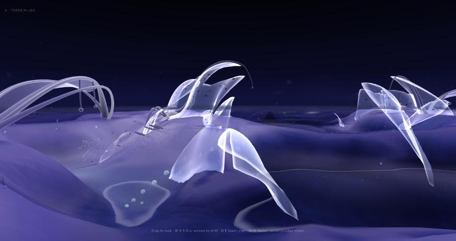
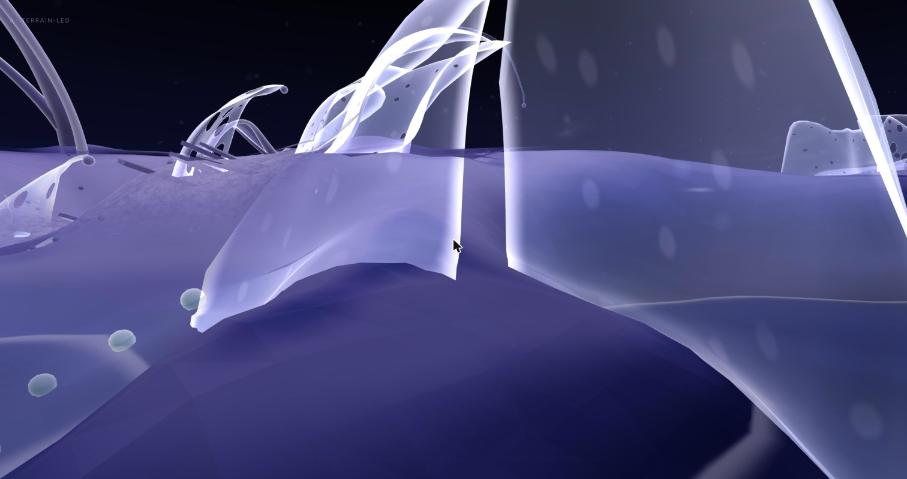
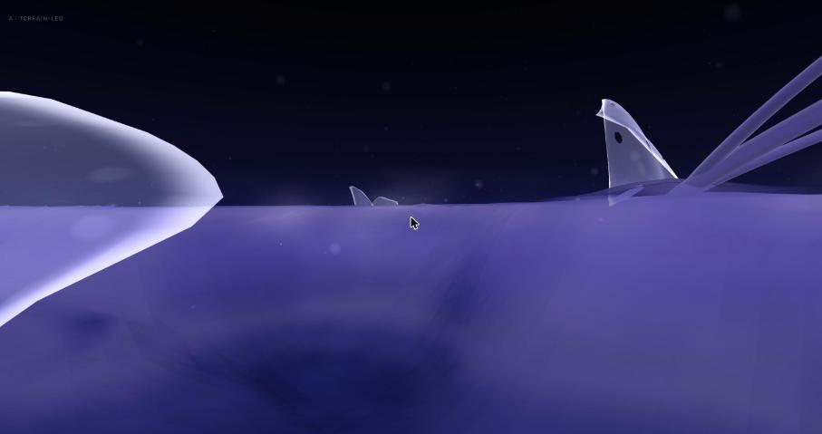
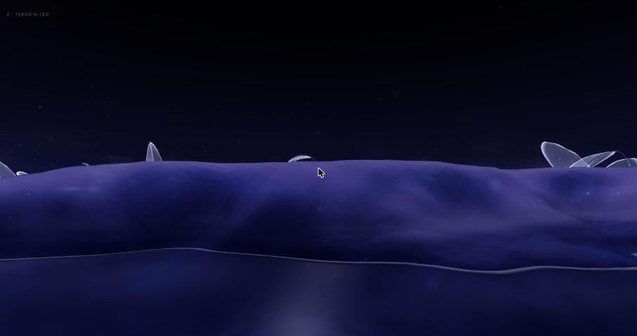
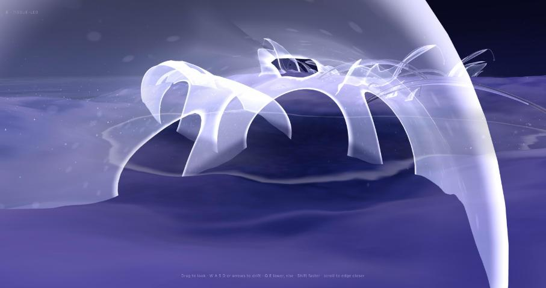
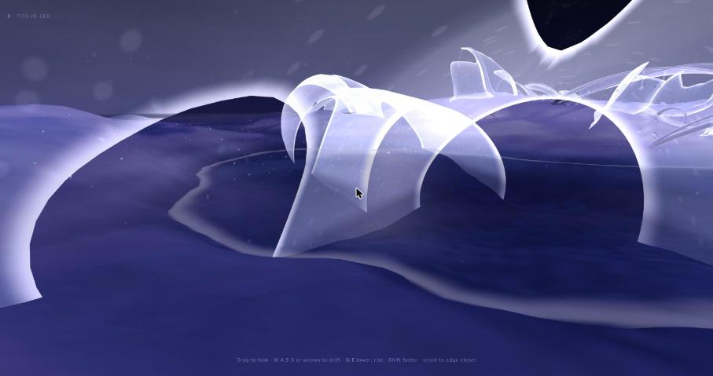
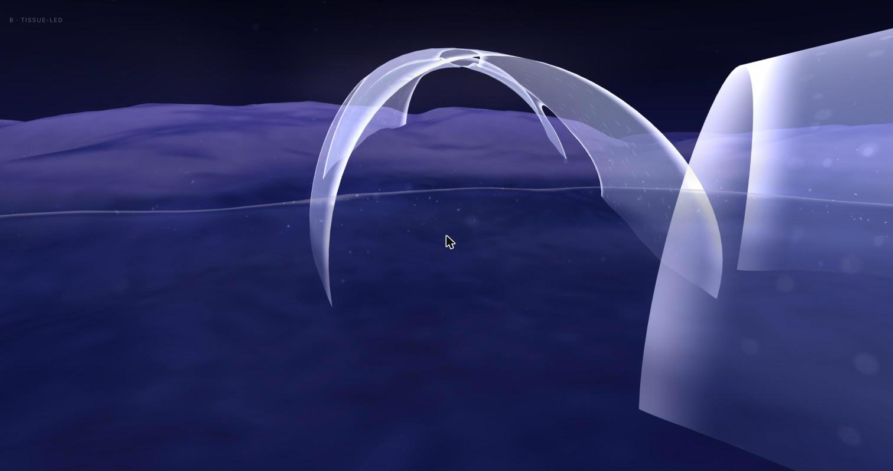

# 13 · Habitat spatial studies, A and B

*Two first-person spaces for the design review. Neither is chosen.*

> **Status, 29 October 2026: two playable studies, for review.** Local only;
> nothing committed. The v0 Habitat (now `/habitat/v0`, [study 12](12-habitat-v0.md))
> and Explore are unchanged.

| | |
|---|---|
| **A · terrain-led** | `/habitat/a` |
| **B · tissue-led** | `/habitat/b` |
| **Baseline (v0)** | `/habitat/v0` |

The controls, body, rendering profile and air are the same in all three:
drag to look, W A S D or arrows to drift, Q / E lower and rise, Shift
faster, scroll to edge closer. A small label at the top left names the study.

## Why

In v0, leaving a colony felt like drifting into an empty dark sea. The
water, and where the visitor was relative to it, were hard to read. Local
complexity didn't extend into a space, and autonomous changes were easy to
miss. Each study answers with one organising idea, chosen by rule from the
world it is given, so neither is tied to one seed or to colony indices.

## A · terrain-led: folded banks, shallow pockets, thresholds

**The idea.** The ground itself makes the rooms. The landform is folded at
its midline into long, rounded banks around shallow pockets of water.
Where land narrows between two pockets (a neck), two veils take root at its
banks and lean along the passage, one each way: a threshold to pass
between. Banks hide what lies beyond them; membranes show over the rims.
- **From The Ephemeral Lake:** the relation of membrane to water and bank,
  and the threshold as an opening rather than an object.
- **From Plane of Incidence:** tissue and ground hard to separate, with the
  thresholds growing from the banks themselves.

**How.**
- **World:** seed 3 with a rounded fold (`FOLD` in `lib/habitatSpaces.js`).
  This is the ridge shaping with its cusp softened, passed to `createField`
  as `shapingOp`, so Explore's own ridge and its menu are untouched.
  - Water 0.64, landform scale 1.8, vertical scale 1.8 (not 2.7).
  - Chosen by a search for 40–70% land, at least three enclosed pockets,
    little open water at the edge and at least three colonies.
  - Result: 72% land, five colonies, five necks. Banks stand about twice
    eye height above the water (90th percentile 0.9); median slope 26°.
- **Thresholds** (`findThresholds`): land at most 3.4 wide between waters
  that goes on as land both ways; the five best, at least 4 apart. They
  are ordinary bloom veils, added to the placement, so they are drawn, met
  and avoided by the lifecycle like any membrane. No new geometry.
- **Arrival:** just outside the threshold nearest the first patch, looking
  through it.

## B · tissue-led: vessels across the shores

**The idea.** Tissue makes the rooms on an open landform. Three vessels
(translucent half-pipe chambers, 5.5–7.5 long and about 2.3–3 high) lie
across shores, from land into the shallows. Each is open at both ends, with
two apertures in its sides at body height and a slit along its top: an
interior to enter from the land and leave by the water, with sightlines
that change as you pass the openings. None is sealed.
- **From The Ephemeral Lake:** the translucent vessel lying where terrain
  meets water, with openings to look and move through.
- **From Plane of Incidence:** tissue that is also ground, its feet sinking
  into the bank and the water.

**How.**
- **World:** seed 3 with the default `power` shaping (1.2), water 0.42,
  vertical scale 2.7: broad, unfolded slopes.
  - Chosen by a search for 45–72% land where three vessels and two separate
    patches fit.
  - Result: 64% land, five colonies. A shares the seed, not the landform.
- **Vessels** (`placeVessels`, `buildVessel`):
  - **Placement:** on a shoreline, running down its gradient. The water end
    stays shallow (≤ 0.5), with land again within 7 units across the
    water. Each stays outside every colony's lifecycle reach and clear of
    every footing, away from the slab's edge.
  - **Geometry (new and coarse):** one sheet in the bloom layer's film
    material, gridded every 0.14 (finer than the body, so it can't be
    slipped through). Apertures are cut from the grid with their edges
    snapped onto smooth outlines. The same points are met by the presence
    (`forms` on PresenceCamera).
- **Arrival:** just back from the land end of the vessel that best leads
  somewhere.

## Shared in both

- **Water cue** (Terrain `cue`, `CUE` in the water shader): a fine pale
  waterline wherever water meets ground, and a soft widening ring on the
  surface under you when you hover over water. A minimal cue; no underwater
  view.
- **Ecology, rules unchanged.** Two lifecycle patches chosen by rule
  (`choosePatches`): the most mature colony with a free veil, and the next
  one far enough that their reaches can't meet.
  - Both checked running in each study, with residents forming from their
    deposits by 247 simulated seconds.
  - The encounter is the tallest veil no patch takes (`chooseEncounterBy`).
    In A that is a threshold veil, at the arrival; in B it is a veil of
    colony 0.
- **Static:** landform, record, colonies, stray residue, thresholds,
  vessels, far field. **Moving:** the air, the films and the lifecycles.
  **Reactive:** the one encounter membrane.
- **Omitted:** nothing from v0. The vessels and thresholds are scenery:
  nothing in the simulation reads them, except that the lifecycle avoids
  forming on thresholds, as on any placed membrane.

## Checked (scripted, not playtested)

Each was entered and moved through with keys (W through the threshold or
vessel, on, then turning sideways and back), and screenshotted along the way.

| | A | B |
|---|---|---|
| Passing the opening | Between the threshold's veils at 0.44–0.57 from either | Through the vessel at 0.51–0.64 from its walls; out over the water |
| GPU per frame (ratio 1.5; mean / p95 ms) | 4.9 / 5.4 at arrival · 4.9 / 5.1 inside · 4.6 / 5.9 back | 5.9 / 6.1 at arrival · 5.9 / 6.2 inside · 4.0 / 4.9 back |
| Frame rate | 120 (display limit) | 120 |

Same machine and method as study 12 (Apple M4 Pro, timer queries). Build
passes; lint has no errors. Explore's default view is unchanged.

## Limitations

- **A's pockets are bare.** Between colonies, a pocket is banks, water and
  its waterline. It reads as structure, and can read as empty dunes.
- **A's necks are often crests,** so a threshold can sit on a causeway
  above the water, not in a low pass.
- **B's vessels are kept out of the colonies' lifecycle reach,** so tissue
  and life stand side by side rather than interleaved. A vessel can read
  as a sculpture beside a colony, not part of it.
- **B's vessels go into the water,** but the visitor floats over it: inside
  the water end you hover at the surface, and nothing marks the sheet's
  wet foot.
- **Large translucent sheets cost overdraw:** B is about 1 ms more GPU
  looking into a vessel. Two vessels overlapping in view aren't depth
  sorted.
- **The water ring is subtle** and only shows when looking down.
- **Everything was checked by scripted movement,** not by a person
  playing.
