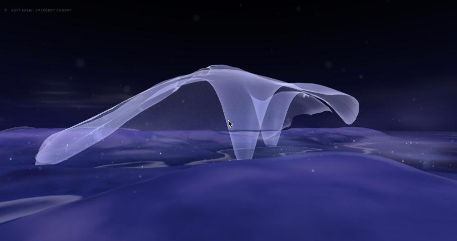
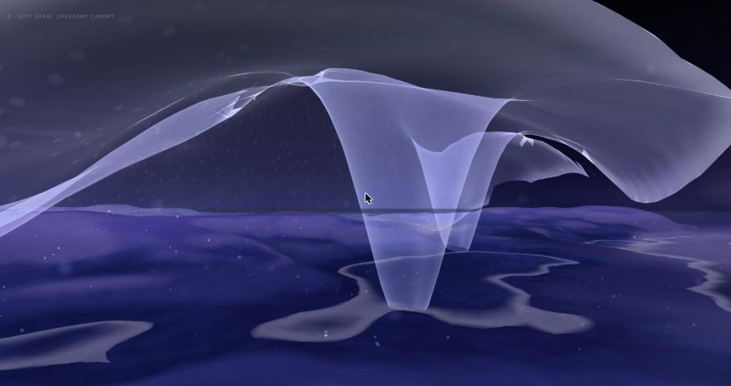
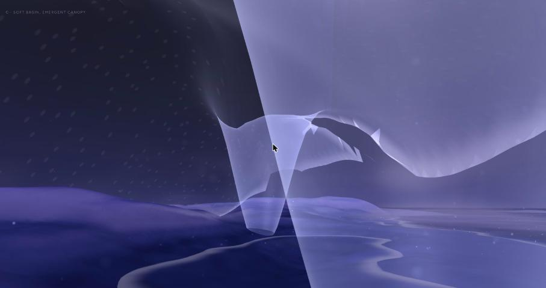
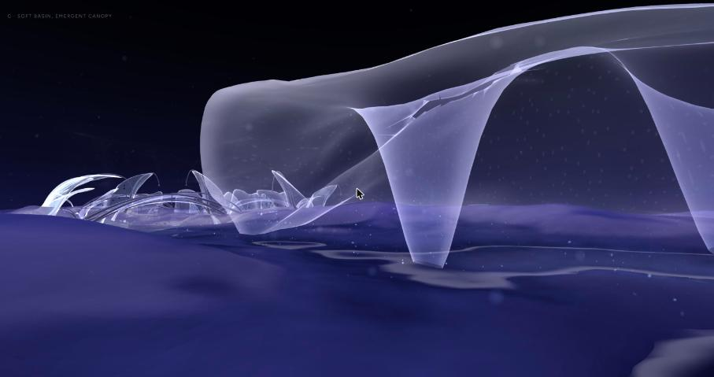
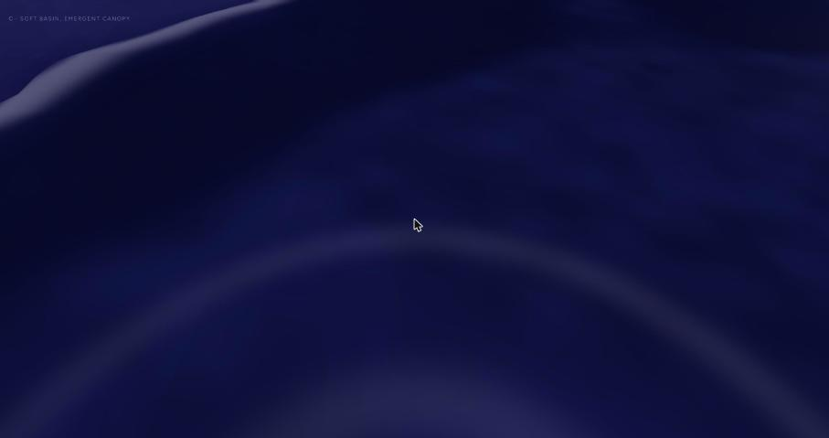

# 14 · Habitat C: soft basin, emergent canopy, and smooth movement

*One more spatial study, and a diagnosis of why movement felt uneven.*

> **Status, 31 October 2026: a playable study, for review.** Local only;
> nothing committed. v0 (`/habitat`), A (`/habitat/a`), B (`/habitat/b`) and
> Explore are kept as they were.

| | |
|---|---|
| **C** | `/habitat/c` |
| **Compare movement anywhere** | add `?motion=smooth` or `?motion=classic` (C is smooth; v0, A, B and Explore's presence are classic) |

## Movement: what was uneven

Checked in two ways:
- **Headless:** the real presence, driven at a perfectly even step over
  v0, A and B, which isolates the movement rules.
- **In the browser:** the displayed camera recorded every frame, which
  adds frame timing.

| | Measured | Cause |
|---|---|---|
| **Uneven step per frame** | Each frame moved the camera by a step 1.6% (median) to 18% (p95) longer or shorter than the last, while cruising at a steady 120 fps. Displayed acceleration noise was 15 units/s² (p95) | R3F's `delta` is the time between callbacks (`clock.getDelta()`), not between displayed frames. It wanders by 5–13% (p90–p99) around the display's 8.33 ms |
| **Eye height swinging over slopes** | Eye height above the ground ranged 0.22–0.95 over A's banks against a target of 0.5 (0.32–0.77 in v0) | Height followed the ground through two cascaded eases (about 0.75 s), so it sank going uphill and floated coming down |
| **Bumps on uphill banks** | 47–65 frames per 22 s crossing of A hit the hard floor, with one-frame jolts of 30–36 units/s² | The hard floor clamp (0.22 above the ground) caught the lagging height |
| **A lurch at every start, stop and turn** | Acceleration jumped from 0 to 1.3 units/s² in one frame (0.7 for one wheel notch) | Speed followed by exponential easing |
| **A nudge on touching a form** | Single-frame position corrections on first contact | Position pushed out of the forms' body |
| **Rendering** | No frame over 12 ms in any run | Not a cause |

**Smooth motion** (`SMOOTH` in `lib/presence.js`, the `smooth` prop on
PresenceCamera):
- Same speeds, height, body and controls.
- **Speed:** follows a critically damped spring, so acceleration builds and
  fades.
- **Height:** follows the ground here and a moment ahead (0.35 and 0.8 s
  of travel), so a rise lifts the eye before it arrives.
- **Floor:** a soft spring at 0.32, with the hard floor (0.18) only a last
  guard.
- **Forms:** met by velocity, against the surface's smoothed distance,
  with a hard push only when deep inside.
- **Step:** a whole number of display frames, learnt from the frames
  themselves.

| | Classic | Smooth |
|---|---|---|
| Change in step from frame to frame while cruising (browser, C, p95) | 17.7% | 1.8% |
| Displayed horizontal acceleration (browser, C, p95 / p99, units/s²) | 15.2 / 23.5 | 1.1 / 1.5 |
| Eye height over A's banks, north–south (headless) | 0.22–0.95 | 0.48–0.83 |
| Eye height over v0, north–south (headless) | 0.32–0.77 | 0.50–0.53 |
| First frames of a start (units/s²) | 1.30, 1.36, 1.34 | 0.04, 0.21, 0.31 |
| To 90% of speed / at rest after letting go | 1.17 s / 1.70 s | 0.89 s / 1.03 s |

Not changed: the look drag (eased over 0.08 s) and the scroll's own
response. The scroll now reaches the body through the speed spring.

## C · the space

**Landform.** Seed 11, `power` shaping 1.0, water 0.44, vertical scale
1.9, landform scale 1.8.
- Chosen by a search for gentle slopes (median ≤ 12°, 90th percentile
  ≤ 22°), 50–82% land, enclosed shallow water, little open water at the
  edge, two separate patches and a place for the canopy.
- Result: 80% land, four pockets, 90% of the water within 0.31 of the
  surface, slopes 10° (median) and 20° (90th percentile), five colonies.
  Soft ridges stand to the east and south-west.

**The canopy** (`placeCanopy`, `buildCanopy` in `lib/habitatSpaces.js`).
One sheet, about 12 × 9 units, in the bloom film made quieter (less gain,
rim and highlight).
- **Shape:**
  - It roots into the bank behind it and along one flank, peeling up from
    the ground slowly there.
  - The front hangs free over the shallows, at 1.35–2.3 and uneven.
  - The other flank comes down in a low lobe.
  - The roof rises to 2.3–3.2 (five to six times eye height), highest off
    centre, with a slow fold across it.
  - Two roots of different sizes come down inside it as funnels that open
    into feet in the ground.
  - It has one large torn opening and one long slit, far apart.
- **Placement, by rule:** a bank behind, the ground falling toward water in
  front, gentle underfoot. It stays clear of every colony's lifecycle reach
  and every footing, away from the slab's edge, with colonies about 9
  units away.
- **Movement:** the presence meets its points (spaced 0.14): you can pass
  under its front and lobe, stand inside, and walk round its roots.

**Arrival, by rule:** 7.5–10.5 units off, three-quarters on to its open
side, on land, with the ground not rising between.

**Ecology, unchanged.**
- Two patches by the same rule as A and B (colonies 0 and 4), both
  running, with residents forming from their deposits by 248 simulated
  seconds.
- The encounter is the tallest free veil, here colony 0's, in the
  north-west cluster, far from the canopy.
- The water cue is as in A and B. Nothing reads the canopy.

## Checked

Every check below was scripted movement in the browser, not a person
playing:
- arrival;
- approaching;
- beneath;
- out through the front;
- looking back;
- across a pocket;
- the lowest height on a slope.

| | v0 | A | B | C |
|---|---|---|---|---|
| GPU per frame (ms, mean, shipped settings) | 4.5–5.4 | 4.5–4.9 | 4.0–5.9 | 4.2–5.9 (most beneath the canopy) |
| Frame rate | 120 | 120 | 120 | 120 |

Unaffected:
- v0's lifecycle hashes at 3,000 steps are identical to before;
- v0, A, B and Explore's presence still move classically by default;
- Explore's presence arrives where it did, with no console errors.

Build passes; lint has no errors.

## Limitations

- **From the arrival, the canopy still partly reads as a sheet laid over
  the ground:** a large object, before it is a place. It reads most as an
  environment from beneath and when looking back.
- **Its life is elsewhere.** The colonies, the patches and the encounter
  are all in the north-west, about 9–14 units away. The canopy shelters
  water and ground, not activity.
- **Large overhead film costs about 1 ms of GPU,** and its folds are not
  depth sorted against each other.
- **Smooth motion is new and scripted-tested only:** its feel (the springs'
  rates, the look-ahead) needs a person.
- **The scene is dark, as v0 is,** and the water ring shows only when
  looking down.
