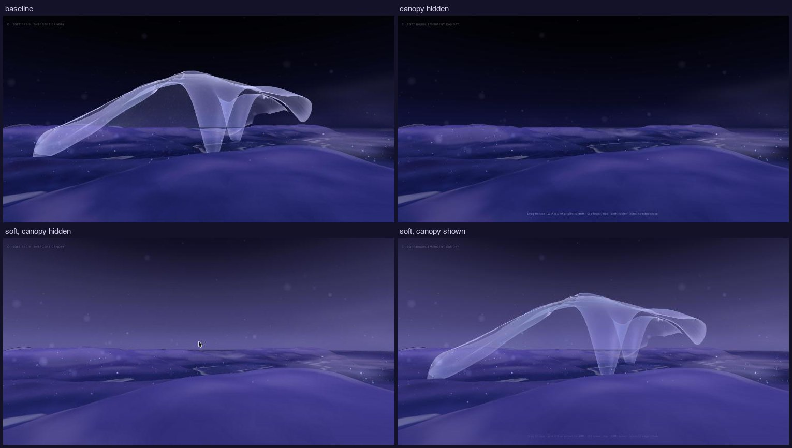
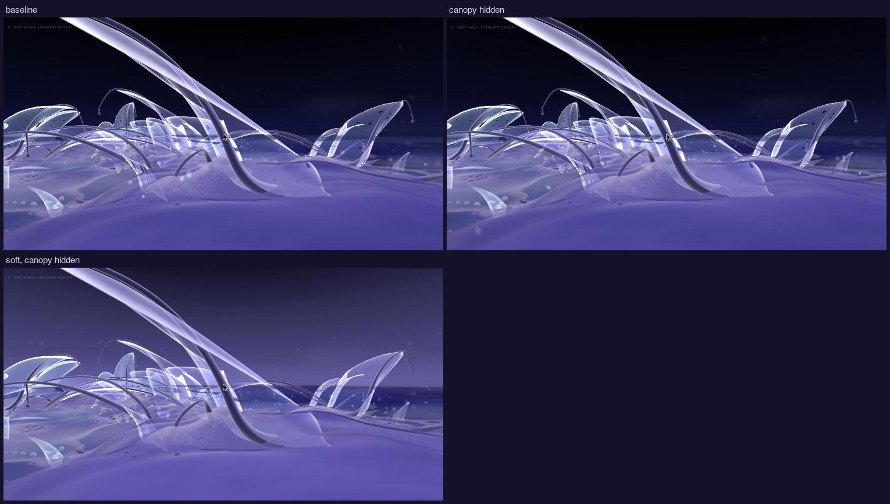
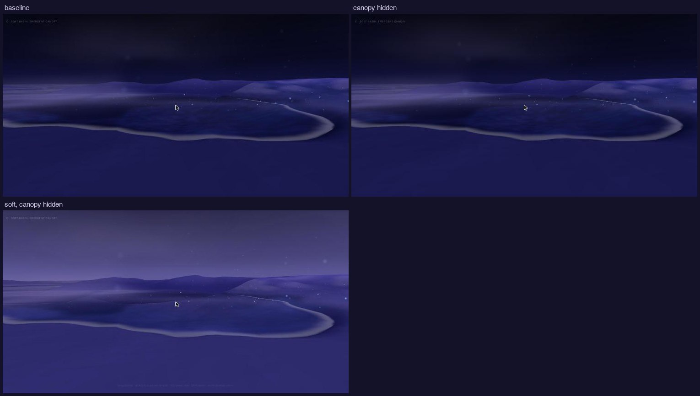
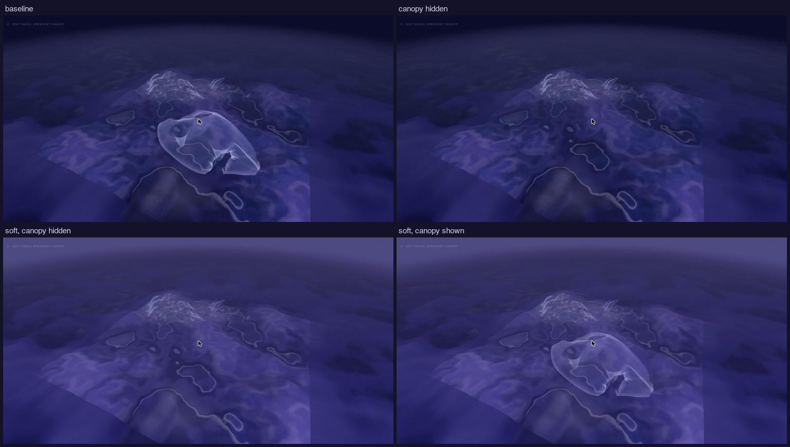

# 15 · Habitat C, visual reset: what causes the look

*A diagnosis and comparisons inside C, before any new geometry.*

> **Status, 2 November 2026: comparisons for review.** Local only; nothing
> committed. Explore, v0, A and B are unchanged; C's own configuration is
> unchanged. Everything below is behind URL flags.

| Compare | URL |
|---|---|
| C as it is | `/habitat/c` |
| Canopy hidden | `/habitat/c?canopy=0` |
| Soft look, canopy hidden | `/habitat/c?canopy=0&look=soft` |
| Soft look, canopy shown | `/habitat/c?look=soft` |
| Movement | `&motion=classic` or `&motion=smooth` on any of them (C is smooth) |

`?look=soft` also works on `/habitat`, `/habitat/a` and `/habitat/b`; without
it every page looks as before.

The comparisons hold everything else fixed:
- the same seed;
- the shaders' clock frozen at 40 s;
- both lifecycle patches stepped to 1,200 steps;
- the same four camera positions, chosen by rule;
- the same rendering profile.

## Comparisons

Each frame was measured straight after it was drawn. L is luminance,
0–1; "near black" is L < 0.06 and "near white" is L > 0.7. The upper band is
the top quarter of the frame, mostly sky; the lower band is the bottom 40%,
mostly ground and water.

| View | Variant | Near black | Near white | L median / 95th | Upper band | Lower band |
|---|---|---|---|---|---|---|
| Arrival | baseline | 35% | 0.2% | 0.15 / 0.46 | `#03040d` | `#2c2d70` |
| | canopy hidden | 41% | 0% | 0.10 / 0.27 | `#03040d` | `#2a2b6e` |
| | soft, canopy hidden | 0% | 0% | 0.24 / 0.36 | `#262445` | `#3b3883` |
| | soft, canopy shown | 0% | 0.05% | 0.24 / 0.47 | `#262445` | `#3c3984` |
| Colony | baseline | 34% | 4.4% | 0.29 / 0.67 | `#131321` | `#5e5aa1` |
| | soft | 0% | 3.8% | 0.36 / 0.66 | `#363459` | `#6862ac` |
| Shallow water | baseline | 18% | 0% | 0.11 / 0.25 | `#0d0e21` | `#191c4f` |
| | soft | 0% | 0% | 0.20 / 0.35 | `#403c6a` | `#2e2e6d` |
| Overview | baseline | 6% | 0% | 0.16 / 0.29 | `#1b1e40` | `#292a62` |
| | soft | 0% | 0% | 0.21 / 0.31 | `#3d3a6c` | `#333172` |

## Causes

**Perforations.** Four sources, three of them in existing shaders:
1. **The dark oval holes** are the film shader's *lace*. Where a membrane's
   openness × the scene's openness uniform is over 0.35, the shader cuts real
   holes (`discard`).
   - Openness is set per membrane by placement: veils 0.25–1.0 by distance
     from the water, anchors 0.15–0.55, footings 0.6, new residents likewise.
   - The uniform is `bloomOpenness` 0.5 × 1.6 = 0.8.
   - So veils above about 0.44, footings and the most open anchors show
     scattered dark holes. These were most of what read as perforation.
2. **Regular light dots or dashes** are the closed film's *thin spots*, from
   the same cell pattern. On C's large stretched sheet they become rows of
   dashes.
3. **Darker pits on solid parts** (rims, beads, residue) come from the
   solid shader's pores.
4. **Geometric openings:** C's two canopy openings, and B's three apertures
   per vessel.

`look=soft` sets `bloomOpenness` to 0.2, below the lace threshold for every
placed membrane and resident. It also turns the thin spots down to 35% (a new
`uSpots` uniform, 1 everywhere else). The structural webs keep their own
openness (0.8) and the solids keep their pores; neither was changed.

**Palette.** Not one parameter: five things stack.
1. **The sky is about three times darker than authored.** The sky dome's
   shader writes its colours without the output colour-space conversion
   every other material applies. Three.js keeps colours as linear values, so
   the zenith `#0C0F26` shows as about `#03040D`.
   - That is the measured upper band in the baseline: 34–41% of the arrival
     and colony frames are near black.
   - `look=soft` writes the dome in the output space (an opt-in `encode`)
     and moves it toward violet.
2. **Untouched ground is the ramp × 0.38.** That is the Dormant reading,
   dark by design for an overview where the record should glow.
   - In first person the ground fills half the frame.
   - Scatter's shadow grading then pushes its darks deeper and toward navy
     (`#222B62`).
   - Soft: 0.56 of the ramp, grading at half strength.
3. **The water is navy:** body `#2E3160` and `#141735`, reflecting the dark
   horizon. Soft thins its veil toward violet (Explore's own Underwater
   visibility, at 0.3), keeps it a little deeper than the land so depth still
   reads, and reflects the soft sky's horizon.
4. **Fog and background are navy** (`#262B4F`, `#0B0E1E`). Soft uses violet
   (`#35325F`, `#141228`).
5. **Membranes are near white against all this:** the bloom film's gain of
   1.5 plus its rim light. Soft lowers film gain to 0.72 of itself. It
   matters less once the darks are lifted; strands and anchors' rims are
   still the brightest things (3.8% of the colony frame).
- **Also, from above:** the far field is plainer and darker than the slab
  (no record shading, deeper water), so the slab shows as a square. Soft
  lets the far land sink more gently, but the square remains. At eye height
  fog mostly hides it.

## What the comparisons show

- **The canopy dominates its views** (its arrival was chosen to face it).
  Hidden, the arrival has no subject. With the soft palette it is less
  glaring, but it still reads as a translucent sheet laid over a hill, and
  from above as a bag on the map. Colour doesn't change that; its form
  does:
  - one continuous sheet of even thickness, about 12 × 9;
  - an outline that follows no contour of the ground, only an offset above it;
  - a smooth drape whose roots read as tent poles from a distance.
- **The perforations are fixed by openness alone.** The colony view shows it
  most: holes in the baseline, none in soft, the membranes otherwise the
  same.
- **The palette's biggest single change is the sky.** Correcting its output
  and moving it to violet removes every near-black pixel. The ground's
  lifted dormant reading turns it from navy-violet to lavender-violet without
  white. Kept as is, the water stays the deepest tone, so depth reads.
- **The risk is flatness:** the soft water view's contrast is 0.19 against
  the baseline's 0.21, the overview's 0.16 against 0.23. The tonal range now
  sits in the middle. The next palette step should open it upward (pearl in
  the light, on membranes and deposits), not down again.

## Recommended direction (not built)

Retire the giant canopy as the organising form. Grow tissue *from* the
terrain, locally:
- **Where:** along existing contours. A bank's edge, a pocket's rim, a
  stream's lip, the shoulder the relief already makes (`withRelief`'s
  shoulder band). Each formation follows a contour line for 2–5 units and is
  attached along most of its length.
- **How:** peeling. A strip of ground skin lifts from the contour at one end
  and lies down again, or stays lifted, at the other. It folds back over
  itself in places, and partly spans a pocket or a channel (one side rooted,
  the other reaching), at 0.5–1.6 high, rarely over the eye. Its outline is
  the contour on the attached side and torn on the free side.
- **How many:** three to six such peels, unequal, near colonies and pockets,
  never repeated in section.
- **Openings:** only where a peel pulls away from the ground and leaves a
  gap you can see or pass through, never as patterns.
- **Material:** the ground's own skin graduating into membrane. The tissue
  material already exists for colony skins and deposits. Pearl where it is
  thin and lifted, ground-coloured where it is attached, so the transition
  from ground to living tissue is visible.
- **Palette:** start from `look=soft`. Then raise the light end with pearl,
  on peels' lifted edges and on deposits, rather than with glow.

Ecology, encounter and movement stay as they are. The peels would avoid
lifecycle reach, as the canopy did, unless you decide life should grow under
them.
