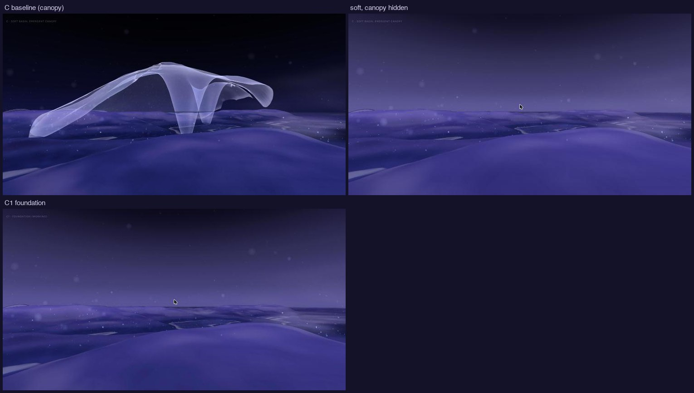
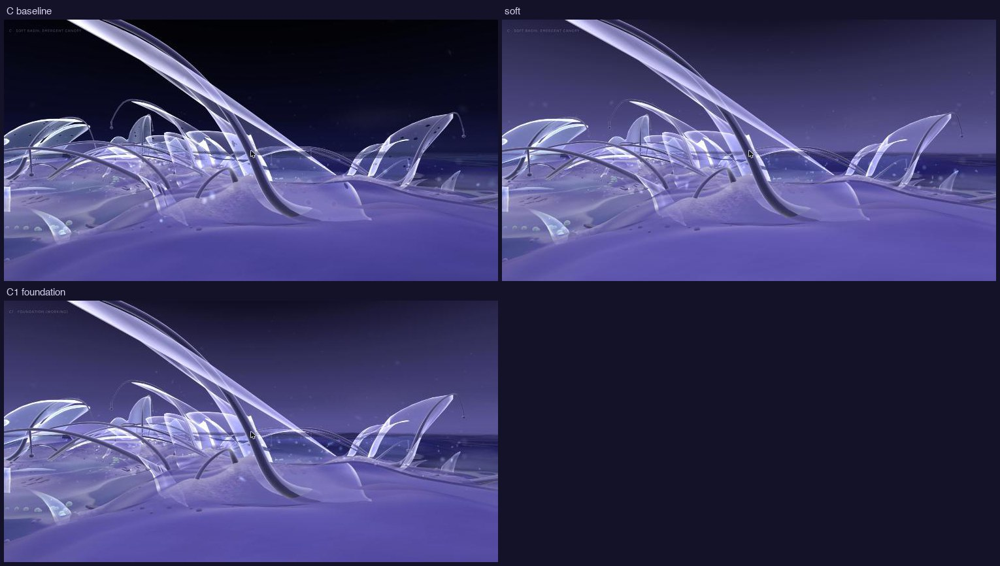
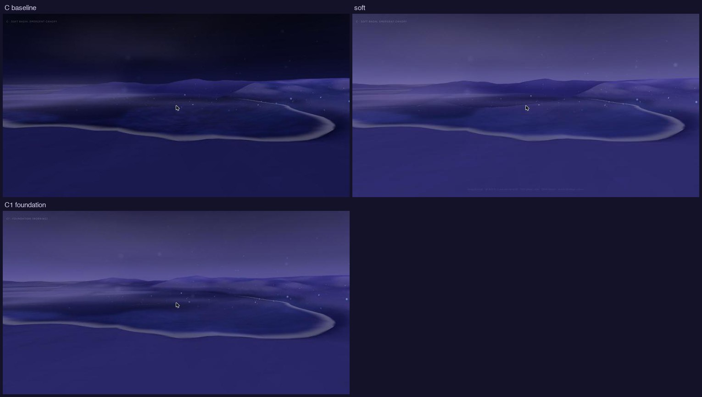
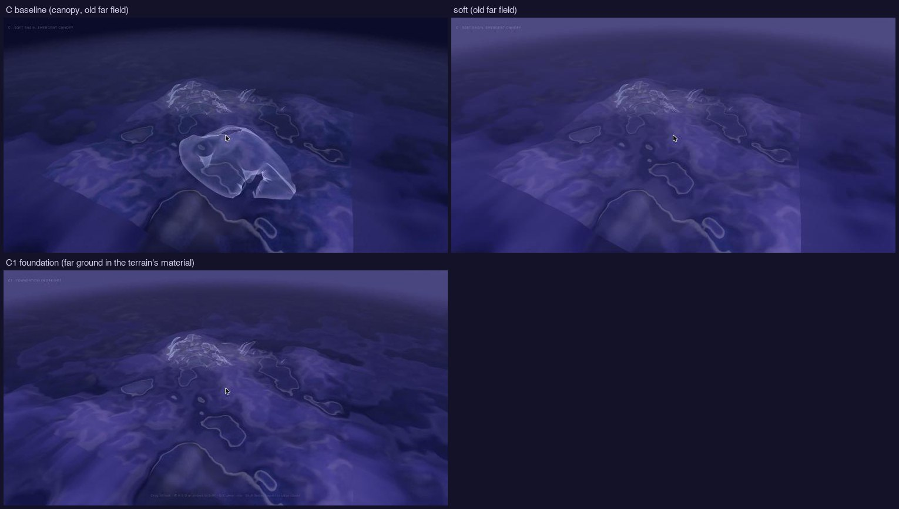
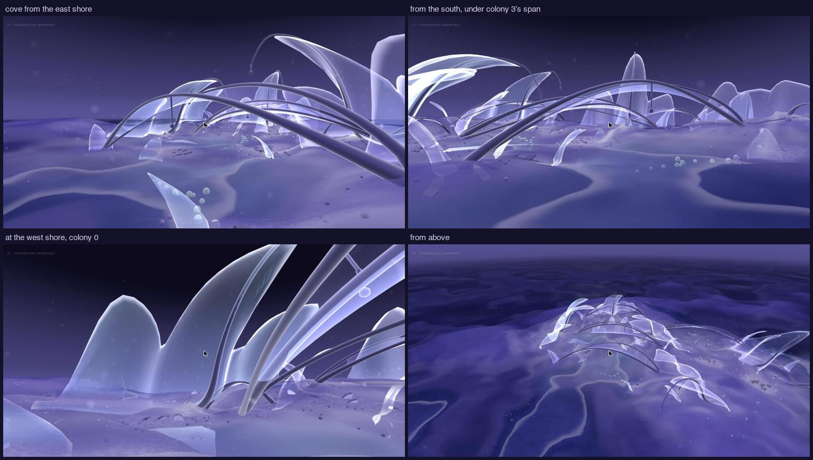

# 16 · Habitat foundation: C1, world continuity, and the cove

*A working base for the Habitat, and one spatial direction for review
(not built).*

> **Status, 2 November 2026.** Local only; nothing committed. Explore, v0,
> A, B and C are unchanged, and C's flags (`look`, `canopy`, `motion`)
> still work.

**`/habitat/c1`** is the working variant: C's world and ecology, smooth
motion, the *foundation* look, and the giant canopy retired. The canopy is
still composed (so arrivals and comparison viewpoints are C's), but it is
neither drawn nor met; `?canopy=1` shows it again. The far field is drawn in
the slab ground's own material.

## Palette: the foundation look

`LOOKS.foundation` in `lib/habitat.js`. It keeps soft's corrections:
- the sky written in the output colour space, and moved to violet;
- untouched ground lifted;
- lace mostly closed.

It gives some depth back:
- the zenith darker (`#0C0A1D`);
- shadow grading at 0.65;
- deeper water (veil 0.85, underwater lift 0.22);
- a little less mist (0.35) and fog (0.026).

Membrane openness is 0.3, just under the lace threshold: only the most open
veils, those farthest up from the water (where placement meant lace), keep a
few small openings. Nothing glows more; no line or effect was added.

| View | C baseline: contrast (p95 − p05) / near black | Soft | C1 foundation |
|---|---|---|---|
| Arrival | 0.26 / 41% (canopy hidden) | 0.26 / 0% | 0.25 / 1.5% |
| Colony | 0.66 / 34% | 0.52 / 0% | 0.55 / 0% |
| Shoreline | 0.21 / 18% | 0.19 / 0% | 0.20 / 0% |
| Overview | 0.20 / 6% (canopy hidden) | 0.16 / 0% | 0.17 / 0% |

The foundation is a conservative step from soft: water is the deepest
tone again (`#282865` in the shoreline view against soft's `#2E2E6D`), and
the sky has a gradient. It is still close to soft. The tonal range sits in
the middle, so the next gain is upward (light on membranes and deposits),
not more darkness.

## World continuity: why the slab showed as a square

| | Slab | Far field (before) |
|---|---|---|
| Height | Carved field with relief (lift, shoulders, plateaus), streams, and History's sediment lift | The base landform only, eased from the rim over 4 units, then sinking |
| Grid | 0.116 units | 0.232 at the edge, widening 13% per line |
| Material | Terrain shader, Dormant reading: ramp × dormant, record tint, reflected light weighted by the record, relief light, faceted normals | A separate plain shader: three colours, smooth normals |
| Sediment | History's record, which piles against the closed boundary | None |
| Water | The slab's water (depth from texture), with waterlines | The same water material, with depth from the far ground, and no waterlines |
| Mist | Present, fading out between 10.9 and 13 units | None |

The smallest correction is Habitat-only, and on in C1. Each step was checked
by hiding layers in the browser:
1. **One material.** The far ground is drawn by the terrain's own shader
   (Terrain `farGround`, a `FAR` define), sharing the slab material's
   uniforms. Palette, light, grading and any look apply identically. Beyond
   the edge there is no sediment, streams or gathered light, because none
   exists there.
2. **The same colouring height.** The far ground is coloured by its height
   without History's lift, taken off over the blend band, as the slab is
   coloured by its carved field.
3. **The record goes quiet at the rim.** The record's look (not its data)
   fades over the slab's outer two units (`uEdgeQuiet`), where sediment
   piles against the boundary.
4. **The same grain past the edge.** The far grid keeps the terrain's
   spacing for 3.5 units beyond the edge before widening.

**What remains:**
- a faint line where only the slab has waterlines;
- the mist ending at the slab (it fades);
- relief detail ends past the blend band.

**Cost:** 0.15–0.35 ms of GPU at eye height, 1.1 ms in the overview
(153k ground triangles past the edge, from 34k). The frame rate stays at
117–120 fps.

## The cove: one colony-to-shore formation (recommendation, not built)

**Where.** The shallow pocket around (−7.5, −4.5), about 5 × 4 units and
0.19 deep at most. It isn't one colony's shore but a shared one: colonies 0,
2 and 3 stand on three sides of it, each leaning into it. Each colony's
nearest water lies in this pocket, and they face it at 0.97–0.99. A second
pocket continues south across low ground. It lies inside the drift bound on
three sides; colony 0's back is at the slab's edge.

**What already makes it a place.** Found in the data and seen from eye
height:
- **Structure across the water.** Two existing spans arch over the pocket:
  colony 0's from (−10.5, −5.5) to (−5.4, −7.4), 5.5 long, and colony 3's
  from (−4.2, −5.1) to (−8.7, −2.8), 5.0 long.
  - Each arches about 1 above its ends, so 1.1–1.3 over the water: you
    pass beneath them at their middles, as from the south shore.
  - They cross the pocket on different lines, so from inside it they layer.
- **The ecology is already here.**
  - Colony 0's lifecycle patch settles 28 films in 600 s, 19 of them in
    these shallows.
  - All six of its new residents form on the pocket's south-west shore.
  - The cove is where its matter goes, and where new residents rise from it.
- **Residue on the banks.** Colonies 0, 2 and 3's residue trails run down
  their banks toward it.
- **Scale.** Anchors of 2.0–2.7 stand around the cove (four to five times
  eye height), with veils of 0.5–0.9 at eye height along it.
- **Approaches.** Arrive from the open east over low ground, drift through
  the shallows beneath the spans, and leave by colony 2 (north) or the
  south pocket. Then come back from the other side.

**What it lacks.** The colonies read as three groups around an empty
pocket. Nothing at the water itself is of the colonies: their tissue skins
stop short of the water, and the spans are bare strands.

**What could be reused, with no new geometry:**
- **The spans:** frame, scale, and a "beneath".
- **The colonies' tissue skin** (the colony ground-skin material and
  builder): can be extended, by its own rules, down the bank to the
  waterline.
- **The lifecycle's deposits and contours:** already lie in the shallows,
  drawn in the same skin material.
- **The rest, as they are:** residue trails, waterlines, the anchors' lean.

**What genuinely needs new geometry.** One element, coarse:
- a membrane hung from each of the two spans: the strand as its upper edge,
  falling toward the water but not reaching it;
- it ends 0.9–1.2 above the surface along most of its length, lower near
  the spans' feet, and torn along its free edge;
- two sheets, unequal, from existing curves, under 1,000 vertices each;
- the presence meets them, and you pass beneath them at the middle;
- they would make the spans read as part of the colonies' tissue reaching
  across the water.
- The same material language as the veils; no new species and no new
  rules.

**Ecology.** Unchanged:
- the patch at colony 0 keeps its rules;
- the sheets stay out of its formation footprint (they hang over open
  water);
- the encounter remains colony 0's tallest free veil.

**Open questions for review:**
- whether the skins should reach the water (presentation only);
- whether the hung sheets should be the encounter's place (the visitor
  brushing them as they pass beneath).
