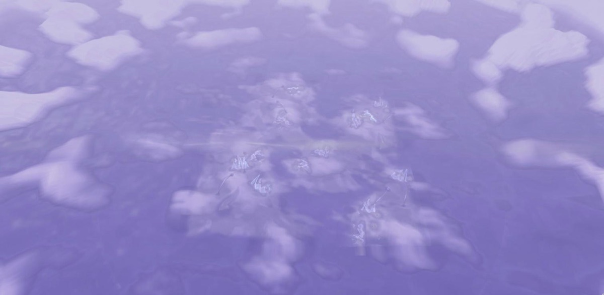

# 17 · Habitat D: a distributed living world (first playable)

*A wider world of rises and connected shallows, colonies across it at
different ages, and a horizon. For review.*

> **Status, 2 November 2026: first playable iteration.** Local only; nothing
> committed. Explore, v0, A, B, C and C1 are unchanged (checked below).

| | |
|---|---|
| **D** | `/habitat/d` |
| **Compare** | `/habitat/c1` |
| **Controls** | As in C1: drag to look, W A S D or arrows to drift, Q / E lower and rise, Shift faster, scroll to edge closer. Smooth motion. |

## The world

**Size: 48 units, not 26** (3.4 times the area). The terrain keeps C1's grain
(a vertex every 0.115 units) and the sediment record keeps its cell size
(History at 256², 0.19 units per cell). At drift speed the visitor takes
about 25 s to cross between neighbouring groups and 70 s to cross the
world (30 s with Shift). 48 was the size tried; it was not compared with
40 or 52.

**Landform.** The same derivation chain, with three opt-in changes (D only):
- **Shallows** (`shallows` in `lib/habitatWorld.js`): under the water level,
  depth is kept at 40%, eased in from the shore. Shores stay where they are
  and land is untouched. Water becomes a shallow sheet over a softly varied
  bed rather than basins: 90% of it is under 0.19 deep, against 0.31 in C1.
- **Drawn out:** the landform is stretched along one direction (ratio 0.55),
  as bars and channels lie along the way water runs. This joins the water
  into one body without raising it.
- **No stepped shelf:** withRelief's `deepen` and `shelf` are lowered, so the
  ground runs on into the water.

Chosen by a scored search. The first pass was seeds 1–14 at water 0.5, 0.53
and 0.56, stretched or not. With the shallows, the second was seeds 1–16 at
water 0.53 and 0.56, stretched. The criteria:
- 35–60% water, mostly one connected body, 90% of it under 0.5 deep;
- gentle land;
- colonies on three or more rises, in all four quarters, some alone and
  some grouped, unevenly spaced;
- at least five colonies with a lifecycle.

| | C1 | D |
|---|---|---|
| Water / share in its largest body | 20% / 35% | 45% / 85% |
| Separate small pools (under 4 units²) | 3 | 1 |
| Water depth (median / 90th percentile) | 0.12 / 0.31 | 0.11 / 0.19 |
| Land slope (median / 90th percentile) | 10° / 21° | 5° / 13° |
| Colonies / on separate rises / quarters with colonies | 5 / 1 / 1 | 13 / 3 / 4 |
| Mean distance between colonies / farthest pair | 6.5 / 10.7 | 22.4 / 43.6 |
| Spread of nearest-neighbour distance (0 = even) | 0.05 | 0.47 |
| Colonies alone (none within 9) | 0 | 3 |

**Where colonies stand.** The site rule (wet margin, gentle ground, record,
shelter) is unchanged. Two opt-in rules are added in `findColonies`:
- **Gathering stops at the water** (`gatherBy: 'land'`). A colony draws
  offshoots only on its own rise, so a site across a channel must be good
  enough to begin its own group.
- **Depletion** (`deplete`). A colony draws on the record around it, so
  nearby sites keep less of their potential. Offshoots still begin near a
  parent (its pull reaches further), but a group fills its ground and stops.
- **The count comes from these rules.** The limit (`colonyMax`, 16) is
  only a ceiling and isn't reached.
- **Without depletion, colonies packed evenly at the spacing limit** (12
  colonies, nearest neighbours 4.4 apart, spread 0.07). Depletion around 0.75
  gave groups and lone colonies.

D's colonies are smaller than C1's first colony. Its membrane amount is
raised (0.85, not 0.5), so most colonies have two or three veils free to
live a lifecycle; at 0.5 each had one.

**Horizon** (`horizon` on buildFarField). Past the slab, the base landform
continues as rises and shallows, sinking a little. Beyond about 40 units it
rises into low hills, broken by gaps. Beyond about 95 it rises into a soft
range whose masses and gaps make the skyline. That part is a polar ring
(360 segments) rather than more grid, so silhouettes stay smooth and cheap.
Nothing lives in the distance.

**Sky and palette** (`LOOKS.open`):
- **Sky:** three stops, light at the horizon and deepening upward, as in the
  Trace Habitat, with a pearl glow low on the side the light comes from.
- **Fog:** pale violet and thinner (0.0105), so distance lightens rather
  than darkens.
- **Ground:** its ramp and its own light are lifted. The other looks' dim
  blue light, multiplied with the violet ramp, made deep indigo.
- **Shore:** wet ground a little darker than dry. There is no drawn
  waterline; the visitor's ring on the water stays.

## Age and what is simulated

Three timescales, all from existing systems:
- **Resident age:** each resident's own lifecycle (forming, holding,
  receding, releasing, ended), unchanged.
- **Colony history:** each colony with free veils has its own lifecycle (13
  in D, 2 in C1). Before the first frame, each is run for its colony's age.
  - The age follows maturity, which comes from the record around the
    colony: the most mature has lived 900 s and the least has just begun.
  - So, at arrival, ended residents lie as contours beside ones still
    holding, releasing or newly forming from the deposits, within the same
    colony.
- **Environmental memory:** History's sediment record decides where colonies
  stand and how mature they are. Each lifecycle's deposits decide where new
  residents can form.

| | Simulated | Generated as initial scenery |
|---|---|---|
| Landform, shallows, horizon | | Noise and shaping, by seed (the horizon is plain noise; nothing happens there) |
| Sediment record | History, 40 s, headless | |
| Where colonies stand, and their maturity | | By rule from the record (site potential, gathering, depletion) |
| Colonies' structure (anchors, spans, veils) | | Built by the scatter rules |
| When each colony began | | Its age from its maturity (`colonyAges`): the one assumption added |
| Everything since a colony began | Its lifecycle, run headless for that age (`prerun`): residents, films, deposits, new residents | |
| After arrival | All 13 lifecycles, live, on their own clocks; the air | |
| Stray residue | | Placed by rule (`strayResidue`, up to 14) |

**How it is run:**
- **Deterministic:** a fixed step and seeded randomness. Each lifecycle's
  step phase is offset by under 0.1 s, so their steps fall on different
  frames.
- **Matter is conserved:** the largest ledger drift over 30 simulated
  minutes is 1.6e-8.
- **No exchange between colonies:** each lifecycle keeps its own grid, and
  matter never passes from one colony to another. Films that settle near
  another colony stay in their own colony's grid.

**The world runs down.** There is no supply, by design. Measured headless
after arrival:

| Minutes after arrival | 0 | 1 | 3 | 5 | 10 | 15+ |
|---|---|---|---|---|---|---|
| D: standing residents / contours | 21 / 30 | 16 / 37 | 9 / 51 | 4 / 57 | 0 / 64 | 0 / 64 |
| D: lifecycle events in that minute | | 87 | 93 | 33 | under 10 | 0 |
| C1: standing residents / contours | 4 / 0 | 4 / 0 | 4 / 3 | 3 / 5 | 2 / 9 | 0 / 11 |

D is far busier at first. Its last lifecycle event comes at about 10
minutes, C1's at about 13. After that only the air moves. The simulation
runs whether or not anything is seen, but it pauses with the tab (it runs
on the frame loop).

## Moving through it

Scripted in the browser, with real key input (W and Shift held, the gaze
steered toward each waypoint), recording every displayed frame:
1. From the arrival, past the young colony.
2. West across shallows into a mid-aged colony.
3. South-east past colony 12.
4. With Shift, across 18 units of shallows (86% of it over water) to the
   oldest colony and its two young neighbours.
5. Then looking back.

In all, 44 units of travel over about 70 s.

| Measure | Result |
|---|---|
| Frame interval while moving (median / 95th percentile) | 8.3 / 8.7–9.1 ms (120 fps) |
| Frames over 12 ms | 0.1–0.4% |
| Step per frame at cruise | constant (4.97 mm) |
| Eye above the floor | 0.49–0.61 (target 0.5) |
| Colonies passed within 4 units | 5, 2, 12 |

The first walk dropped 7% of frames, every 0.1 s:
- **Cause:** all 13 lifecycles stepped on the same frame, and each one's
  display redid its deposit and warm-accent grids over the whole world.
- **Fix:** the lifecycles' steps are staggered, and each display works only
  over the cells its colony's deposit reads (`cull`, D only), with
  identical results there. Deposits are also culled off screen and before
  anything has settled.

## Compared with C1

| | C1 | D |
|---|---|---|
| Lifecycles / standing residents at arrival | 2 / 4 | 13 / 21 |
| Triangles per frame (arrival) | 0.75 M | 2.2 M |
| GPU, main scene (median, timer queries) | 1.7 ms | 3.3 ms |
| GPU, the air's own passes (particles, haze, wisps) | about 5 ms | about 6 ms |
| Frame interval standing (95th percentile) | 10.1 ms | 10.3 ms |
| Ready after load (production build) | 1.5 s | 3.2 s |
| JS heap | 480 MB | 930 MB |

Apple M4 Pro, timer queries, pixel ratio 1.5.

**The 3.2 s load is spent on:**
- deriving the world, 0.6 s;
- the horizon, 0.4 s;
- running the 13 lifecycles to their ages, 0.75 s;
- the colonies' light, 0.26 s;
- geometry and the rest.

In development, React's StrictMode doubles it.

## Checked

- **Earlier spaces unchanged.** Compared against a copy of the code with
  this study's edits removed:
  - v0's two lifecycles over 3,000 steps hash identically (`28771e8a…`,
    `2a430813…`);
  - the colonies, membrane counts and sediment record of v0, A, B, C and
    C1 match.
- **Explore loads** with no console errors.
- **Build passes;** lint has no errors (68 warnings, as before).

## Limitations and open questions

- **The world runs down in about ten minutes.**
  - **Shorter age span:** colonies would start younger, giving more
    activity for longer but less difference between places.
  - **A real, slow source of matter:** for example, from History's own
    supply. That would be a new mechanic, so it is not added here.
- **The ground is quiet.** Between colonies it reads as one smooth lavender
  sheet. Water and land are told apart mostly by the sky's reflection, and
  the sediment record and the streams barely show.
- **The distance is plain.** The ranges are soft and hazy, with no
  silhouettes of remains in the distance. I left these out because nothing
  there is simulated.
- **From above,** the slab still shows as a square against the far field, and
  a faint pale line crosses the middle. Neither shows at eye height.
- **Memory and load roughly double** C1's, mostly from 13 lifecycles each
  with whole-world grids. Windowing their grids to each colony would cut
  most of it.
- **Many colonies are small** (three to five membranes). The groups read as
  scattered small formations more than as a few rich places.
- **The arrival was chosen by rule** (a young colony near, another at middle
  distance and one far off in view). The encounter is the tallest free veil
  near it. Neither has been tried by a person.
- **Untested:** all movement was scripted, not played by a person.
