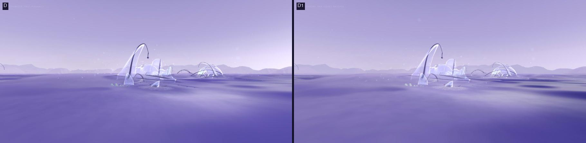
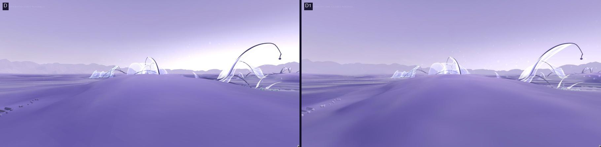
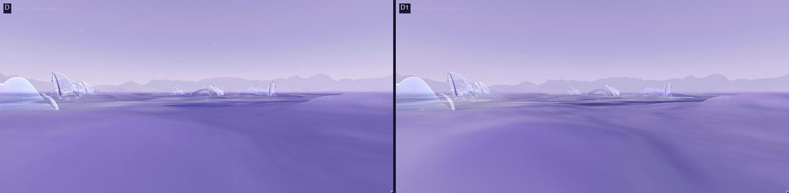
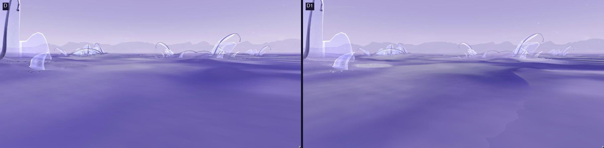
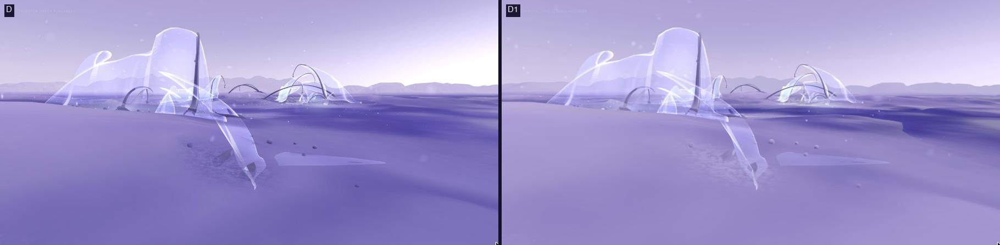
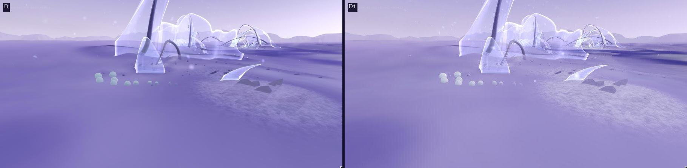
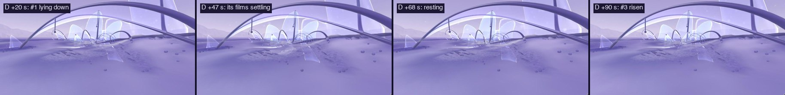
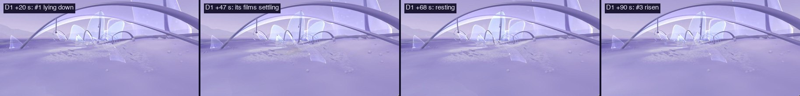
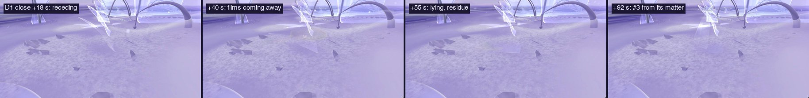

# 18 · Habitat D1: visual hierarchy, one legible passage, and why the ecology stops

*D's world and ecology exactly, seen with more depth, with one real
ecological passage drawn so it can be read from eye height, and a diagnosis
of the ten-minute dormancy. For review.*

> **Status, 4 November 2026: first playable iteration.** Local only; nothing
> committed. Explore, v0, A, B, C, C1 and D are unchanged (checked below).

| | |
|---|---|
| **D1** | `/habitat/d1` |
| **Compare** | `/habitat/d` |
| **Controls** | As in D: drag to look, W A S D or arrows to drift, Q / E lower and rise, Shift faster, scroll to edge closer. |
| **Where to look** | Turn round at the arrival: colony 8 stands about 6 units behind you. Its first resident lies down within seconds, and a new one rises from what it released at about 76–100 s. |

D1 is D's configuration with a different look (`LOOKS.open1`) and
`legible: true`. Its landform, colonies, ages, seeds and lifecycle rules are
D's, so the two can be compared directly. Nothing in the ecology differs.

## 1. Visual hierarchy

### What was wrong in D, and why

Each cause below was found in the code and then checked by switching it off
in the browser:

| Seen in D | Cause |
|---|---|
| Ground, water and sky at about the same value | D lifted the ground's ramp and light to sit under its pale sky. Its water colour (`#6A64A6`) is almost the bed's own (`#6E68A6`), so near water is more lavender ground. Far water reflects the sky with an extra lift at the horizon, so it joins the sky. |
| Near-white horizon on the light's side | The sky's glow is added on top of an already pale horizon and clips to white. |
| Middle distance no different from the foreground | Fog `exp2` at 0.0105 is 4% at 20 units and 22% at 48: only the far range hazes. |
| Uninterrupted lavender ground | The ground's light is mostly ambient (sky ambient close to the key light), so 5° slopes barely shade. History's record is gated out almost entirely. Nothing marks wet ground. |
| Dark triangular/polygonal patches up close | Mostly the colonies' sediment plates and the stray residue. They are lit with the darker, bluer light all forms use (`#4C4A7E`/`#8E88C0`) while D's ground uses its lifted light, so on the pale ground they read as dark grey shards. The ground is also lit on its per-fragment faceted normal. |
| Films invisible | Lifecycle films are screen-blended, which shows over dark air but vanishes over D's pale ground and sky (see §2). |

### What D1 changes (Habitat only, all off elsewhere)

- **Moisture by the water's reach.** Ground within 0.15 of the water (about
  1–2 units across, on D's gentle banks) is darker, a little deeper in hue,
  and glossy where it lies flat. It stays drier where History's record lies
  thick, so bars of settled matter stand pale among damp hollows. Under the
  water the bed deepens with depth. Ground the water never reaches is a
  shade warmer, toward pearl.
- **Water as its own surface.** A deeper, more saturated violet body and
  more of a veil, so near water lies over the bed as a surface. It reflects
  10% less sky and has no horizon lift, so far water stays a step below the
  sky. Its slow swell tilts further, so the sky's gradient shows in broad
  bands.
- **Relief.** The ground is lit on its smooth normal (no facets), with the
  light reading its slopes more steeply (×2.6 in slope for the light only)
  and a little less ambient, so the landform's own rises and channels shade.
- **Distance.** Haze thicker (`exp2` 0.019) and a shade deeper than the
  horizon. Mid-distance colonies separate from the foreground, the hills
  become mid-tone silhouettes, and the range a flat soft one against the
  sky. The sky keeps its gradient. Its horizon is a step less white and its
  glow gain is 0.45, so nothing clips.
- **Forms lit by the ground's light.** This applies to plates and grains
  (part of the way), footings, the residue (fully), the colonies' skin and
  strands (part of the way, so strands remain the darkest line, the
  structure). Films keep their own light.

**What it does and doesn't do (judged from these fixed views):**
- **Clearer:**
  - water against land, at the shore and at middle distance;
  - layered distance;
  - the horizon;
  - the close ground (no dark shards, no facets);
  - membranes' bases against deep water.
- **Still weak:** the arrival's foreground is a broad sheet of uniform
  shallows. It now reads as water (deep near, reflective far), but has no
  texture at the 1–5 unit scale. Shallow water with nothing in or under it
  is still a plain surface. Planar reflections would change this but are a
  rendering feature, not attempted.
- **Membranes against the sky** are still pale on pale. They separate where
  the ground is behind them.

## 2. One legible autonomous passage

### What the simulation supports

Per resident: stage and stage time, unfold, recline, `body`, `need`,
`taken`, `contour`, its last release (and now every release, below),
`tookAt`, and recent `inflow`. Per lifecycle: the residual grid, when matter
last arrived in each cell, what was drawn from it lately, and every film's
position, velocity, matter and state.

What D draws of it:
- unfold, as growth;
- recline, as posture;
- a 30% fade while releasing;
- films as screened carriers with a wake;
- the residue as a thin skin;
- the warm accent's variant 1.

### The patch: colony 8

Colony 5 is the one the arrival faces, but in the first minutes its films
fall into the water, which makes them inaccessible. Its one new resident
forms on residue left before the visitor arrived, and takes all of it up in
about 4 s.

Colony 8 is 6 units behind the arrival and only 6 s old. Its whole chain
happens on land, in one place:

| After arrival | In the simulation (headless, and identical on the page) |
|---|---|
| +8 s | resident #1 (height 0.53, body 0.318) begins to lie down |
| +28 s | it begins to release: four films, each 15% of its body |
| +41–53 s | the films settle on land 0.4–0.7 units from where they left |
| +56 s | #1 ends: a contour holding 0.127 |
| +76 s | after the residue has lain the 22 s the rules require, #3 forms at its edge on `{#1: 0.117}` |
| +76–102 s | #3 takes up the residue (0.117) and half of #1's contour (0.063), and unfolds as far as that allows (0.65) |

### How D1 draws it (`legible`)

Every element below reads a real record. None is triggered by the visitor or
put on a schedule.
- **Density follows the body.** A resident is as present as the matter its
  body holds against a full body for its height. It begins faint, fills as
  it takes matter up, is a little denser than the colony's placed veils when
  full, and thins as its films leave. An old contour shows what it still
  holds, so #1 visibly fades as #3 draws on it.
- **Release marks.** Where each film came away (now recorded per resident
  as `left`, a display record), the sheet thins and opens into fine lace,
  and the marks lie down with it. Lace, never one hole: a single hole read
  as an eye.
- **Films laid over the scene,** not screened, so they show over pale ground.
- **The residue more sensitive:** it shows fully at 0.004 rather than 0.008,
  with a one-cell blur instead of two. One resident's films leave only a few
  thousandths in a cell, which D drew as faint haze.
- **The warm accent's whole passage** (variant 6). The accent appears only
  while the simulation records matter crossing:
  - where a film leaves the resident;
  - the film in its first seconds of flight;
  - a fresh deposit's edge;
  - the skin as it is drawn out;
  - the new resident as it takes matter in;
  - an old contour as it gives.
  It is champagne, transient, and has almost no glow of its own.
- **Bent by its own air.** Residents bend with the air's horizontal velocity
  at their crest on the simulation's clock: the same air that carries their
  films. Half-formed or lying residents give more, ended ones don't move.
  This replaces their decorative sway.

### What a visitor can perceive

These judgements come from the stills; the inspector and captions were not
used:
- **At about 1.5 units:**
  1. #1 lies down;
  2. a soft champagne light appears where its films come away and settle;
  3. it lies flat;
  4. about 30 s later a new sheet stands where its matter settled, while the
     old one fades.

  The passage reads as one thing becoming another.
- **At 2.5 units:** the lying-down and the new sheet are visible, and the
  warm light on the fresh residue just about. Release marks and films are
  too small: residents here are 0.35–0.6 tall.
- **From the arrival (6 units):** only that something changes in a colony.

So D1 offers a small, truthful demonstration, legible to someone who goes
close and waits a minute. It is not legible in passing.

### Ambient vitality

Ambient vitality is weaker than hoped, because of what the simulation holds:
- **The air is slow.** It moves at a median 0.085 units/s at membrane
  height, and its direction at one place turns over about a minute. Residents
  lean 0.004–0.088 at the crest (median 6% of their height) and change
  slowly. The lean is coherent with where their films drift, but it is not a
  flutter, and I didn't add one.
- **Holding is static.** It is most of a resident's life (80–140 s). It has
  no internal state that changes, apart from the uptake of late-arriving
  matter, which the accent shows.

### Truth table

| | |
|---|---|
| Generated initial scenery | Landform, shallows, horizon; History's record; colonies' sites and structure; stray residue; ages |
| Visual-only movement | The tide's rise and fall; the water's swell; the air's particles, haze and wisps; the presence's drift; a film's roll in flight; the placed (non-lifecycle) veils' sway |
| Driven by simulation state | Residents' size, posture, density and bend; release marks; films' positions and load; the residue skin; every warm cue |
| Causally affecting later ecology | Films' matter → residue → where and how fully a new resident forms; contours' spare matter → the next resident nearby |
| Still experimental | Variant 6's balance; the residue's sensitivity; the bend gain; whether residents should read apart from placed veils at all |

## 3. Why the ecology stops

All lifecycle runs are headless, with D1's (= D's) rules, the page's fixed
step, and the lifecycles interleaved as on the page.

**It stops by rule, not by error.** The budget is closed and conserved
(9.47 across the 13 lifecycles, worst drift 1.6e-8 over an hour). Once it
has stopped (measured at minute 20; nothing moves after minute 10) it lies:

| Where | Matter | Usable under the current rules? |
|---|---|---|
| Kept in old contours (the 50% each keeps for good) | 3.51 (37%) | Never |
| Contours' spare part | 1.47 (16%) | Only by a resident forming on top, which must first find 0.1 in residue |
| Residue under water | 1.13 (12%) | Never (no resident forms under water) |
| Residue on land within a colony's reach | 3.23 (34%) | Too thin: the best footprint anywhere holds 0.139, and that is in the field's edge band, which lookAt excludes; nowhere else reaches the 0.1 a resident needs to start |
| Residue out of reach | 0.14 (1%) | Never |

**Why the cascade runs down.** Each resident is replaced by fewer than one:
over the colonies' whole histories, 64 residents ended and left 34 new ones
(0.53 each).
- **Every formed resident is the smallest a resident can be** (height 0.6,
  need 0.36).
- **It starts on about 0.1 and fills to a median 65%.**
- **It sheds 60% of that,** over 0.1–1.5 units and partly into the water,
  so the next footprint rarely reaches 0.1 again.
- **The contour keeps 20% of the body for good.**

**Ages bring dormancy forward; they don't cause it.** Each colony's own
cascade lasts 5–15 minutes. Its age only sets how far along that one curve
it starts, so the oldest (colony 0) is already dormant at arrival, and
everything stops by minute 10. Begun all at age 0, it would stop by minute
12–15.

**What a return process would have to do.** These are hypotheses, patched in
scratch code only, 60 simulated minutes each:

| Variant | Standing at 5 / 15 / 30 / 45 min | Last new resident |
|---|---|---|
| As built | 4 / 0 / 0 / 0 | minute 7 |
| Every colony begun at age 0 | 14 / 0 / 0 / 0 | minute 12 |
| Contours weather continuously back to the ground (τ 600 s) | 0 / 0 / 0 / 0 | minute 2 |
| The bed under water washed up the bank (2% a minute) | 4 / 0 / 1 / 0 | minute 37 |
| The residue keeps settling by its own transport rule | 3 / 0 / 0 / 0 | minute 6 |
| Contours shed what they keep in discrete flakes, every 2 min | 14 / 9 / 2 / 3 | minute 57 |
| (rule tweak) a resident may start on 0.06 | 18 / 1 / 0 / 0 | minute 13 |

What these show:
- **Continuous return is worse than none.** Any trickle into a cell resets
  its "nothing new for 22 s" clock, so nothing near a weathering contour can
  ever form. The rest rule reads time since the last arrival, not how much
  arrived.
- **Concentration is what binds, not quantity.** A third of the matter is on
  land, near colonies, and spread too thin. Settling it further by the
  sediment rule spreads it, not gathers it.
- **Discrete return from contours works but is not a steady state.** It
  keeps the ecology going for about an hour, with residents shrinking (median
  fullness 0.5). It still declines: each flake leaves less behind, and the
  water keeps taking its share.

**For review: three directions, none implemented.**
1. **Dormancy as the end (no change).** The world becomes a field of traces,
   and the visitor arrives at a time in that history. This is honest, but
   the visitor would have to be shown a younger world, or arrive into one.
2. **Transformation:** contours return in discrete pieces (the flakes above,
   with the rest rule kept), so the ecology runs on for about an hour as
   ever smaller residents among fading contours. This needs a decision on
   "keeps": a contour would no longer keep half of itself for good, only a
   trace.
3. **Renewal:** discrete return plus a slow gathering process, such as
   matter washed up to the strand line at the tide (which is visual only
   now), or residue drawn into hollows by the air. That would let
   concentration rise again. It needs one of these to become a rule of its
   own, and probably the rest rule changed to read amount as well as time.
   Without any gathering or a real supply (History's own), every variant
   above still ends.

## 4. Performance and simulation integrity

**Measured** in development (StrictMode), Apple M4 Pro, pixel ratio 1.5,
standing at the arrival for 6 s:

| | D | D1 |
|---|---|---|
| Frame interval, median / 95th percentile | 8.3 / 8.9 ms | 8.3 / 9.1 ms |
| Frames over 12 ms | 0% | 0% |
| Triangles / draw calls / programs | 2.168 M / 112 / 28 | 2.171 M / 117 / 29 |

Both are capped at 120 fps, so this shows only that D1 drops no frames
there. GPU time and long-running thermal load were not measured.

**Memory, measured as buffer sizes** (`performance.memory` here is coarse
and read about 335 MB for both C1 and D, so it can't separate them):

| | C1 | D (at load) |
|---|---|---|
| Geometry buffers | 24.6 MB | 74.1 MB (terrain 416² grid, far ground 295 k vertices, far water 295 k vertices, 85 resident meshes) |
| Lifecycle grids | 1.2 MB | 48.8 MB before this study; 27.5 MB now |

The likely sources of the rest of D's increase, not measured: plain-JS
objects such as each deposit display's 16,384 UV pairs, the scatter
records, and StrictMode's double build in development.

- **Done (low risk): shared working grids.** Each lifecycle had its own five
  whole-world working grids (deposit settling, place search), each used only
  inside one call. They are now shared by all lifecycles. This saves about
  19 MB in D and D1. Hashes of every lifecycle's residual, per-source grids,
  event log and ledger after the prerun and 10 more minutes are identical
  with shared and private grids, for D (13 lifecycles) and v0 (2).
- **Recommended, not done:**
  - **Per-source grids.** One whole-world grid (262 KB) for every resident
    whose films settle, up to about 64 in D, while only a colony's window
    (about 4% of the grid) is ever used. Windowing them, or keeping them
    sparse, saves about 16 MB.
  - **The far water.** It is a full copy of the far-ground grid (295 k
    vertices), most of it dry and discarded per fragment. Dropping triangles
    dry at all three corners changes nothing visible.

**Simulation integrity:**
- **Staggering** shifts only which frame a step falls on (under 0.1 s). Each
  lifecycle runs whole fixed steps on its own clock, so results are a
  function of simulated time only.
- **Off screen,** deposits are culled from drawing but every lifecycle steps
  every frame. Nothing ages or settles by visibility.
- **Two limits remain.** The ecology pauses with the tab (it steps on the
  frame loop), and below 10 fps it runs slower than real time (each frame's
  step is capped at 0.1 s). Neither changes outcomes, only when they happen.

## Checked

- **D1's lifecycles are D's:** the same patches, seeds and ages, and the
  hashes above.
- **The new display record (`left`) changes no outcome:** the hashes are the
  same before and after it.
- **All new shader inputs default to their old behaviour.** D, re-captured
  after the changes, looks as it did. This was compared by eye: the viewport
  had changed, so there was no pixel comparison. Explore and v0–C1 were not
  re-captured; they take the same defaults.
- **Build passes;** lint has no errors (68 warnings, as before).
- **Untested:**
  - no one has played D1;
  - all viewpoints were placed by script;
  - legibility was judged from stills, not from watching in motion.

## Limitations and open questions

- **The arrival faces colony 5,** whose passage goes into the water. Should
  the arrival face colony 8 instead, or is finding it part of the visit?
- **Residents stay small (0.35–0.6),** so their passage reads only close up.
  Larger first residents would be a placement change.
- **Placed veils and living residents look alike,** except for density and
  bend. Should living ones read apart?
- **Variant 6** puts the warm accent on every lifecycle. It is champagne,
  but there are now more cues at once in a busy minute.
- **Water texture** at the 1–5 unit scale (reflections) is the main
  remaining visual gap.
- **Dormancy:** choose 1, 2 or 3 in §3 before any rule changes.
