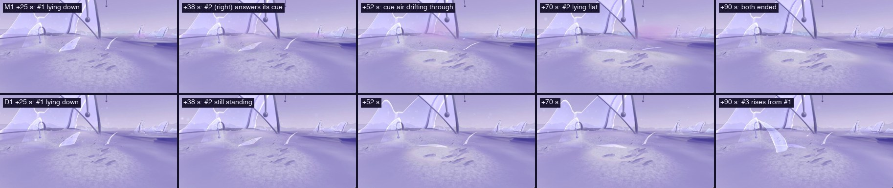
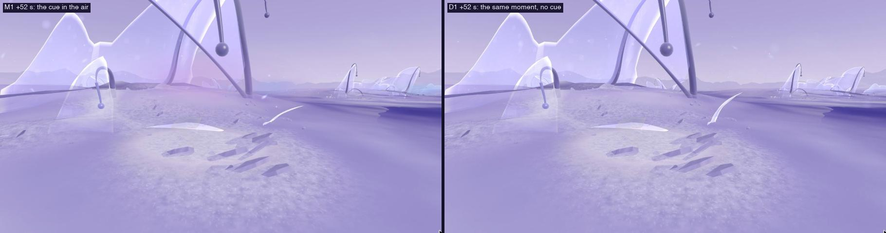
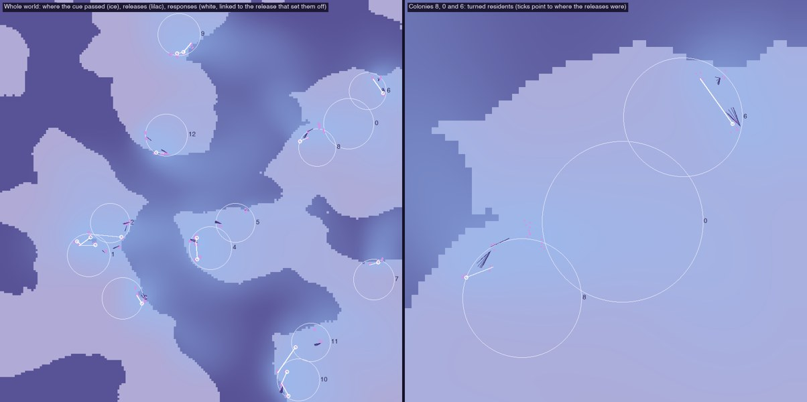
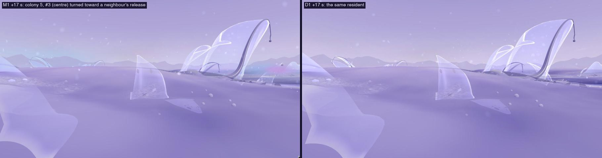

# 19 · Collective morphogenesis: a shared cue in the air (first exploration)

*Can many independent lives produce a perceptible shared spatial behaviour
without a predetermined shape? A first, small prototype, for design review.*

> **Status, 4 November 2026: conceptual prototype.** Local only; nothing
> committed. D, D1, Explore and the older studies are unchanged (checked
> below).

| | |
|---|---|
| **M1** | `/habitat/m1` (D1's world, plus the commons) |
| **Compare** | `/habitat/d1` |
| **Where to look** | Turn round at the arrival and go to colony 8 (about 6 units behind you): within the first minute, one resident's release reaches its neighbour, which lets go about 70 s early. Colony 6, beyond it, does the same at about +48 s. |

## What exists, and what was recovered

- **The lifecycle** (study 10, D1):
  - residents form, hold, recede, release films and end;
  - the films carry matter on the air and settle as residue;
  - new residents form on that residue;
  - each colony runs its own simulation, and no matter crosses between
    colonies.
- **The air** (`lib/air.js`, study 07): one procedural field moves the dust,
  the films and the wisps. Colony air bends it round membranes.
- **The coloured wind you miss** is the air study's Phase 2: broad currents of
  lilac, ice and mint air with light travelling along them. Phase 2.5
  replaced it ("residue as dye in moving air", what `AirWisps` draws now),
  because currents drawn as continuous strips read as designed splines. Its
  code is not in git history (AirWisps has one commit, already 2.5). What
  could be recovered was its visual language: the palette (silver, lilac,
  ice, mint, pearl); bodies of air as a lying and a standing sheet, each
  fading edge-on; and soft, broken edges. That language is used here.
- **The paused Conduit** (study 10's mycelium tissue) was not revived. Its
  principles are reused differently: local sensing, directional spread,
  accumulated history and reinforcement. The medium is the air the world
  already has, not a drawn network.

## Mechanisms considered

| | Mechanism | Strengths | Why not first |
|---|---|---|---|
| 1 | **A cue in the air:** a release breathes a signal downwind; residents answer by their own state | Uses the air and the events that exist. Directional, delayed and variable by construction. Carries no matter, so accounting is untouched | **Chosen** |
| 2 | **Shared residue:** films that land in another colony's ground join its grid | Real material exchange between colonies | Films fly 0.1–1.5 units and colonies are 4–22 apart, so it would almost never happen without changing flight. It also needs one ledger across lifecycles |
| 3 | **Wind-sorted deposition:** residue piles on lee sides, new residents follow | Slow, morphological | Matter-limited: the ecology stops at about 10 minutes (study 18), too few cycles to show |
| 4 | **Conditioned ground:** where signals pass, the ground is primed for formation | Lasting history that could link colonies | Needs 1 first, and formation outside a colony needs matter there |

## The prototype: one cue, two responses

### New rules (M1 only, `lib/morph.js`, `Lifecycle.gather`)

1. **Propagation (a signal, simulated).**
   - **A puff per release.** When a film comes away, a puff of cue begins
     where it left, as strong as the matter the film carried.
   - **Carried by the air.** The puff moves on the same air the films ride
     (its horizontal waves, at 90% of their speed, half a unit above the
     floor), spreading (radius 0.45 + 0.22 √age) and fading (time constant
     70 s, thinner as it widens).
   - **No matter.** The film carries the matter, as before.
2. **Response by state (two rules).** Every 0.5 s, each standing resident
   gathers the cue that reaches it, with a 25 s memory. What it does depends
   on its own state:
   - **Full and standing at least 20 s:** past a threshold it **lets go**. It
     begins to lie down now, instead of at the end of its own hold.
   - **Still taking matter up:** it **turns toward where the release was**,
     and holds the turn with a 150 s memory, up to 30% of its height. Its own
     films later leave from the turned sheet, so where its matter goes
     follows what reached it.
   - **Lying down, or ended:** reached, not changed.
3. **Accumulation (a record only).** Where the cue has passed is summed on a
   96² grid of the world (`passage`). Nothing reads it yet. It is the place a
   slower consequence would come from (§Next).

**No central controller.** Each lifecycle reads the shared cue and decides
for its own residents.

**Determinism, whatever the frame rate.** One world clock: world step 0 is
the arrival. The cue is carried on fixed steps on that clock, and a
lifecycle at world step w reads it as it was at w − 3. Lifecycles are never
more than two steps apart, so every release up to then is in it, whoever ran
first. Before arrival, the 13 lifecycles run together, one world step at a
time, each from its own age (`prerunTogether`). The results are identical
with 1/60 s frames and with jittered 4–34 ms frames.

### What is drawn

- **The cue as tinted air** (`components/MorphAir.jsx`). Each puff is drawn
  at its simulated place, radius and strength, as two soft sheets (one lying,
  one standing), with its last few seconds of path behind it, so it reads as
  air moving.
  - Its colour shows how long it has travelled: a pinker lilac as it leaves,
    then ice, then silver as it fades.
  - The tints are a step deeper than D's pale sky, so the air changes hue
    rather than brightening.
  - It is never champagne. Champagne stays reserved for matter crossing, so
    a signal and a material exchange never look alike.
- **The response.**
  - Letting go is the existing lying-down.
  - A turn is the resident's sheet bent toward the release.
  - A faint cool stain in a resident's film shows the cue it has gathered.

### What is simulated and what is drawn only

| | |
|---|---|
| **Simulated, and changes the ecology** | When a full resident lets go; how far a resident has turned, and so where its films leave from |
| **Simulated, a signal (no matter)** | The cue: where it is, how strong, how wide |
| **Simulated, a record nothing reads yet** | `passage`, where the cue has been |
| **Drawn only, from simulated state** | The tinted air (its trail is display memory); a resident's stain (its gathered cue); its bend (its turn, plus D1's air bend) |
| **Matter and accounting** | Unchanged: same five places, same ledger. Only timing and release position differ from D1 |

## What happened

These are bounded runs: each lifecycle's own history, then 10 minutes after
arrival.

| | D1 | M1 |
|---|---|---|
| Residents that let go early | – | 16 (14 before arrival, 2 after) |
| Distance from the release to the resident that answered (10th / 50th / 90th percentile) | – | 0.7 / 1.4 / 2.1 units |
| Delay (10th / 50th / 90th percentile) | – | 1.5 / 6 / 29 s |
| Answers across colonies / chained (an answer to an answer) | – | 2 / 1 |
| Standing residents turned by more than 10% of their height, at 1 / 2 / 3 minutes | – | 8 of 13 / 6 of 10 / 5 of 7 |
| New residents formed in the 10 minutes | 13 | 9 |

### What emerges, and what doesn't

- **Within a colony, events no longer stay separate.** One release reaches
  neighbours 1–2 units downwind within seconds:
  - the full ones let go;
  - the ones still forming turn toward it;
  - the ones lying down are only stained.

  Colonies 8 and 6 show this in the first minute after arrival. It is
  directional (only downwind), delayed by the air, and different by state.
- **Across the world, influence makes shapes no one drew.** The `passage`
  record (summed over minutes, and not visible at any one moment: see study
  20) shows each colony's cue spreading as a fan downwind. Fans overlap
  over the shallows between groups (map, left). This is a field of influence
  shaped by the air and the colonies' positions, with no predetermined form.
- **It is messy, not yet organized.**
  - Answers are few: most happen before arrival. At arrival only 6 of 21
    standing residents are full, so little is left to set off.
  - Chains are short (one answer to an answer).
  - Colony-to-colony links are rare (2), because the cue thins as it spreads
    and colonies are 4–22 units apart.
- **The cue slows renewal (an interaction found, not designed).** A
  neighbour that lets go early lays its films over the residue a new
  resident was about to rise from, and that resets the residue's 22 s rest
  clock. In colony 8, #3 rises at +90 s in D1, but not yet in M1. Over 10
  minutes, 9 residents form instead of 13.
  - **Why it matters:** synchronised release does not help regeneration here
    (my hypothesis was that it would). It competes with it, through the rest
    rule, the same rule study 18 found blocking continuous return.
  - **Corrected in study 20:** over each colony's whole history plus 10
    minutes, D1 and M1 form the same number of residents (34). The cue moves
    renewal earlier rather than reducing it. Colony 8's delay came from the
    faint fringe of a neighbour's deposit resetting the rest clock.
- **Perceptible at normal distance?**
  - **Letting go early:** yes, if you are near colony 8 or 6 in the first
    minute (at 2–3 units).
  - **The tinted air:** as a local hue shift near releases, at 3–6 units; it
    is fainter once it has spread.
  - **The turn:** at most 0.1–0.2 units at the crest of a 0.4–0.6 sheet; real
    in the data (the map's ticks), hard to see in a still.

## Checked

- **D and v0 are unchanged:** their lifecycle hashes are identical to before
  (`486a5f86…` for D, `599d2b90…`/`4370207d…` for v0). D1 runs D's
  lifecycles.
- **The new hooks are inert outside M1:**
  - without a commons, the lifecycle steps, releases and reads exactly as
    before;
  - its new step counter is read by nothing else;
  - release offsets add 0.
- **M1 is deterministic,** as above, and the page's counts match headless
  (14 answers before arrival).
- **A StrictMode impurity, fixed:** the first wiring built the commons
  outside the lifecycles' memo, so React's development double-build wrote
  two runs into one commons. It is now built with them.
- **Lint has no errors** (70 warnings: 68 before, plus 2 in MorphAir of the
  same kind as the repo's other frame-loop components). The build passes.
- **Performance.** Measured standing at the arrival in development, 6 s,
  with 86 puffs alive and 766 sheets drawn: frame interval median 8.3 ms,
  95th percentile 9.7 ms (D1: 9.1 ms), no frames over 12 ms. Each puff costs
  one air sample per step. GPU time was not measured.
- **Untested:** no one has played M1. Every view was placed by script.

## Limitations

- **Small scale, few actors.** 2–3 lifecycle residents per colony, most
  half-formed by arrival, and an ecology that runs down in about 10 minutes
  (study 18). There are not enough events for organization at the scale of
  the world to build up. This exploration ran into the same constraint
  rather than solving it.
- **The cue's numbers are first guesses.** Strength, fade, spread and
  threshold were chosen so answers reach 1–2 units, then tested with two
  thresholds and one alternative response. That is bounded, not a sweep.
- **The tinted air** is legible near releases and faint once spread. It
  should be judged in motion, not in stills.
- **The turn** is small. Its gain could be larger, but larger turns start to
  read as animation rather than as posture.
- **A noticed issue, not M1's:** one formed resident at colony 5 shows two
  small dark openings (from the existing lace rule), in D1 too. Two holes in
  a pale sheet read as a face, which the film shader's own notes warn
  against.

## Next steps, for review

1. **Let the record matter (A → D).** New residents could prefer ground the
   cue has often crossed, and lean along its usual direction. Colonies would
   then grow toward each other along their shared fans, with no shape given.
   This needs a decision on formation outside a colony's current reach,
   which needs matter there.
2. **Make answers contribute rather than compete.** For example, the rest
   rule could read how much has arrived rather than when. The same change
   would also unblock study 18's discrete return.
3. **Renewal first (study 18, §3):** without it, any collective behaviour
   has only a few minutes of events to grow from.
4. **More actors:** let the colonies' placed veils (now static scenery) take
   part in a lifecycle. This is a placement change, with performance to
   watch.
