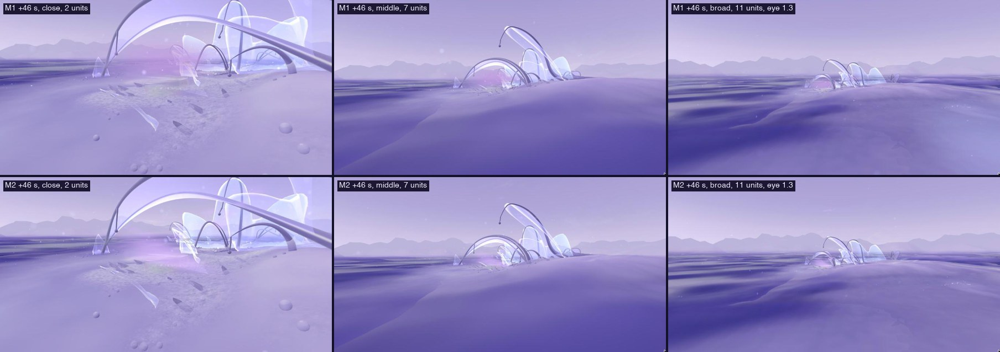
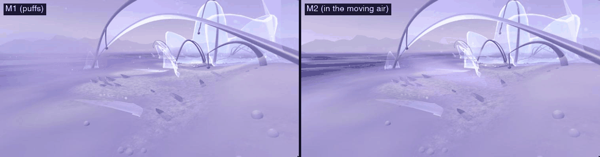
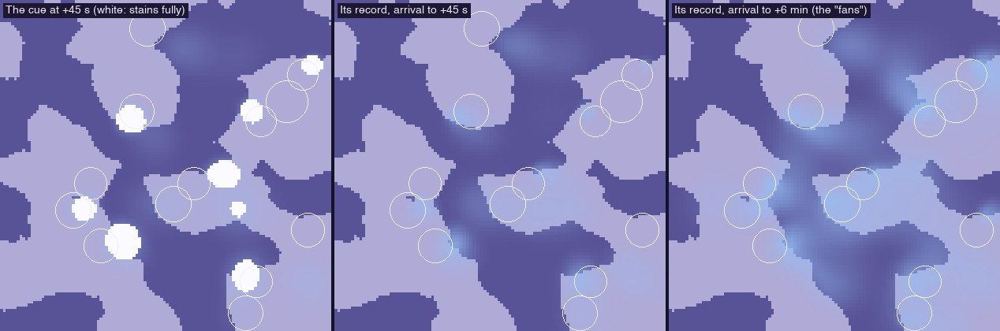

# 20 · The cue in the moving air (M2), what a visitor can see, and the rest rule

*A visual exploration of M1's cue, and a diagnosis of the formation rest
rule, for review. No lifecycle rule changed.*

> **Status, 4 November 2026: visual prototype and diagnosis.** Local only;
> nothing committed. M1 (`/habitat/m1`) is kept as the baseline; D, D1 and
> earlier are unchanged (checked below).

| | |
|---|---|
| **M2** | `/habitat/m2`: M1's simulation exactly, the cue drawn in the wisps |
| **Baseline** | `/habitat/m1`: the same cue drawn as puffs (MorphAir) |
| **Where to look** | Colony 8, about 6 units behind the arrival, from +30 s: #1's films come away and its neighbour answers |

**What M2 is, and is not:**
- **A shared environmental cue driven by existing ecological events.** A
  film coming away from a resident (a real lifecycle event) breathes a cue
  into the air (`lib/morph.js`, M1's commons). The air carries it, and
  residents gather it and answer by their own state.
- **A signal, distinct from material transport.** The cue carries no matter.
  Matter still moves only as films, residue and uptake, with the ledger as
  before.
- **Drawn in the existing air wisps.** M1 drew it as puffs; M2 draws it as
  coloured, moving wisp grains.
- **A local, experimental mechanism.** It is not yet proof of collective
  morphogenesis at the scale of the world. Answers stay within about 2
  units, links between colonies are rare, and its record (the "fans") is a
  sum over minutes that no visitor sees.
- **The M1 renewal finding, corrected.** Over each colony's history plus 10
  minutes, D1 and M1 form the same number of new residents (34). The cue
  changes when renewal happens, not how much (§3).

## 1. M2: the cue in the existing air

### What was found first

- **D's wisps barely reach the colonies near the arrival.**
  - The wisp regions are laid out for the old 26-unit slab, around the
    middle of the world.
  - The colonies' incoming filaments go to colonies 0–5 by index, not to
    the nearest; colony 8, where M1's cascade happens, has none.
  - The fifth region's seven release points are idle at the default amount.
- **Wisps are screen-blended.** Over D's pale ground and sky that adds
  almost nothing, as with the lifecycle's films (study 18). In D1 and M1
  the wisps are, in effect, invisible.
- **The wisps' air is not the cue's air.** Among a colony's forms the
  wisps' air is slowed and held (colony air), while the simulated cue moves
  on the open waves. Dye released at a release site lingered there (0.5
  units in 17 s) while the cue drifted on. Drawing it "where the cue is"
  then showed almost nothing.

### What M2 does (drawing only; AirWisps `cue`, M2 only)

- **The idle release points follow the cue.** The fifth region's seven
  release points move to where films have come away within the last 34 s
  near the visitor, one per resident. They let out grains only as strongly
  as the simulated cue at that place now.
- **Those grains move as the cue does.** They ride the same waves, on the
  commons' world clock, at the cue's 90% of the air speed, and colony air
  does not hold them. What is drawn goes where the cue goes.
  - **What is the drawing's own:** they rise and fray as they travel, like
    smoke leaving a source (the cue itself is a field over the ground; its
    height in the drawing is not simulated). Only 40% of them are shown,
    twice as wide and with longer streaks, so they read as filaments.
- **Every grain inside the cue takes its colour.** Any wisp grain passing
  through the simulated cue (from a region, a colony's filaments or the
  cue's own release points) is stained by it, and is shown even where the
  wisps' own visibility field would hide it.
  - **The colour shows how long the cue has travelled:** a pinker lilac as
    it leaves, then ice, then silver as it fades (M1's palette).
  - **Mist sprites keep the colour but don't carry it.** With mist, the
    whole cue became one soft blob.
- **Only the cue's part is laid over the scene.** It is tinted a step above
  the ground's brightness, up to 60% opacity. The rest of the wisps stay
  screened, as before.
- **The colonies' incoming filaments follow the visitor's nearest
  colonies** (AmbientAir's own following set).
- **MorphAir's puffs are not drawn in M2.**

### Comparison (same events, same viewpoints, same simulation times)

**Judged from these:**
- **In stills, M1 and M2 are about equally present.** M2's close view is a
  broader, streakier lilac rising between the struts. Its middle and broad
  views are a little fainter than M1's: the cue's grains are small at 7–11
  units.
- **Over time they differ.** By +70 s, M1's spread puffs wash the whole left
  half of the close view lilac. M2's cue stays a local body of air, moving
  west behind #2's lying sheet, made of streaks that move with it. It no
  longer reads as separate discs.
- **Neither shows direction in a still.** Direction is legible only in
  motion: the drift of the streaks, and the colour turning from lilac to ice
  away from the source. Both are real, both are slow (the cue moves at
  about 0.08 units/s), and they are best seen standing still for 10–20 s.
- **Still unresolved.**
  - The cue still reads as a soft lilac haze, not as clear filaments. The
    wisps' half-resolution, soft-edged drawing blends its grains together.
    Sharper filaments would mean drawing the cue's grains at full
    resolution, a separate pass I haven't tried.
  - At middle and broad distance it is a small tint at a colony's foot.

## 2. The simulated field and what a visitor can see

**What is present at one moment** (+45 s, headless):
- **Where it is strong:** 83 puffs in all, strong enough to show over about
  95 units² (4% of the world), in a few compact patches up to about 1.5
  units across, at the colonies releasing now.
- **The faint rest:** its faint tails reach about 45% of the world, far
  below anything drawable.

**The "fans" are a record, not something present at any moment.** They are
the cue summed over minutes: each patch drifts about 5 units a minute and
fades. Nobody can see that sum from where they stand. What a visitor can
see is the present field:
1. a patch of tinted air leaving a releasing resident;
2. drifting downwind for half a minute to a minute;
3. reaching, or missing, the residents beside it;
4. one of them, if full, lying down early.

In M1's report the map's fans were described alongside what is perceptible;
they should have been labelled a record only.

**Ways to make direction more legible without inventing effects** (for
review, not built):
- **The colour gradient along the plume.** It is already real (how long the
  cue has travelled). It could carry more contrast between lilac and ice, so
  a still shows which end is the source.
- **A stain that arrives from one side.** A resident is reached first on
  its upwind side; its stain could rise from that side, which is true of
  where the cue came from.
- **Let the record mark something only once it has a consequence.** If the
  record later shapes formation (study 19, next steps), its mark would then
  be ecology, not decoration. Until then it should stay off screen, as now.
- **Not:** drawing the record, lengthening the cue's reach, or brightening
  it beyond the simulated strength.

## 3. The rest rule: a diagnosis

**The rule.** A new resident may form only where nothing new has arrived in
its footprint for 22 s: any matter at all (over 1e-6 in any cell).

**The variants compared** were patched into a subclass in scratch code; the
app's lifecycle is unchanged. Each ran each colony's own history plus 10
minutes after arrival, in D1 (no cue) and M1 (cue):

| Variant | Rule | | New residents before / after arrival (total) | Standing at 1 / 3 / 5 / 10 min | Colony 8's new residents (s after arrival) | Median fullness |
|---|---|---|---|---|---|---|
| **as built** | no new matter at all for 22 s | D1 | 21 / 13 (34) | 16 / 9 / 4 / 0 | 76 | 0.65 |
| | | M1 | 25 / 9 (34) | 13 / 7 / 4 / 1 | 96, 290, 520 | 0.60 |
| **traces ignored** | only cells gaining ≥ 2e-4 reset the clock | D1 | 21 / 13 (34) | 16 / 9 / 4 / 0 | 76 | 0.65 |
| | | M1 | 26 / 8 (34) | 14 / 7 / 3 / 1 | 76, 272, 524 | 0.60 |
| **meaningful arrival** | wait only while ≥ 25% of a start's matter has arrived in the footprint in the last 22 s | D1 | 21 / 13 (34) | 16 / 9 / 4 / 0 | 76 | 0.65 |
| | | M1 | 25 / 9 (34) | 14 / 7 / 4 / 1 | 76, 272, 524 | 0.61 |
| **most has lain** | the footprint's matter, weighted by amount, has lain ≥ 22 s on average | D1 | 21 / 16 (37) | 18 / 10 / 6 / 1 | 70 | 0.64 |
| | | M1 | 23 / 10 (33) | 13 / 7 / 4 / 0 | 70 | 0.62 |
| **no rest** (reference) | form as soon as there is enough | D1 | 21 / 12 (33) | 18 / 8 / 3 / 1 | 48, 262 | 0.60 |
| | | M1 | 27 / 9 (36) | 15 / 7 / 2 / 0 | 48 | 0.60 |

The ledger drift is under 3e-8 in every run. The "as built" D1 run
reproduces D1's own counts, which checks the patch.

### What it shows

1. **The cue moves renewal earlier; it doesn't reduce it.** Under the rule as
   built, D1 and M1 both form 34 residents over the whole run. M1 forms more
   before arrival (25 against 21) and fewer after (9 against 13), because
   answers bring releases forward. Study 19's "9 instead of 13" described
   only the part after arrival.
2. **Locally, the disruption came from traces.** Colony 8's new resident
   slips from +76 s to +96 s in M1. With traces ignored, or with only
   meaningful arrivals counting, it rises on time (+76 s). Its neighbour's
   films had landed 0.5–1 units away, and only the faint fringe of their
   consolidated deposit reached the waiting residue's footprint, resetting
   the clock. In D1 these two variants change nothing at all: there,
   without propagation, traces never mattered.
3. **Every variant is bounded by matter.** Totals stay at 33–37 under every
   rule. The rest rule decides mostly when residents form and how full, not
   how many. That is study 18's finding: renewal is limited by
   concentration and the closed budget.
4. **"Most has lain" is the one that raises renewal in D1** (16 after
   arrival instead of 13, and residents standing longer). It reads the
   residue's age by its matter, so a little new matter landing on an old
   deposit no longer resets it. It also changes D1's outcomes, unlike the
   two before it.
5. **No rest is not better.** Residents form sooner on fresh, thin matter,
   and fill less.

### For review (nothing changed)

- **The smallest change that removes the specific disruption:** traces
  ignored, or meaningful arrival only. Each changes nothing in D1 and
  nothing in M1's totals.
- **The more ecological reading:** most has lain. It is closer to "matter
  that has settled", raises renewal a little, and would also suit study
  18's discrete return. It changes outcomes everywhere it is used.
- **Any of these is a lifecycle rule change.** It would apply to D1 and
  later only by decision, behind a flag first.

## Checked

- **Unchanged elsewhere.** M1's simulation is untouched: M2 shares it, and
  only drawing changed. D's and v0's lifecycle hashes were confirmed
  unchanged in study 19, and the lifecycle code has not changed since.
- **The wisps' changes are opt-in** (a `CUE` define, a following colony set
  only when asked). Without them, every changed line of the shaders reduces
  to its old expression.
- **Performance:** M2 standing at colony 8, in development, has a frame
  interval median of 8.3 ms and 95th percentile of 9.1 ms, with no frames
  over 12 ms. GPU time was not measured.
- **Lint has no errors** (70 warnings, as before this study). The build
  passes.
- **All tests were bounded:** five rest variants × two worlds, each of its
  history plus 10 minutes; one map run to +6 minutes.
- **Not done:** no one has played M2; all views were placed by script; the
  motion was judged from six frames, not watched live at length.

## Limitations

- **Filaments are soft.** The cue's air is legible as moving tinted air,
  not as distinct strands. That is the cost of staying inside the wisps'
  half-resolution, soft drawing.
- **There is a cue height in the drawing** (rising with travel) that the
  simulation doesn't have.
- **Colony filaments jump** when the visitor's nearest colonies change
  (every 2 s at most). Grains rejoin their new colony as they are released
  again.
- **At middle and broad distance** M2 shows less than M1's puffs did.
  Larger grains at distance would help, at the risk of reading as particles.
