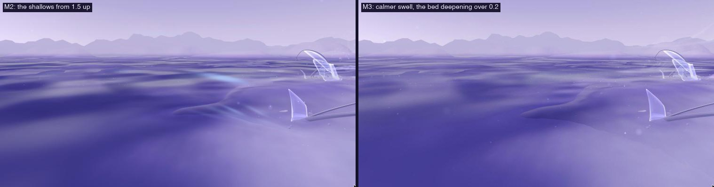
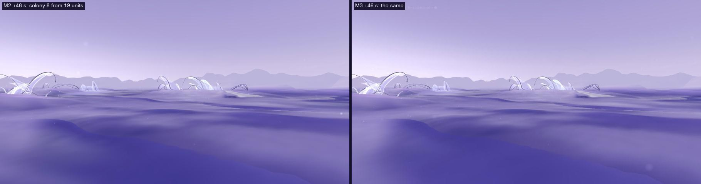
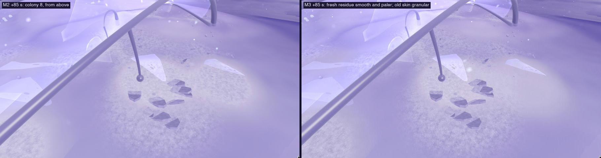
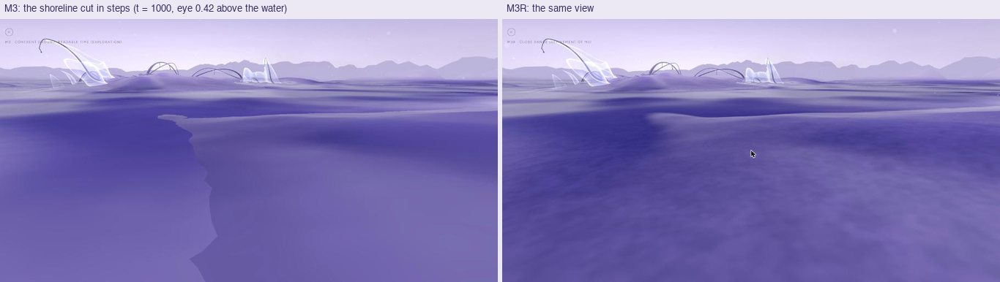
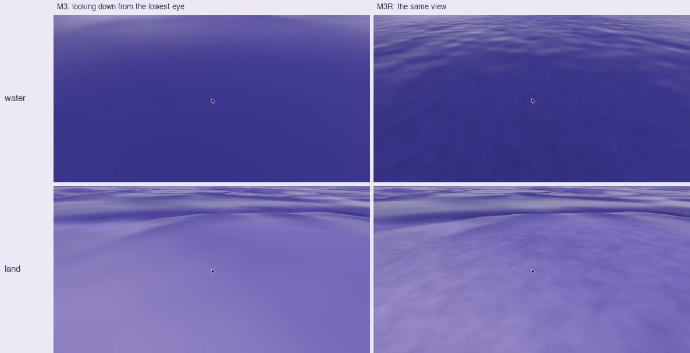
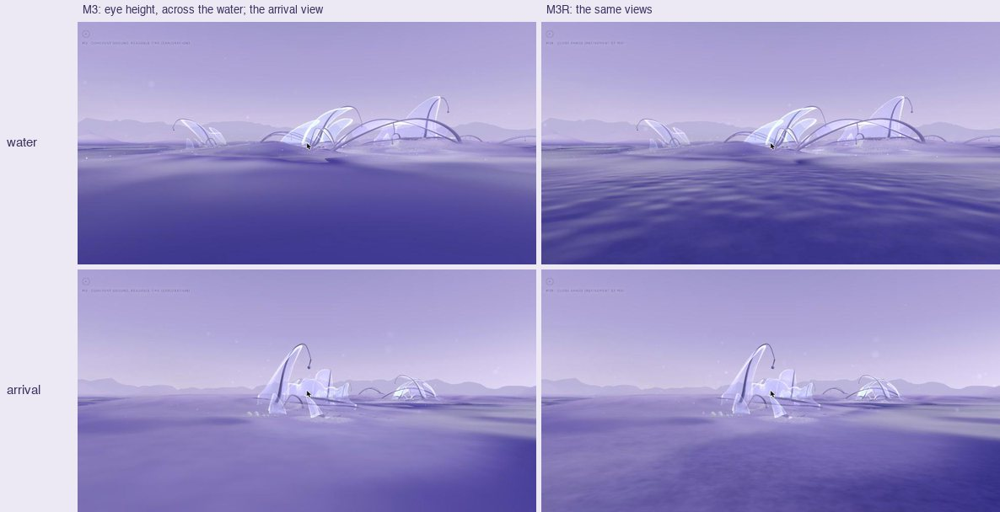
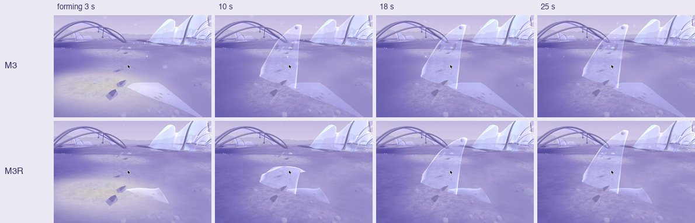
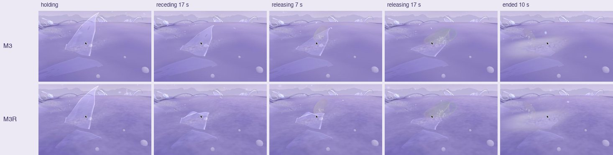

# 21 · Habitat M3: a coherent ground, a cue independent of the visitor, readable time

*M2 with three changes, none of them to the ecology. For review.*

> **Status, 5 November 2026: first playable iteration.** Local only; not
> committed or deployed (M2 and earlier are checkpointed and pushed, see
> below). M2 is unchanged for comparison.

| | |
|---|---|
| **M3** | `/habitat/m3` |
| **M3R** (close range, [below](#m3r-close-range)) | `/habitat/m3r` |
| **Compare** | `/habitat/m2` |
| **Simulation** | M1's exactly (the same commons, rules and outcomes) |

## 1. The white line

**Where it was.** Hiding each surface in turn (slab water, far water,
terrain, far ground), the line disappeared only with the far ground hidden,
and sky showed exactly along it. It is the seam where the slab's terrain
ends and the far ground begins, at |x| or |z| = 24.

**Why.** The two edges are not at the same height:
- **The slab's edge is lifted on the GPU** by History's sediment, which piles
  against the closed boundary, read from an 8-bit texture. It also
  "breathes" with that sediment (the Dormant reading's slow pulse).
- **The far ground's edge** is the CPU's displayed ground height, with
  neither.
- **The result:** where the slab's edge ends up a little lower, a hairline
  gap opens between the two meshes. Rays pass under the far ground's edge
  and the pale sky shows through. Because the slab breathes, the gap comes
  and goes over about 18 s: one of my captures of M2 at the same view
  caught a moment without it.

**The fix** (`seal` on buildFarField, M3 only). A skirt 0.6 deep hangs
from the far ground's inner edge all round the slab. It is facing inward,
drawn in the far ground's own material, and hidden under the slab
wherever the slab is higher. No colour, height or other mesh changes. The
same seam exists in D, D1, M1 and M2; the fix is not applied there.

## 2. Water and terrain

**Sources, measured at one raised view over the shallows.** Each source was
turned off in turn and the frame compared:

| Turned off | Near-water patchiness (std) | Far banding (row to row) |
|---|---|---|
| none (M2) | 14.0 | 3.10 |
| D1's stronger swell (2.2 → D's 0.9) | 7.4 | 2.72 |
| the bed's darkening with depth | 13.7 | 2.38 |
| reflected light | 14.2 | 3.19 |
| relief light | 14.1 | 3.09 |

**On land**, none of these changes the broad patches (11.2–11.9 against 11.6
in M2). The ground's large light and dark areas are its real relief: the
rises are lit paler and the low ground lies deeper.

**So the blotches are on the water, and both causes are D1 changes of
mine:**
- **The swell.** D1 tilted the water's slow swell further (2.2) to show the
  sky's gradient. On D's shallows that becomes broad light and dark blotches
  near, and bands far off.
- **The bed darkening.** It deepened over only 0.08 units of depth, so every
  small ripple of the shallow bed shows as a band.

**M3 (`LOOKS.open2`):** the swell is D's again (0.9), and the bed deepens
over 0.2 units. Nothing else changes; the palette and the water's depth
against the land stay as they were.

| | Near-water patchiness | Far banding | Mean value |
|---|---|---|---|
| M2 | 14.0 | 3.10 | 82 |
| M3 | 12.6 | 2.31 | 86 |

A modest gain: single frames vary as the swell moves.

## 3. The cue, independent of the visitor

**In M2 the cue's drawing depended on where the visitor stood.**
- Its seven release points went to the release sites nearest the visitor.
- Its puffs were drawn only within 16 units.
- The colonies' incoming filaments, which carry the cue's colour, follow the
  visitor's nearest colonies.
- **The risk:** colour could appear as the visitor walked up, and read as
  their own doing.

**M3 (`cueGlobal`):**
- **Release points:** they go to the most active release sites (the most
  cue leaving there now).
- **Puffs:** the strongest anywhere within 46 units (about the edge of
  sight).
- **Filaments:** they no longer take the cue's colour.

What is drawn now depends only on what the cue is doing. Nearness makes it
clearer only as it makes anything clearer.

**What is the same:** the cue, its colour, and how it moves.

**A limit.** At 19 units the cue is too small and fogged to see in either
version. The change matters within a few units of M2's 16-unit radius, and
wherever more than seven sites are releasing at once.

## 4. Readable at any moment: the residue's age

**What can be seen between events.** In first person, a colony between
events shows:
- standing residents;
- contours lying where residents ended (with their release lace, D1);
- residue around them;
- residents turned toward recent releases (M1's turn has a 150 s memory);
- a cue stain fading over 25 s.

What it couldn't show was *when*. A contour from a minute ago looked like
one from ten minutes ago, and fresh residue looked like old.

**M3 draws the residue by how long its matter has lain** (`residueAge`).
- **The age comes from the lifecycle's own record.** The time matter last
  arrived in each cell is the clock its rest rule reads.
- **Three looks, by that age:**
  - **Just arrived** (under about 25 s: still settling, nothing may rise from
    it yet): smooth and a little paler.
  - **Settled:** the granular deposit, as in D1.
  - **Long lain** (towards 4 minutes): coarser and darker, sinking toward
    the ground's tone.
- **Old contours** settle toward the ground as they age (up to 30% fainter
  between 1 and 6 minutes after they ended).
- **Nothing in the simulation changes.**

**The data behind it** (+66 s, cells of residue drawn, by age):

| Colony | Just arrived | Settled | Long lain |
|---|---|---|---|
| 8 | 436 | 33 | 0 |
| 6 | 324 | 58 | 0 |
| 12 | 121 | 398 | 344 |
| 1 | 0 | 273 | 1,004 |
| 0 | 0 | 0 | 265 |

At the same moment different colonies are at different points in their
history. The ages overlap, and a visitor entering at any time sees a mix of
fresh, settled and old.

**How it reads:**
- **Close (1–2 units):** the fresh residue reads as a smooth, paler zone
  around a contour or lying sheet that has just released.
- **At middle distance:** it merges with the colony's own ground skin, which
  is drawn in the same material.
- **Over time:** only by revisiting a colony; it is not an event to watch.

## The rest rule (no change)

The rule stays as it is. Study 20 found that what disrupts renewal under
propagation is trace arrivals: the faint fringe of a neighbour's deposit
resets the whole 22 s rest.

**A minimal, isolated comparison to consider:**
- **The change:** one flag (for example `?rest=traces`, M-spaces only), under
  which only cells gaining at least 2e-4 reset the clock.
- **What it would leave alone:** D1's outcomes, and M1's totals.
- **What it would fix:** colony 8's new resident rises on time (+76 s)
  instead of being pushed to +96 s.
- **How it would be checked:** headless against the baseline, as in study
  20.
- **Not built, pending your decision.**

## What is simulated, and what is drawn

| | |
|---|---|
| Changed in the simulation | Nothing: M3 runs M1's commons and lifecycle unchanged |
| Rendering fixes | The skirt at the seam; the water's swell and bed darkening |
| Drawing that reads real state | The cue's choice of what to draw (by its strength); the residue's age (the lifecycle's arrival record); old contours' age (time since they ended) |

## Checked

- **The seam:** sealed at the view where M2 showed it, in the browser.
- **Water patchiness:** measured as above.
- **The residue's age:** read from the residue mesh's own data (the table)
  and seen in the browser.
- **Lint has no errors** (72 warnings: 70 before, plus 2 of the same kind
  in the residue's age update). The build passes.
- **M3's simulation:** the same code as M1's (no lifecycle or commons
  change since study 20).

## Limitations

- **The seam fix is M3's only.** D through M2 still show the line.
- **The residue's age reads close up only.** At a distance it merges with
  the colony's skin.
- **The cue is still faint beyond about 10 units** (study 20).
- **The ground's broad light and dark areas remain.** They are its relief.
- **Not done:** no one has played M3; all views were placed by script.

## The checkpoint and the release (this round)

- **Committed and pushed** to the new remote branch `local-experiments`:
  - `3ef8c41`: Atlas content and the references it imports;
  - `603717c`: studies 11–20.

  `main` and `atlas-release` are untouched. Not committed: `.DS_Store`,
  `.obsidian/workspace.json`, and `docs/references/habitat-direction/`
  (nothing refers to it).
- **Released to a preview, not to the live site.** The checkpoint's build is
  deployed to a Firebase preview channel, `m2-checkpoint`, which expires
  on 19 November.
  - **Verified there:** Explore at `/` matches the live homepage; the Atlas
    landing matches; `/habitat/m2` opens directly with no console errors.
  - **Why not live yet:** the live site is the 23 October build (the Atlas
    archive commit). Promoting this build would also publish the Atlas
    portal redesign (`6627f95`) and the chapter updates, as well as adding
    `/habitat/*`.
  - **Promoting it** is one command, for the exact build tested:
    `firebase hosting:clone residual-ecology:m2-checkpoint residual-ecology:live`.

## M3R: close range

*M3 refined for the visitor's eye height. M3's world, simulation, palette
and light exactly. Local, for review: not committed or deployed.*

### What was wrong close up, and why

| Seen | Cause |
|---|---|
| Hard, polygonal shorelines | **Not the slab seam.** Two causes: (1) the water read its depth from the simulation's 8-bit, 256-cell copy of the ground (steps of 0.015 units on 0.19-unit cells). D's water is mostly under 0.15 deep, so its veil followed those terraces in saw-tooth edges. (2) D1's damp shading stopped exactly at the waterline, where the bed's darkening began from nothing: a 30% step in value. |
| A featureless purple field | Looking down at water, the veil was 38–58% opaque however shallow, and the swell is too broad to read at that range. On land there was no detail finer than the 0.115-unit mesh. A membrane within about a unit of the eye drew as a near-solid pale wall. |
| A rigid resident | Lying down was a shear: the sheet lost a third of its length midway, and lay at its foot's height whatever the ground did, so contours floated or cut in as flat planks. Its bead vanished the moment it ended. Its sheet showed two or three small holes that read as eyes: its openness, 0.84 × 0.48 = 0.40, sat just past the threshold where holes open, 0.35. As it ended, its opacity stepped down by about 25%. |
| Sudden emergence | A forming resident's columns scale up from their feet, so by about 10 s it was nearly full size. |

### What M3R changes

All of it is display. The lifecycle's rules, matter, timing and placement
are untouched. Flags live in `LOOKS.open3` and `SPACES.m3r` (`lib/habitat.js`):

- **`exactDepth`:** the water's depth comes from the ground exactly as the
  terrain draws it: the mesh's own heights in half floats, plus the same
  sediment lift and breathing. The veil begins at the line itself.
- **`wetJoin`:** the damp ground runs on under the water, and the bed
  deepens from there: one gradient through the line.
- **`clear`:** the water is as opaque as the eye's path through it.
  Shallows seen from above are clear to their bed; water seen at a slant,
  or deep, stays dense and reflective. A fine ripple shows within a few
  units of the eye only. The water beyond the slab takes the same rule, so
  nothing changes at the slab's edge.
- **`nearGrain`:** a soft grain in the ground near the eye (about ±5%,
  multiplied, so value and hue hold), gone by 5 units.
- **`nearAlpha`:** a film within about a unit of the eye thins to 30%.
- **`closeRange`** (lifecycle residents only):
  - **Posture:** one bend from the foot toward the lean, which keeps the
    sheet's length. It is read from the stage, `stageTime` and `recline`
    the simulation already keeps:
    - **forming:** it rises from lying low over its lean, its crest curled,
      and lifts and opens over the stage's 26 s
    - **holding:** it stands as built (and is bent by its air, as in D1)
    - **receding:** the crest folds over first, then the whole sheet sags
    - **releasing:** the bend moves down to the foot until the sheet lies on
      the ground ahead of it, on the local slope
    - **ended:** it lies so
  - **Continuity:** each stage ends in the next one's first pose.
  - **The bead** shrinks into its crest with the last films.
  - **The living sheet stays closed:** its only openings are the lace
    where its films left.
  - **Ending:** its opacity eases from the body's to the contour's over 6 s.

### Before and after

The same seed and simulation time (t = 1000, or the stage named), the same
camera, the render clock pinned, the same window (2268 × 1200, DPR 1.5).

Colony 6's resident #4 forming:

Colony 5's resident #3, from holding to its ended contour:

### Verified

- **Matched comparisons.** Both pages were fast-forwarded to the same
  lifecycle time and frozen: the simulation has a fixed step, so equal time
  means equal state. The same view of M3 in two separate sessions differs
  by a mean of 1.1 out of 255; M3 against M3R differs by 7 to 8, over a
  quarter of the frame.
- **One whole life, live in M3R.** Colony 6's #4 was watched from the start
  of forming (t ≈ 1018) through holding (131 s), receding, releasing and
  ending (t ≈ 1223). Frames either side of each stage change show no jump
  in pose. The contour lies on the ground, without floating or cutting in,
  from a low side view.
- **The shoreline in motion.** Stepping the eye along a water's edge, and
  looking straight down at the line, with the tide moving: no seam,
  opacity step or flicker. Across the slab's edge, ripples and opacity
  carry on.
- **Performance.** M3 and M3R are the same: both hold the display's
  120 Hz (mean frame 8.33 ms, p95 8.7–9.0 ms, slowest 9.4 ms over 6 s), with
  113–121 draw calls and 2.0–2.2 M triangles.
- **Nothing else changed.**
  - M2 from the working tree against the committed build: a mean
    difference of 0.27–0.38 out of 255, and 0.1% of pixels or fewer
    differing by more than 12 (JPEG noise and air motes).
  - With the flags off, the new shader code is not compiled, or its
    uniforms default to 0, so M3, M2, the featured Habitat and Explore draw
    as before.
  - `/habitat` and Explore load without errors.
- **Lint:** no errors (72 warnings, as before). The build passes.

### Not resolved

- **Released films still read as soap bubbles** (below).
- **Deep water seen straight down** is still nearly uniform below the
  ripple band: at 0.25 deep and more, the veil is dense, as it should be.
- **The standing resident is still a flat sail.** That is the bloom
  builder's rest shape, and changing it would change generation.
- **The young sheet at about 10 s** still has a straight top edge from some
  angles (softer than in the first pass).
- **A lying contour is paler than the ground** around it: it faces the sky
  now.
- **The colony's sediment plates** read as dark debris close up. They are
  placed composition and are untouched.
- **Placed blooms** keep their own openness (only lifecycle residents are
  closed).
- **Height and density hierarchy** across a colony is not addressed: every
  lifecycle resident is 0.6 high, and varying that would change the rules
  (a resident's matter is its height).
- **Not tested:** touch screens, other displays, GPU time (the frame rate is
  capped by the display).

### The released films: diagnosis and a small proposal

**Why they read as bubbles:**
- **The material:** they are drawn in the ambient air's skin material
  (`createFilmMesh`, `AirFragments.jsx`), not the membrane's.
- **The colour:** it cycles pearl → rose → periwinkle → aqua with the
  viewing angle, a thin-film interference look.
- **The shape:** each is clear in the middle and thicker toward a bright
  rim, which together make a ring.
- **The size:** a half-extent of 0.4–0.58, so each of a resident's four
  films is about as large as the resident.
- **Seen face-on in flight,** a film is a large, round, rainbow-edged disc:
  a soap bubble, not a piece of the sheet.

**Proposal (not built), for lifecycle films only and behind M3R's
`closeRange`:**
- **Size them from what they carry:** about a quarter of the resident's
  width, for its quarter share of the shed matter (half-extent about 0.12
  to 0.16).
- **Draw them in the resident's film language:** its lavender tint and rim
  light, with only a trace of the angle shift. Keep the carrier's silt and
  grains, which show the load.
- **Give every film its torn edge,** let its density fall toward the tear
  rather than toward the middle (so no ring), and keep the existing roll
  and fold states.
- **What stays the same:** where and when they fly and settle, the matter
  they hold, and the warm accent at release and landing.

