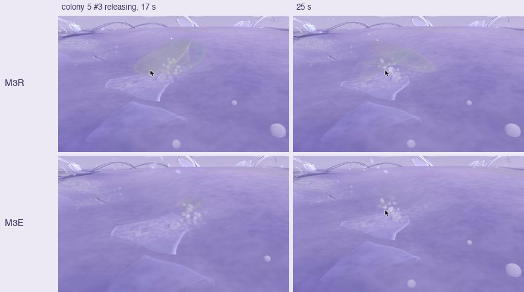
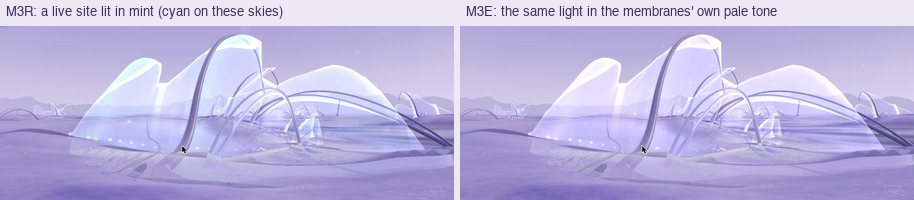
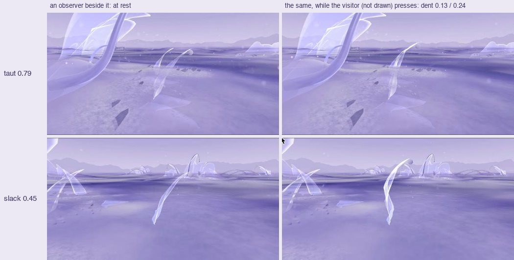

# 22 · Habitat M3E: an encounter, and three small fixes

*M3R with one encounter and three fixes. A prototype for you to try.*

> **Status, 7 November 2026: prototype, for review.** Local only; not
> committed or deployed. M3R, M3, M2 (the featured Habitat) and Explore are
> unchanged.

| | |
|---|---|
| **M3E** | `/habitat/m3e` |
| **Baseline** | `/habitat/m3r` ([study 21](21-habitat-m3.md#m3r-close-range)) |
| **Simulation** | M3R's exactly: the whole lifecycle state at t = 1060 hashes the same in M3R, in M3E untouched, and in M3E after pressing two residents for 5 s each |

All four changes are flags of the space (`SPACES.m3e`, `LOOKS.open3e` in
`lib/habitat.js`). They are off everywhere else.

## Part 1: three fixes

### The released films (`kinFilms`)

**Why they looked like soap bubbles** (study 21):
- **The material:** the air's own skin material, not the membrane's.
- **The colour:** opal, cycling pearl → rose → periwinkle → aqua with the
  viewing angle.
- **The shape:** clear in the middle, with a bright rim, which drew a ring.
- **The size:** each about as large as the resident that released it.

**The fix.**
- **In the resident's film language:** its tint and rim light, with a trace
  of the opal.
- **A torn edge on every film,** a little thicker where it tore, and no
  outline ring.
- **Size from the matter it carries:** a half-extent of 0.11 to 0.18
  (before, 0.4 to 0.58). The simulation's own `size` field was only ever
  drawn, never read, so nothing simulated changes.
- **Unchanged:** where films fly and settle, their load (the silt and
  grains), and the warm accent.

### "Stuck" near a membrane (`unstick`)

**Reproduced by script**, walking into colonies from many directions and
then moving every way. On open ground a 0.7 s move covers 0.21. Next to
forms:
- **A hard stall about 0.55 from every form**, never the body's own reach
  (0.3).
- **Crawling** when walking along a sheet at a slight inward angle.

**The cause.** Inside its cushion (0.7) the body removed a share of its speed
toward the surface every frame. At 0.55 that is about 22% a frame, around 15
per second, and more on faster displays.

**Ruled out:**
- a geometric trap (the normals agree with the true ones to 0.99)
- the height spring leaking into horizontal movement
- the speed spring winding up while pressed

One complete stop in all four directions showed once in an automated probe
and could not be reproduced.

**The fix.** The cushion is a gentle rate (14 × x² per second, x rising from
0 at its edge to 1 at the body); the body's reach still holds the visitor out.

| | M3R | M3E |
|---|---|---|
| Closest approach, walking straight in | 0.57 | 0.30 (the body's own reach) |
| Movement when held against a sheet (per 40 ms) | | 0.003 (steady) |
| Away from a sheet, 0.7 s | 0.22 | 0.19–0.22 |
| Under an overhang, into its slope, 0.7 s | 0.08 | 0.11 |
| Along a curving sheet at a slant, 0.7 s | 0.10 | 0.10 |

**Partly resolved.** The stall is gone. Walking along a curving sheet at a
slant still crawls, and moving into a sloping overhang stays slow. Both are
partly correct, since the path heads into the surface.

### The blue/cyan patches (`live`)

**Measured, not guessed.**
- **The survey:** cyan and blue pixels were counted in a view of every
  colony, switching each source off in turn.
- **The answer:** 98% (7,685 of 7,820) came from the forms' mint glow,
  shown on membranes and on the beads along their foot.
- **What it is:** the colony's "live site" accent, set from History's flow
  at each membrane and pulsing on a slow breath and with the viewing angle.
  That is why the patches came and went.
- **Not the cue:** hiding the air changes nothing.
- **Nor films, ground or water.**

**The fix.** It is real data, not an error, so it stays. On these pale skies,
though, the mint read as the cue's ice blue and blurred signal and matter.
M3E draws the same light in the membranes' own pale tone. At colony 0 the
cyan pixels go from 1,278 to 0.

## Part 2: one state-aware encounter

**What existed:**
- **The veil:** one placed membrane in each Habitat that yields to the
  visitor (`Membrane`, `lib/encounter.js`): a dent on a damped spring, the
  visitor held at the displaced surface.
- **Lifecycle residents had no collision at all.** They were left out of
  the visitor's forms, so the visitor passed through them.

**What M3E adds** (`ResidentEncounter`; `encounter` flag):
- **Which resident:** the nearest standing one (forming, holding or
  receding) within 1.6 of the visitor, one at a time. Another is chosen
  only once the last has come back to rest.
- **What the visitor meets is what they see.**
  - The resident's film is posed in JS exactly as the shader draws it
    (growth and posture, `poseFilm`), and rebuilt as it changes.
  - Its air's bend is allowed for.
  - The dent is drawn with the same weights that hold the visitor (the
    shader now measures the dent on the sheet as it stands; for the placed
    veil that is identical to before).
- **Lying residents are not met:** the visitor floats above them, and so
  nothing draws them as touched.

### What drives the response

| | Source |
|---|---|
| **Tension** (ecological state) | The matter its body holds against a full body for its height, as far as its stage keeps it: forming 0.55, holding 1, receding falling to 0 as it lies down. Mapped over 0.3–0.85: slack below, taut above |
| How deep it gives, how much of a press it takes | Tension (slack: up to 60% of its height, 98% of the press; taut: 30%, 82%) |
| How it returns | Tension (slack: slowly, never past rest; taut: quickly, springing back once) |
| How much of the sheet leans with the dent | Tension (slack: all of it; taut: 60%) |
| Where it dents | The visitor's position: where they meet the sheet. The foot is held; the crest bends more |
| Which way | The visitor's direction: pushed from their side. A slanting walk drags the dent along (shear) |
| How hard | The visitor's movement: a faster approach presses deeper. Standing still, the sheet's own return moves them out |

**Visual only:** the drawing of the deformation, though it is the same
displacement that holds the visitor.

**Nothing reaches the lifecycle.** It reads stage, body, recline and unfold;
it writes nothing the simulation reads. The proof is the hash above.

### Measured (approach, press, pause, retreat, re-entry)

| | Taut (colony 4 #7, 79% full) | Slack (colony 2 #4, 45% full) |
|---|---|---|
| Deepest dent (sheet about 0.6 high) | 0.13 | 0.24 |
| Half returned after the visitor stops | 0.16 s | not within 2.5 s while leaned on; returns once they move away |
| Past rest on return | −0.037 | 0 |
| Visitor's closest distance to the drawn sheet | 0.24 | 0.17 |

- **From the side and at a slant** (slack resident): dents of 0.13 to 0.15,
  dragged sideways by 0.07.
- **From behind:** both residents tried could not be reached; other colony
  forms stand behind them.
- **Re-entering from close by:** a slow approach touches lightly, as it
  should.

## Checked

- **Movement:** measured by script, as in the table above.
- **The encounter:** the trace of each phase for two residents. Also
  side/slant approaches, from-behind attempts, and first-person and
  observer views.
- **Collision and drawing agree:**
  - The visitor is held at the body's reach less the dent.
  - Holding against a sheet stays steady.
  - At contact the visitor is 0.17 to 0.24 from the drawn surface: no
    passing through.
- **The ecology is unchanged:** the full-state hash, as above.
- **Performance:** unchanged. M3E holds 120 Hz with the encounter bound
  (mean 8.33 ms, p95 9.0 ms), as M3R.
- **Other spaces:**
  - The featured Habitat (M2) loads with no resident encounter, the old
    cushion and only its veil.
  - Explore loads.
  - M3R's frames, re-rendered, differ from before only by a sub-pixel eye
    drift in the capture harness.
- **Lint:** no errors. The build passes.

## Not resolved

- **One resident at a time.** Others nearby stay passable, as in M3R: two
  residents standing close together, one can be walked through while the
  other is met.
- **Taut residents respond subtly** (by design; 0.13 at most). The slack
  ones are the clearer encounter.
- **The press depends on approach speed;** a slow walk only touches.
- **From behind, most residents are hard to reach:** their colony's forms
  stand there.
- **The films are now small and quiet.** Whether their transport still
  reads at a distance needs to be judged in play.
- **The slanting crawl along curving sheets** remains (above).
- **The posture's height measure** (`desc.height × 1.4 × unfold`) is not the
  drawn height above about unfold 0.35. Shader and collision agree; only
  the shape of the bend is affected.
- **Not tested:** touch screens, other displays.

## Next, after your review

- **Living with the encounter in play:**
  - does a taut resident read as alive, or only as stiff?
  - is the slack one's hold on a still visitor welcome?
- **If it holds,** the same contact could meet two residents at once,
  instead of one.
- **The Accumulator is not started.**
