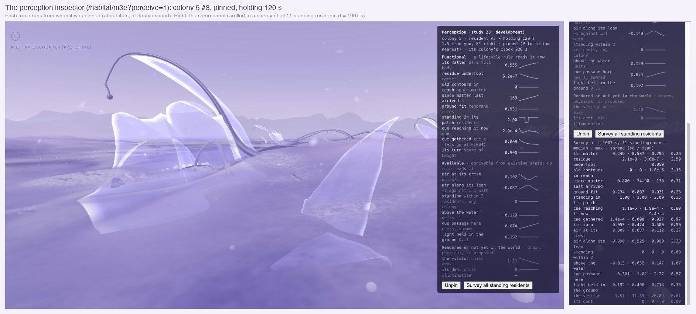
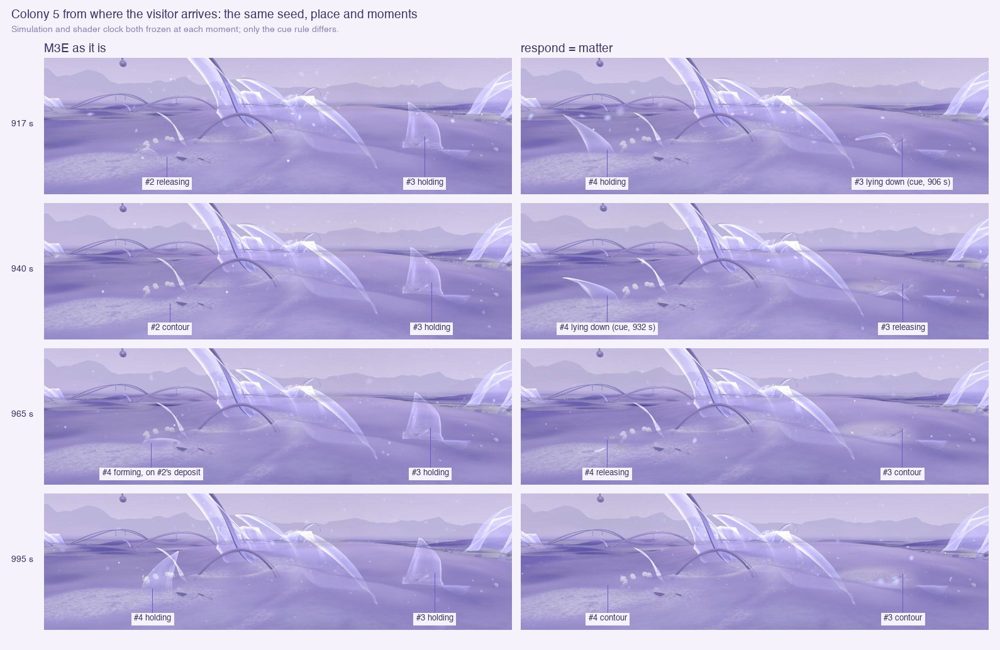
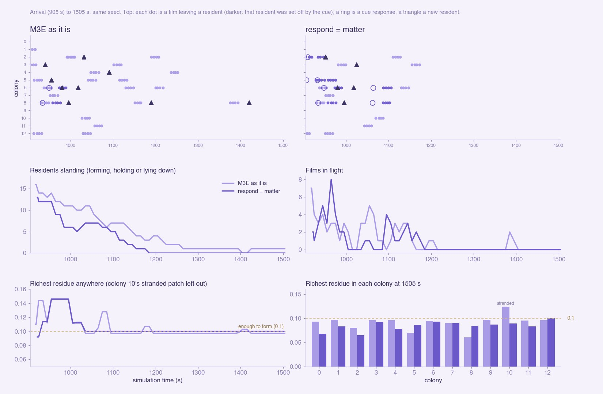
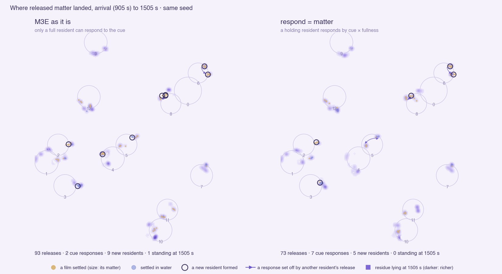

# 23 · Distributed perception

*What a resident can read where it stands, and one experiment from that.*

> **Status, 10 November 2026: exploration, for review.** Committed in the
> M3S checkpoint (11 November); not deployed. M3E, Explore and the earlier studies are
> unchanged: both additions are off unless their query flag is set.

| | |
|---|---|
| **Inspector** | `/habitat/m3e?perceive=1` (read-only) |
| **Experiment** | `/habitat/m3e?respond=matter` |
| **Baseline** | M3E ([study 22](22-habitat-m3e.md)), same seed |

## Implemented

- **`lib/perception.js`:** `perceive(life, resident)` reads only existing
  state. Nothing reads it, and it writes nothing.
- **The inspector:** `components/PerceptionInspector.jsx`, on any Habitat
  with `?perceive=1`.
  - It follows the standing resident nearest the visitor (P pins one).
  - Each reading has its last 90 s as a trace.
  - Readings are marked **functional** (a lifecycle rule reads it),
    **available** (derivable, read by no rule) or **rendered / not in the
    world**.
  - A survey reads every standing resident at once (the panel scrolls to
    it).
- **The experiment, behind a flag:** `?respond=matter` (Lifecycle
  `respond`).
  - The cue may set off any holding resident once its gathered cue × its
    fullness passes the existing threshold. Before, only a full one could
    respond.
  - A full resident behaves as before.
  - No new state, and nothing in the ledger changes.
  - Without the flag the rule is unchanged.

## What a resident can read (M3E, surveys at t = 920 to 1120)

| Reading | Status | Across standing residents | Learned |
|---|---|---|---|
| Its matter (fullness) | functional | 0.22–1.0 | varies; after arrival none reaches full |
| Residue underfoot | functional | about 0 | used up by the time it stands |
| Since matter last arrived | functional | 1–300 s | varies |
| Ground fit | functional | 0.23–0.94 | varies, but fixed per place |
| Standing in its patch | functional | 1–2 | the cap of 4 never binds |
| Cue gathered | functional | 1e-4–0.12 (threshold 0.004) | often over the threshold, but unused unless full |
| Its turn | functional | median about 0.45 of 0.5 | saturates |
| Air at its crest (as its films ride it) | available | 0.01–0.2 units/s | varies; read by no rule |
| Neighbours within 2 units | available | almost always 0 | residents are isolated in this world |
| Cue passage here | available | 0.07–2.5 | varies strongly; recorded, read by nothing |
| Light held in the ground | available | 0.19–0.72 | varies; fixed when the world is made |
| Illumination | not in the world | | one fixed light |
| Visitor, dent | rendered / physical | | never ecological |

The resident in the image is the typical case. It is 55% full and has
gathered 0.008 of cue, twice the threshold. In M3E it cannot respond,
because it is not full.

## Where regrowth is limited

**The limit is concentrated matter, not where residents form.** A new
resident needs 0.1 of residue in its footprint.

- **After arrival, residue reaches 0.1 only briefly** (in 20 of 61
  samples in M3E). Each time it is a fresh deposit, taken up by the
  resident that forms on it.
- **The one lasting rich deposit is stranded.** Colony 10's patch (0.10 to
  0.12) lies half under a placed History form's claim and half past the
  world's edge margin. No rule lets anything form there.
- **Both runs end the same way.** Every colony's richest residue sits a
  little under 0.1, and nothing moves residue once it has settled.

So weighting where residents form by a perception would rarely change
anything.

## The experiment: let the cue's perception act (`?respond=matter`)

Same seed, window t = 905 (arrival) → 1505. M3E's run was repeated three
times, with identical counts.

| | M3E (`full`) | `respond=matter` |
|---|---|---|
| Residents standing at arrival | 16 | 13 |
| Cue responses before arrival / after | 14 / 2 | 32 / 7 |
| Responses set off by a resident that had itself responded (whole run) | 1 | 21 |
| Responses across colonies (whole run) | 2 | 5 |
| Releases after arrival | 93 | 73 |
| Matter carried by the films that settled | 3.45 | 2.57 |
| Films landing within 0.6 of another release's films | 52% | 49% |
| New residents after arrival | 9 (the last at 1420 s) | 5 (the last at 1025 s) |
| No resident standing | from 1405 s (one more forms at 1420) | from 1185 s |
| Richest residue in each colony at 1505 s | 0.06–0.097 (colony 10's stranded 0.124 aside) | 0.065–0.10 |
| Ledger drift | 4e-8 | 4e-8 |

**What the visitor sees.** Colony 5 stands straight ahead at arrival.
- **With the flag:** both its residents lie down within 30 s of arriving,
  the second set off by the first's release. By 995 s both are contours.
- **In M3E:** both stand, and a third rises on an earlier deposit.

**Over time.** Top: each film leaving a resident, by colony, with the cue
responses. Below: residents standing, films in flight, and the richest
residue against the 0.1 a resident needs.

**Where the matter went.** Each film is shown where it settled. The
residue is as it lies at 1505 s.

### Learned

- **Cascades appear.** With the perception allowed to act, a release sets
  off its neighbours, with no central control (21 cascade responses
  against 1). Most of this happens before the visitor arrives. In the
  prerun, colony 9 lets go as a chain of six between 602 and 799 s.
- **Young residents let go early.** Two residents formed after arrival
  responded 46 and 66 s after forming, still far from full.
- **It does not concentrate matter.**
  - Films land no closer to each other (49% against 52%).
  - Each release's films clump as before (median spread 0.47 against
    0.56).
  - Each film carries the same matter (0.034).
  - Less matter moves in all, since fewer residents stood at arrival.
- **The world reaches the same end sooner.** It is dormant from 1185 s
  rather than about 1400 s, with residue everywhere just under 0.1.
- **Matter is still conserved,** and without the flag nothing changes.

## Hypotheses (not tested)

- **Cascades need concentration on the other side.** For a cascade to
  build form rather than only empty a colony, its deposits would have to
  reach the formation threshold more often. This run shows they do not.
  Two candidate rule changes, for review:
  - The formation threshold perceived relative to the neighbourhood: a
    resident may form where residue stands out, not only above 0.1.
  - Settled residue that can still move, so deposits could gather (today
    it settles for five steps and then stays).

  Both would change rules, not the ledger. Neither is built.
- **Colony 10's stranded deposit** is the richest residue in M3E. Whether
  a placed form's claim should keep residue from being grown on is a
  separate question.
- **Air and light are the unused perceptions that vary most.** They are
  the natural inputs for later responses.

## How to look at it

- **`http://localhost:5173/habitat/m3e?perceive=1`:** the inspector.
  - P pins the nearest resident.
  - "Survey" reads all standing residents; scroll the panel to see it.
- **Add `&respond=matter` for the experiment.** Stay at the arrival and
  look at colony 5, straight ahead. Within a minute its two residents lie
  down.

## Checked

- **The runs:** both from page load to t = 1505.
  - The data was recorded in the page and plotted offline.
  - Frames were taken with the simulation and the shader clock frozen at
    each moment.
- **The baseline:** M3E's counts were identical across three runs.
- **The inspector in the browser:** following, pinning, traces, the
  survey and scrolling to it. Before this, the presence camera's wheel
  handler kept the panel from scrolling.
- **Without a commons** (`/habitat/v0?perceive=1`): the cue readings show
  as absent, and the rest read as in M3E.
- **Lint:** no errors (the inspector's warnings are the codebase's usual
  mutable-store ones). The build passes.
- **Not checked:** performance with the inspector open.
