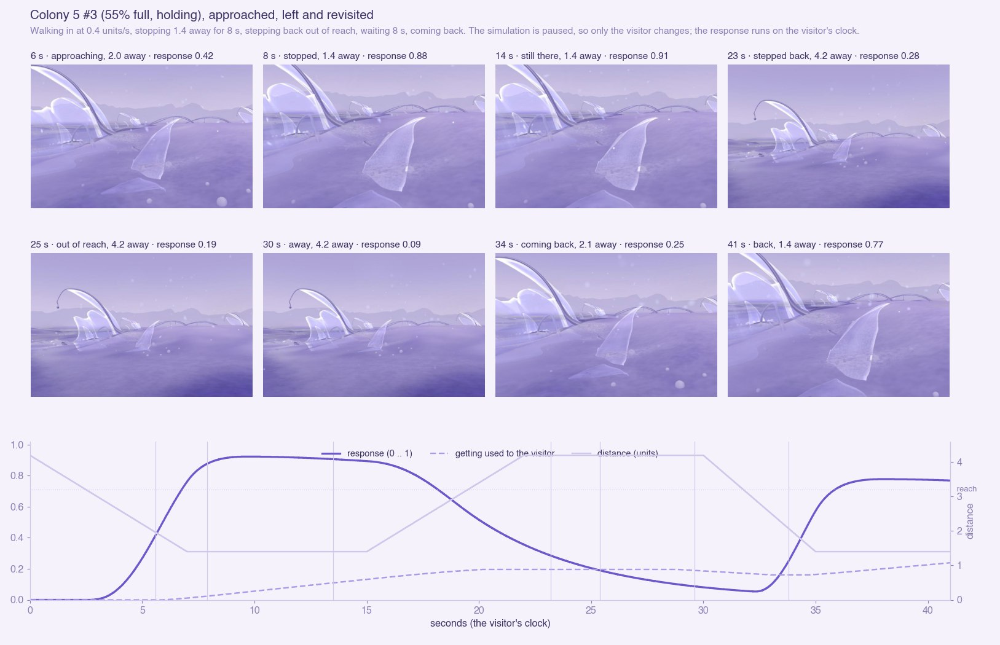
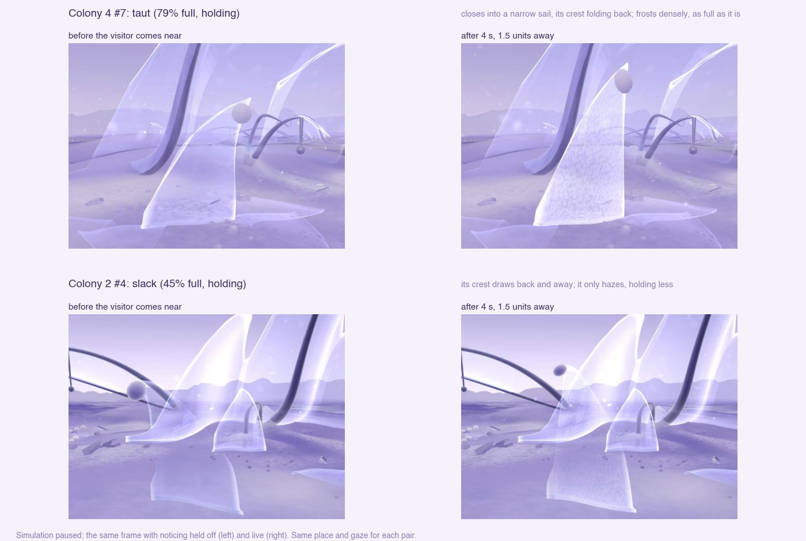

# 24 · Noticing (M3N)

*A resident responds to the visitor's nearness, before any touch. One
interactive prototype for legibility.*

> **Status, 10 November 2026: prototype, for review.** Committed in the M3S
> checkpoint (11 November); not deployed. M3E (the checkpoint), Explore and the earlier studies are
> unchanged.

| | |
|---|---|
| **M3N** | `/habitat/m3n` |
| **Baseline** | `/habitat/m3e` ([study 22](22-habitat-m3e.md)) |
| **Simulation** | M3E's exactly: noticing reads the residents and writes nothing |

## The problem

The world can be busy and still look static. In M3E a resident answers the
visitor only on contact: they must come within about 1.6 units and press
its sheet. Most visitors never do, so the residents read as sculpture. The
aim was one response that:
- shows within a few seconds of approaching
- needs no precise contact and no instructions
- stays sparse, organic and uncanny, and keeps the world autonomous

## What M3N adds (`notice`, `lib/notice.js`)

The **one or two standing residents nearest the visitor** respond, from
about 3 units away. Each responds in its own way:

- **It frosts.** Its film clouds to a milky pearl. The frost starts on the
  side the visitor comes from, spreads across the sheet, and grows into a
  fine grain. **How dense it gets is the matter its body holds,** so the
  response also shows the resident's hidden state: a full resident turns
  milky, a young or emptying one only hazes.
- **It closes.**
  - Its sheet cups away from the visitor, as a leaf folds shut.
  - Its crest folds away from them.
  - It draws back.
- **Its tension sets the manner.** This is M3E's own measure: fullness, as
  far as its stage holds it.
  - **Taut (full, holding):** it closes quickly and barely leans.
  - **Slack:** it sags away slowly, and further.
- **It settles back** over several seconds once the visitor leaves.
- **It grows a little used to a visitor who stays** (`habit`). A quick
  return answers about 15% less, and it recovers in about a minute.
- **Old contours on the ground** only frost, faintly, as the visitor passes
  over them. When few residents still stand, the ground keeps a trace of
  response.

## Simulated, and presentation only

| | |
|---|---|
| **Read from the simulation** | Stage, the matter its body holds (or a contour's), tension (`tensionOf`, as in M3E), its place, lean, height and unfold |
| **Presentation only (new)** | How strongly each resident is noticing, the side it is approached from, and how used to the visitor it is. All three run on the visitor's clock, never the simulation's |
| **Drawn** | The frost (the film shader's `NOTICE` block); the cup (the same block, in the vertex shader); the lean and the crest's fold, through the channels the resident's air and posture already use |
| **Untouched** | Lifecycle stages and timing, matter and the ledger, formation thresholds, the cue, the films |

**What the visitor meets is what they see.**
- The cup is also applied in `poseFilm`, the copy of the drawn sheet that
  M3E's encounter collides with.
- The lean travels in the air's bend, which the encounter already allows
  for.

This holds by construction; it was not measured separately.

## Telling the visitor's effect from the ecology's own

| | The visitor's (noticing) | Autonomous |
|---|---|---|
| **Colour** | A cool pearl frost | The cue: an ice-lilac stain. Matter crossing: champagne |
| **Tempo** | Seconds; reverses when they leave | Stages of 20 to 140 s; one way |
| **Direction** | Keyed to where the visitor stands | Keyed to the resident's own lean (lying down, releasing) |
| **Reach** | One or two residents at a time | Any resident, by its own state, and through the cue |

## Measured

- **Approach, pause, retreat, revisit** (colony 5's #3, 55% full; walking at
  0.4 units/s, simulation paused):
  - The response begins at about 2.8 units, 3.8 s into the approach.
  - It reaches 0.88 on stopping 1.4 away, and holds about 0.9 there.
  - Stepping back, it settles over about 8 s.
  - Coming back after 8 s it peaks at 0.78, against 0.92 the first time.
- **Taut against slack** (images above): colony 4's #7 (79% full) closes
  into a narrow frosted sail. Colony 2's #4 (45% full) draws its crest back
  and only hazes.
- **From the arrival, with the keyboard only:** holding W (forward) with the
  simulation running.
  - Colony 5's #3 began to respond after 10.5 s, at about 3 units, and
    reached 0.56.
  - The walk then stopped against the colony's placed forms, 2.1 units from
    it, which partly hide it from there.
- **Performance:** M3N holds 120 Hz with a resident responding (mean
  8.32 ms, p95 9.3 ms), as M3E.
- **M3E is unchanged:** none of its 142 materials compile `NOTICE`, and
  there is no noticing object and no console error.
- **Lint:** no errors. The build passes.

## Not resolved

- **Only residents respond** (contours faintly). The colonies' placed forms
  are History's, not living, so they stay still. After about 1300 s few
  residents stand, and the response is mostly the contours' faint frost.
- **Occlusion:** walking straight from the arrival, the responding resident
  can sit behind its colony's placed sheets.
- **Habituation is light** (about 15%) and may go unnoticed.
- **The taut frost is near white.** Under other light it might read as glow.
- **From the side** a resident only frosts and leans; it cups and folds its
  crest only when approached from in front or behind.
- **Not tested:** other displays, where the fine frost grain may shimmer;
  touch.

## Later: legible autonomous ecology, and collective morphogenesis

Noticing makes the visitor's own effect legible. The ecology's own events
are the second half of the brief, not built here:

- **The coloured flowing air** can return where it carries a real event:
  - Each release's films could leave a faint trail in the air, tinted by
    where they came from, so a film's journey from release to settling can
    be followed.
  - The cue's passage grid (recorded, read by nothing; [study 23](23-distributed-perception.md))
    could tint the air it has crossed for a while.
  - The cue's own puffs already use this palette (`MorphAir`: lilac, ice,
    silver).
- **Regeneration** could be marked where a resident forms on a deposit
  (champagne, as matter exchange).

**For a collective morphogenesis experiment:**
- **Noticing writes nothing.** Letting what a resident notices reach the
  ecology (a disturbed resident releasing earlier, say) would couple the
  visitor to the simulation. That is a deliberate choice for later, not a
  side effect.
- **Residents noticing each other,** rather than the visitor, is the
  collective version. Study 23 found neighbours within 2 units almost
  always absent, so it would act mainly through the air and the cue.
