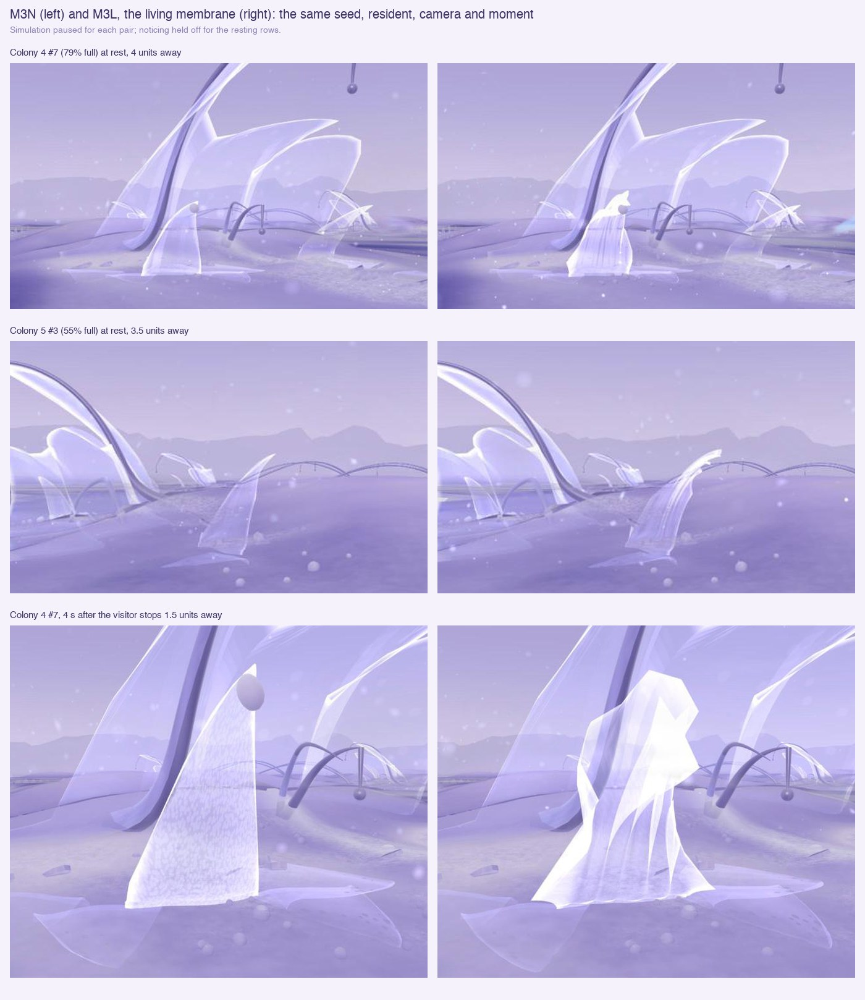

# 25 · Living membrane (M3L)

*One morphology × motion experiment from the visual research archive
(XenoCells, Floraform, Shylight). A prototype for visual review.*

> **Status, 10 November 2026: prototype.** Committed in the M3S checkpoint (11 November); not deployed.
> M3N, M3E and the earlier studies are unchanged.

| | |
|---|---|
| **M3L** | `/habitat/m3l` |
| **Baseline** | `/habitat/m3n` ([study 24](24-noticing.md)) |
| **Simulation** | M3N's exactly: everything here is drawn, on the visitor's clock |

## What it does

Every resident's membrane is drawn as living tissue (`living`; the form
vertex shader's `LIVING` block, LifecycleLayer `LIVING`).

- **At rest:**
  - Flutes run up the sheet, unevenly spaced and turning slightly with
    height (XenoCells).
  - Its rim ruffles and stands in lobes (Floraform's longer edge).
  - How deep both go is the matter its body holds: a young resident is
    smooth, a full one convoluted. How many flutes it has is its own (3 to
    5, by its seed).
  - It breathes very slightly.
  - Its folds relax as it lies down; an old contour keeps a trace of them.
- **Noticed** (study 24's proximity, about 3 units): it gathers.
  - It draws down and slightly in around its crest. The length it loses
    buckles into deeper flutes and a crumpled rim.
  - The rim and the side the visitor is on go first, the foot and the far
    side last (Shylight's staggered folds).
  - **Timing follows its tension:** a taut, full resident gathers quickly
    and less far; a slack one slowly and further. This is a spring per
    resident: 0.85 Hz taut, 0.32 Hz slack.
- **Recovering:** it unfurls, the last parts gathered opening first, a
  little past rest before it settles.

The bead at its crest follows the rim, and draws in while the body is
gathered. The encounter (M3E) meets the sheet as drawn: the same
deformation runs in `poseFilm`.

**One layer, not several.** The archive's own counter-argument held:
- Films don't write depth, so added layers would stack alpha in an
  already pale scene.
- One membrane with folds reads as one body.

**M3N's own closing is turned down here** (`Noticing` options): no cup, no
crest fold, frost at 35%. The membrane carries the response.

**M3L arrives elsewhere** (`arriveAt`): on open ground between colonies
2 and 4, looking at colony 4's #7 about 5.8 units ahead. Walking straight
on reaches it. This is the camera only; the world and colonies are the
same.

Recording (20 s; rest, approach, close, step back, recovery):
[25-living-membrane-walk.mp4](images/25-living-membrane-walk.mp4)

## Checked

- **Unguided, keyboard only** (holding W from the arrival, simulation
  running):
  - Colony 4's #7 starts to gather after about 5 s, 2.6 units away.
  - It is at 0.5 by 6 s and 0.88 by 7 s.
- **The recording:**
  - Response 0.86 a second after stopping 1.4 away.
  - Recovery under way within a second of stepping back.
- **M3N unchanged:**
  - none of its materials compile `LIVING`
  - noticing at its defaults, its arrival as before
  - no console errors
- **Frame time pressed against a resident:**

  | Space | Mean | p95 |
  |---|---|---|
  | M3L | 10.5 ms | 16.8 ms |
  | M3N, same place | 9.3 ms | 16.7 ms |

- **Lint:** no errors. The build passes.

## For review

- **Gathered, a narrow resident can read as a draped, cloaked figure.**
  - Seen from mid distance it is a white body with a rounded top.
  - Earlier passes were worse (pointed "ears", the bead as an eye, a
    pointed hood) and were changed. This one remains to judge.
- **Fully gathered, it is brighter than the scene around it:** deep folds
  catch rim light, and some frost remains.
- **Pressed right against it,** its folds and its colony's sheets stack
  into many translucent layers.
- **At rest from 4 to 6 units,** the flutes read mainly as vertical
  streaks. The silhouette changes most at the rim.
- **Lying residents** keep a faint crumple until their folds relax.
- **Not tested:** other displays, and slack residents in the recording
  (the taut one was filmed).
