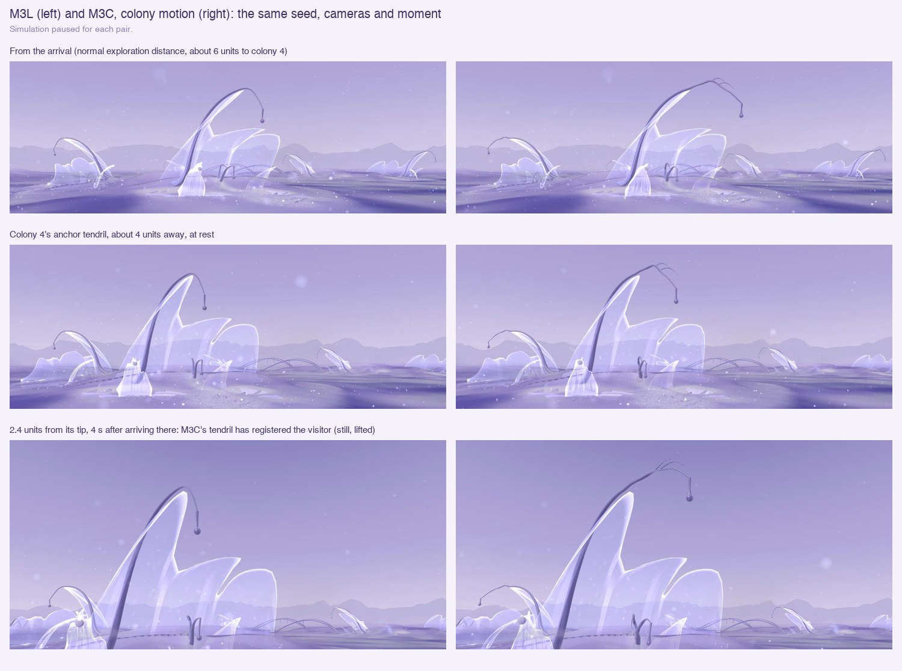
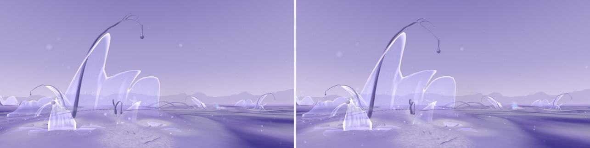

# 26 · Colony motion (M3C)

*The colony's tendrils as quiet sensory appendages, and a refinement of the
living membrane. After the colony encounter study
(`references/Residual Ecology_ Colony Encounter Study.png`). A prototype
for visual review.*

> **Status, 11 November 2026: prototype.** Committed in the M3S checkpoint (11 November); not deployed.
> M3L, M3N and the earlier studies are unchanged.

| | |
|---|---|
| **M3C** | `/habitat/m3c` |
| **Baseline** | `/habitat/m3l` ([study 25](25-living-membrane.md)) |
| **Simulation** | M3N's exactly: everything here is drawn, on the visitor's clock |

## What was there

- **Tendrils:** the colony's structure (bridgework).
  - An anchor's ribs climb its tallest crest and hang past the lip.
  - Reaches leave the anchor; some end in the air.
  - Each is a smooth tube on an arc, ending in a thread and a ball.
  - All share one slow sway from the shader.
- **Bulbs:**
  - **Hanging drops at tendril tips:** part of the tendril, permanent.
  - **Trace-bead trails on the ground:** History's live flow channels, by
    flow. Static.
  - **Sediment grains:** static.
  - **A resident's crest bead:** the one that comes and goes. It appears on
    mature residents, shrinks with the last films it releases, and in M3L
    draws in while the body is gathered.

No bulb was given a new function.

## What M3C does

**Tendrils** (`tendrils`: traceForms `tendrilise`, `lib/tendrils.js`, the
form shader's `TENDRIL`). Strands that end in the air, and ribs past the
lip, become tendrils. Landing strands stay as they are, since they hold
their films.

- **Form:**
  - a root that flares into what it grows from
  - a slow taper with a few soft swellings, grown in segments
  - a bend out of its plane and a twist, the tip hanging
  - on the longer ones, one or two fine branchlets ending in small nodes
  - the thread swelling into its bulb as a neck
- **Ambient:** each drifts on its own frequencies and phase, with an
  occasional brief tremble at the tip. The root holds; none move together.
- **A stranger within about 3.4 units of a tip:**
  - After its own pause, it falls still.
  - Its outer part lifts and turns toward the stranger.
  - It may reach once or twice along its tip.
  - After a few seconds it returns to its drift, even if they stay, and
    registers them again only once they have left.
  - Its bulb lags as a pendulum.
  - The few nearest respond (eight at most), each on its own schedule.
- **The lift is what reads from where the visitor stands.** Turning toward
  them alone moves the tip along their line of sight, barely visible.

**Membrane** (`living: 'fan'`): fewer, broader folds that turn across the
sheet as they rise, not vertical pleats. It gathers as M3L does, a little
cupped, and draws down less.
- **Tried and set aside:** lobes that grew and rounded as it gathered, with
  a deeper cup (the study's shell). They sharpened the crest into points.

Recording (20 s; at rest, approach, registering, returning while the
visitor stays, stepping back):
[26-colony-motion-walk.mp4](images/26-colony-motion-walk.mp4)

## Checked

- **The recording's trace:**
  - Colony 4's tendril registered about a second after the visitor came
    within reach: still, turned and lifted 0.21.
  - It let go about 4 s later, with the visitor still there.
- **M3L unchanged:**
  - no `TENDRIL` and no tendril driver
  - its membrane's form values are its own
  - no console errors
- **Frame time at medium distance:** M3C 8.3 ms, M3L 8.3 ms.
- **Lint:** no errors. The build passes.

## For review

- **Is the forked apex soft enough?** From far away it can read as a twig.
- **Turned only toward the visitor, it is hard to see,** so it also lifts.
  Whether the lift reads as attention (not alarm) is for you to judge.
- **Short reaches** have swellings and a bulb, but no branchlets. They read
  as small soft stalks.
- **The membrane refinement is modest.** The study's layered, shell-like
  gathering is not reached, and the attempt at it is described above.
- **Probing reaches** happen only for some tendrils (by seed); none
  happened in the recording.
