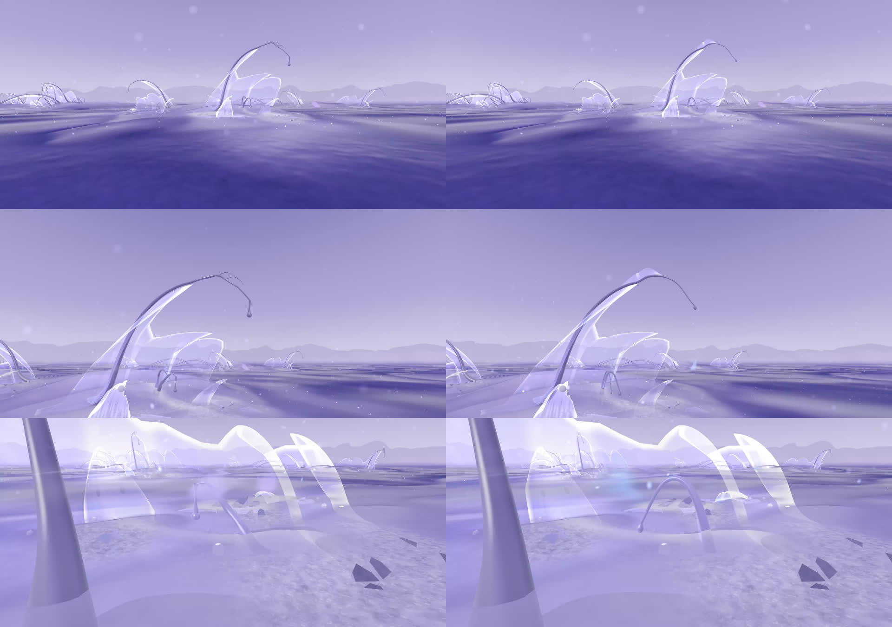
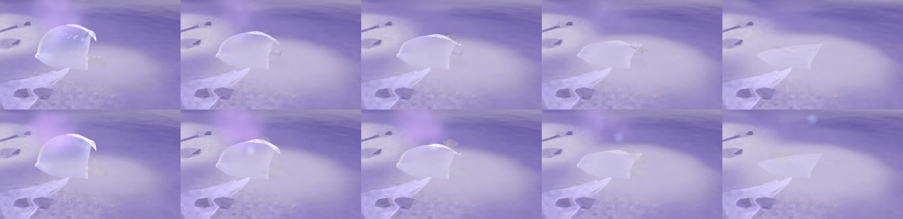

# 27 · Sheathed tendrils, a visible passage (M3S)

*Tendrils grown out of the colony rather than set on it, after the tendril
morphology study (`references/tendril morphology.png`: 02 ribbon root, 05
membrane–tendril hybrid). The films' real passage is drawn so it can be
followed. A prototype for visual review.*

> **Status, 11 November 2026: prototype, and the featured Habitat**
> (`/habitat` opens it). Committed in the M3S checkpoint; not deployed.
> M3C and the earlier studies are unchanged.

| | |
|---|---|
| **M3S** | `/habitat/m3s` |
| **Baseline** | `/habitat/m3c` ([study 26](26-colony-motion.md)) |
| **Simulation** | M3N's exactly: everything here is drawn |

**Nothing travels along a tendril, and nothing here suggests it does.**
Nothing in the simulation moves through a tendril. Matter leaves a declining
membrane only as films carried by the air.

## Tendrils (`tendrils: 'sheath'`)

traceForms `tendrilise({ soft })`, `sheathe`, `teardrop`.

- **An anchor's crest carries on past its lip as a blade** (05). A leaf of
  membrane opens out of the crest's own edge. It starts with no width well
  down the crest, is widest just past the lip, then narrows into the stalk.
  Past it, the bare tendril arcs over to its bulb.
- **A reach is a tapered arc** (01), no longer the strand's rise cut off in
  mid-air, which hooked over like a cane. It rises at a slant from the same
  root, toward where the strand was going. Its high point is nearer the
  root, and the tip hangs lower.
- **A reach's root is a fin of membrane** (02, "root / base transition").
  The fin spans the rising stalk and the ground, leans a little to one side,
  and narrows up into the stalk.
- **A teardrop bulb grows from the tip.** The tip's own taper swells into
  it, and it turns down to hang. This replaces the ball on a thread.
- **Form throughout:**
  - one continuous curve: a single bow aside, not a wave
  - a steady taper with at most two long, low swellings, no beads
  - no twig branchlets
- **The sheaths are films, tagged with the stalk's place along the
  tendril.** The bridgework film material compiles `TENDRIL` here, so each
  sheath moves with its stalk. A bulb's lag eases in along its neck.
- **Registering a stranger, without the periscope** (`TENDRIL_SOFT`). The
  tip lifts a quarter as far as in M3C. Instead it draws in toward the
  inside of its own arc (its crook deepens) as it leans toward them.
  Timing, reaches and the return are M3C's.

## The passage (`passage`)

LifecycleLayer `PASSAGE`, the form shader's `PASSAGE`, the films' `PASSAGE`.
Everything is read from the simulation on its clock:
- each film's position, velocity, age and state
- the resident's record of each release (`left`)

Nothing is read back.

- **Coming away:**
  - The sheet springs back a little where the film tears free, and settles
    within a few seconds.
  - Round the opening it shows a thin film's colours (pearl, rose-lilac,
    pale aqua) as it thins, for a few seconds.
  - These cues stay on the membrane, at the mark.
- **Carried:**
  - The film holds the membrane's own light and has a fine lit margin.
    Before, a film from a resident was lit like the air's skins: a grey
    smudge beside the bright sheet it left, and seen edge-on from eye height.
  - It tumbles more, so it shows its face now and then.
  - Soft rows of the same colours cross it from its leading edge back. They
    move only as far as the film actually travels, so they slow as it slows
    and stand still when it settles.
  - Behind it is a short, soft wake: the air it has just passed through,
    a little brighter, fading over 6 s. This replaces the wake's motes.
- **Settling:** it spreads half again as it clears into the residue. The
  residue's own arrival light (D1's) is unchanged.

**Iridescence appears only on a film as it parts, and on the film while it
moves.** Never on a tendril, a resident at rest, or the ground. The warm
accent (matter crossing) is as before.

Recordings:
- [27-passage.mp4](images/27-passage.mp4): 20 s, one resident releasing
  and lying down, from 1.7 units.
- [27-sheath-walk.mp4](images/27-sheath-walk.mp4): 20 s, from the
  arrival:
  - walking to about 2.5 units from the anchor
  - its tendrils registering and returning while the visitor stays
  - stepping back

## Tried and set aside

- **A reach leaving the ground on a low run** (the reference's ribbon
  lying low). Over a reach's short footprint it stayed steep unless its root
  moved.
- **The wake as a fine line of the whole path.** At eye level it read as a
  strand joining the resident to the ground, as if the matter ran along it.

## Checked

- **The walk's trace:**
  - The anchor's rib tendril registered as the visitor came within reach
    (turn 0.23).
  - Two reaches followed (0.15).
  - All three had let go by 14 s, with the visitor still there.
- **M3C unchanged:**
  - no `PASSAGE`
  - no tendril tags on its films
  - lift 0.8, no draw
  - the same geometry path (the soft branch is taken only for `'sheath'`)
- **Frame time at the arrival:**

  | Space | Mean | p95 |
  |---|---|---|
  | M3S | 8.3 ms | 10.1 ms |
  | M3C | 8.3 ms | 10.0 ms |

- **No console errors.** The blade's last row had NaN widths: a cosine just
  below zero under a fractional power. This is fixed.
- **Lint:** no errors. The build passes.

## For review

- **The passage is still small.** A film is as large as the matter it
  carries (M3E's rule): about 0.3 units across, flying half a unit or so in
  a few seconds. From 1.5–2 units the sequence reads:
  - the sheet's give at the mark
  - a pale piece leaving
  - it tumbling
  - it landing in the residue's arrival light

  From further away it is mostly the residue's light. The comb rows show
  only up close.
- **Is the mark's colour enough, or too much?** It is kept to the sheet's
  own brightness (a hue shift, not a glow).
- **The rib along the membrane is M3C's.** Seen right at an anchor's foot it
  is still a heavy tube.
- **Two tendrils from one root:** the second also ends in a small bulb,
  which is near the study's forked tip (04) but not designed as one.

## Next: a conserved transfer through the sheath (assessment, not built)

**How it fits:**
- **The cleanest hook already exists.** A forming resident takes matter from
  a pool: residual cells under it, plus an old contour's spare matter (all
  above its 50% floor). That take is instantaneous: the contour's matter
  joins the new body in the same 0.1 s step (`take`, `gaveAt`).
- **Give that same transfer a route and a transit time.** No new rule of
  who gives to whom. The amounts, floors and thresholds stay the same; only
  the arrival is later.
- **Ledger:** a new term, `passage`: packets with an amount, a link and a
  position along it.
  - Debit the contour when a packet leaves; credit the forming body when it
    arrives.
  - `bodies + flight + residual + contours + passage + out` stays constant
    every step.
  - Fixed-step and deterministic, so `ledger()` checks it as it checks the
    rest.
  - For legibility, spare matter can leave in a few discrete packets (one
    when enough has gathered) rather than a trickle. That is still
    conserved.
- **The route must be data, and drawn from that data.** `links` in the
  lifecycle: contour ↔ forming resident, the pairing `take` already finds,
  made when a resident begins to form.
  - The sheath would be drawn from the link.
  - Not the scatter's tendrils: none of them joins two bodies in the ledger.
    Anchors are not simulated, and a free tendril ends in the air.
  - The drawn sheath must exist exactly where matter can pass, and only
    there. Otherwise sheaths that carry and tendrils that don't look alike.
- **What it changes:** forming residents fill a little later (by the transit
  time). The ecology's timing and its precomputed history therefore drift
  from M3N's. It needs its own flag and space, with both histories
  recomputed.
- **Unaffected:** films and the air, the cue (a signal), the contour's
  floor, `respond`.

**Visual mapping, only then:**
- A packet is a short, directional brightening in the sheath, at its real
  position and speed and as strong as its amount.
- The warm accent shows at its departure and arrival.
- Ctenophore-like colour may ride the packet, and only the packet.
- An empty sheath shows nothing.

**Alternative (not recommended first): the bulb as a store.** A sheath could
draw matter up into a bulb, which would swell and later drop it as residue.
- **For:** it gives the bulbs a real function and is legible.
- **Against:** it is a new rule of who gives, rather than a route for an
  existing one.

**Risks:**
- The contour give rates are small, so packets will be faint unless
  batched.
- A dynamic strand adds alpha layers where colonies are already dense.
- A sheath that appears only while a resident forms has to grow and fade
  without looking like an effect.
