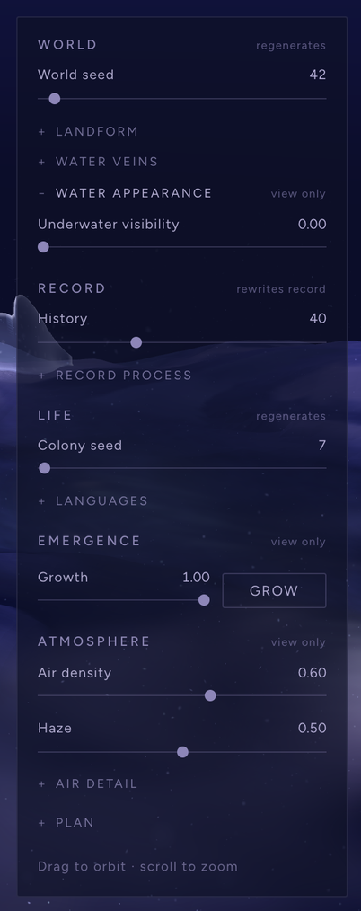

# Architecture and interface

How the app is put together now that the weekly studies have become one
world: what the views are, where the state lives, how the world is derived,
how Explore keeps it consistent while it changes, and which spatial issues
are known and deferred.

## Views: Explore, then the studies

The app opens on **Explore**: the complete world as one place. The studies
it grew from are behind a quiet **Studies** menu under the title, each still
its own view with its own panel, unchanged.

| View | What it shows | Panel |
|---|---|---|
| **Explore** (default) | The complete world: terrain, water, streams, colonies with every form, tissue, branching, accumulated light, the air. The same scene and world as the Scatter study with all languages shown | `ExplorePanel` |
| Field (studies 01–02) | The terrain and the **live** sediment simulation (Run / Reset) | `SidePanel` |
| Volume (study 03) | The volume study: its own suspended mass, its own seed. Not part of the world | `VolumePanel` |
| Shaders (study 04) | Three material readings of the same terrain | `ShaderPanel` |
| Scatter (study 05) | The complete world with the study's tools: one language at a time, its rules and its suitability map | `ScatterPanel` |

Explore is not a second world. It is the same `Scene`, the same state and the
same derivation as the Scatter study (`scattering` is true for both), with
the colony always shown whole.

The **Library**, saved configurations, is secondary: its toggle appears
with the Studies menu or in any study, not in Explore's exhibition view.

## State

All of it lives in `App.jsx`, one group per concern. Explore writes the same
groups the studies do; nothing is copied.

| State | Contents | Written by |
|---|---|---|
| `params` | World seed, landform scale, detail scale and amount, shaping and amount, elevation, water level, grid resolution | Field panel; Explore (all but detail scale and amount, and grid resolution) |
| `simParams` | Flow, deposition, supply | Field panel; Explore ("Record process") |
| `scatterParams` | History, colony seed, language amounts, streams, air, growth, solo view | Scatter panel; Explore (all but structure reach, air curl, wisp strength and the solo view) |
| `shaderParams` | Material mode and its controls, water | Shaders panel |
| `volumeParams` | The volume study | Volume panel |
| `view`, `running`, `growing`, `wireframe` | The current view, the live simulation, Grow, W | Menu, panels, keyboard |

## The world, derived

Verified from the code (October 2026). Capitals are controls; arrows are
direct dependencies.

```
WORLD SEED ──┐  (also seeds the relief and the streams)
LANDFORM ────┼─► base field ─► relief (built around WATER LEVEL) ─► streams (ELEVATION, WATER LEVEL, VEINS) ─► carved FIELD
WATER LEVEL ─┘                                                                                                    │
     ┌───────────────────────────────┬──────────────────────────────┬──────────────────────────────────────┤
     ▼                               ▼                              ▼                                      ▼
terrain mesh · water plane     live Field simulation (reset)  HISTORY: the sediment model run headless   air floor (this field, no sediment lift)
                                                               ◄ History seconds · RECORD PROCESS · water level
                                                                    │ sediment
                                                                    ▼
                                         world data: shore · slope · record · flow · colony field ◄ COLONY SEED, ELEVATION
                                                                    ▼
                                         colony sites → members · residue ◄ LANGUAGES (members only), streams as no-go zones
                                                                    ▼
                                 forms and tissue · branching (the first colony) · accumulation light · colony air
GROWTH / Grow ─► when forms, tissue, branching and the ground light appear (nothing is rebuilt)
AIR, HAZE ─► dust, wisps, haze and colony-air settings, in every view (nothing is rebuilt)
UNDERWATER VISIBILITY ─► how the ground below the water line and the water's veils are drawn, Explore only (nothing is rebuilt)
```

Volume has its own density field and its own scene; it shares only the
palette and the atmosphere's look.

### What each Explore control does

"Rebuilds the world" means the terrain, a reset of the Field study's live
simulation, History, world data, placement, forms, branching, accumulation
light, and the air's particles (which respawn).

| Control | Directly changes | Downstream | When | Same state as |
|---|---|---|---|---|
| World seed | the base field, relief and streams | rebuilds the world | on release | Field: Seed |
| Elevation | the vertical scale | **also the carved field** (streams are traced and carved in world units), so it rebuilds the world; slopes in degrees change, so colonies can move | on release | Field |
| Water level | the water line | **reshapes the land itself** (relief is built around it), so it rebuilds the world; the water plane moves | on release | Field |
| Landform scale, operation and amount | the base field | rebuilds the world | on release (operation: on choice) | Field |
| Streams, stream flow | the carved channels | rebuilds the world, in every view; colonies keep clear of streams | on release | Scatter study |
| History | the seconds of the headless record | recomputed **from nothing**: the visible sediment lift, world data, placement onward. Not the live simulation, not the air floor | on release | Scatter study |
| Flow, deposition, supply | the sediment model's rules | History onward; also the rules of the Field study's live simulation from then on (without resetting it) | on release | Field: Simulation |
| Colony seed | the colony field and placement | colony sites, members, branching. The terrain and History are kept | on release | Scatter: Scatter seed |
| Structure, membrane and residue amounts; residue accumulation | placement | members, residue, light, branching (structure amount and residue accumulation also feed it), colony air. **Colony sites unchanged** | on release | Scatter study |
| Membrane openness | a shader value | nothing rebuilt | live | Scatter study |
| Growth, Grow | the emergence clock | forms, tissue, branching and the ground light appear over 42 s. Nothing placed differently | live / on action | Scatter study |
| Air density | how many dust grains are drawn | nothing rebuilt | live, every view | Scatter study |
| Haze, drift, wisps, colony air | the air's settings | nothing rebuilt | live, every view | Scatter study |
| Underwater visibility | three shader values: the ground below the water line, the basin water's veil, the stream water's veil | nothing rebuilt; nothing above the water line changes | live, **Explore only** | Explore's own (`scatterParams.underwater`); the studies never receive it |

Interactions worth knowing:
- **Elevation and water level are not visual scales.** Both move streams and
  colonies.
- **Water veins are a world control.** Changing them resets the Field study's
  live simulation.
- **The live simulation and History are separate.** Running the live one never
  changes Explore; they share only their rules.
- **Only the colony seed, History, the landform and the water move colony
  sites.** The languages change what each colony grows.
- **The air does not follow Growth.** Colony air bends around colonies that
  have not emerged yet.
- **Controls left to the studies keep working on the same state.** Detail
  scale and amount (Field), structure reach (Scatter, under Bridgework), and
  air curl and wisp strength (Scatter) still shape Explore's world when set
  there.

## Three processes that are easy to confuse

| | What it is | Where |
|---|---|---|
| **Live simulation** (Run, Pause, Reset) | The sediment model stepping in real time | Field and Shaders. Paused while Explore or Scatter is shown, resumed on return |
| **History** | The same model run headless and deterministically for N seconds from nothing: the record the colonies are placed on | Explore and Scatter. Running the live simulation never changes it; changing Flow, Deposition or Supply does |
| **Growth / Grow** | An animation of emergence over the forms already placed: when they appear, never where | Explore and Scatter |

## Explore: consistent while it changes

The world is rebuilt from scratch when anything that shapes it changes:
field, streams, History, placement, accumulation, branching. That takes
roughly 0.2 s in the pipeline, plus about 0.3 s of branching and the
geometry, and it runs on the main thread.

Explore therefore applies those controls **on release, all at once**:
- **Regenerating controls.** Anything in `params` or `simParams`, and the
  scatter keys in `RECOMPUTE_KEYS`: while a hand is on one, its value is
  staged (the panel shows it, the world keeps the last applied state). When
  it lets go, everything staged is applied in one state update; the panel
  reads "Regenerating the world…" first.
- **Live controls.** Growth, membrane openness, the air and Underwater
  visibility move uniforms only, and act at once.
- **Every stage comes from one applied state.** All stages of the world are
  memoised from the applied state and derived in the same render. Changes
  to scatter keys still pass through `useDeferredValue`, as in the studies.
- **Branching follows the placement.** The colony's branching is built from
  the same deferred values as the placement (`layerParams`), not from the
  newest slider value. Before, for one render it grew on the old colonies
  with the new seed. This also applies in the Scatter study, where it
  removes that transient and the wasted rebuild; the final state is
  unchanged.
- **Explore draws the terrain at the default grid resolution.** The colonies
  sit on the exact field, so the Field study's coarser grids would leave
  them floating or sunk. The grid control stays in the Field study.

The scene can therefore show the old world or the new one, never a
mixture. The studies keep their own behaviour: their panels write directly,
live, as before.

## Explore's panel

Five sections in the order the world is made: three that make it, then two
that change how it is seen. The panel is a list of controls, not of notes:
one word beside each section's title says what kind of change it holds, and
what follows from what is in tooltips (on the section title, on each
collapsed group and on each control).

| Kind (the word shown) | Meaning (its tooltip, shortened) | Sections |
|---|---|---|
| **regenerates** | Applies on release; the world is built again from it | World, Life |
| **rewrites record** | Applies on release; the record is laid down again and the colonies placed on it; the ground stays | Record |
| **view only** | Acts at once; how the world is seen, never what it is | Emergence, Atmosphere; World's Water appearance group |

| Section | Shown | Collapsed |
|---|---|---|
| World | World seed | **Landform:** elevation, water level, landform scale, operation and amount (the operation's note is its tooltip here). **Water veins:** streams, stream flow. **Water appearance** (view only): Underwater visibility |
| Record | History | **Record process:** flow, deposition, supply (the tooltip says the Field study's live simulation is separate) |
| Life | Colony seed | **Languages:** structure, membrane and residue amounts, membrane openness (its tooltip says it acts at once), residue accumulation |
| Emergence | Growth and Grow | n/a |
| Atmosphere | Air density, haze | **Air detail:** drift, wisps, colony air |
| (Plan) | n/a | The plan of the world (the Scatter study's map) |

Explore's labels are a little brighter than the studies' (section titles,
control labels, group names and the hint line); the studies' panels are
unchanged.



- **World seed and Colony seed are separate:** the first is the landform, the
  second the gathering of colonies on it.
- **History and Growth are separate:** History changes what the world is;
  Growth only when its forms appear.
- **The most technical controls stay in their studies,** on the same state:
  detail scale and amount, structure reach, air curl, wisp strength.
- **Water appearance is Explore's own.** Its one control, Underwater
  visibility, is presentation only and is not in any study. App adds it to
  Explore's ground descriptor (`exploreGround`: Scatter's ground plus
  `underwater`), so the Scatter study, Field and Shaders always draw the
  water as before. At 0 (the default) Explore draws it as before too; see
  [09](09-composition-and-light.md#water-pass-the-stream-artifact-and-underwater-visibility).

## Saved configurations

`lib/savedState.js`:
- **Saving** stores the view and every state group, now including
  `shaderParams`, which earlier builds left out.
- **Reading back** merges each stored group over the current defaults, so a
  save from before a control existed still loads. Underwater visibility
  (`scatterParams.underwater`) is stored with the rest; older saves read 0,
  the water as it was.
- **Unknown views are ignored.** Saves made before Explore open their study,
  with the Studies menu open.

## Known limitations, deferred

Measured on the default world (October 2026). Recorded here, not fixed: each
changes what the scene shows and needs its own review.

**Consistent.**
- **Colonies, tissue, branching and ground light.** Colonies, membrane bases,
  tissue, the branching drape and its fibres, and the ground light all use
  the exact ground heights. The terrain mesh (224 grid) matches those to a
  median of 1.3 mm, a 95th percentile of 5 mm and at most 7 cm (at sharp
  stream banks).
- **World data at cell centres.** World data agrees with the ground exactly at
  cell centres.
- **After a landform change.** Every system is rebuilt from one field in one
  render.

**Mismatched.**

| Issue | Cause → what it shows | Risk to fix |
|---|---|---|
| **Air floor** (haze, dust, wisps, fragments) | 96-cell, 8-bit floor of the carved field (relief and streams), without the sediment lift: a median 7–9 cm below the drawn ground, up to about 0.25. Mist lies inside the ground and, composited without a depth test, is painted onto it; dust sits inside it. In the Field study it never follows the live simulation. See [09](09-composition-and-light.md#layering-and-boundary-diagnosis) | Medium: changes the atmosphere |
| **Base edge** (the mist under the rim) | Hangs from the field without the lift: a median 10 cm and up to 22 cm below the visible rim, because sediment piles against the world's closed boundary. A gap under the edge, which adds to the slab look | Low code risk; changes rendering |
| **Water depth** | Read from an 8-bit, 128-cell height: shore steps of 2 cm at the default elevation, 7 cm at the maximum | Low–medium |
| **Grid resolution** (Field study only) | The mesh follows the study's grid; forms use the exact field (errors of 1–3 cm median at grids 64–32). Explore locks the grid, and the study shows no colonies | n/a |
| **Water seen edge-on** | One flat veil: from low angles a horizontal band ending at a long straight waterline | Design question |
| **The air ignores Growth** | Colony air and haze do not follow the emergence clock | Low |

**Water appearance.**
- **About 70% of the default world lies below the water line,** so the
  water veil covers about 41–44% of each frame and renders at about half the
  land's brightness.
- **The veil itself lightens what is under it.** The sky reflection makes no
  measurable difference.
- **The darkness is the submerged floor.** Several darkenings stack there:
  - the Dormant ground reading (38% of the height colours, already darkest
    under water)
  - the palette pass's shadow deepening (about 20%)
  - the record's glow held down away from colonies
  - glow dimmed again under water
- **The haze then lifts that area by about 35%.**
- **The smooth veil over textured land is intended material.** Its stacking
  on a 70% basin is not. Any change should lift toward violet, not darken (see
  [09](09-composition-and-light.md)).
- **Explore can now lift it, as presentation.** Underwater visibility
  (World ▸ Water appearance) lightens the submerged ground in its own colour
  and thins the veils toward violet. The default leaves everything above
  unchanged.

**The striped region under the water (world 188).** Diagnosed and fixed in
the stream water shader (2026-10-14; details and figures in
[09](09-composition-and-light.md#water-pass-the-stream-artifact-and-underwater-visibility)):
- **The stripes were the stream's ripples, sheared by time.** They drifted
  at time × a speed that varies along the stream, so they turned into bands
  that grew finer the longer the scene ran. Worst on the flat pool of a
  sediment fan.
- **The stream's last stretch floated.** It stood a full sediment lift
  (17 cm) above the basin water, past its mouth.
- **Still there, documented:**
  - a dark faceted ledge at the fan's front, which is the ground itself:
    the sediment lift steps down where the deposit ends
  - the level stream ribbon's jagged outline against faceted ground

**The world's square boundary.** The recorded direction (October 2026) is
to move away from a square slab toward an organically gathered landform,
with edges that pass into the surrounding atmosphere. It is a direction,
not a design: no geometry solution is prescribed and nothing is scheduled.
Restricting the camera is not considered a fix.

## How changes are verified

A Node fingerprint of the generated world, plus deterministic captures, the
latter run in the browser through the capture harness.

| Check | What it covers |
|---|---|
| Fingerprint (Node) | Field samples, streams, History sediment, world channels, colonies, every placed instance and the accumulation grid, for eight worlds. Compared bit for bit |
| Deterministic captures | Explore and every study from fixed cameras. The render clock is frozen at one instant and the stateful air (dust, wisps, haze, fragments) is hidden, so old and new code render the same frame. Compared pixel by pixel |

Results for the Explore + Studies pass (2026-10-13):

**Generated world**
- The fingerprints for all eight worlds are bit-identical before and after.
  No procedural module changed; the only new library file is
  `savedState.js`.

**Explore against the old Scatter tab (All)**
- Pixel-identical in all 16 frames: four worlds from four cameras, with the
  world seed, colony seed and History set through Explore's own controls.

**Studies through the new menu against the old tabs**
- Pixel-identical for Field, the three Shaders modes and the four Scatter
  views.
- Volume varies by about 3% of its pixels between two runs of the *old*
  code itself, and by the same amount here.

**The live simulation**
- Running the Field simulation leaves Explore pixel-identical.
- While Explore is shown the simulation does not step: 6 s and 20 s away
  give the same sediment, as in the old Scatter tab.
- On return it resumes.

**Atomic updates**
- Holding a regenerating slider leaves the world pixel-identical.
- After release, each of 24 captured frames is entirely the old world or
  entirely the new one, never a mixture. Tested for world seed (immediate),
  and for colony seed and History (deferred).

**Saved configurations**
- Field, Scatter, Volume and Shaders saves in the old shapes read back
  correctly.
- Unknown views and empty saves are ignored.
- A new save round-trips, Explore and shader settings included.

Results for the panel refinement (2026-10-13; layout, notes and which
controls Explore shows; no procedural change):

| Check | Result |
|---|---|
| World fingerprints | Bit-identical for all eight worlds |
| Explore, 16 frames | Pixel-identical to the previous pass |
| Studies | Field, Shaders and Scatter pixel-identical; Volume within its own run-to-run variation |
| Shared state | History, colony seed and wisps set in Explore read the same in the Scatter study; detail amount set in Field and curl set in Scatter persist, and still shape Explore's world |
| Saved configurations | The same checks pass |
| Atomic updates | Held sliders leave the world unchanged; after release every frame is entirely the old or the new world (History, and elevation from the collapsed Landform group) |

Results for the final UI and water pass (2026-10-14; the panel's text,
the stream water fix, Underwater visibility; no procedural change). The
before frames are the previous code, with the same seeds, cameras and
frozen clock (t = 50 s), on five worlds:
- the default world
- world 188 at elevation 2.1, water level 0.355, History 80
- elevation 1.2
- world 123 at elevation 5.5, water level 0.45, History 60
- world 7 at water level 0.62

| Check | Result |
|---|---|
| World fingerprints | Bit-identical for all eight worlds; no library file changed |
| Everything but the stream water, at the default | With the stream water hidden, the previous and the new code render the same frames: 19 of 19.2 million pixels differ, by one level of 255 at most (12 frames, five worlds) |
| The stream water, at the default | Changes only where the stream water is: its ripples (no longer sheared by time), and the faded end past the mouth where the sediment lifts it |
| Underwater visibility at 0.5 and 1 | Changes only the water surfaces and the ground below the water line; the land is pixel-identical at every value. At 1 the submerged ground rises from 0.38–0.73 to 0.61–0.92 of the land's mean luminance, its shading order kept (rank correlation 0.88–0.97), with no seam at the shore and no shift toward cyan or teal |
| Studies | Field, Shaders and Scatter are pixel-identical with Underwater visibility at 0 and at 1 (set in Explore); Volume is within its own run-to-run variation (1.1%) |
| Build | `vite build` passes (built into a scratch folder) |
| Saved configurations | An old save without the new key reads Underwater visibility 0 and keeps its own values; a save with it round-trips; unknown views are ignored |
| Lint | No errors; the warnings are the existing kinds, none in the changed panel or App code |
