# References

Residual Ecology is a procedural world in which traces accumulate, persist,
transform, and influence what grows after them. Its intended look:

- **Dreamlike, luminous and atmospheric**, predominantly violet and lavender,
  with pearl and subtle iridescent accents.
- **Biomorphic, but not literal organisms.** Structures you can recognise up
  close, in a world that stays ambiguous and organically continuous at a
  larger scale.
- **Forms that emerge from accumulated matter** and their surroundings,
  rather than standing on them as decoration.

The images below are inspirations, not instructions: none of them is a
geometry or a palette to copy.

- **A. [External visual and conceptual references](#a-external-visual-and-conceptual-references):**
  in this folder.
- **B. [AI-generated concept studies](#b-ai-generated-concept-studies):** in
  [`concept-studies/`](concept-studies/).

## A. External visual and conceptual references

Kept for study. Credits are given as far as they are known; where an artist
or a source was not recorded, none is given.

### Sabrina Ratté — *Plane of Incidence* · primary visual inspiration

| Accumulated structures | Ambiguous materiality | Form and surroundings |
|---|---|---|
|  |  |  |

- **Translucent, ambiguous materiality.**
- **Accumulated organic structures** and rich micro-detail.
- **Forms in relation to their surroundings.** The world should feel
  continuous, not like separate objects placed on terrain.

### *Journey* and *ABZÛ* · atmosphere

| *Journey* | *ABZÛ* | *ABZÛ* |
|---|---|---|
| 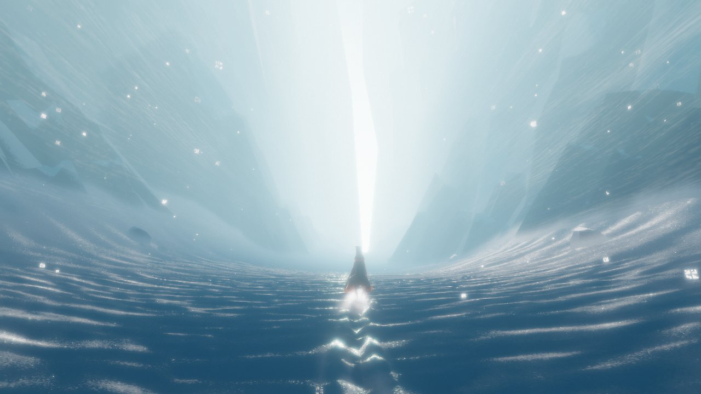 | 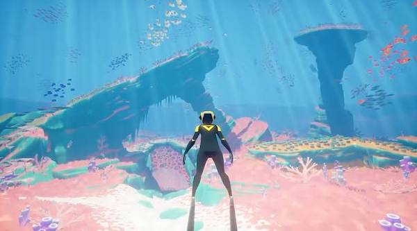 | 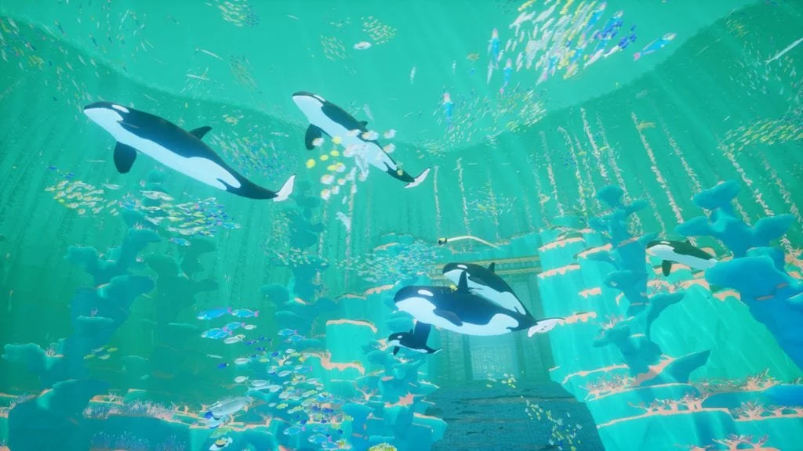 |

*Journey* by thatgamecompany; *ABZÛ* by Giant Squid.

- **Dreamlike light and luminous colour.**
- **Immersive environments** with spatial depth and a sense of wonder.
- **For atmosphere only.** Not references for morphology, and their blues
  and turquoise are not the project's palette.

### *The Ephemeral Lake* · secondary conceptual and spatial reference

- **Traces of time:** transformation and impermanence.
- **A form and its environment**, read together.
- **Not the primary visual target.**

## B. AI-generated concept studies

[`concept-studies/`](concept-studies/) holds exploratory visual mockups made
during the earlier procedural experiments, to describe a direction before
building it. They cover terrain, volume, colony forms, atmosphere, branching
and material. They are records of visual exploration: **not screenshots of
the implementation, and not strict requirements.** Each study says how it
used them.

### Terrain and volume · studies [03](../03-voxel-study.md) and [05](../05-scatter-study.md#base-revision)

| Cohesive substrate | Controlled rupture |
|---|---|
| 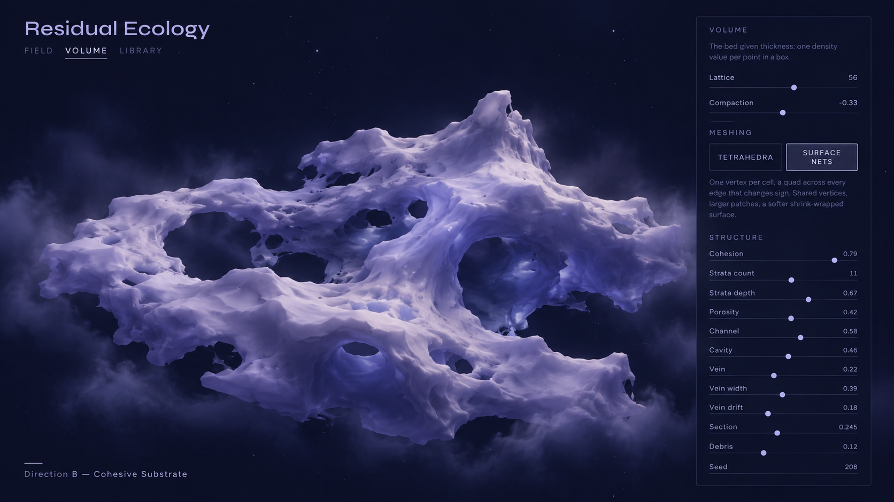 | 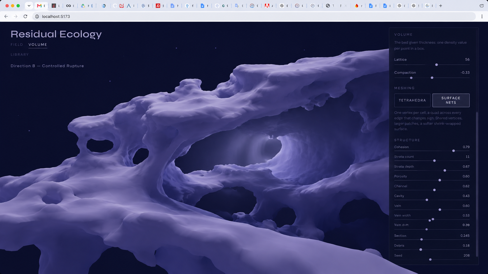 |
| `vox-ref1`: a lobed mass, few large openings | `vox-ref2`: thick spans and arches over voids |

| Residual scaffold | Internal seam network |
|---|---|
| 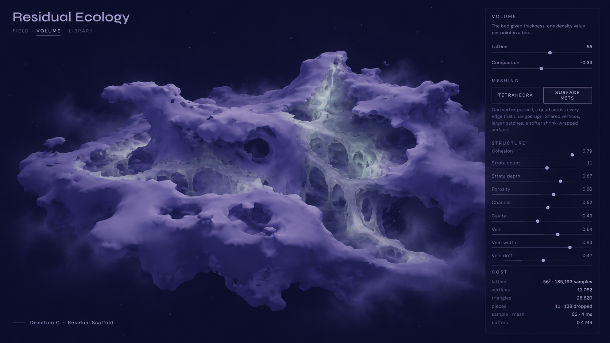 | 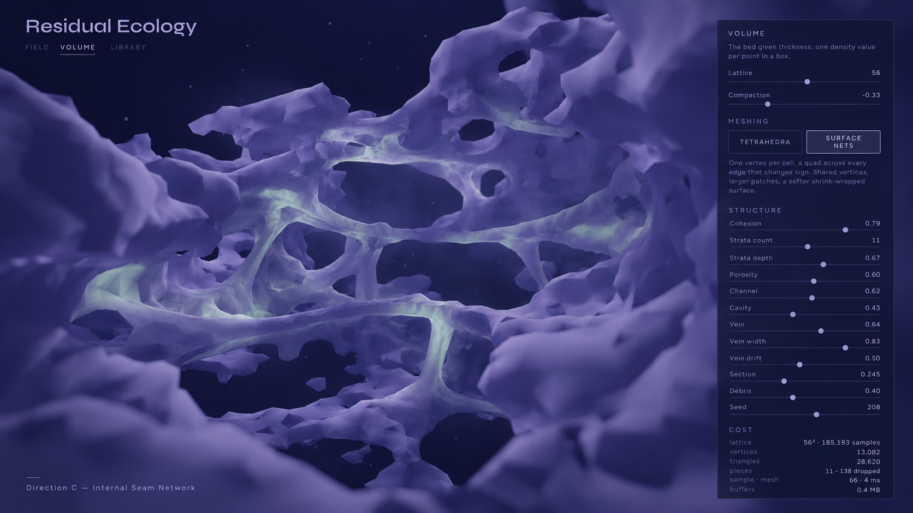 |
| `vox-ref3`: pale ribs inside the cavities | `vox-ref4`: cords meeting at nodes, loops around openings |

| Base terrain revision |
|---|
| 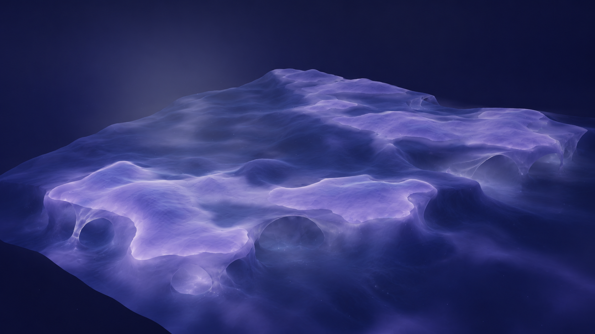 |
| `base-rev1`: thick land with plateaus, a rounded shore, deeper basins |

The volume images share what the earlier, sponge-like results lacked:
elongation, spanning, and nodes.

### Colony forms · study [05](../05-scatter-study.md)

The Dream Organism sheets: a trace-grown, non-human perceptual colony, as
loose guidance rather than targets.

| Dream Organism | Bridgework |
|---|---|
|  | 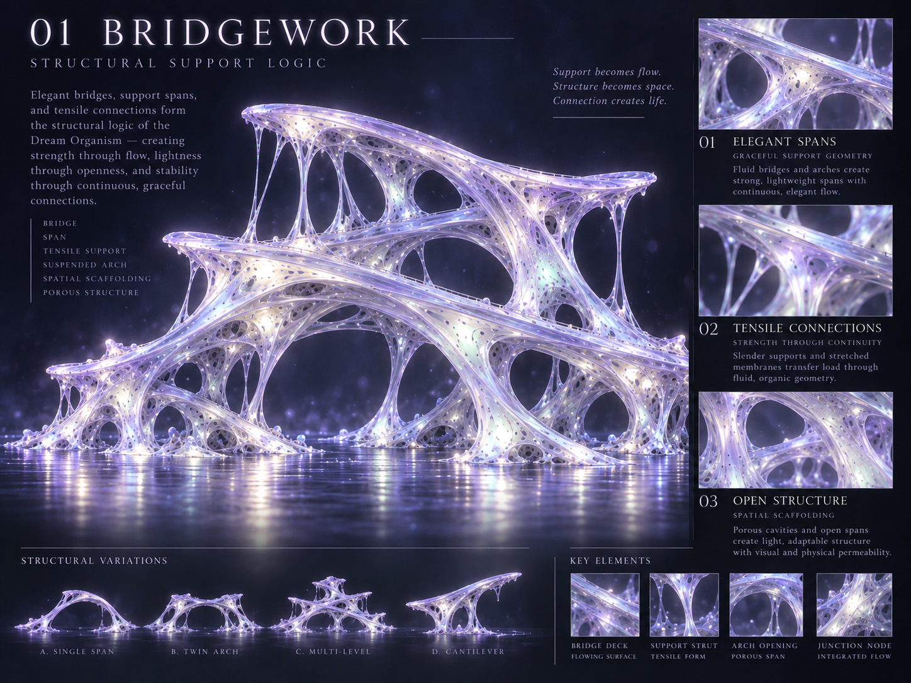 |
| The whole colony; growth as trace → gather → accrete → wrap | Structural support: spans, tensile connections, porous structure |

| Membrane Bloom | Shard / Residue |
|---|---|
|  |  |
| Soft growth: translucent skins, folded blooms, apertures | Sediment: layered residue, beads and crust |

### Atmosphere and branching · studies [07](../07-air-study.md) and [08](../08-branching-study.md)

| Ambient particles | Branching network | Branching at a colony |
|---|---|---|
|  | 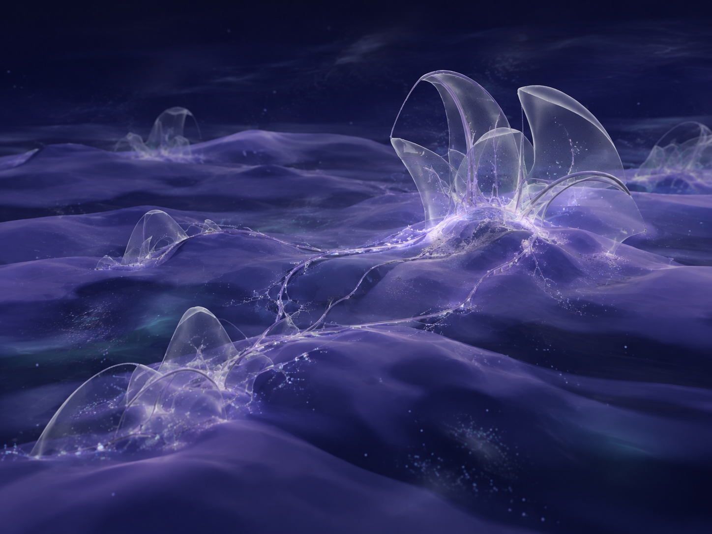 | 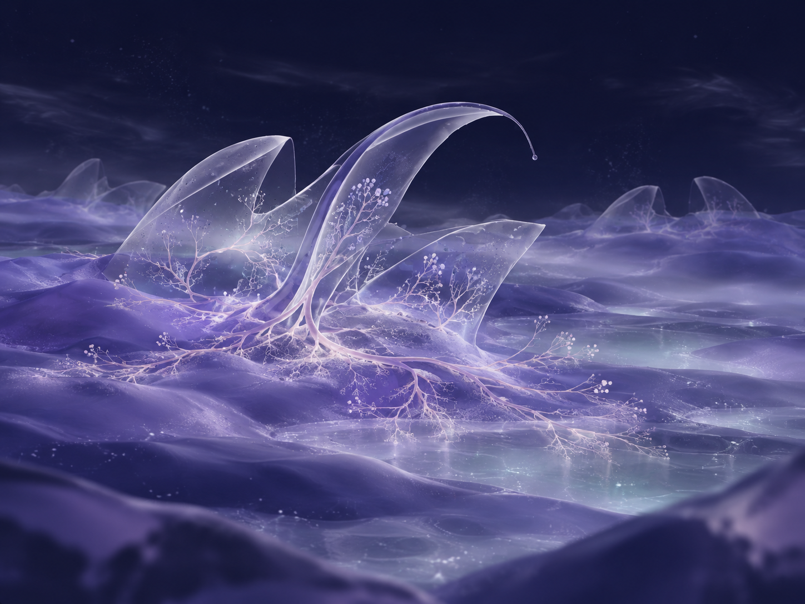 |
| The air: several subtle kinds of particle, uneven density, no bright core | `branching1`: traces between colonies | `branching2`: beaded roots, veins rising into the membranes |

## Not yet classified

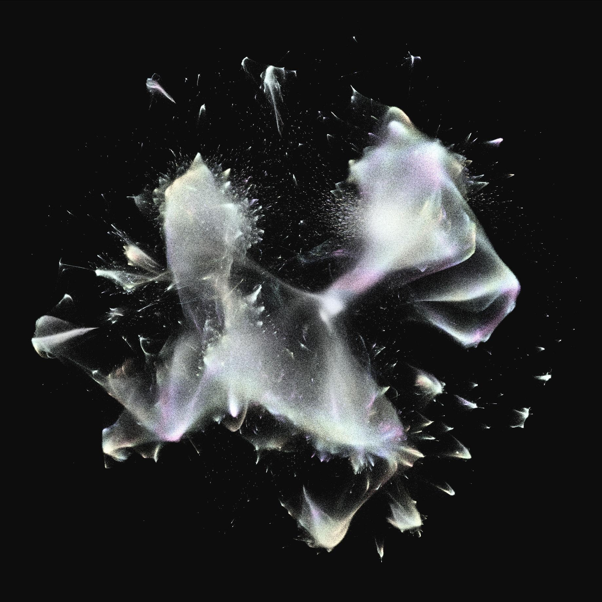

`fragment-material-ref.jpeg`, the material reference for the air's
fragments in study 07: pearlescent translucency, delicate folds, soft
iridescence. **Source not recorded**, so it is not yet filed as an external
reference or as a concept study.
